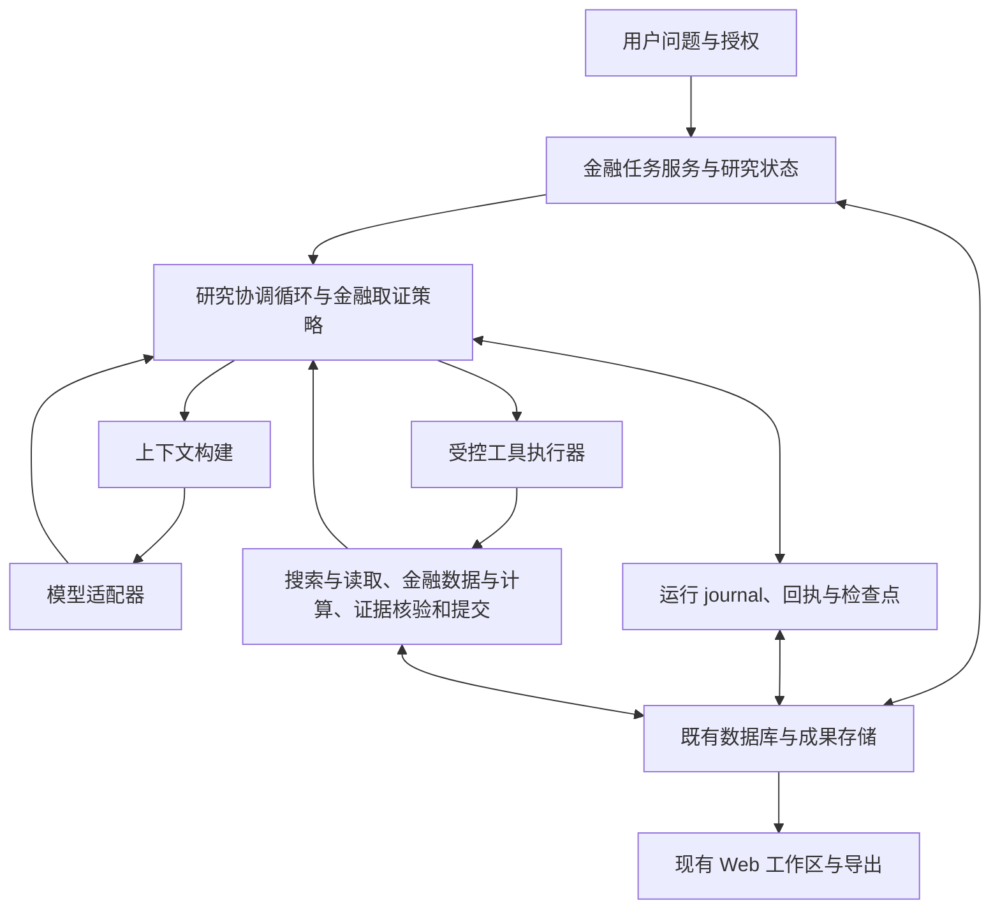

# ForesightNine 产品与实施计划

## 当前执行方案：金融 Agent 自建运行时与研究闭环

更新日期：2026-11-16。**本节是下一轮唯一执行入口**，依用户明确指令调整既有执行顺序；旧 F1–F6、339 下一轮入口及其他历史计划已归档，不作为执行依据。规划写入不等于实施完成，不授权部署或发布。阶段 B 尚未通过真实质量验收：357 两题均在取证决策阶段失败，未进入研究生成；后续入口补修仅有离线证据，尚未真实复验，不重放原批次。356 的离线工程验证和多页边界见[记录](src/docs/product/phase-a/356-generation-reliability.md)，357 见[评价](src/docs/product/phase-a/357-generation-reliability-validation/evaluation.md)。

### 1. 产品目标与建设边界

ForesightNine 仍是面向全球市场、多类金融研究和持续复核的金融 Agent。这里的通用性指跨金融问题、公司、行业、市场和资料类型的泛化，不以开发样本定义产品边界。自建运行时服务该产品，不以跨行业通用 Agent 平台、SDK 或插件市场为交付目标，也不整体嵌入 Codex 或 fork 其核心。

项目仍在开发且未公开发行。允许直接重构或替换内部模块，按开发需要重建开发库及运行状态；不建设旧引擎并行路由、旧 schema/快照读取、兼容层、生产数据迁移、灰度或双写，也不以历史数据兼容阻塞。本次仅修改文档，未清理数据。当前运行的恢复、防重复外呼、证据、研究版本和用户判断追溯仍是产品能力。

保留一个研究协调者；取证需求、来源选择和补证职责逻辑独立，但不强制独立进程或多 Agent。金融证据需求、时点、来源独立性、财务口径、反证、版本及更新是产品核心，不能抽象掉。沿用 Python、PostgreSQL、现有 API 和 Web 基础，不以拆分微服务为目标。

用户默认输入问题即可开始，资料、来源发现、权限和预算为可选高级设置。运行预算省略或 None 表示未设，明确的零、关闭和空选择照做；来源和必要步骤在已有授权及工具能力内自动选择，不自动设置模型调用数、搜索次数、总 token、总时长或费用硬限。显式空来源且未另授权搜索时不发现；另有明确正搜索预算或启用补充搜索可发现线索，但不自动获取资料。已有账户权限、来源许可和工具能力始终生效；不可用时保留部分成果并展示缺口。单次请求超时、供应商上下文、取消和故障处理是执行边界，不是隐藏的用户预算；实际调用与用量仍记录。

FRED 许可未核清前不作为 Agent 或 LLM 实验输入。首版不真实下单、不托管资金。已有用户确认的核心判断不自动覆盖；阶段 C 新事件须关联受影响的证据、假设及版本，展示差异并记录接受过程。FM 继续保留客户端确定性计算、Raw 与约束结果的区分，其产品地位仍待决定。

### 2. 参考机制与适用性

以下资料于 2026-11-16 列为设计参考，借鉴机制而不承诺依赖框架或声称最优。各供应商的工具、续接、上下文、缓存和用量能力须按实际锁定版本验证。

- [Codex Agent loop](https://openai.com/index/unrolling-the-codex-agent-loop/) 与 [Codex as a platform](https://developers.openai.com/blog/codex-as-a-platform)：参考模型多轮工具交互、上下文与缓存的工程组织。
- [Anthropic managed agents](https://www.anthropic.com/research/managed-agents)：参考会话、运行环境和执行职责的分离。
- [DeepAgents 概览](https://docs.langchain.com/oss/python/deepagents/overview)：参考资料外置与技能按需加载。
- [LangGraph 持久化](https://docs.langchain.com/oss/python/langgraph/persistence)：参考检查点和持久 store 的分工。
- [Advanced tool use](https://www.anthropic.com/research/advanced-tool-use)：参考工具发现和批量、程序化调用能力；代码执行不作为首切片前提。

### 3. 目标结构与职责

| 部分 | 责任与边界 |
| --- | --- |
| 金融任务服务 | 验证账户、主题、来源权限、版本、幂等和用户配置；保存研究业务状态及成果。 |
| 协调循环与领域策略 | 结合金融问题、证据需求和工具反馈选择下一行动、补证或交付；执行权限由服务端决定。循环可以抽象，但不单独交付通用平台。 |
| 上下文构建 | 从持久历史、当前研究状态和原文成果中选取可追溯内容；标明覆盖、冲突、截断和未读范围。 |
| 模型适配器 | 依据能力矩阵使用模型，规范化交互并保留必要的原生关联与续接数据；隔离不透明数据和敏感诊断。 |
| 工具执行器 | 在调用前校验账户、来源、权限、预算、取消和工具能力；保存结果、回执与失败状态。 |
| journal 与检查点 | 记录外部调用和状态提交，支持对账、取消、中断恢复及版本冲突处理；与业务研究状态分开。 |

模型推理按 wire API 协议适配，例如 `openai_chat_completions`、`openai_responses`、`anthropic_messages` 分别为独立协议；不把品牌或笼统的“OpenAI 协议”当作协议。endpoint/base_url、部署必填的 model、credential_ref、协议版本（协议有定义时）、支持的生成参数和能力配置分离，不硬编码具体默认模型或拒绝更换模型。同协议相容服务通过配置切换，但标称 compatible 不保证所有特性一致。显式 capability profile 包含 native tools、stream、schema、context、usage、continuation，未知如实记录，不按模型名称判断。仅确属私有扩展才隔离为可选 adapter 扩展，无强制品牌预置。协议参考：[Responses](https://developers.openai.com/api/reference/resources/responses/methods/create)、[Chat Completions](https://developers.openai.com/api/reference/resources/chat/subresources/completions/methods/create)、[Messages](https://platform.claude.com/docs/en/api/messages)。

优先使用实际支持的原生多轮工具调用；JSON-only 仅作为明确配置的兼容适配，不以大 JSON 一次生成整个研究状态。协议规范化保留原生工具调用关联及必要不透明续接数据，隔离敏感内容。M1 选一个实际验证支持原生工具的协议，其余协议按需实现，不作为接口前置障碍。模型推理 API 与搜索/数据连接器独立选择，不假定某个模型自带搜索。OpenCode 是外部 coding harness 而非模型协议，Codex 同属外部 harness；它们不作为金融运行时主路径依赖，金融业务不认模型品牌。

M1 正在接入配置化原生工具协议和研究运行时，移除主路径的模型品牌锁定；实际协议能力、恢复及金融研究闭环仍待集中验证。 2026-11-17 的 [359 实际验证](src/docs/product/phase-a/359-native-runtime-validation/evaluation.md) 收到 HTTP 400，研究为 partial、用量与结算未确认；未产生原生工具反馈，M1 尚未完成。

### 4. 首切片必须具备取证决策

研究协调者围绕问题形成动态证据需求，比较已有覆盖、冲突与未知，选择适用的来源或行动，观察结果后补证或交付。不是每个任务都必须经过全部阶段；简单事实核验可以直接结束，复杂问题可以继续补证。首切片必须真实包含至少一次可观察的选择—执行—反馈—停止或补证闭环，不能只把旧 analysis 包进新循环。

选择来源时考虑问题适用性、公开和获取时点、财务期间与修订、口径、来源之间独立性及授权。未找到不等于不存在；发现线索不等于正式证据。不得用固定站点权重作为通行证，也不得以样本公司、文档或问题命名规则代替研究方法。反方和冲突证据进入需求状态；专业研究方法可版本化并按需加载。外部资料和工具结果均为不可信数据，不能更改权限或指令。

记录候选、决策依据、反馈、缺口和停止原因，允许使用同一模型工具调用轮次完成决策，避免为每个字段或内部步骤强制增加调用。无进展根据同一状态、同一动作且没有新增信息识别，不以隐藏次数上限冒充无进展；明确预算耗尽、取消、不可恢复错误和无可用行动各有状态。

### 5. 金融工具、成果与上下文

按金融研究动作设计少量粗粒度、可批量处理的工具，例如发现及读取资料、查询结构化数据、金融计算和证据核验。确定性解析、单位与期间检查等内部流水线不拆成大量模型可见的碎片工具。独立只读工具可在确认无共享副作用和预算安全后并行；写入串行或通过版本冲突检查提交。首切片可以固定少数工具并串行执行，按需加载和并行不阻塞 M1。

工具结果完整保存在受权限控制的 artifact，模型通常接收摘要和可定位引用，并可按需回查原文。摘要带来源版本、位置、覆盖范围和截断标记；压缩不是事实，不能丢弃限定条件、冲突或把未读部分视为已覆盖。财报表格、页面图像及其可视位置按实际工具能力处理，无法读取时明确披露。

来源和证据 ID 由服务端拥有；候选线索、原始资料、提取事实、确定性计算、模型解释与正式证据分别保存。报告可先以文本生成，但入库关联字段必须校验；引文定位、确定性计算与语义支持分别核验，结构有效和引用存在不等于支持结论。MCP 仅作为外接边界的可选协议，不要求所有工具跨进程。

上下文区分持久运行历史、当前研究状态和原文/成果三层。依据实际 provider 容量和缓存行为选择材料，不在产品默认中偷偷增加总 token 限额；用户设置的限额和剩余额度继续生效。记录模型看到的覆盖及省略情况，使用户能回查依据。

### 6. 可靠性与开发期重构

复用现有账本、journal、检查点、operation 租约、账户隔离和幂等能力。外部调用按意图记录、提交状态、回执与业务提交建立可对账链；用事务或幂等方式处理跨边界提交。外部结果或收费状态未知时不自动重放；保留已完成成果并显式呈现待对账状态。当前 SSE 是进度传输，不是完整账本。安全诊断记录允许的参数、错误位置及传输、结构、证据、任务四维状态，不保存原始密钥或不必要的敏感内容。

直接重构当前路径，按开发需要重建开发状态；不为旧运行、旧 schema 或旧快照建设兼容和并行引擎。当前运行仍须接入来源权限与账本，结果未知的外部调用不能自动重放；运行内保存证据、用户确认和业务版本以支持可追溯研究。

| 处理 | 现有基础与重构方向 |
| --- | --- |
| 复用领域能力 | 按实际适用性保留 `research_topics`、`research_sources`、`research_calculations` 中有用的金融算法、证据与来源许可，以及账户、账本、Web/导出和 FM 客户端计算；不要求保留旧数据格式。 |
| 封装复用 | `research_coordinator.ResearchExecutionContext` 的预算、调用与取消；`research_workflow` 回执；`research_tools` 能力声明和结果；`research_recovery`、`research_checkpoints`、`research_lifecycle` 的恢复、检查点和版本机制，以及 `operations`、`operation_store` 的运行状态与存储。细粒度授权仍由服务端执行。 |
| 替代默认路径 | 从 `main.start_research_run` 抽出执行组合，逐步以新研究循环替代 `research_orchestrator` 的固定阶段选择；复用有用的领域处理器并可删除旧主编排，无需跨版本兼容；不将旧 analysis 单独包装视为迁移完成。 |
| 延期 | 跨进程工具平台、通用事件平台、代码执行、并行调度和多 Agent；仅在真实任务收益及可靠性证据支持时推进。 |

### 7. 实施顺序

| 里程碑 | 范围与出口 |
| --- | --- |
| **M1 金融研究最小闭环** | 固定少数工具、串行起步；选用一个实际验证支持原生工具的 API 协议并移除主路径品牌锁定；从真实金融问题和授权资料出发，动态形成证据需求，选择至少一个适用的读取或发现动作，观察结果并补证或交付。出口至少有一项依据可核查的真实金融研究成果；任务要求计算时须提供可复算计算，并保留模型实际原生工具调用及反馈证据。接通账户、来源许可、取消、必要回执、版本及最小安全恢复；Web 读取真实成果。失败、拒绝、未知和无进展路径须保留并验证，但这些部分结果只能标为 partial，不能单独证明成功闭环；M1 完成不等于阶段 B 质量通过。 |
| **M2 长任务可靠性** | 完善三层上下文、可回查 artifact、检查点、外部调用对账及跨进程故障恢复；按实际容量管理材料，支持当前运行安全恢复。 |
| **M3 多类金融任务** | 用多类任务验证来源、期间、单位、反证和跨语言泛化；依据实际收益引入批量、独立只读并行和工具/研究方法按需发现。 |
| **M4 按需扩展** | 根据可测收益评估代码分析、有限委派和后续更新扩展；保留委派契约但不预设子 Agent。阶段 C、D 范围及 FM 客户端计算边界不因本方案改变。 |

### 8. 验证与完成标准

先实现主线，再集中验证；仅对具体失败进行必要的定向复核，不围绕 357 两题持续堆叠特例。产品运行预算未设置时仍保持未设置。受控 LLM 实验另行预登记任务、资料快照、工具权限、模型、提示词、供应商支持的参数及调用预算，一次只改变一个主要因素；实验限额不回写产品默认，也不在未获用户授权时新增硬上限。历史实验保留各自冻结条件，不追补。记录实际调用、工具输入输出、耗时、usage、费用及未知项；模型版本或检索变化无法锁定时标记为混杂因素。保留独立跨任务证据，旧结果不因新代码或模拟测试自动改变。

四维状态分别报告：传输与外部调用、结构与协议、证据支持及覆盖、任务完成与交付；任一成功不代替其他维度。验证正常、权限拒绝、空资料、冲突、取消、恢复、未知外部结果和部分交付，并核验引用、确定性计算与财务口径。比较同条件下的旧路径与新路径时，同时记录调用次数、成本及质量，不预设新方案更省或更准。

M1 完成需要代码真实接通、可复核的取证闭环与上述必要安全恢复证据；M2–M4 各按实际交付和证据单独记录。阶段 B 只有获得独立跨任务、真实资料上的研究质量与失败恢复证据后才能称完成；运行成功、报告长度、模型评分或模拟测试都不够。研究质量与投资效果分开，投资效果须另行设计前向、样本外评估。不设固定工期或自报通过率。未取得证据如实保留，人工验收不作为等待阻塞，发布另需授权及既有许可和安全门槛。

### 9. 2026-11-19 补充规划：开放来源获取与研究闭环改进（待实施）

基于线上主题 `topic_8e91c0299a7b4b25823bc12ab9c7e53a` 排查（`operation:d7ff50a51b5265d7746f5ae0` 成功续跑 18 次模型调用但所有抓取均被拒），确定下一轮将移除 `research_fetch.py` / `research_source_catalog.py` 中“仅允许 `www.bea.gov`、`www.federalreserve.gov`、`www.sec.gov`”的三域名硬编码白名单及 PDF 两域名限制，并按两阶段推进（完整设计见[开放来源获取与研究闭环改进规划](src/docs/product/open-source-retrieval-and-loop-plan-2026-11-19.md)，当前尚未修改代码）：

1. **抓取解耦与合规/安全底线（第一阶段）**：保留公网 HTTPS、私网/DNS Rebinding SSRF 防护、`_UploadedHtmlParser` 防隐藏文本注入及 `FRED` 硬拦截；将下载响应上限从默认 256 KB 提升至 5 MB、支持按响应 `Content-Type`（HTML/纯文本/PDF）及实际字符集解码、支持安全有界 3xx 重定向；通用网页抓取默认保留 `store/display/model_input` 但设 `export=False`，与明确公共领域/授权披露区分权限与标识；并在部署环境配置合规 `FORESIGHTNINE_SEC_USER_AGENT` 启用 SEC 通道。
2. **闭环效率与可解释性（第二阶段）**：将已有 `research_structured_connector`（SEC CIK 与 XBRL `companyconcept`）暴露为受控 Agent 工具；在 `run_research_agent` 初始载荷中注入可用来源能力并细化 `acquire_sources` 错误码，避免模型空转及自行拼接 URL；在保留 `partial` 不生成未核实正式结论的前提下，拆分独立字段展示模型整理的过程说明与补证建议；排查 `glm_coding_mcp` 大量返回 `redirect_link` 丢弃及容器内 IPv6 `errno: 101` 无路由回退。

### 10. 2026-11-20 补充规划：金融取证与工具调用完整方案（待实施）

这份规划源于对线上主题 `topic_91c2720b`（研究“纳指最近走势”，但拿不到 2026 年的数据）和 `topic_c2ba04f0`（IPO 首日没有拿到盘中数据）的排查，并统计了全部线上主题的工具调用：SEC 查询失败 51%，行情查询失败 58%，94 条搜索结果因跳转链接被丢弃。完整方案见[金融取证与工具调用完整方案](src/docs/product/financial-data-tooling-gap-and-innovation-2026-11-20.md)，排查的原始证据见[修复方案](src/docs/product/topic-91c2720b-timeliness-and-retrieval-fix-plan-2026-11-20.md)。目前尚未修改代码。

用户在 2026-11-20 做了四项决定：

- 大 PDF 不以报错结束，改为按需读取，无法解析的页面并行 OCR 后可以按需读取；
- 面向所有主流市场；
- 产品不面向短线交易，只用免费数据源；
- 在本文件中加入方案入口（即本节）。

随后用户又确认按方案中的推荐执行：

- OCR 默认使用本地开源引擎，允许用视觉大模型做后备 OCR；
- 大文档的安全上限为 200 MB；
- 市场按三批次接入；
- 使用 FinSearchComp 作为外部对照，使用前先核对许可；
- 创新项先做 I1、I4、I9。

S0 由主 Agent 统筹，交给 Sonnet 子 Agent 实施。

2026-11-20 执行记录：S0 已全部实现，S1 中的大文档 OCR 也已实现，目前只做了离线验证，代码尚未提交。

- 全量 API 测试与修改前的基线逐项一致，都是 312 项原有失败，没有新增；新增的 6 个测试文件全部通过。
- 契约生成检查和 Web 类型检查通过；测试镜像可以构建。
- 未部署，未做真实模型复验，M1 仍未完成。

详见方案第 13 节。

2026-11-20 许可核查与决定：Twelve Data 免费档只允许个人、非商业用途，不得向第三方展示。用户决定，研究中的行情改用用户自带 key：只供本人使用，不导出，平台 key 默认禁用。线上现有的平台 key 配置要在新版本经授权部署时关闭，在那之前保持现状，作为已知的合规风险。用户随后修订：当前只供本人开发使用，FM 继续使用平台 key；研究部署时通过配置允许平台 key 用于行情；不做来源条款全面审计。公开发布前必须复核的事项见方案第 12 节。

2026-11-20 至 21 日执行记录：第 2 步（中国内地和香港公告来源的合规处理、大文件流式上传）、第 3 步（S2 检索、新闻、口径核对、覆盖地图、方法包）和第 4 步（部署）都已完成。线上镜像为 `foresightnine-api:d431caa`，部署前的备份在 `predeploy-20261120T144937Z`。GLM 搜索的额度要到 2026-11-23 才恢复，GDELT 对本机限流，在此之前新闻搜索不可用。详见方案第 13.3 节。

2026-11-21 执行记录：港股和 A 股的替代途径已部署（`1f4e328`），包括发行人官网公告抓取、巨潮资讯等站点的用户发起单篇获取、Yahoo 日线后备、年报报表抽取。本机访问不了 Tushare、BaoStock 和很多国内公司官网，A 股财报目前要靠用户上传或配置国内中转。详见方案第 13.4 节。

推进顺序如下：

1. **S0 缺陷修复（属于 M1）**：
   - 每次运行开头提供研究时钟。放在每次运行的第一条消息里，不放进 `SYSTEM` 和工具定义，以保护前缀缓存。
   - 行情工具按交易时段判断是否可以查询，并修正 Twelve Data 结束日期不含当天的问题。
   - 修复“响应过大”的错误被误判为“结果未知”。
   - 只读来源失败时不再中止整轮研究；已获取但未读的来源进入版本。
   - 所有工具失败时返回可执行的修改提示。
   - 修正“无进展”误判。
   - 上下文压缩增加回落线和最小收益门槛。
   - 大文档改为流式下载并按页按需读取。
2. **S1 数据层骨架与 OCR**：统一的工具结果格式；`resolve_entity`、`market_data`、`company_financials`、`filings`，第一批覆盖美国、中国内地和香港；并行 OCR worker；免费数据源的许可核验和限流。
3. **S2 检索与核对**：主题内的资料检索；能按时间过滤的新闻发现；多源口径核对表；覆盖与缺口地图；研究方法包；接入第二批市场。
4. **S3 更新与预测**：宏观序列、事件日历、持仓数据；观察条件与变化收件箱（阶段 C）；预测登记与到期判定；接入第三批市场。
5. **S4 扩展**：多文档表格式抽取；按实际收益评估是否需要子 Agent。

每个阶段的验收都按方案第 9 节进行：先通过离线测试，再做每次只改一个变量的受控真实复验。这些规划不代表 M1 已完成，也不代表阶段 B 的质量已通过。

---

[历史计划归档（非执行依据）](src/docs/archive/plan-history-before-protocol-2026-11-16.md)

2026-11-18 执行记录：Messages 研究接入及账户配置、额度边界和恢复绑定正在进行离线验收；独立研究部署配置不改变 Challenge 的模型路由。真实调用尚未执行，凭据用途授权与实测能力仍待核验。
离线验收补记：Messages 及研究路径相关 70 项 API 测试、11 项网页配置测试通过；真实端点验收尚未执行，六项既有计费测试失败继续单独保留。
