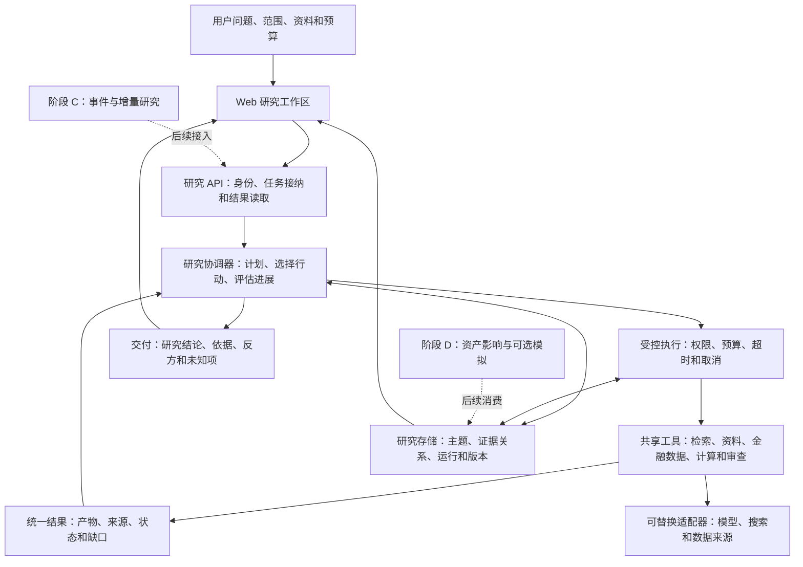

# 历史计划归档

> 本归档保留原历史进度及执行方案，仅供追溯，不作为当前执行依据；以仓库根目录 plan.md 为准。链接按归档位置调整。

## 历史进度记录（截至各自日期，当前状态见顶部）

> **2026-11-15 用户授权的职责调整**：保留单一主研究协调者，在现有运行、权限和研究状态中逻辑分离取证 Agent 的需求、来源选择及补证职责；决策、核验及工作区路径已接入并完成相关离线验证，工程与真实质量分开核验，不默认新增服务或并行。既有未提交改动予以保留，未经验证不宣称阶段 B 通过。详见 [取证决策方案](../../../src/docs/product/evidence-acquisition-agent-plan-2026-11-15.md)及[实施记录](../../../src/docs/product/phase-a/345-evidence-acquisition-implementation.md)。

> **自主来源方案实施与 343 状态**：多轮发现、授权获取、入库与再分析、来源能力与逐候选状态、既有 SEC 结构桥及证据质量/工作区已接工程路径；局部模拟验证不能替代真实质量。343 首题 `provider_transport_error`、外部状态未知且无可评分成果，后五题未运行；10,000 tokens 为保守预留，实际用量及费用未知。真实来源覆盖/分页、SEC 语义、未知补证外呼与完整 PG 故障路径仍待验证；阶段 B 未通过。见 [343 记录](../../../src/docs/product/phase-a/343-stage-b-autonomous-acceptance/evaluation.md)。

> **历史缺口记录（执行入口已由顶部新方案替代）**：已接入的问题入口、可选运行限额、增量补证及租约续期不重复列为未实现；阶段 B 仍需完成默认不指定来源时的自主取证和来源质量链，并处理必要证据与语义、结构输出、复杂资料有限支持和真实质量验证；不能以要求用户先提供可靠材料代替自主取证。详见 [339 当前五项缺口](../../../src/docs/product/phase-a/339-stage-b-remaining-gaps.md#当前五项缺口)；历史 342 两题不通过、三题未运行不变。

> **2026-11-15 最新运行限额状态**：用户未设置时，研究的模型调用数、搜索调用数、总 token、总时长和费用上限均可为空；明确给出的数字或 0 仍有效。实际使用继续计量，旧有数值快照沿用原限额，未设置额度的恢复保留用量。供应商上下文、单次请求超时和既有阶段执行能力仍有限，不承诺无限运行。 活跃 worker 在原 owner、运行中且租约未过期时续租；失联后仍可过期恢复，续租不延长用户截止时间。本地短租约定向 1/1，PostgreSQL 对应续租条件本轮未实库验证。后端离线定向 4/4，另多份资料获取 1/1；前端类型检查通过，未做真实网络或模型验收，阶段 B 质量结论不变。[进度](../../../src/docs/progress.md)。

> **2026-11-15 前一版自动入口记录（默认预算策略已被最新原则取代）**：输入问题可直接创建并启动；资料、来源权限及预算为可选高级项。省略配置由服务端逐项设定有界默认，明确 false/0 和空来源选择优先；空来源且无显式搜索授权时不发现，另给正搜索预算或启用补充搜索可发现但不自动获取。显式启用补充搜索且省略补证时补开补证，显式关闭补证或零搜索额度则拒绝矛盾配置。自动发现依赖已配置 provider，符合条件的官方白名单最多获取一份，FRED 排除；不可用时保留缺口。实际解析结果写入运行快照供后续恢复。后端离线模拟初组 8/8、随后自动配置边界定向 2/2（初组未重跑），前端类型检查通过；没有新的真实模型质量验收，342 仍两题不通过、三题未运行。[当前缺口](../../../src/docs/product/phase-a/339-stage-b-remaining-gaps.md#当前去重缺口)。

> **研究入口原则（2026-11-15，最新）**：默认输入问题即可开始，添加资料、来源发现、权限与预算设置均为可选高级项。未主动要求时不自动给研究调用数、总 token、总时长或费用设限；省略或空值表示未设置，明确数值、关闭和空来源选择优先。供应商上下文与单次请求超时仍是执行边界，并继续记录实际使用。实际来源发现和获取受 provider 可用性及既有许可约束，不保证自动取得资料；失败显示缺口或部分结果。具体落地状态待本轮前后端实现核对，历史质量结果不变。

> **342 后有界修复，尚未真实复验**：v60 补证优先未读相关完整单元，必要旧上下文受预算和共现约束；私有运行 journal 新增不含原文或值的白名单结构诊断。通用补证离线 1/1、模拟 provider 诊断 4/4；342 仍为两题不通过、三题未运行。详见 [339 当前状态](../../../src/docs/product/phase-a/339-stage-b-remaining-gaps.md#最新-342-真实评估)。

> **342 受控评估：阶段 B 仍未通过。** 已执行两题均按冻结标准不通过：一题漏选必要事实且未计算，一题模型输出未通过结构校验；另三题停批未运行。累计 4 次、9,703 tokens，费用未知。详见 [342 评价](../../../src/docs/product/phase-a/342-stage-b-verified-attempt/evaluation.md)。341 的零 HTTP 配置失败保留为前置记录，不能与 342 混算质量。

> **341 受控评估停批：阶段 B 仍未通过。** 首题 provider 配置无效、执行未完成且无可评分成果；后四题未运行。账本 4,500 tokens 为保守预留，不是实际模型用量；依冻结代码与只读对账在 HTTP 传输前退出，当时具体配置错误未记录，后经启动配置与冻结代码定位为不允许的固定模型覆盖；费用未知。四包工程交付与剩余能力边界见 [339 当前交付表](../../../src/docs/product/phase-a/339-stage-b-remaining-gaps.md#本轮四包交付与-341-证据状态)，冻结材料见 [341 记录](../../../src/docs/product/phase-a/341-stage-b-bounded-acceptance/README.md)。

> **341 前有限能力增量**：按实际 PDF 几何记录映射、不可用和超限，声明原件/阅读顺序的未知与扫描件限制；复合结论分项只验证版本内索引与位置，不声称语义支持。局部后端 37/37、Web 类型检查及展示/导出 5/5 为工程证据，阶段 B 质量仍待冻结真实评估。见 [支持与降级](../../../src/docs/product/phase-a/339-stage-b-remaining-gaps.md#本轮有限支持与降级)。

> **2026-11-14 340 最新结果：阶段 B 仍未通过。** 三题按冻结标准均未通过，另两题因第三题未决标记而停批；已结算 8 次、13,539 tokens，费用未知。首两题关键期间事实未选入，公司题数值计算正确但部分结论引用不完整；详见 [340 评分与对账](../../../src/docs/product/phase-a/340-stage-b-followup-acceptance/evaluation.md)。PDF 几何、范围分类与复查能力已有局部工程增量；本次小样本不能证明真实质量通过。

> **340 后有界工程修复**：补充无规划需求建议、相关单元预算内补选、结论与可复算计算的显式关联及来源展示；安全结算区分已知结果与未知调用。工程定向检查不能替代真实质量复验；[后端源码快照](../../../src/docs/product/phase-a/acceptance-evidence/post340-backend-snapshot/manifest.json) 是批次后的版本，不覆盖 Web。340 隔离环境已清理，证据保留。

> **338 后代码增量**：已接入可选任务维度、需求到来源/事实/计算的结构关系与保守缺口门控；缺失观察显式绑定结论，初始与补证范围分阶段保存。关联均为建议且语义未独立核验，不能宣称任务质量已满足。后续仍需通用语义检索、复杂 PDF 原件几何与真实质量证明；此前 338 结果未因代码修复改变。见 [当前验收](../../../src/docs/product/phase-a/208-stage-b-current-audit.md)。 当前归并后的实现、能力边界与验收缺口见 [阶段 B 剩余缺口清单](../../../src/docs/product/phase-a/339-stage-b-remaining-gaps.md)。

> **2026-11-14 最新：阶段 B 未完成、未通过。** 338 冻结批次中，前三个开发回归未满足标准；第 4 题已保存成果未满足标准且复查阶段未决，第 5 题按规则未启动。已结算 9 次、账本 12,518 tokens，费用未知；未决与质量分开处理。PDF 原文受影响组 3/16 通过，合成 context/input budget/counterpoint 24/24 不证明真实材料覆盖。详见 [338 评价](../../../src/docs/product/phase-a/338-stage-b-migration-acceptance/README.md)。后续优先处理原件阅读顺序与可审计映射、必要证据选择，以及正文缺失结论的范围门控；不以样本修补替代通用能力。未部署、未提交。

> **2026-11-14 当前验收：阶段 B 仍未通过、未完成。** 本轮加强来源完整单元、多来源分配、未核验关系、可选检索线索和安全结算，并完成隔离受控验收；上下文集中回归 209 通过/10 失败，非盲宏观批次按冻结标准 1/3 满足，三题均 partial。模型调用 6 次、报告 8,422 tokens、费用未知；剩余资料覆盖、事实计算和缺失表述等须继续解决。详情见 [B01–B10 当前记录](../../../src/docs/product/phase-a/208-stage-b-current-audit.md)；不将历史成绩、模拟测试或模型意见当作质量验收。未部署、未提交。

**历史下一轮入口（已由顶部新方案替代）**：先限定阶段 B 支持和降级范围，并行推进任务语义/跨语言取证与复杂 PDF；再收敛主张、计算和缺失结论的逐项边界；代码稳定后进行一次预先冻结、预算受控的集中验证。具体工作、交付物、完成标准及停止条件见 [阶段 B 下一轮执行清单](../../../src/docs/product/phase-a/339-stage-b-remaining-gaps.md#下一轮唯一执行清单)。已修机制不重复开发；342 已开展有限真实评估但未通过，泛化效果仍未验证；此计划不授权发布。

## 历史执行方案：完成通用金融 Agent 宏观框架（已由顶部新方案替代）

更新日期：2026-11-13。来源：用户明确要求“作出一个着重宏观层面搭建完 agent 框架的方案，写进一个 plan.md 里”。

**本节为历史框架方案，执行入口已由顶部新方案替代。**产品方向沿用 [AGENTS.md](../../../AGENTS.md) 和[融合宏观方案](../../../src/docs/product/fusion-finance-ai-macro-plan-2026-11-11.md)，本节明确建设顺序和收尾标准。已有[阶段 B 规格](../../../src/docs/product/phase-a/06-phase-b-spec.md)提供细节，但其中与本节冲突的执行顺序以本节为准。下方旧计划保留供追溯，不重新触发旧任务或用户待办。

本节最初为方案更新，不代表建设工作当时已完成。用户随后授权阶段 B 集中验收，解除先前测试、浏览器和模型实验暂停；人工验收继续跳过。固定数据、权限、模型参数和预算，区分模拟工程检查与真实研究质量，并按实际证据记录；验收授权不包含部署或发布。

### 1. 本轮目标与边界

完成一个有实际执行路径的通用金融研究 Agent 框架：用户提交问题或资料后，由协调器选择必要步骤，调用受控工具，维护研究状态，根据已有结果决定继续、补充或结束，最终交付成果和缺口；中断后保留已完成工作并提供明确的恢复路径。

以**单一研究协调 Agent + 共享工具 + 持久化研究状态 + 运行控制**为核心，沿用现有 Python、TypeScript 和 PostgreSQL 基础。模型、搜索和数据供应商通过适配器接入。先在现有应用内明确模块边界，不以拆微服务、引入新 Agent 框架或增加 Agent 数量为建设目标。

本轮涵盖首次研究框架及后续扩展接口。持续监控、情景更新和变化收件箱属于阶段 C，资产影响与持仓属于阶段 D；本轮只保留其接入位置，不建设空界面或虚假功能。Android、计费改造、全市场数据扩展和公开发布不进入本轮关键路径。FM 保持现有计算边界，最终产品定位继续待评估。

### 2. 当前起点

以当前代码和[架构基线](../../../src/docs/product/phase-a/334-stage-b-architecture-boundary.md)为依据，不把历史测试结果视为当前实现的证明。

| 架构部分 | 当前基础 | 本轮需要补齐 |
| --- | --- | --- |
| 研究协调 | 规划、发现、获取、分析、反方、缺口补充、复查和交付已有阶段实现 | 总体调度仍部分位于 API；统一任务与阶段契约，形成有界的决策和执行循环 |
| 工具接入 | 已有搜索、部分官方来源、文档和结构化资料、计算及模型适配 | 统一工具能力、权限、输入输出和失败表达，避免协调器依赖供应商细节 |
| 研究状态与证据 | 已有资料、引文、结论、计算、版本和检查点 | 明确原文、事实、推断、证据关系和审查状态；减少历史主题特例依赖 |
| 运行控制 | 已有预算、取消、调用记录及部分幂等保护 | 统一运行状态、阶段提交、失败交付及中断恢复；当前不能从检查点自动续跑 |
| Web 工作区 | 已有查看成果、来源、版本、编辑确认和导出 | 统一运行进度、部分成果、缺口和恢复入口的数据来源 |

当前阶段 B 尚未完成。引文语义、反方分析和财务口径仍有已知缺口；它们应进入统一证据与工具机制处理，不继续按个别公司或文档补答案规则。

### 3. 目标结构与职责

下图是本轮拟完成的结构，包含尚未实现的部分，不是现状完成图。

| 模块 | 核心职责 | 边界 |
| --- | --- | --- |
| 工作区与 API | 接收目标和授权范围，展示运行与成果，接收编辑、确认和取消 | 不在页面或路由中复制研究决策 |
| 研究协调器 | 使用目标、计划、已有材料和缺口选择下一步；记录调整原因和停止原因 | 不直连供应商，不绕过运行控制，不强制所有任务走全部阶段 |
| 工具与适配器 | 暴露可用能力，执行检索、获取、解析、数据查询、计算和模型分析 | 来源专属格式留在适配器；不把公司或行业名称写进通用调度规则 |
| 研究与证据模型 | 保存原文、事实、计算、主张、反方、假设及其关联与未知状态 | 引文位置、模型意见和证据支持状态分别记录；不以模型自评分确认事实 |
| 运行控制与持久化 | 执行权限、预算、状态转换、并发保护、检查点、恢复与日志 | 运行完成不代表结论正确；外部调用未知状态和未知费用不得补造 |
| 成果交付 | 汇总可用成果、证据缺口、覆盖边界及许可内导出 | 部分成果可以交付；失败和空结果必须如实呈现 |

### 4. 先统一四组核心约定

复用现有对象并补齐边界，不为形式另造一整套平行模型。本轮先确定信息归属和模块交换方式，不逐字段展开庞大规格。

1. **任务约定**：研究目标、对象范围、资料范围、时点、所需产物、权限和预算。公司、证券、交易所、币种和期间独立表达，不隐含单一市场默认值。
2. **行动与工具结果约定**：行动目的、依赖、输入输出、来源、执行状态、缺口、用量和可重试性。能力是否可用由注册信息和实际配置决定，工具失败不伪装成“没有相关事实”。
3. **研究状态约定**：原始资料、提取事实、确定性计算、模型解释、用户判断与支持/反对关系分开保存；研究版本独立于聊天上下文。资料记录权限和时间，计算记录输入、公式、单位、币种和期间。
4. **运行与交付约定**：任务及阶段的标识、状态、检查点、停止原因、恢复依据和成果版本。业务成果与运行日志分开，工作区与导出读取同一份成果数据。

### 5. 按六个工作包完成框架

以下 F1–F6 是本轮框架工作的编号，不替代产品阶段 A–E。按 F1 → F2 → F3 → F4 → F5 → F6 推进；每个工作包落实到现有主路径后转入下一项，不以单个模块反复精修占用整体进度。

| 工作包 | 主要工作与交付物 | 实现收尾条件 |
| --- | --- | --- |
| **F1 统一边界与约定** | 将上述四组约定映射到现有契约和模块；确定每类状态的唯一写入责任、旧版本兼容方式和依赖方向 | 工作区、API、协调器、工具和存储使用一致约定；新增能力有明确接入位置，无平行状态体系 |
| **F2 完成研究协调核心** | 从 API 收拢研究调度；连接计划、行动选择、执行、结果观察、缺口更新和交付；复用现有阶段处理器 | 主路径由协调器驱动；任务可以选择、跳过或补充必要阶段，存在明确的终止与部分交付路径 |
| **F3 统一工具与证据通路** | 将已有工具接入同一执行入口；统一资料上下文、来源定位、事实/计算/主张关系与缺口表达 | 协调器经统一接口取得可追溯结果；新来源通过适配器接入，研究类型变化不需要修改核心调度 |
| **F4 完成运行与恢复骨架** | 将运行状态、预算、阶段提交、版本和检查点统一；使运行生命周期独立于浏览器连接，并提供受控恢复入口 | 正常、失败、取消、预算耗尽和中断都有落库及交付路径；已提交成果可复用，外部调用不明时有明确处置 |
| **F5 贯通工作区与交付** | 工作区统一读取任务状态、阶段成果、缺口、来源和版本；接入取消、编辑确认、恢复与导出 | 用户操作连接真实服务路径；刷新后读取已保存状态；所有展示和导出遵守相同的证据与权限约定 |
| **F6 宏观收尾与扩展交接** | 清理重复编排，标明保留的兼容路径；整理阶段 C 事件入口和阶段 D 成果消费边界；更新架构、进度及剩余缺口 | 当前入口到交付形成完整代码路径；已实现与未验证分别列明；后续阶段可复用任务、工具和研究状态 |

**F2 的关键要求：形成有界 Agent 循环。**模型提出计划和下一步建议，确定性控制层校验可用工具、权限、依赖和预算后执行，再依据结果更新研究状态。达到目标、无新进展、预算耗尽、取消或不可恢复错误时结束；补充检索和重新规划受迭代上限约束。简单核验可以直接完成，复杂研究可以补证，不能把“所有阶段顺序调用一遍”视为完成通用 Agent。

**F3 的关键要求：围绕资料与证据结构泛化。**按资料类型、实体、时间、单位、问题相关性和来源关系处理内容。只接入已有且有权限的能力，不以扩展大量供应商或立刻更换检索技术为前提。FRED 在许可核清前继续排除出 Agent 输入。历史启发式保留为可识别的兼容路径，逐步隔离，不未经验证一次性删除。

**F4 的关键要求：把保存与恢复分开落实。**检查点必须关联已提交产物、计划版本和运行状态；恢复时核对账户权限、任务版本与剩余预算，只重新执行可安全执行的未完成步骤。对结果不明的外部调用先对账；不能对账时保留未知并受控结束或另建明确的新尝试，不静默重放。并发恢复与用户编辑通过版本冲突和执行占用保护处理，不覆盖已确认判断。复用现有持久化和执行设施，只有确有缺口时引入最小后台执行机制，不预先建设分布式调度平台。

### 6. 宏观优先与防止过拟合的执行纪律

- 每项改动对应 F1–F6 的一个整体出口，说明它解决了哪类任务、哪条模块边界或哪种运行状态。
- 不新增基于具体公司名、题目措辞、文档片段或预期答案的核心判断分支。来源格式适配属于工具层，金融规则必须具有明确且可复用的定义。
- 不以拆文件数量、报告篇幅、测试次数或某个样本回答变好来代表框架进度。
- 框架阶段优先解决统一数据流、统一状态和模块接入；提示词润色、个别报告格式、检索参数搜索和单样本调优进入后续质量清单。
- 不重建已有可用基础，不主动增加多 Agent、向量库、知识图谱、微服务或新的基础设施依赖；引入前须对应当前确切能力缺口。
- 影响主路径衔接、权限、数据保存或恢复语义的问题在对应工作包内处理；局部效果问题登记后继续宏观工作，不循环打补丁。
- 需要外部权限的连接器可以标为不可用，框架继续接入其他已授权能力；不让单一供应商或待定 FM 定位阻断无关建设。

### 7. 完成标准与验证安排

**“框架实现完成”必须同时满足：**

- F1–F6 均有实际代码落点和调用关系，核心路径不依赖空实现或演示数据冒充真实成果。
- API、协调器、工具、研究存储和工作区之间的数据与状态责任清楚，通用流程能够按任务选择步骤。
- 执行、补充、停止、失败、取消、部分交付和受控恢复均有实现路径；预算和权限贯穿工具调用。
- 来源、事实、计算、判断、反方和缺口能够关联至保存的研究版本；用户确认不会被后台结果静默覆盖。
- 模型和来源可通过现有接口替换；阶段 C/D 的接入位置明确，未支持的能力明确标记不可用。
- 旧功能和用户资料保留，旧版本兼容及恢复限制有说明；当前调用关系、未实现项与未验证项可追溯。

满足这些条件后可以收尾为**“框架实现完成，运行与质量待验证”**，不因测试暂停而阻塞其余可推进的实现，也不能据此宣布阶段 B 全部完成或产品可试用。

| 状态 | 含义 |
| --- | --- |
| 方案已写入 | 本轮文档交付完成，不代表框架工作已完成 |
| 框架实现完成 | 上述代码与衔接条件满足，运行和质量证据单独标注 |
| 阶段 B 完成 | 首次研究及失败恢复达到阶段 B 的实际质量要求，具有相应验证证据 |
| 首个可试用版本 | 阶段 B 与 C 完成，覆盖首次研究和一次有依据的后续更新 |

用户现已授权按改动范围集中验证接口与状态衔接、故障恢复、账户隔离以及不同研究任务的证据与计算质量；出现具体失败后针对性复核，不反复全量运行。LLM 对照固定任务集、资料快照、权限、提示词版本、模型参数与预算，一次只改变一个主要因素。历史成绩不能代替当前证据，验证阈值不按结果事后调整。人工验收继续按用户要求跳过；需要的独立质量证据仍如实列为待取得。

### 8. 进度记录与旧计划调整

本轮状态（2026-11-13，集中验收）：**阶段 B 未通过验收，尚未完成。** 此前“开发实现收尾”为当时静态判断；验收发现研究工程集合仍有失败，以及资料选取、多来源覆盖、引用语义、关键事实与反方交付的通用质量缺口。预算预检和 PostgreSQL 快照兼容问题已修复并作定向检查，其他问题及未验证项见[验收记录](../../../src/docs/product/phase-a/208-stage-b-current-audit.md)。用户授权了测试与受控模型实验，不授权部署。

本轮由 GPT-6.1 Terra 子 Agent 按文件归属实施、审阅及集中验收，主 Agent 统筹。先前禁测为历史状态；新授权不改变完成标准，也不授权发布。

沿用 [progress.md](../../../src/docs/progress.md)、[架构基线](../../../src/docs/product/phase-a/334-stage-b-architecture-boundary.md)和[当前验收记录](../../../src/docs/product/phase-a/208-stage-b-current-audit.md)分别记录进度、结构与证据。每个工作包完成后记录“完成的整体能力、代码落点、遗留实现、未验证事项、下一工作包”，避免为每次局部修改另起一份计划。

本次依据用户明确指令，对旧执行基线作以下调整：

| 旧基线 | 当前处理 |
| --- | --- |
| 固定观点→Challenge→世界线→FM→组合流程 | 首次研究由目标驱动，按需选择工具和阶段；旧功能保留 |
| Web 和 Android 同步作为完成条件 | 本轮完成 Web 研究框架，Android 不阻断 |
| 逐模块测试、模型试验和人工验收推进 | 先前暂停测试及模型实验，现获授权集中验收；跳过人工验收，验证证据单独记录 |
| 旧第 19 节用于所有任务完成判定 | 本轮依本节第 7 节判断；阶段 B/C 与公开发布分别判断 |
| 旧订阅、供应商、平台开通和生产部署待办 | 作为历史或后续专项事项，不自动成为框架建设前置条件 |
| 只有尝试失败后才能改计划 | 本次是用户直接要求更新计划，无需制造失败尝试来取得修改理由 |

本节不授权删除已有功能、迁移生产数据、发布服务、真实交易或新增付费承诺。模型、供应商、市场覆盖、价格和 FM 产品定位继续按已有待定状态处理。

---

## 历史计划与执行记录（保留原文）

以下内容保留原编号、路径、状态和历史证据，供回溯；其中“已批准”“完成”“需要用户支持”等表述只代表对应时期，不覆盖上方当前执行方案。旧第 19 节及旧平台、价格和模型约定不自动成为本轮出口。

> **2026-11-13 规划更新：**本文件保留原观点、世界线与组合产品的历史执行基线。当前产品方向和系统性改进以[融合金融 AI 工具宏观方案](../../../src/docs/product/fusion-finance-ai-macro-plan-2026-11-11.md)及其第 13 节为准，阶段 B 的具体实施以[阶段 B 规格](../../../src/docs/product/phase-a/06-phase-b-spec.md)第 7 节为准；实际进度和已取得证据见[阶段 B 当前验收记录](../../../src/docs/product/phase-a/208-stage-b-current-audit.md)。下文旧决策、阶段、状态、平台路径及完成定义保留为历史记录，不能直接作为新版产品范围或已完成情况。用户的最新指令优先。
>
> 新版定位为通用金融分析 Agent 工作台：以问题、资料或关注资产进入研究，不强制输入观点或资金，也不要求每次经过 Challenge、世界线及 FM。Web 优先；首个可试用版本目标为阶段 B 的首次研究与阶段 C 的有依据更新。FM 的可选模块与双入口仍是待评估选项；保留现有实现和计算边界，不因规划调整删除功能或数据。
>
> 系统性改进优先建设可追溯的证据与金融事实、任务规划和工具、确定性计算、主张与反方审查，再完善运行恢复与研究交付；具体依赖、阶段出口和非过拟合原则见宏观方案。用户当前要求暂停测试和模型实验、跳过人工验收；未取得的质量证据不能标为通过。

## 0. 文档状态

- 文档版本：v1.0
- 建立日期：2026-08-10
- 项目目录：D:\Foresightnine
- 唯一实施目录：D:\Foresightnine\src
- 状态：已批准的执行基线
- 变更规则：除非某一步经过验证后客观无法执行，否则不得修改本计划。若必须修改，只允许做解除阻塞所需的最小修改，并记录原计划、证据、替代方案、影响和复核结果。

本计划的目标不是制作静态演示，而是完成一个公开可访问、可审计、可扩展的观点到世界线到组合配置产品，同时提供 Web 与 Android 两个客户端。

## 1. 已确认的产品决策

1. 产品面向公众开放。
2. 长期目标覆盖所有资产类别，不把业务模型硬编码为 9WL 的 15 个可交易标的。
3. 用户除观点外，只强制输入资金金额；资金金额用于把组合权重换算为配置金额和可交易份额。
4. 概率拆分为：
   - 前提概率 P(premise)
   - 前提成立后的条件路径概率 P(worldline | premise)
   - 联合概率 P(worldline) = P(premise) × P(worldline | premise)
5. Challenge 使用结构化审查 rubric；用户可以在 AI 保留异议的情况下确认观点。
6. 优先使用 OpenCode DeepSeek 自带检索；若不可用，接收用户客户端提交的搜索结果、链接和证据摘录。
7. 初期通过现有 OpenCode 兼容网关调用付费 DeepSeek Flash，只进行小规模测试。
8. 因子与组合计算采用实验 FM 的方法，并在用户端执行。
9. 技术栈采用 React、TypeScript、React Native Expo、FastAPI、PostgreSQL。
10. 视觉采用 Claude.ai 式克制、编辑感、对话优先的产品语言，但不得复制 Claude 商标、logo、专有插画或造成官方关联误认。
11. MVP 完成完整纵向闭环，不接券商真实下单。

## 2. 产品定位与边界

### 2.1 产品定位

ForesightNine 是情景研究与组合模拟工具。它把用户观点转化为：

观点草案 → 反方审查 → 证据补全 → 世界线 → 概率树 → 资产影响 → FM 因子组合 → 持仓配置 → 压力测试与解释。

### 2.2 面向公众时的表达边界

- 产品输出必须标注为模型生成的研究情景和组合模拟，不承诺收益。
- 不使用“保证”“必然”“稳赚”“确定性预测”等表达。
- 概率必须显示来源、区间、置信度和是否经过历史校准。
- 组合结果必须显示数据时点、市场数据来源、方法版本和风险提示。
- 在完成目标司法辖区的法律审查前，不连接券商、不代客下单、不托管资金、不收取按收益计算的费用。
- 正式公开部署是单独的 launch gate：隐私政策、服务条款、风险披露、数据许可和投资建议合规必须审核通过。

### 2.3 “所有资产”的工程定义

“所有资产”通过可扩展 Asset Registry 实现，而不是在代码中枚举固定资产：

- 股票、ETF、基金、指数
- 国债、信用债、收益率曲线和债券 ETF
- 外汇与货币篮子
- 商品现货、商品 ETF、期货
- 加密资产
- 房地产与 REIT
- 期权及其他衍生品
- 现金及现金等价物

MVP 必须以统一 schema 支持这些类别，并至少实际打通：

- 现有 benchmark 15 个可交易暴露
- 主要全球股票/债券/商品 ETF
- BTC、ETH
- 现金等价物

期权、期货等具有杠杆、保证金和非线性风险的资产可以进入注册表和影响分析，但只有在数据、合约乘数、期限、Delta、保证金和风险模型齐全时才允许进入默认配置。无法直接交易的指数或收益率必须映射为可交易代理工具，并同时保留原始经济暴露标识。

## 3. MVP 用户闭环

### 3.1 观点输入

首屏只要求两项核心输入：

1. 用户观点：自然语言。
2. 可配置资金：金额，货币默认按客户端区域设置推断，用户可在金额控件中切换币种，但不增加额外问卷。

AI 从观点中提取并让用户确认：

- 前提
- 时间范围
- 触发事件
- 中间因果链
- 受益/受损资产
- 影响方向与强度
- 用户声称的专业背景或私有证据
- 可证伪条件

### 3.2 Challenge

DeepSeek 扮演结构化反方审查者，不能只做顺从式扩写。每轮输出：

- 当前主张
- 最强反例
- 缺失证据
- 逻辑跳跃
- 市场可能已经定价的部分
- 推荐补充的公开证据
- 对用户的一个到三个高价值问题
- rubric 分数与理由

### 3.3 确认与保留异议

当 rubric 达标时，AI 可以建议确认。用户也可以提前选择“带保留意见确认”。系统必须保留：

- 未解决问题
- AI 反方观点
- 用户的最终确认
- 用户是否声明拥有不可公开验证的业内信息
- 每项证据的可验证等级

### 3.4 世界线

生成一条主世界线和至少两条相邻分支：

- 主路径
- 前提成立但传导失败的弱路径
- 前提成立且产生二阶效应的强路径

每条路径包含时间轴、事件节点、状态转移、资产锚点、事件揭示时间、失效条件和概率。

### 3.5 因子和持仓

客户端获取签名的世界线、因子库快照和必要市场面板后，在本地完成：

- 因子表达式求值
- IC、ICIR 和有效性检查
- 因子选择
- 因子合成
- 目标权重计算
- 成本死区判断
- 金额和份额换算
- 组合压力测试

### 3.6 输出

结果页必须同时显示：

- 世界线摘要
- 三层概率
- 主要支持与反对证据
- 资产影响矩阵
- FM 原始权重
- 公开产品安全约束后的建议权重
- 各资产金额、单位数、币种和可交易代理
- 预期风险、最大回撤情景、换手和费用假设
- 方法与数据版本
- 风险披露

## 4. Challenge 与证据系统

### 4.1 Rubric

每项采用 0 到 4 分：

1. 前提清晰度
2. 时间边界
3. 触发事件可观察性
4. 因果链完整性
5. 反事实与替代解释
6. 证据质量
7. 资产传导合理性
8. 市场已定价程度
9. 可证伪性
10. 用户确认程度

默认通过条件：

- 总分至少 30/40
- 前提、时间、因果链、资产传导、可证伪性均不得低于 3
- 仍有重大缺口时必须显示保留意见

### 4.2 证据等级

- A：原始数据、监管文件、公司公告、同行评议论文
- B：可靠媒体、机构研究、可追溯数据库
- C：二手评论或专家访谈
- D：用户内部经验或不可外部验证信息
- E：模型推断

模型不得把 D 或 E 描述成公开事实。

### 4.3 搜索优先级

1. OpenCode DeepSeek 原生搜索或 tool call。
2. 后端 SearchEvidenceProvider。
3. 用户客户端提交的 SearchEvidenceBundle。

SearchEvidenceBundle 至少包含 URL、标题、发布日期、检索时间、摘录、用户说明和内容哈希。只有客户端提交摘要而没有 URL 时，必须标为不可独立复核。

### 4.4 Provider 抽象

定义：

- LlmProvider
- SearchEvidenceProvider
- MarketDataProvider
- AssetRegistryProvider
- WorldlineGenerator
- ProbabilityAssessor

OpenCode DeepSeek Flash 是首个实现，但业务层不得依赖提供商私有响应格式。

## 5. 世界线数据模型

所有核心对象都必须有 schema_version、created_at、source_refs 和 content_hash。

### 5.1 ThesisDocument

- thesis_id
- raw_text
- normalized_premise
- horizon
- trigger_events
- claimed_asset_impacts
- capital
- base_currency
- user_private_evidence_claims
- status

### 5.2 EvidenceItem

- evidence_id
- source_type
- url
- title
- publisher
- published_at
- retrieved_at
- excerpt
- grade
- supports_or_challenges
- content_hash

### 5.3 ChallengeRecord

- turn_id
- claims
- objections
- missing_evidence
- questions
- rubric_scores
- unresolved_issues
- user_confirmation

### 5.4 Worldline

- worldline_id
- title
- premise
- baseline_date
- horizon_end
- nodes
- edges
- asset_anchors
- event_reveal_schedule
- invalidation_conditions
- provenance

每个节点包含：

- node_id
- time_window
- event
- observable_indicators
- causal_parents
- state_changes
- confidence

### 5.5 ProbabilityAssessment

- premise_probability
- premise_probability_range
- conditional_probability
- conditional_probability_range
- joint_probability
- confidence
- base_rate_refs
- adjustment_reasons
- calibration_status

MVP 中若没有足够历史样本，calibration_status 必须是 model_estimate_unvalidated，禁止显示伪精确小数。

### 5.6 AssetImpact

- economic_exposure_id
- instrument_id
- direction
- severity
- start_window
- peak_window
- decay
- first_order_reason
- second_order_reason
- already_priced_score
- evidence_refs

## 6. 世界线路径生成

### 6.1 复用现有 9WL 方法

新的任意观点世界线应继承已有 benchmark 的可审计方法：

- 基准日使用当前可见市场数据
- 事件和资产锚点分离
- 价格类资产在锚点间采用对数路径
- 收益率和波动率类采用水平路径
- 可选波动桥噪声在锚点归零
- 新闻可见日与事件发生日分离
- 每个事件必须有 leak/reveal 规则
- 任何决策只使用当时可见数据

现有 9WL 是模板、测试夹具和回归集，不把九条场景当作未来事实。

### 6.2 概率流程

1. 从公开证据提取基础发生率。
2. 估计前提概率区间。
3. 在前提成立条件下估计路径概率。
4. 计算联合概率。
5. 对相邻分支做概率归一和一致性检查。
6. 输出支持证据、反方证据和敏感性因素。

概率展示以区间为主，例如 15%–25%，不默认展示 21.37% 一类伪精确值。

## 7. 市场数据与资产注册表

### 7.1 Asset Registry

每项资产至少包含：

- asset_id
- display_name
- asset_class
- subtype
- exchange
- currency
- timezone
- price_type
- tradable
- proxy_instruments
- contract_multiplier
- lot_size
- fractional_supported
- liquidity_tier
- data_license
- provider_symbol_map

### 7.2 数据字段

- datetime
- asset_id
- open
- high
- low
- close
- volume
- amount
- currency
- adjusted
- provider
- as_of

衍生品扩展字段：

- expiry
- strike
- option_type
- delta
- implied_volatility
- margin
- contract_multiplier

### 7.3 数据许可

公开产品不得直接再分发没有授权的 Suntime、交易所或商业数据库内容。开发期可以使用：

- 用户已授权的本地数据
- 现有 9WL 测试快照
- 明确允许开发/展示的公共数据
- mock provider

正式上线前必须替换为有许可的 MarketDataProvider，并记录每个字段的来源和刷新时间。

## 8. 客户端 FM 计算规范

### 8.1 权威参考实现

只读参考：

- D:\FM acceleration-deepseek\bundle\agent-framework\scheduler\fm_walk_forward.py
- D:\FM acceleration-deepseek\bundle\agent-framework\FactorMiner\factorminer\evaluation\combination.py
- D:\FM acceleration-deepseek\bundle\agent-framework\FactorMiner\factorminer\evaluation\portfolio.py
- D:\FM acceleration-deepseek\bundle\agent-framework\FactorMiner\factorminer\evaluation\metrics.py
- D:\FM acceleration-deepseek\bundle\agent-framework\FactorMiner\factorminer\evaluation\backtest.py
- D:\FM acceleration-deepseek\bundle\agent-framework\ASSETS.yaml

不得修改这些源文件。客户端实现必须通过 golden fixtures 与 Python 输出逐项对齐。

### 8.2 因子选择

1. 因子按 abs(IC mean) × abs(ICIR) 降序。
2. 默认最多选择 top 10。
3. 因子录取门槛从因子库元数据读取，不硬编码。
4. 缺失或求值失败的因子采用 reject 策略。

### 8.3 因子合成

对每个因子最后可见日的横截面信号：

1. 百分位排名。
2. contribution = sign(IC mean) × (percentile_rank - 0.5)。
3. quality_weight = max(abs(IC mean), 1e-6) × max(abs(ICIR), 1e-6)。
4. 每个资产只在产生有效信号的因子之间加权平均。
5. 缺失信号不得当作零信号。

### 8.4 预测收益缩放

1. 计算 forecast_horizon 日收益。
2. 每日计算横截面波动率。
3. 取最近 252 个有效时点的中位数作为 return_scale。
4. forecast = signal_z × mean_abs_ic × return_scale。
5. 该 forecast 只用于成本死区和解释，不描述为精确收益预测。

### 8.5 原始目标权重

1. 对合成信号横截面中心化并标准化。
2. kappa 默认 1。
3. raw_weight_i = (1 + kappa × z_i) / N。
4. 负权重截断为 0。
5. 重新归一化到总权重 1。
6. 无有效信号时回退为全资产等权。
7. FM parity 输出为 long-only、完全投资、支持小数份额、现金权重 0。

### 8.6 成本与调仓

- 初始配置成本默认 0。
- 后续资产迁移成本默认 3 bps。
- 默认每 10 个交易日计算一次。
- 如果预期增益不超过迁移成本，触发 cost dead-band 并保持原组合。
- 计算中不得使用决策日之后的数据。

### 8.7 公开产品安全层

结果页同时保留：

1. FM Raw：完全忠实于参考实现。
2. Public Default：在 FM Raw 基础上施加可解释的公开产品约束。

Public Default 初始约束：

- long-only
- 总权重 100%
- 不使用杠杆
- 单一证券权重上限 25%
- 单一高波动资产类别上限 35%
- 流动性不足或数据过期资产不得配置
- 不能直接交易的经济指标映射到可交易代理
- 衍生品默认以风险等价暴露而非名义金额归一

任何约束造成的权重变化必须在 UI 中逐项解释。Sol 验收时必须确认 FM Raw 没有被安全层悄悄覆盖。

### 8.8 客户端实现方式

建立共享 TypeScript 包 packages/fm-engine：

- 使用 Float64Array
- 自己实现确定性的 rank、tie handling、mean、std、Spearman、IC、ICIR、turnover
- 因子 DSL 使用白名单 AST，不允许 eval 或动态执行任意代码
- Web 在 Web Worker 中运行
- Android MVP 在 Hermes 中运行小规模计算；数据规模超过阈值时采用分块计算
- 后续若性能不足，再用 Rust 核心分别编译为 WASM 和 React Native JSI；这属于经 benchmark 证明后的优化，不是首选重写

## 9. 组合金额和份额

用户只输入资金，不输入持仓或风险问卷。系统因此使用公开、固定、可见的默认约束。

计算：

- target_amount_i = capital × target_weight_i
- fractional_supported 时：units_i = target_amount_i / price_i
- 不支持小数时：按 lot_size 向下取整
- 舍入余量进入现金等价物
- 多币种资产先按 as_of 汇率换算
- 指数和收益率暴露先映射可交易代理

资金只缩放金额和份额，不改变原始 FM 权重。若小资金无法满足最小交易单位，必须明确显示无法实施的资产和替代 ETF/基金。

## 10. 技术架构

### 10.1 Monorepo

所有实现位于 D:\Foresightnine\src：

~~~
src/
  apps/
    web/                 React + Vite + TypeScript
    mobile/              React Native + Expo
    api/                 FastAPI + Python，使用 uv
  packages/
    contracts/           OpenAPI/JSON Schema 与生成的 TS 类型
    domain/              纯 TypeScript 领域对象和状态机
    fm-engine/           客户端 FM 计算
    design-system/       Web/Android 共用 token 与组件语义
    asset-registry/      资产、代理、币种和交易规则
    test-fixtures/       Python 对齐夹具和 9WL 回归夹具
  infra/
    docker/
    migrations/
    deployment/
  docs/
    architecture/
    api/
    compliance/
    qa/
~~~

### 10.2 Web

- React
- Vite
- TypeScript strict
- TanStack Query
- Zustand 或同等级轻量状态管理
- React Router
- Web Worker 承载 FM 计算
- 图表使用可访问、可导出的 SVG/Canvas 方案

### 10.3 Android

- React Native
- Expo
- Expo Router
- 与 Web 共用 contracts、domain、fm-engine 和 design token
- 使用 Android Share Intent 接收用户从浏览器分享的搜索结果或链接
- 支持离线查看已完成的世界线和组合快照

### 10.4 API

- FastAPI
- uv 管理 Python 环境
- Pydantic v2
- SQLAlchemy 或 SQLModel
- PostgreSQL
- Redis 用于限流、短期缓存和异步任务状态
- SSE 用于流式 Challenge 和世界线生成

### 10.5 存储

MVP 默认匿名 session：

- 服务端保存最少必要状态
- 对话和证据设置过期时间
- 不保存 API key
- 本地保存可导出的加密研究档案

公开测试必须有：

- IP/session 限流
- CAPTCHA 或同等级滥用控制
- 每日模型调用配额
- 请求大小限制
- 审计事件但不记录秘密

## 11. API 合同

建议端点：

- POST /v1/sessions
- POST /v1/challenges
- POST /v1/challenges/{id}/messages
- POST /v1/challenges/{id}/evidence
- POST /v1/challenges/{id}/confirm
- POST /v1/worldlines
- GET /v1/worldlines/{id}
- POST /v1/probabilities/assess
- GET /v1/assets/search
- GET /v1/assets/{id}
- POST /v1/market-data/manifests
- POST /v1/market-data/shards
- GET /v1/factor-libraries/{version}/manifest
- GET /v1/factor-libraries/{version}/shards
- POST /v1/client-computations/{id}/attest
- GET /v1/methodology
- GET /health

服务端不直接返回未经 schema 验证的 LLM 文本。所有结构化结果先做：

- JSON schema 验证
- 概率范围验证
- 资产 ID 验证
- 引用完整性验证
- 内容安全检查

## 12. 状态机

~~~
DRAFT
  -> CHALLENGING
  -> EVIDENCE_REQUIRED
  -> CHALLENGING
  -> CONFIRMED
  -> WORLDLINE_GENERATING
  -> WORLDLINE_READY
  -> DATA_PREPARING
  -> CLIENT_COMPUTING
  -> PORTFOLIO_READY
  -> EXPORTED
~~~

任何失败必须可恢复，不允许因为刷新页面而重复扣费或丢失已确认的证据。

## 13. DeepSeek/OpenCode 集成

### 13.1 安全

- 先前在对话中暴露的 key 视为失效，绝不使用。
- 新 key 只能由部署者放入服务端 Secret Manager 或未提交的环境变量。
- Web bundle、Android bundle、source map、日志、错误上报和数据库均不得出现 key。
- 增加 secret scanning 测试。

### 13.2 小规模测试模式

- 默认模型调用并发 1
- 会话轮次上限
- token 和金额预算
- 429/5xx 指数退避
- provider timeout
- 可取消请求
- mock provider 保证无 key 时仍可完成 UI、合同和 FM 验证

### 13.3 Prompt 合同

Challenge、世界线和概率分别使用独立 prompt 模板。每个模板：

- 有版本号
- 有输入 schema
- 有输出 schema
- 有反顺从要求
- 有证据引用要求
- 有未知项处理要求
- 有 prompt injection 防护
- 有 snapshot tests

## 14. Claude.ai 启发的设计方向

### 14.1 设计原则

- 安静、对话优先、编辑感
- 温和但不是装饰性的背景
- 清晰的长文本阅读体验
- 克制的边框、阴影和动效
- 少卡片、少仪表盘噪音
- 重点使用开放布局、对话流、证据抽屉和时间线
- 组合页可以提高信息密度，但必须保持排版纪律

不得复制：

- Claude 名称和 logo
- Anthropic 专有插画
- 完全相同的导航、文案或品牌标识
- 会造成官方产品误认的视觉组合

### 14.2 设计稿范围

编码前必须生成并审查完整概念：

Web：

1. 观点输入空状态
2. Challenge 对话状态
3. 证据补全抽屉
4. 世界线时间轴和概率树
5. 因子计算进度与解释
6. 组合结果与压力测试
7. 方法、数据和风险披露

Android：

1. 输入
2. 对话
3. 证据
4. 时间线
5. 组合
6. 分享/导出

必须先用 Image Gen 生成完整可读概念，获得用户批准后才实现可视层。批准后的概念是生产规格。

### 14.3 视觉验收

- Browser/IAB 优先验证 Web
- Android 使用 Expo/Android emulator 截图
- Desktop、窄屏和 Android 三套视口
- 用 view_image 同时检查概念和实现截图
- 至少记录五项逐点对照
- 不允许裁切、溢出、默认浏览器字体、假按钮或无响应控件

## 15. 测试策略

### 15.1 FM Golden Tests

从只读 Python 参考实现导出固定输入和输出：

- tie ranks
- NaN
- 正负 IC
- 全部无效因子
- 单因子
- top 10 因子
- 权重截断
- 等权回退
- 3 bps 成本
- cost dead-band
- 多币种
- lot rounding

TypeScript 与 Python 对齐标准：

- 中间 signal 和 weights 绝对误差不超过 1e-10
- 金额误差不超过最小货币单位
- 相同输入产生稳定哈希

### 15.2 Worldline Tests

- schema 验证
- 节点无环
- 时间单调
- 概率范围合法
- 分支条件一致
- 联合概率计算正确
- 事件时间与 reveal 时间分离
- 不引用未来数据

### 15.3 Provider Tests

- DeepSeek 成功
- 无搜索能力
- 用户客户端证据 fallback
- 429
- 502
- timeout
- invalid JSON
- prompt injection
- citation mismatch

### 15.4 Web/Android

- 核心闭环 E2E
- 无障碍键盘/读屏
- Android 返回键和分享入口
- 响应式布局
- 断网恢复
- 流式响应取消
- FM 计算进度与取消
- 导出结果可重复打开

### 15.5 安全

- secret scan
- dependency audit
- rate limit
- CORS
- CSP
- 输入长度
- 上传内容类型
- SSRF 防护
- URL 抽取和搜索结果清洗
- 日志脱敏

## 16. 实施阶段

### Phase 0：项目基线和证据盘点

交付：

- src monorepo 骨架
- README
- ADR 模板
- 源代码/数据只读清单
- FM 参考实现哈希
- 不可使用的旧 key 记录为 revoked，不记录其值

验收：

- 所有新代码只在 src
- 没有修改 FM、9WL 或论文源目录
- 无秘密进入 Git

### Phase 1：合同优先

交付：

- JSON Schema
- OpenAPI
- TS/Python 生成类型
- 状态机
- mock 数据
- contract tests

验收：

- Web、Android、API 使用同一 schema
- 无 any 逃逸核心领域类型

### Phase 2：完整视觉概念

交付：

- Web 各核心状态概念图
- Android 各核心状态概念图
- 设计 token
- 组件清单
- copy 清单
- 用户批准记录

验收：

- 完整产品面而不是单一 hero
- Claude.ai 气质但无品牌复制
- 可实现、可读、移动端完整

### Phase 3：Challenge 和 Evidence

交付：

- OpenCode DeepSeek adapter
- mock adapter
- 搜索能力检测
- 客户端证据 fallback
- rubric
- 流式对话
- 确认和保留异议

验收：

- 无 key 也可用 mock 完成闭环
- DeepSeek 小规模测试通过
- 每项事实有证据等级

### Phase 4：世界线和概率

交付：

- 世界线生成器
- 概率分解
- 分支一致性检查
- 9WL 回归夹具
- 时间线可视化数据

验收：

- P(premise)、P(path|premise)、联合概率可复算
- 未校准状态明确
- 无伪精确概率

### Phase 5：客户端 FM Engine

交付：

- AST DSL
- operators
- metrics
- factor selection
- factor combination
- target weights
- forecast scaling
- cost dead-band
- rounding
- golden fixtures

验收：

- 与 Python 参考实现在容差内一致
- Web Worker 路径通过
- Android 小规模数据通过
- 服务端不计算用户最终组合

### Phase 6：Web

交付：

- 完整主流程
- 响应式
- 本地计算
- 图表
- 导出
- 方法和风险披露

验收：

- Browser 实际操作闭环通过
- 概念与截图 10/10 对照
- 桌面和移动 Web 无严重偏差

### Phase 7：Android

交付：

- Expo app
- 与 Web 共用合同和 FM engine
- Share Intent 证据导入
- 离线快照
- Android build

验收：

- emulator/真机核心闭环
- 计算结果与 Web 一致
- Android 生命周期和返回键行为正确

### Phase 8：公开测试加固

交付：

- 配额
- 限流
- CAPTCHA
- 数据清理
- 隐私和风险文档草案
- 监控
- 故障降级

验收：

- 不泄漏密钥和隐私
- 模型不可用时不产生伪结果
- 数据过期时禁止给出“当前配置”

### Phase 9：发布候选

交付：

- Web release candidate
- Android APK/AAB 测试包
- 部署说明
- 数据提供商切换说明
- 安全审计
- QA 报告
- 已知限制

公开发布前仍需：

- 目标地区法律审查
- 市场数据许可
- 隐私政策和服务条款批准
- 新 DeepSeek key 的安全注入

## 17. 关键验收场景

### 场景 A：完整观点

用户输入结构完整观点和资金，Challenge 两轮完成，生成世界线、概率和组合。

### 场景 B：业内人士声明

用户声称拥有行业信息但不给公开证据。系统可以继续，但必须把该依据标为不可外部验证并保留反方意见。

### 场景 C：搜索不可用

OpenCode 没有 search tool，客户端提交 URL 和摘录，系统完成证据分级。

### 场景 D：无有效因子

客户端 FM engine 返回等权 fallback，UI 解释原因，不能伪造高置信策略。

### 场景 E：小资金

资金无法购买最小交易单位，系统用代理或现金等价物处理舍入余量。

### 场景 F：数据过期

数据超过 freshness threshold，系统只显示历史模拟，不显示当前可执行金额。

### 场景 G：模型故障

429、502 或超时后可重试、取消或恢复；不得重复生成收费请求。

## 18. 风险登记

1. 公开组合建议触发监管要求。
   - 缓解：研究模拟定位、固定默认约束、无下单、launch legal gate。
2. “所有资产”导致数据和计算范围失控。
   - 缓解：Asset Registry、按相关性选择候选集、分片下载、适配器。
3. DeepSeek 搜索能力不稳定。
   - 缓解：能力检测和客户端证据 fallback。
4. LLM 概率不校准。
   - 缓解：区间、基础率、calibration_status、回测后再升级。
5. FM Python 到 TypeScript 漂移。
   - 缓解：逐公式 golden tests 和中间值对齐。
6. Android 本地计算性能不足。
   - 缓解：小规模 MVP、分块、benchmark 后再 Rust/JSI。
7. 数据许可不允许公开再分发。
   - 缓解：provider adapter、mock/授权数据、上线许可 gate。
8. API 成本和滥用。
   - 缓解：匿名配额、限流、CAPTCHA、缓存、调用预算。
9. 用户把输出当成确定性投资建议。
   - 缓解：方法、异议、概率区间、风险披露和不确定性同屏。

## 19. 完成定义

项目只有同时满足以下条件才可声明完成：

- Web 与 Android 都能跑通 MVP 闭环
- Challenge 不是顺从式聊天，rubric 可见
- 搜索和客户端证据 fallback 都有测试
- 世界线 schema、时间线和概率可审计
- FM 在客户端计算并与 Python golden fixtures 一致
- 只输入观点和资金即可得到配置
- 输出 FM Raw 和 Public Default 两套权重且差异可解释
- 没有真实下单
- 没有任何 API key 泄漏
- 设计概念经批准，最终截图通过 view_image 对照
- Browser 和 Android 验收通过
- 所有核心测试通过
- 已知限制、合规 gate 和数据许可状态清楚

## 20. 计划修改纪律

执行者不得因为实现偏好、重构冲动、库选择或局部困难修改 plan.md。

只有满足全部条件时可以修改：

1. 原步骤客观无法执行，而非仅仅困难。
2. 已完成至少三种安全的验证或替代尝试。
3. 有可复核证据。
4. 先在 docs/plan-deviations.md 记录。
5. 修改范围是解除阻塞的最小范围。
6. Sol 复核通过。

用户的新明确指令可以覆盖本计划，但必须记录覆盖项。

---

# 2026-09-06 双平台流水线复核与下一步实施计划

## A. 本次复核结论

### A.1 流水线文档当前状态

`src/docs/deployment/twopaltformpipeline.md` 仍然是“规划与证据同步”文档，且明确不授权部署。现有证据可按以下状态理解：

| 模块 | 当前状态 | 证据/结论 |
|---|---|---|
| 0 冻结与基线 | 部分完成 | 计划基线存在，但 OAuth、Cloudflare、Play、Android 外部验收仍未全部闭环 |
| 1–6 Linux、PostgreSQL、Redis、API、Cloudflare API、认证契约 | 已有证据 | `linux-module-evidence.md` 有对应 checkpoint；仍需重新验收在线 Tunnel |
| 7–8 Web/Android 客户端接口与认证基础 | 基础完成 | 本地类型检查与测试通过 |
| 9–13 浏览器、真实 Provider、OAuth、客户端链接、FM parity | 部分完成 | 真实浏览器/Android 和公开 Tunnel 证据不完整 |
| 14 生产加固 | 未完成 | 不能进入生产发布门禁 |
| 15 签名非 Debug AAB | 阻塞 | 当前 Linux 可见的是 Debug APK，正式 release 签名/AAB 还需外部构建证据 |
| 16 Play internal testing | 部分可验证 | Play API 已能读 internal release；还没有 Billing 商品与购买链路 |
| 17 Pages Web/production API | 阻塞 | 当前 `cloudflared` 无 active connection，公网历史探测为 530 |
| 18–20 生产验证、提交、运维交接 | 未开始 | 依赖上述 P0/P1 完成 |

当前代码基线有 `249 passed, 1 skipped`，typecheck 通过；没有现成订阅、权益、按 Token 计费账本或 Android Billing 实现。

### A.2 Google Play credential 与 API 权限实测

核查对象：`/home/lxx/.config/google-play/foresightnine-play-publisher.json`。

实测结果（2026-09-06）：

- 文件存在，权限 `600`；JSON 结构有效；未输出任何 credential 字段。
- Service Account token exchange：`PASS`，HTTP `200`。
- 申请 scope：`https://www.googleapis.com/auth/androidpublisher`，scope 已确认。
- `GET .../applications/com.foresightnine.mobile/tracks/internal/releases`：HTTP `200`。
- 返回 1 个 internal release，生命周期为 `RELEASE_LIFECYCLE_STATE_PUBLISHED`，有 1 个 active artifact，versionCode 为 `1`。
- `GET .../applications/com.foresightnine.mobile/subscriptions`：HTTP `204`，表示当前没有可列出的订阅商品；这不是 credential 认证失败。

因此，结论从“Play 权限未开通”更正为：**当前 credential 的 Android Publisher 认证、应用读取和 internal track 读取已经开通；当前还没有已创建/可列出的订阅商品。** 之前针对通用应用路径 404 的判断不作为依据；本次使用了有效的 track release API。

### A.3 仍然存在的外部阻塞

- Cloudflare Tunnel 已由 user service 保持在线；最近一次重启后 app 与 api-staging 的公网 health 均为 HTTP 200。
- Play 内部测试版本已通过 API 读到 versionCode 1；Android 客户端安装、License Tester、商品查询、测试购买、服务端验签仍待 Windows 侧验收。
- 官方当前模型文档未确认 `glm-5.3-flash` 可用；必须先做能力探测，不能把不可用模型直接作为默认生产模型。

## B. 目标商业与额度定义

### B.1 账户与权益

1. 权益主键使用 ForesightNine `account_id`，Google/GitHub 只是登录身份；同一账户绑定多个 Provider 时额度不重复发放。
2. 首次完成 Google 或 GitHub 登录时，按账户原子、幂等地发放一次 `200,000` Token 初始额度；身份合并时保留已发放记录，不重复领取。
3. Pro：`30,000,000` Token/月，价格目标 USD `20`/月。
4. Max：`500,000,000` Token/月，价格目标 USD `200`/月。
5. 月额度按账户和计费周期记录 `period_start/period_end`，不依赖客户端时间；周期切换由服务端完成。
6. 计费单位为 provider 返回的 `prompt_tokens + completion_tokens`；若 provider 没有可信 usage，调用不计入成功消费并进入可审计失败状态。
7. 现有 IP/session abuse quota 保留，账户月额度是第二层业务配额，不能用登录切换绕过。
8. 默认模型目标为 `glm-5.3-flash`；先执行 capability probe。若目标模型在当前商业 API 账户不可用，则停止默认切换并选择已验证的可用模型，不做静默 fallback。

### B.2 Google Play 商品约定

以下为实施默认值，真正写入 Play Console 前需要用户确认，因为 product ID/base plan ID 一旦对外使用不应随意改名：

- Product ID：`foresightnine_pro`；base plan：`monthly`；目标价 USD 20/月。
- Product ID：`foresightnine_max`；base plan：`monthly`；目标价 USD 200/月。
- Google Play 会按地区显示本地化价格；美元价格作为基准，不在客户端硬编码最终收费金额。
- 本轮不做 production 发布，不创建真实收费交易；只在 internal testing + License Tester 环境验证。

## C. 按顺序的实施计划

### P0-1：恢复公开入口与验收基线

1. 保留现有 ingress 规则：`/oauth/complete` 到 Web，`/api/auth/callback/*` 与 `/v1/*` 到 API，`/metrics` 返回 404。
2. 用现有 `/home/lxx/.cloudflared/key.txt` 和配置恢复 `cloudflared` 长驻 supervisor，启动后检查 `tunnel info` 必须显示 active connection。
3. 验证三域名 HTTPS、redirect、CSP、CORS、HSTS 和 API base；确认 Web 不再请求错误的 `app.foresightnine.com/v1/*`。
4. 成功标准：app/api-staging/staging 不再 530；health/readyz、OAuth start、callback 缺参 fail-closed 均有状态码证据。

### P0-2：固化 Play API 访问与商品前置检查

1. 继续使用当前 canonical credential path，不复制 JSON、不把 key 写入 Git。
2. 先只读核验 internal release、track、package 与当前权限；本次已达到 token exchange PASS、internal release HTTP 200。
3. 在 Play Console 对 Service Account 保持 app-level 的 `View app information`、`Release apps to testing tracks`、`Manage testing tracks and edit tester lists`、`Manage store presence`。
4. 为后续 Billing API 增加并确认：`View financial data, orders and cancellation survey responses` 与 `Manage orders and subscriptions`。Google 官方将这两项列为 Billing API 所需权限；权限变更传播可能需要等待。
5. 已按确认的 product ID、base plan 和美元基准价创建订阅目录；后续只允许在测试轨道与 License Tester 范围内激活/验收，不自动触碰生产发布。

### P0-3：后端额度、权益与审计账本

新增 migration（建议 `003_billing.sql`）和服务层：

- `billing_entitlements`：account_id、plan、status、source、period、granted_at、expires_at、version。
- `billing_purchases`：provider、package_name、product_id、base_plan_id、purchase_token_hash、purchase_state、acknowledged、raw_payload_encrypted、last_verified_at；原始 token 不进入日志。
- `usage_periods`：account_id、plan、limit_tokens、used_tokens、reserved_tokens、period reset。
- `usage_ledger`：request_id、account_id、model、input_tokens、output_tokens、total_tokens、state、created_at、settled_at；request_id 唯一。
- `login_grants`：account_id、grant_type、amount、唯一约束，保证首登额度只发一次。

调用流程：

1. 服务端从 session 得到 account_id，从数据库得到 entitlement；客户端不能声明 plan、quota 或消费量。
2. 估算 Token 后用 Redis 原子操作或 PostgreSQL 事务预留额度。
3. 调用 GLM；读取 provider usage；以实际 usage 结算预留差额。
4. 超额、超时、重试、重复 request_id、provider 缺 usage 都有确定状态；重试不能重复扣费。
5. 并发测试覆盖剩余额度边界，保证 Pro 不能超过 30,000,000，Max 不能超过 500,000,000。
6. `GET /v1/me`（或现有等价接口）返回安全字段：plan、entitlement status、used、remaining、period_end、model；不返回 provider key、purchase token 或内部凭据。

### P0-4：GLM provider 适配

1. 将模型名、endpoint、价格/计量策略配置化；默认候选写为 `glm-5.3-flash`。
2. 先对当前 GLM API 做 capability probe：模型可用、认证有效、结构化输出有效、usage 字段存在且可解析。
3. 扩展 provider result，使 usage 与 request id 进入服务端计费层；不能再只返回 ChallengeDraft 而丢弃 usage。
4. 使用可授权 SaaS/API 的商业方案。Z.AI 条款对 Coding Plan 的用途有专门限制，不能默认把个人 Coding Plan 配额代理给付费用户；需要 API 商业授权或适用的企业方案。
5. 写入 golden tests：正常 usage、usage 缺失、超时、429、结构化响应异常、重试幂等。

### P1-1：Google Play Billing 实现

1. Android 加入 Google Play Billing Library 的稳定版本，并封装 RN/Expo 可调用的原生模块；当前项目尚无 Billing 依赖。
2. App 启动/登录后查询 `foresightnine_pro` 与 `foresightnine_max` 的 ProductDetails，价格仅用于展示。
3. 购买结果只把 purchase token 通过 TLS 发到后端；后端调用 `purchases.subscriptionsv2.get` 验证 package、product/base plan、状态、到期时间与账户绑定。
4. `PENDING` 不授予权益；验证成功后幂等落库、授予权益、执行 acknowledge；重复 token 不重复发额度。
5. 登录、重装、换设备和“恢复购买”都按 account_id 重新同步；取消、到期、grace、on-hold、暂停、升级/降级均映射到明确状态。
6. 默认策略：Pro→Max 立即升级；Max→Pro 在下一个续期周期生效，并在 UI 显示当前与待生效计划。

### P1-2：模拟 Billing 验收

使用 internal test release + License Tester，不使用真实付费账户：

- internal tester opt-in 后安装 versionCode 1 或后续 release。
- 商品查询：Pro/Max 两个商品均可见，价格和 base plan 正确。
- 测试购买：Google Play 测试支付完成，后端验签成功，权益变为 active，额度正确。
- 重复回调/重复恢复：不重复记账、不重复授予额度。
- pending/取消/到期/恢复：状态与 UI、API 一致。
- Web 登录同一 ForesightNine account 后显示同一 plan/remaining；刷新 session 仍有效，logout 后只失效当前 session。
- 测试结束后保存 HTTP 状态、Purchase API 结果摘要、数据库状态摘要和截图，不保存 token/Cookie。

Google 官方说明了 License Tester 与 Billing 测试流程；Billing 实现还应遵循客户端购买、服务端验签与安全处理文档。

### P1-3：Web 与运营面板

1. 研究控制台增加 plan、周期、已用/剩余 Token、模型和额度重置日。
2. 增加管理员只读审计页：账户、权益状态、最近验证时间、用量汇总、失败原因；默认不展示 purchase token 和凭据。
3. 账号删除时撤销 session、解绑 identity、停止权益继续使用，并按保留策略保留最小财务审计记录。
4. 所有额度变更写审计事件，后台授予测试权益必须有明确测试标记，不能伪装成 Play 购买。

### P1-4：测试与发布门禁

新增并执行：

- 后端：迁移、额度边界、并发预留/结算、首登 grant 幂等、identity merge、权限拒绝、购买验签、恢复、状态同步、删除账号。
- Web：未登录/Free/Pro/Max/过期/超额/刷新/logout 状态。
- Android：商品查询、购买、pending、restore、断网重试、重复回调、release signing。
- 合约：`/v1/me`、verify、restore、usage 字段和安全响应。
- 回归：现有 `249 passed, 1 skipped` 不得回退；typecheck 必须通过。

### P2：正式发布前

只有 P0/P1 全部通过后才进入：正式 AAB、production preflight、正式商店商品与价格复核、隐私/条款/退款说明、备份恢复演练、监控告警、RTDN。RTDN 作为轮询/restore 稳定后的增强项，先不引入额外付费服务；生产发布和真实收费交易不属于本阶段执行内容。

## D. 当前需要用户支持的事项

1. 在 Play Console 确认当前 Service Account 用户状态为 `Active`，并确认 app `com.foresightnine.mobile` 已勾选；本次 API 已证明读 internal release 成功，因此这一步重点是保存权限截图或确认后续写权限。
2. 为 Billing 增加并保存两项权限：`View financial data, orders and cancellation survey responses`、`Manage orders and subscriptions`。权限变更后等待传播，再通知我复测。
3. 把测试 Gmail 加入 License testers，并完成 internal testing opt-in；提供 Windows 侧可安装的 internal release 测试结果。Linux 当前没有可用 Android 设备证据。
4. 确认商品 ID/base plan：`foresightnine_pro/monthly`、`foresightnine_max/monthly`；确认 USD 20/USD 200 是否作为基准地区价格。
5. 提供已授权的 GLM API 商业方案/测试额度，并确认目标模型 `glm-5.3-flash` 对该账户可用；API key 只放服务端环境，不写入本计划。

以下事项可由本地执行者完成：数据库迁移、后端账本/验签、Android Billing bridge、Web 状态展示、测试与审计、Cloudflare supervisor 恢复及只读验证。Play Console 邀请确认、License Tester 操作、Android Windows 设备验收和 GLM 商业账户选择需要用户侧完成。

## E. Play Console 开通路径

1. 打开 [Google Play Console](https://play.google.com/console)，进入 **Users and permissions**。
2. 找到 Service Account 用户并打开用户详情；若状态为 Invitation sent，使用与邀请完全相同的 Service Account 邮箱接受邀请，直到状态为 Active。
3. 在 **App permissions** 中选择 `com.foresightnine.mobile`，保留应用信息只读、测试轨道发布、测试轨道/测试者管理、商店管理权限。
4. 在同一用户的权限列表中增加 `View financial data, orders and cancellation survey responses` 与 `Manage orders and subscriptions`，保存。
5. 进入对应应用的 **Monetize > Products > Subscriptions**，核对已创建的两个订阅商品及 monthly base plan；在测试前按 Play Console 流程激活测试用 base plan。
6. 进入 **Testing > Internal testing**，确认 versionCode 1 已发布到 internal track；在 **Testers** 添加测试 Gmail，完成 opt-in 链接。
7. Billing 测试只使用 License Tester。购买完成后由客户端把 token 交给服务端验证；不要把 token 粘贴到聊天或提交到 Git。
8. 权限确认后通知我复测：token exchange、internal release、subscriptions、purchase verification 和 entitlement sync。Google 官方说明 Service Account 要在 Cloud Project 启用 API 后，再在 Play Console 的 Users & Permissions 授权；Billing API 需要上述两项 Billing 权限。

## F. 验收出口

本计划可进入下一阶段的条件：

- Tunnel active，三个域名 HTTPS 公网检查通过；
- Play token exchange PASS，internal release read PASS，订阅目录可读；
- Pro/Max 商品查询通过，测试购买验签通过，权益/额度/恢复/取消全链路通过；
- Pro 30M 与 Max 500M 的并发边界测试通过，首次登录 200K 只发一次；
- `glm-5.3-flash` capability probe 与 usage 计量通过，或已记录并批准替代模型；
- Web 与 Android 使用同一 account_id 读取一致权益；
- 现有回归测试保持通过，新增 billing 测试全部通过；
- 没有生产发布、真实收费、退款、付款资料或金融信息变更。

## G. 参考依据

- [Google Play Developer API Getting Started](https://developers.google.com/android-publisher/getting_started?authuser=2)
- [Play Console 用户与权限](https://support.google.com/googleplay/android-developer/answer/9844686?hl=en-GB)
- [Google Play Billing 测试](https://developer.android.com/google/play/billing/test)
- [Google Play Billing 集成](https://developer.android.com/google/play/billing/integrate)
- [Google Play Billing 后端与安全](https://developer.android.com/google/play/billing/backend)
- [Z.AI 模型总览](https://docs.z.ai/guides/overview/overview)
- [Z.AI 订阅条款](https://docs.z.ai/legal-agreement/subscription-terms)

## H. 当前实证更新（2026-09-10）

- staging API 已切换到通用 `openai_compatible` 适配器。
- 当前来源为 Linux 本机 Cline key-pool gateway；容器通过
  `host.docker.internal:10910/v1` 访问，密钥仅存在部署环境文件。
- 当前池内已实测模型为 `deepseek/deepseek-v4-flash`；适配器返回的
  OpenAI-compatible usage 已被解析并传入 Token 账本。
- 保留 `glm-5.3-flash` 作为无部署覆盖时的默认回退值；在 Cline 池配置期间，
  账户界面显示实际选定的 Cline 模型，避免把请求错误标成 GLM。
- 已执行容器重建、健康检查和一次受控结构化 provider smoke；Google Play
  两个订阅商品仍需在测试轨道激活后，才能执行真实 Billing 购买验收。
- 两个订阅商品已由 Android Publisher API 读回：`foresightnine_pro/monthly`
  为 USD 20、`foresightnine_max/monthly` 为 USD 200，当前均为 `DRAFT`；
  最新 5 次/轨道矩阵为 OLD/NEW internal/closed/open 均 `403/403/403`；
  历史采样曾出现 internal HTTP 200 和 OLD `200/404/403`，保留为间歇性稳定性证据。
- Android Billing 原生桥接已通过 `compileDebugKotlin` 和 `assembleDebug`；
  生成的 debug APK 仅用于 QA，Linux 当前没有可用 adb 设备，也没有 release
  keystore，因此尚未进行 Play 安装和真实测试购买。
