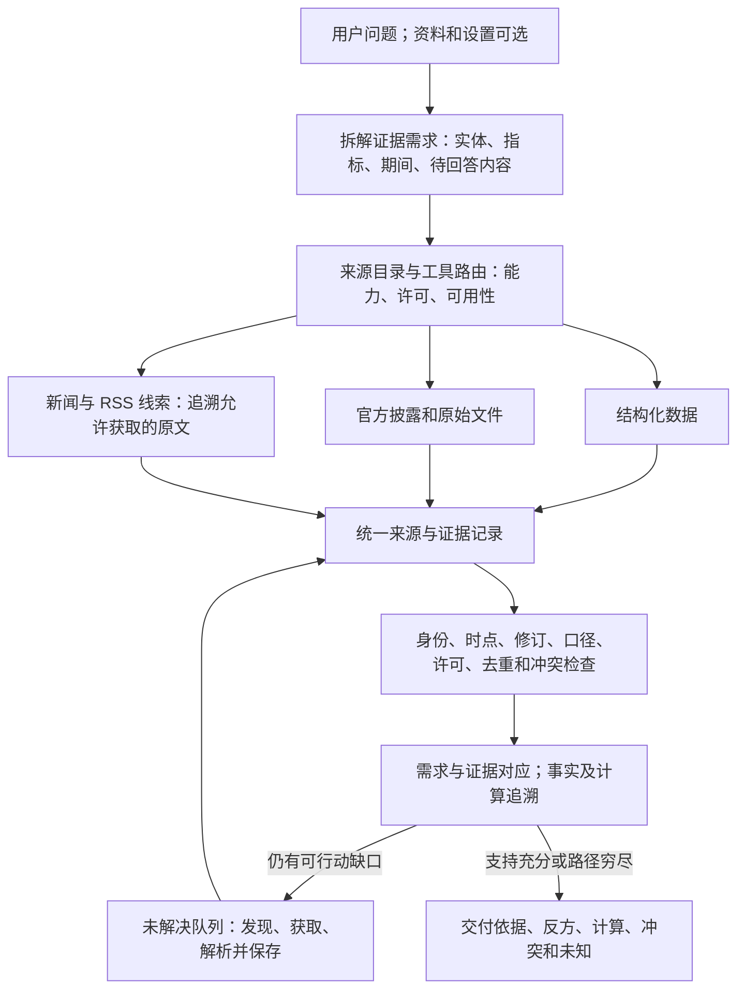

# 自主信源与证据通路方案

版本：规划草案  
日期：2026 年 11 月 15 日  
适用范围：阶段 B 的首次研究，以及未来接入更新流程的边界。本文是建设方案，不代表方案已经实施、产品已通过验收，也不作产品先进性排名。

> **2026-11-15 实施增量与验证边界**：已接入来源能力目录、单候选获取结果、多轮补证发现→授权获取→入库→分析的工程路径、既有 SEC 结构化查询桥、需求关联的单位/期间/币种及候选冲突提示、原文与结构化记录定位区分，以及工作区轮次展示。保留权限、用户可选预算与历史版本；这些接线不代表语义覆盖或真实研究质量已通过。核心离线模拟首次集中组 55 通过/2 失败/1 跳过，随后两项分别定向通过，不能称全量重跑通过；质量定向 24/24、Web 类型检查通过属于各自范围。未知补证外呼的完整端到端、当前 PostgreSQL 全故障场景、真实 SEC 桥及供应商分页仍未充分验证。
>
> [343 受控评估](phase-a/343-stage-b-autonomous-acceptance/evaluation.md)首题传输失败、外部状态未知，不能评分；后五题未运行。账本 10,000 tokens 为保守预留、实际用量和费用未知。实际 provider 分页/全球资料覆盖、来源身份与语义支持、结构化数据经济口径及真实质量仍是缺口；阶段 B 和本方案均未完成验收。

## 摘要

用户默认只需提出问题。系统应围绕研究要求自主寻找可用且可靠的资料，取得允许使用的原文或结构化数据，将事实、引用和确定性计算与任务逐项关联；证据不足时继续有目的地取证，路径不可用或穷尽时交付已有成果并说明缺口。添加资料、指定来源和调整权限或预算均为可选项，不能把用户先提供可靠材料当作默认流程的前提。

当前已有问题入口、来源记录、部分发现和官方获取、证据与计算结构以及运行控制，但尚缺贯穿“需求—多轮发现—获取—解析—再分析—缺口交付”的完整自主取证闭环。本文建议复用现有研究对象和持久化机制，优先打通可靠原文与结构化数据，再按实际需要扩展新闻线索和连接器；不以引入大型知识图谱、增加供应商或综合评分替代证据质量。

## 目标与约束

- **默认流程**：仅输入问题即可开始研究。用户可以自带资料或手动选择来源、授权和额度，但这些不是开始的必经步骤。自动选择只能在已有账户权限、来源许可和工具能力内进行。
- **用户运行限额**：模型调用数、搜索调用数、总 token、总时长及费用上限，用户未设置时不自动添加；省略或 null 表示未设置，明确的 0 和其他数值照做。实际使用仍需计量。供应商上下文和单次请求超时、工具权限、取消及失败恢复仍然适用，未设置运行预算不代表无限能力。
- **来源与安全**：原文、结构化观察、计算和模型解释分别保存；保留原始位置、身份、时间、修订、使用权限及失败状态。外部资料是不可信数据，不能授予工具权限。FRED 在现有条款核清前不作为 Agent 或 LLM 输入；模拟资料不得作为真实证据。
- **范围**：优先复用现有授权来源、适配器、研究版本和运行账本；不承诺新增付费供应商，不以开发样本的公司、地区或市场定义长期产品边界。人工验收按既有要求跳过，不以等待人工阻塞工作；缺少的独立基线和人工证据如实保留。
- **实验与产品默认分开**：未来开展 LLM 实验时，事先固定任务、资料快照、工具权限、提示、模型支持参数及实验预算；本方案不因此为普通产品运行设置默认总额度。

## 本机可借鉴内容与不迁移项

以下是 2026-11-15 对本机代码的只读核对，不代表真实网络、授权或覆盖已经验证。OpenClaw-stock 的工作路径是 `/home/lxx/Openclaw-stock`，不是另一处同名项目。 OpenClaw-stock 当时服务于韩国市场，其 Naver、DART 和韩国 RSS 等是历史区域插件示例，不构成 ForesightNine 的默认来源优先级或产品边界。只选择性复用协议适配、字段解析、缓存和调度等机制；韩国证券代码、语言、币种和交易日历不得成为全局默认。

| 本机能力 | 可借鉴 | 必须处理或不迁移 |
| --- | --- | --- |
| [新闻聚合器](/home/lxx/Openclaw-stock/openclaw/skills/data_collection/news_aggregator.py:42) | Naver、CryptoPanic 的真实接入结构，包含 URL、时间等发现元数据 | 缺 key 或异常时可能回落 mock；必须显式标记未配置/失败，不能将模拟内容作为证据。 |
| [公告监控](/home/lxx/Openclaw-stock/openclaw/skills/data_collection/announcement_monitor.py:31) | DART 公告列表的发现流程 | 列表到公告原文及标识的链路不完整，不能把列表当已核验原文。 |
| [基本面数据](/home/lxx/Openclaw-stock/openclaw/skills/data_collection/fundamental_data_fetcher.py:76) | Finnhub 财务和 earnings 的连接经验 | TTM 与年度数据混搭、缺失填零、默认数据和硬编码宏观内容不迁移；必须保留单位、期间、口径及缺失。 |
| [RSS 监控](/home/lxx/Openclaw-stock/openclaw/skills/data_collection/influencer_rss_monitor.py:127) | RSS 标题、链接、作者和时间等线索元数据 | 缺时间填当前时间、回落 mock 不可作为真实事实；Reddit 等社媒仅是待核验线索，且须先核对使用许可。 |
| [对话处理](/home/lxx/Openclaw-stock/openclaw/skills/analysis/conversation_handler.py:2834) | 收集、汇总线索的交互经验 | RSS 被压成标题与摘要会丢出处，单源异常可能被吞；新流程必须保留来源、错误和可追踪状态。 |
| [缓存](/home/lxx/Openclaw-stock/openclaw/core/database.py:17)与调度 | TTL 缓存和调度经验 | 不能替代 ForesightNine 现有持久版本、操作账本、取消与安全恢复。 |

`global_news_sources.yaml` 未见运行引用，不能据此宣称来源已启用；测试名称 `test_deduplicate` 本身也不能证明去重行为。禁止直接迁移 mock 回退、缺失填零、固定综合评分、地区默认、FRED 数据和未经许可的社媒内容。

## 商用方案对比与参考边界

下列内容是相关机构截至 2026-11-15 的官方资料或产品声明，不是独立效果评测，也不意味着 ForesightNine 已获得相应付费授权。

| 方案 | 可借鉴的设计 | 边界 |
| --- | --- | --- |
| AlphaSense | [Deep Research](https://www.alpha-sense.com/resources/product-articles/introducing-deep-research-in-alphasense/) 描述迭代检索、自适应计划及原文引用；[SuperAnalyst](https://help.alpha-sense.com/hc/en-us/articles/53909448564243-Getting-Started-with-SuperAnalyst) 提供进一步的研究工作流参考 | 后者为 beta；[FAQ](https://help.alpha-sense.com/hc/en-us/articles/53911346856851-SuperAnalyst-FAQs) 说明金融引用能力仍在完善。[MCP 说明](https://help.alpha-sense.com/hc/en-us/articles/56689794102419-SuperAnalyst-MCP)对自动模式、网页和 broker link 的限制说明，不能把宣传概括为无限来源能力。 |
| FactSet | [机构 AI 要求](https://insight.factset.com/convincing-is-not-the-same-as-accurate-what-financial-institutions-must-demand-from-ai)强调实体统一、结构化数据、权限和可追溯性 | 设计主张不等于本项目已经拥有其数据或许可；对经济含义的判断仍需独立核对。 |
| Hebbia | [Matrix/Max 与数据整合](https://www.hebbia.com/blog/whats-new-october-disclosure-2026/)展示按条件组织研究流程；[引用及核对](https://www.hebbia.com/blog/whats-new-june-disclosure-2026)提供证据检查的产品参考 | 引用或页面组织不自动证明来源实质支持结论，功能及商业权限以其官方条款为准。 |
| Anthropic | [金融 Agent 方案](https://www.anthropic.com/news/finance-agents)展示技能、连接器与子 Agent 的职责组织以及授权连接方式 | 仅借鉴职责与权限边界；不继承其 benchmark、排名或数据访问承诺。 |
| OpenBB | [扩展接口](https://docs.openbb.co/odp/python/extensions)可作为替换数据 provider 和组织扩展的基础设施参考 | 可替换不等于来源可靠、时点正确或用途获准；每个连接器仍需分别验证。 |

## 当前系统与主要缺口

以下基于 2026-11-15 对本项目的只读核对，属于代码现状，不是真实网络实测： SEC、BEA 和美联储是当前已实现的部分覆盖，并不定义全球来源范围；美股/宏观及中英文只是首批验证顺序，不是长期产品边界。

1. [来源发现](/home/lxx/Foresightnine/src/apps/api/app/research_discovery.py:37)目前固定保留前五个候选，[研究运行](/home/lxx/Foresightnine/src/apps/api/app/research_runs.py:103)中的查询截断至 70 字符；[来源策略](/home/lxx/Foresightnine/src/apps/api/app/research_source_policy.py:15)单次分析最多处理 20 个来源，主题来源容量为 100。分批能力、排序和截断应让用户与协调器知道，不能误称整项任务已经穷尽。
2. [官方获取](/home/lxx/Foresightnine/src/apps/api/app/research_fetch.py)已有 BEA、美联储和 SEC 白名单；[SEC 工具](/home/lxx/Foresightnine/src/apps/api/app/research_sec.py)提供 CIK 身份与 company concept，[结构化资料](/home/lxx/Foresightnine/src/apps/api/app/research_structured_data.py)已有观察值结构。当前可获取多份官方资料，但一个候选失败可能中断整批；界面仍有“最多一份”的过时文案，需与实际行为一致。
3. [补证阶段](/home/lxx/Foresightnine/src/apps/api/app/research_gap_stage.py:69)可以发现搜索线索，但尚未把补证搜索结果获取并纳入当前分析；[协调器](/home/lxx/Foresightnine/src/apps/api/app/research_orchestrator.py:52)现按动作尝试记录，动作尝试后不再执行，最多七项动作。用户不设置总预算并不等于已经具备多轮、自适应的取证闭环。
4. [来源模型](/home/lxx/Foresightnine/src/apps/api/app/research_sources.py:65)已有原文、哈希、身份/时点与许可等结构，可作为共同基础；转载是否独立、任务所需语义是否覆盖仍未证实。引用定位、确定性重算或模型自评都不能单独证明原文支持结论。
5. [342 冻结评估](phase-a/342-stage-b-verified-attempt/evaluation.md)两题不通过、三题未运行；v60 补证及后续调整只有各自范围内的工程定向证据，没有新的真实研究质量证明。不能将失败归因简化为某一家公司的字段或某一题措辞。

## 目标流程

线索只能帮助寻找来源。新闻、RSS 或社媒条目在取得并核验相关原文以前，不自动构成独立证据；同一事实的转载不能计作多个独立来源。官方来源也需要核对具体原文、时点和许可，不能仅凭域名宣称结论正确。

## 模块与接口职责

### 1. 证据需求与来源路由

协调器将原问题和已有材料转为可检查的证据需求，记录实体、指标、期间、对象、口径及需要回答的关系；模型提出的分解和检索词是建议，不是完整覆盖证明。对未确认的身份、缺失或冲突保留未知。来源目录声明连接器能力、已配置状态、覆盖、权限、输出类型和可选用途，协调器据此选择可执行路径，不依赖供应商内部细节。

来源目录按区域独立、可插拔；路由依据研究问题、实体、市场、语言、资料类型、时点、许可和可用性，而非继承某个旧项目的地区默认。全球与跨市场研究中，公司、证券、交易所、币种和交易日历分别识别，并复用通用证据模型。无需接完各国来源才能推进阶段 B；实际覆盖与未知须如实披露。

结构化数据、官方原文、新闻/RSS 线索作为三条可组合通道。优先官方披露、公司原文和已许可结构数据；新闻/RSS 主要帮助发现，商业资料和社媒留待未来按权限与实际价值选择。不能承诺所有问题都存在可获取的可靠来源。

### 2. 统一连接器和来源记录

复用现有来源/证据对象，为连接器结果统一表达：来源标识与名称、原始 URL 或查询标识、获取和事件时间、公开及修订时间、权限、原文或结构化结果、哈希、解析方式和状态。状态至少区分 **未配置、无结果、获取失败、解析失败、受限、成功**；应标记模拟结果，不让 mock 进入真实证据。

原文文档引用使用可回到原始连续文本的 span；API 查询结果保留请求、数据集或记录标识、时点和字段的可追溯关系，不伪造文档页码或 span。解析和展示应遵循来源的存储、模型输入、展示及导出权限，不从一个权限推导另一个。

### 3. 身份、时点、口径、转载与冲突

公司、证券和数据实体分别建模，匹配失败或存在多个候选时保持未知；对财务期间、单位、币种、口径、修订和历史可得性逐项记录。用原始文件哈希、规范来源标识和可核对的转载关系辅助去重，区分“同一来源的多次转载”和独立资料；相似文本或共同数字不足以证明独立或语义一致。

冲突作为可见研究状态而不是静默覆盖。来源之间不一致、口径不同、原始证据不足以及只能确认部分范围时，都应关联到受影响的需求、事实或结论，并说明下一步可用的资料类型和动作。

### 4. 按未解决需求多轮取证

复用现有协调、工具结果、版本、证据和账本，建立可持久的未解决需求队列。每轮按当前缺口选择有用工具；发现后的候选必须经过权限和身份检查、实际获取和解析，再以保存的材料进入后续分析，不能把搜索摘要当作已读原文。重复查询按查询、权限和版本状态去重，文档按来源/哈希及版本去重，保留失败和重试原因。

来源结果应支持分页或分批处理，单个来源失败不阻断其他来源；每批和当前运行的限制、已处理范围与未处理原因可检查，不以固定前几条默默代表全任务。已读范围与新增材料分别记录，避免重复送入占据关键资料空间。所有执行和恢复继续受账户隔离、授权、显式用户额度以及外部调用状态约束。

终止条件为：研究目标在可核查标准下已满足；当前可用路径穷尽且无新进展；用户取消或达到用户明确设置的限额；或出现不可恢复的真实故障。对重复失败或无新信息的操作停止无进展重试，说明缺口；不能在没有用户额度时陷入无进展的无限循环，也不能将供应商单次限制伪装成用户的总预算。

### 5. 交付与后续扩展边界

交付记录每项结论对应的引用、来源时间、事实、计算输入与公式、反方、冲突和未知；对未确认支持的结论标明状态。用户修改或版本更新后重新验证可保留的关联，保留历史而不把过期关系当有效证据。继续使用已有 API、研究状态、版本、权限和运行账本，不建设并行证据体系；后续情景与持续更新可消费这些记录，但不要求在本阶段实现阶段 C/D 功能。

## 分批实施与验收

| 批次 | 实施内容 | 可检查出口 |
| --- | --- | --- |
| **1. 工具契约与多轮入库** | 统一连接器能力与失败状态；将补证候选经授权获取、解析、保存后接回当前研究；按未解决需求选择后续动作。移除静默全任务截断，按容量分批，隔离单源失败和重复查询。 | 问题入口可在已有授权范围内完成发现→原文/结构数据→保存→再分析；无结果、未配置、权限限制和单源失败均可区分，部分成果和用户选择可追溯。 |
| **2. 需求覆盖与证据核对** | 复用现有来源、事实、计算和主张结构，补齐任务需求到具体来源与证据关系；核查身份、期间、单位、修订、转载和冲突；为引用和确定性计算保留必要输入。 | 可从每项研究要求回查原始依据或明确缺口；引用定位与语义支持分开，计算公式、输入和口径可复核；缺失、冲突及未读范围不得升级为已确认事实。 |
| **3. 选择性接入与集中验收** | 按研究能力缺口逐项核对并选择连接器，而非照搬旧项目清单或优先韩国；先验证适用的官方披露、公司原文和结构化数据，再将新闻/RSS 用作发现线索；对未授权或失败路径保守降级。 | 固定跨任务资料快照和判定标准，验证来源权限、获取与恢复、引用支持、计算、反方及未知项；各任务结果、失败和未运行情况可检查，不把某个样本或模拟测试当泛化证明。 |

批次可以按依赖分阶段交付，现有能力保持兼容；不删除旧功能、不迁移生产数据、不部署。质量标志是可追溯、可复核、未知明确，而不是绝对正确、任意设定通过分数或新的综合评分。阶段 B 通过与否以实际证据和事先确定的验收条件判断。

验证时，先冻结跨类型任务、许可资料原文/结构结果和哈希，再固定模型和其实际支持的参数、提示版本、权限、实验预算与停止规则；分开记录模拟工程检查、真实研究质量和成本。人工验收按用户既有要求跳过，未取得的独立基线或泛化证据明确保留为未知。研究能力与投资绩效分别评估，后者不能从引用正确或计算一致推断。

## 证据来源与使用方式

- 项目约束与当前计划：[AGENTS.md](/home/lxx/Foresightnine/AGENTS.md)、[plan.md](/home/lxx/Foresightnine/plan.md)、[阶段 B 规格](phase-a/06-phase-b-spec.md)、[现有缺口](phase-a/339-stage-b-remaining-gaps.md)及 [342 评价](phase-a/342-stage-b-verified-attempt/evaluation.md)。历史验收只证明各自冻结版本和任务范围。
- 本机 OpenClaw-stock 与 ForesightNine 文件见上方具体路径；所列观察为 2026-11-15 的只读代码核对，不等于来源可用性或使用许可已完成实测。
- AlphaSense、FactSet、Hebbia、Anthropic 和 OpenBB 的官方参考链接见对比表；它们提供产品设计和接口声明，不作为独立效果或商业授权证据。
