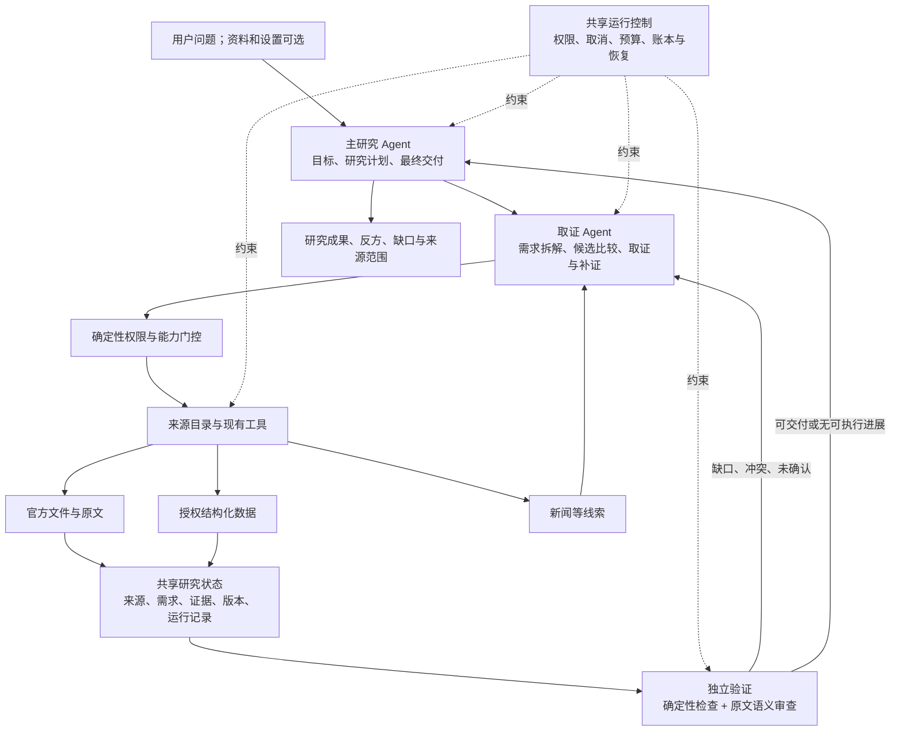

# 信源决策层与取证 Agent 架构方案

日期：2026 年 11 月 15 日  
状态：**用户已授权实施；决策、核验与工作区路径已接入，相关离线验证已执行，真实质量尚未证明**。本轮范围和证据见 [345 实施记录](phase-a/345-evidence-acquisition-implementation.md)。

> **实施基线（2026-11-15）**：用户授权在现有主研究协调者下逻辑分离取证决策职责，复用共享工具、权限、运行账本和研究状态；不默认增加模型供应商、服务或并行。工作区已有大量未提交修改，必须保留，既有脏改与历史验收不全部归属本轮。本轮分别记录实际代码接线、模拟工程证据及真实质量，实施授权不等于发布授权。

## 推荐结论

在现有研究协调器下，增加一个**逻辑独立的取证 Agent**：主研究 Agent 负责理解问题、组织研究与交付；取证 Agent 面向每项证据需求选择资料、读取和补证；两者共享已有研究状态、来源记录与运行控制。验证层分别执行确定性检查与原文语义审查，并把未确认项退回研究流程。默认一个取证 Agent；只有独立子任务的收益经对照验证后，才选择性并行。

这是对 [plan.md](/home/lxx/Foresightnine/plan.md) 中“单一研究协调 Agent + 工具”职责划分的建议调整：**保留一个主协调者，将取证决策职责逻辑分离**。复用已有存储、协调、工具、权限和运行账本，不另建运行控制系统；不以微服务、新模型供应商或默认并行作为前提。用户已授权实施该职责调整；具体效果仍须验证。

[自主信源与证据通路方案](autonomous-source-evidence-plan-2026-11-15.md)是基础：问题入口、来源目录、原文和结构数据接入、补证及恢复已有工程路径。本文补充的是**如何决定需要什么证据、选择什么资料、证据是否足够以及下一步做什么**。连接器可调用或某次运行结束，不等于这些判断已经可靠。原方案下方的历史现状描述保留其写作时点，不覆盖其顶部的后续实施状态。

阶段 B 仍未完成。[343 评估](phase-a/343-stage-b-autonomous-acceptance/evaluation.md)首题传输失败且外部调用状态未知，没有可评分成果；其余题目未运行。该批次不能证明研究质量通过或不通过；不得静默重放未决调用。

## 要解决的问题

目前需要加强的是贯穿任务的决策能力，而不只是扩大来源名单：

1. **判断证据需求**：识别问题中的对象、时期、指标、关系、对比、反方和未知，区分用户明确要求与模型提出的候选子问题。
2. **为具体主张选择资料**：比较候选来源对该对象、指标和时点的适用性、可用性和许可；不能用一份全局“权威总分”替代逐项判断。
3. **判断充分性与独立性**：核对原文是否支持主张、是否存在必要但缺失的资料、冲突及反证；分辨独立来源与转载，无法确认时保留未知。
4. **动态选择下一步**：根据已有资料、实际读取范围与缺口决定继续发现、获取、读取、复核或交付；没有进展时说明原因，而不是把未找到等同于不存在。

## 目标结构

“独立验证”是与取证选择相分离的职责与结果记录，不预设必须部署另一服务或使用另一模型。它不能自行放宽权限，也不能把模型自评当成事实。后续可比较规则、相同模型独立调用或不同模型审查；其独立性和效果分别验证。

## 职责与交接

| 部分 | 负责 | 交接与限制 |
| --- | --- | --- |
| 主研究 Agent | 解释用户目标，维护研究问题和交付范围；协调分析、反方与最终成果 | 将有上下文的证据需求交给取证层；不将模型建议直接写成已确认事实 |
| 取证 Agent | 将需求转为资料候选、选择行动、读取原文或结构记录，检查缺口并提出下一步 | 返回来源、实际读取范围、支持或冲突线索、失败及未知；不授予自己访问权限 |
| 共享来源与工具 | 描述并执行可用连接器，保存原文、结构观察、身份、时间、许可及错误 | 搜索摘要仅为线索；需实际获取、解析且获准使用，才能进入证据通路 |
| 独立验证 | 确定性检查身份映射、日期、单位、计算与引用位置；语义审查主张与原文关系 | 机械一致不证明经济含义或语义支持；语义审查仍可能出错，保留未核验状态 |
| 运行与研究存储 | 复用主题、版本、检查点、授权、调用记录、取消和恢复 | 用户已确认判断不得被后台结果静默覆盖；外部调用状态未知时不静默重放 |

模型可提出查询、来源及下一步建议；确定性控制层依据账户、资料许可、用户选择和工具能力决定是否执行。外部网页、文件和工具响应均为不可信数据，不能改变指令或权限。

## 取证循环

### 1. 建立需求

围绕用户问题形成可修订的需求清单。每项记录：用户原问题及来源、待验证主张或关系、研究对象、指标、时间范围、经济口径、预期数据类型、潜在反方，以及缺失或歧义。尚无法确定的实体、指标和时点标为未知；模型拆分是建议，不代表覆盖完整。

例如，一个跨公司收入比较需要分别确认公司与证券身份、财年区间、报告币种、收入定义，以及是否需要汇率或口径换算。缺少这些要素时，系统可以继续寻找能够消除歧义的资料，不擅自填充。

### 2. 比较候选来源并行动

来源目录按能力而非供应商名称硬编码决策。对每项需求，比较：

- 是否覆盖所需实体、指标、市场、语言、期间与资料类型；覆盖未知时保留未知。
- 数据的原始发布者、可得性、更新与修订时间、是否可回到原件或具体记录。
- 储存、展示、发送模型和导出各项权限；来源是否可用、收费与否及失败状态。
- 是否属于相关的一手披露、可核对的结构化数据，或只能作为发现线索的二手材料。

目录提供适用能力与约束，确定性层先排除无权、明确不适用或不可用的选项；取证 Agent 再提出候选、理由和查询参数。可选多个互补来源，不因为某来源总体声誉高就认定它支持所有主张。无候选、许可不明、身份多义与工具故障分别记录。

优先考虑与需求直接相关的一手披露及已许可结构化数据，再按具体任务使用新闻或其他来源发现线索。搜索结果、摘要和转载不是已读原文，也不能自动成为独立证据。

### 3. 获取、读取与保存

在现有授权内获取原文或结构化结果，记录请求、来源标识、版本与哈希、获取时间、解析方式、权限和失败状态。原文引用保留可回到原始连续内容的位置；结构化观察保留查询、字段或记录标识及其来源，不伪造文档页码。

金融资料分别记录事件发生、公开、获取和修订时间。历史研究只使用能够证明在截止时点已经可得的版本；当前修订值不能冒充当时可得的数据。历史版本或公开时刻无法确认时标记未知，不以获取时间代替公开时间。

按任务读取有用范围，保留模型实际看到的片段和未读取范围。已处理一个文件不表示全文已读；复杂 PDF、图表、跨页表格、扫描件和供应商分页若不能可靠处理，必须保留缺口或部分完成。重复获取应按来源身份与版本核对；相似内容或同一数字不能独自证明转载关系。

### 4. 检查并更新需求

验证层对候选证据进行两类检查，并记录各自状态：

- **确定性检查**：来源和权限、公司／证券身份候选、公开和修订时点、期间、单位、币种、位置、可复算公式及输入是否一致。事实、计算和模型解释分开保存。
- **原文语义审查**：逐项检查原文是否实际支持或反对主张，是否只覆盖部分表述、是否遗漏限定条件，以及是否存在冲突或更有力反证。审查结论保留依据和不确定性，不把引用存在或文本匹配当作语义正确的证明。

转载独立性要有可核对的来源关系；无法识别时标记未知，不将多篇转载自动计为多个独立证据。公司、证券、交易所、币种和交易日历分别建模；同名、多上市地或历史代码变化造成歧义时保留候选，不猜测唯一身份。

### 5. 决定继续还是交付

取证 Agent 根据尚未解决的需求、候选覆盖、已读范围、失败与新信息提出下一动作。主研究 Agent 结合验证结果更新研究计划。每次决策记录需求、选用与未选候选的理由、执行结果、已读范围及剩余路径。

每项行动还应记录其目标需求、拟用工具及参数、预期消除的缺口，以及不同可能结果将如何更新需求或触发下一步；理由应简短且可检查，不要求保存模型内部推理。

可以继续搜索、获取、读取同一来源的其他范围、查询结构化记录、交叉核对、查找反证或交付部分成果。按需求、查询、授权和来源版本避免无新信息的重复；允许以新事实或新未读范围为依据再次处理，不把一次动作视为覆盖全部材料。

## 共享状态与决策契约

复用当前研究状态并以版本化接口增量表达，以下是目标契约，不表示现有字段已全部实现。

| 对象 | 最少保存内容 | 不得推断 |
| --- | --- | --- |
| 研究任务 | 原问题、范围、用户选择、时点、交付要求、当前版本 | 样本中的公司、国家或行业就是系统范围 |
| 证据需求 | 稳定标识、来源、主张／问题、实体、指标、期间、口径、需要的反方、状态及未知 | 模型拆分已完整或模型关系已核实 |
| 来源候选与决策 | 能力／覆盖、权限、可用性、用途、选择或未选原因、查询与时间 | 候选、摘要或目录注册等于已获得可用证据 |
| 原文／结构记录 | 所有者、原件或记录标识、来源、哈希、版本、公开／获取／修订时间、许可、解析和实际范围 | 原件哈希或位置能证明结论的经济含义 |
| 证据与核验 | 需求到事实、计算、主张、支持／反对关系、冲突及确定性和语义审查状态 | 候选关系、模型复查或相同数字必然构成支持 |
| 执行与停止 | 下一动作、选择理由、已尝试路径、进展、调用、用量、故障、检查点和停止原因 | 工具无结果即事实不存在，或 provider 未分页即全网穷尽 |

状态区分至少包括：待调查、部分覆盖、待核验、冲突、已取得可检查依据、不可用和未知。是否满足研究目标由具体任务与事先确定的标准评定；不能以模型自评分、报告长度或来源数量自动判定。

## 停止与运行边界

- **有依据交付**：任务要求已有可核查依据和必要反方，或根据记录明确交付部分结果与剩余未知；这不是模型自身宣称“足够”即通过。
- **当前路径无进展**：已尝试路径无新增可用来源、有效记录或需要读取的新范围；注明未处理范围、不可用连接器和分页未知，不能称所有来源已穷尽。
- **权限、能力或真实故障**：用户未授权、来源不允许、工具缺失、身份无法消歧或外呼失败时，记录具体状态与已保存部分，不制造结果。
- **用户取消或明确限额耗尽**：保留已提交成果、用量与缺口；取消和恢复遵守账户、版本及幂等约束。

默认用户只提问题即可开始；添加资料、配置来源和权限、调整预算均为可选。用户未设置时，模型调用数、搜索调用数、总 token、总时长和费用上限**不自动设定**；省略或空值表示未设置，明确 0 或其他数值照做并记录。单次模型上下文、网络超时、来源处理批次、取消以及无进展终止是执行和技术边界，不伪装成用户总预算，也不因此承诺无限能力。实际调用、用量与未知费用始终记录。

显式关闭来源发现、明确空来源选择与其他权限选择优先。空来源且未另授权搜索时不发现；另有明确正搜索预算或启用补充搜索时可以发现线索，但不因此自动获取。来源权限不因模型建议、工具目录或 MCP 接入而扩张。

失败恢复沿用现有账户隔离、版本检查、检查点、调用与结算账本。外部调用状态不明时保留未决并阻止静默重放；确认返回且已保存的结果才可按安全边界续用。历史快照采用明确的兼容策略，不能将旧运行改写为新策略完成，也不能覆盖用户确认。

## 全球可插拔来源与适用范围

来源目录按**能力、许可、覆盖及可用性**描述，不规定某个国家、市场、语言或供应商作为全球默认。当前可用适配器的实际覆盖需逐项验证；接入顺序依据任务和许可，而不是依据样本或历史区域。

SEC、BEA、美联储只是当前部分来源基础，不代表全球覆盖。韩国 DART、Naver 等若将来采用，只能作为独立区域插件并单独验证身份、时点、接口、许可和故障行为；不能将韩国证券代码、韩元或交易日历设成系统默认。FRED 的相关使用条款尚待核清，核清之前不作为本项目 Agent 或 LLM 的已授权输入。

新闻、社媒和其他另类信息可以在许可范围内作为线索；是否可以获取、保存、发送模型和导出需分别确认。连接器失败或未配置时展示真实状态；模拟数据不得混入真实证据。

## 公开方案参考与取舍

以下引用的是机构公开技术资料或代码，说明设计机制，不构成本项目的数据许可、独立质量证明或产品排名。功能和条款可能变化，实施时应再次核对。

| 参考 | 可借鉴的机制 | 对本方案的边界 |
| --- | --- | --- |
| [Anthropic 多 Agent 研究系统](https://www.anthropic.com/research/multi-agent-research-system) | 主协调者明确委派独立研究任务，汇总不同分支成果 | 并行是可选组织方式；不因 Agent 数量增加就假定质量更好，成本、重复和汇总错误须实测 |
| [Google Deep Research Agent](https://blog.google/innovation-and-ai/technology/developers-tools/deep-research-agent-gemini-api/) | 多步骤搜索、读取和迭代补缺的研究流程 | 产品能力描述不证明本项目具备相同来源或质量；仍需逐项保留权限与依据 |
| AlphaSense [Context Graph](https://www.alpha-sense.com/resources/technical-articles/context-graph/) 与 [Supply Chain Intelligence](https://www.alpha-sense.com/resources/technical-articles/supply-chain-intelligence/) | 将实体与关系连接回原文证据，并参考独立审查思路 | 实体图、关系或独立模型审查都不是事实真实性的保证；不假定已获得其数据或许可 |
| Dexter [财务工具路由](https://github.com/virattt/dexter/blob/main/src/tools/finance/get-financials.ts) 与 [申报文件读取](https://github.com/virattt/dexter/blob/main/src/tools/finance/read-filings.ts) | 用受限工具集合路由财务问题；规划文件类型后取得元数据并读取相关内容 | 模型推断身份／日期需验证；固定文件或循环限制、自我检查和引用存在都不保证证据充分，不能照搬为默认运行总限额 |
| LlamaIndex [Router Retriever](https://developers.llamaindex.ai/python/framework/integrations/retrievers/router_retriever/) | 依据查询和工具元数据选择一个或多个检索器 | 是可组合路由示例，不自动解决金融口径、许可、独立性或语义核验；不因此要求引入向量库 |
| OpenBB [扩展机制](https://docs.openbb.co/odp/python/extensions) | 用扩展与统一接口组织可替换的数据提供方 | 提供工具或通过 MCP 暴露接口，不等于来源选择、内容可信或使用获许可 |

## 实施顺序与出口

| 批次 | 建设范围 | 可检查出口 |
| --- | --- | --- |
| 1. 统一职责与需求状态 | 在现有协调和存储中加入取证职责、版本化需求及候选决策记录；保持权限和旧版本兼容 | 能从问题追溯需求、候选选择和未知；无可执行来源时真实交付缺口 |
| 2. 闭环与验证 | 将授权来源的发现、获取、读取、确定性校验、语义审查、缺口更新与继续／交付串联 | 原文或结构记录可回查；实际已读及未读范围、冲突、反方和停止原因可检查；故障、取消和恢复行为按证据报告 |
| 3. 选择性扩展与并行 | 在闭环稳定后按能力缺口扩展区域连接器；对独立任务尝试并行取证 | 新连接器的覆盖、许可、时效和错误有证据；并行只在对照中有可见收益且不破坏隔离、恢复和成本控制时启用 |

每批同时区分“代码路径已接入”“工程行为已验证”和“真实研究质量已验证”。测试数量、一次顺利运行、模型自评或引用数量不单独证明取证决策已完成，也不取代阶段 B 出口。

## 受控验证与单 Agent 对照

### 本轮集中工程验证范围（准备中）

代码稳定后集中一次检查：实际入口和补证均经过取证决策；复查发现冲突能产生下一步，非法工具参数和模型自称完成不能绕过确定性门控；来源或主张版本变化使旧复查失效；检查点保存不触发额外模型调用，未知外呼不自动重放，恢复保留账本与进度；显式预算 0 和空来源/关闭权限按用户设置执行；未获模型输入或导出许可的来源不进入决策上下文或输出。另以模拟 provider 验证零上传入口、跨领域来源能力与前端展示/类型检查；失败后只复测受影响项。上述是计划，结果以实际证据为准。

下一次真实研究方案先冻结跨任务资料与许可、比较条件、源码/提示及模型实际支持参数，预先确定实验预算、停止规则与评分；区分固定资料研究、自主零上传和未用于调参的任务，独立模型质量与模拟工程结果。343 未决调用保留，不重放；本段不授权新的真实调用或购买。

先完成与改动相关的模拟工程验证：权限、显式关闭／空选择、来源和范围记录、失败、取消、去重、版本冲突、未知外呼和安全恢复。模拟结果只证明所覆盖工程路径。

进行真实模型研究前预登记并固定跨类型任务、许可资料快照与哈希、工具权限、模型及其实际支持的参数、提示版本、实验预算、停止条件和评分标准；一次只改变一个主要因素。保留重复运行和未用于调参的独立任务，分别记录调用、耗时、费用与未知项。实验预算用于约束实验，不变更普通用户未设置预算的产品默认。

比较 **A：现有单主协调 Agent + 共享工具** 与 **B：同一主协调 Agent + 专门取证 Agent**，固定其他条件；将委派结构作为主要变化。分别评价必要资料召回、引用对具体主张的支持、身份与期间单位币种、计算、反方与冲突、缺失和未读范围表达、失败恢复、延迟和单位有效成果成本。按事前标准比较任务类型与失败原因，不凭单题或模型评分宣布优劣。人工验收继续按用户既有指令跳过；未取得的人工基线、独立核验证据和泛化证据照实保留，不用等待人工作为开发阻塞。

能力出口应覆盖：用户不上传资料时在已授权能力内自主取得证据；排除看似权威但不适用于该主张的资料；出现冲突时重新规划；发现并处理关键反证；以及无进展、受限或缺失时合理停止并交付缺口。使用跨公司、市场和语言的独立任务检查泛化，避免针对开发样本堆叠特例；来源或权限不足的任务按实际结果记录。

只有受控证据表明独立取证或并行在具体任务上带来值得其成本和复杂度的改善，并满足权限、账户隔离与恢复要求，才把它扩为默认运行方式。研究能力与投资绩效分开评价；正确引用或公式一致不证明未来收益。
