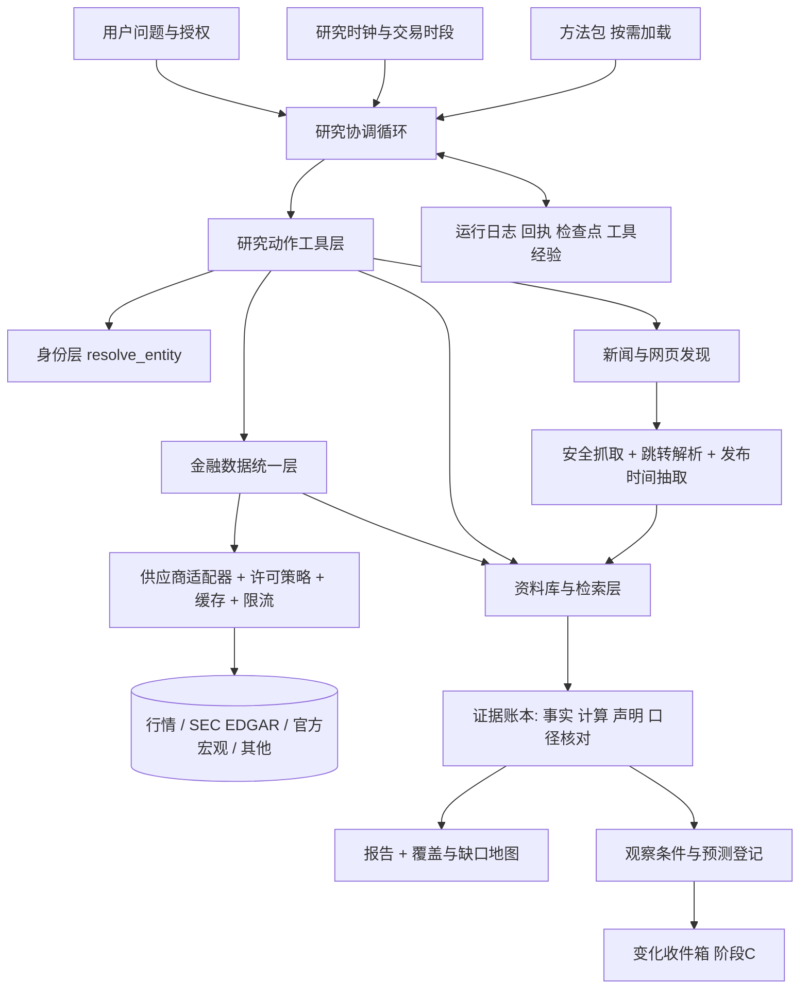
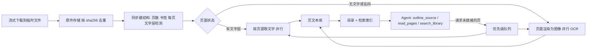

# ForesightNine 金融取证与工具调用完整方案

日期：2026-11-20。状态：**规划，待实施**。本文没有修改代码，也没有部署。

- **本文汇总三件事**：两次线上排查（`topic_91c2720b`、`topic_c2ba04f0`）的缺陷修复，金融资料获取能力的缺口分析和业界对比，以及完整的建设方案。
- **与修复方案的关系**：[研究时效、取证与上下文缓存修复方案](topic-91c2720b-timeliness-and-retrieval-fix-plan-2026-11-20.md)保留为排查证据的原始记录，其中全部修复项已并入本文第 6.1 节（W0）。执行以本文为准。
- **与 plan.md 的关系**：本文对应 plan.md 的 M1（完成取证闭环）、M2（长任务可靠性）和 M3（多类金融任务）。plan.md 仍是唯一的执行入口，本文写入规划不等于已获批准或已实施；建议在 plan.md 第 9 节后加一条指向本文的入口。
- **候选只是候选**：文中所有数据供应商和接口都只是候选，接入前要逐项核验许可、覆盖范围和故障表现。FRED 仍不作为输入。

**2026-11-20 用户决定**（本文已按此修订）：

1. 大 PDF 不能以明确报错结束。改为“选择性按需读取”，无法解析的页面交给并行 OCR，转成文字后由 Agent 按需读取（见 6.14 W13）。
2. 面向所有主流市场（见 6.15 W14）。
3. 本产品不面向短线交易，**只使用免费数据源**。不接入付费数据，延迟行情可以接受。
4. 在 plan.md 中加入本文的入口（已加在 plan.md 第 10 节）。

---

## 1. 背景与证据

### 1.1 两次线上排查的结论

| 主题 | 问题 | 主要失败原因 |
| --- | --- | --- |
| `topic_91c2720b` | 分析纳斯达克最近走势并预测（5 轮，7 次运行） | 模型不知道当前日期，把 2025 年当成“最近”；价格工具拒绝结束日期不早于当日的请求，且只回一个错误码；Twelve Data 的结束日期不包含当天；已经取到的英伟达 2026 年季报模型没有找到，还写成了缺口；抓到的 Schwab 2026 展望没进入版本；一个 28.9 MB 的 PDF 被误判为“结果未知”，整轮中止；“无进展”误判两次；上下文压缩过于频繁，前缀缓存反复失效 |
| `topic_c2ba04f0` | 收集 Anthropic IPO 首日交易信息（1 轮） | 研究工具里根本没有盘中或报价工具；行情只保留收盘价，且只能查 3 个 ETF；当天收盘后的数据在现行逻辑下拿不到；首日价格全部来自新闻，没有和行情数据核对过。实测 Twelve Data 能提供 ANT 的 5 分钟线和完整日线 |

逐条证据见[修复方案](topic-91c2720b-timeliness-and-retrieval-fix-plan-2026-11-20.md)第 1 节和第 7 节。

### 1.2 全部线上主题的工具统计（10 个主题，2026-11-19 到 11-20）

| 指标 | 数值 |
| --- | --- |
| 工具调用总数 | 223：`search_source` 53、`sec_company_concept` 43、`record_facts` 36、`read_sources` 27、`acquire_sources` 18、`discover_sources` 17、`historical_prices` 12、`calculate_financials` 10、`create_chart` 7 |
| SEC 查询失败率 | 51%（22/43）：期间或单位不匹配 17 次，限流 5 次 |
| 行情查询失败率 | 58%（7/12），全部是“交易时段未确认” |
| 抓取不可用 | 11 次 `source_cannot_be_acquired`；nasdaq.com 返回 403 |
| 搜索结果因跳转链接被丢弃 | 94 条 |
| 研究问题的类型 | 9 个有效主题里，6 个问英伟达的营收和利润率，2 个问纳指走势，1 个问 IPO 首日 |

### 1.3 基线指标（复验时对比）

| 指标 | topic_91c2720b | topic_c2ba04f0 |
| --- | --- | --- |
| 模型调用 / 搜索调用 | 32 / 1 | 11 / 2 |
| 总 token | 约 123 万 | 约 27.8 万 |
| 前缀缓存命中率 | 42.5%（第 4 轮只有 18.4%） | — |
| 价格数据最新日期（相对研究日） | 2025-12-30（研究日 2026-11-20） | 无行情数据 |
| 结束状态 | 2 轮 completed，3 轮 partial | completed（价格只来自新闻） |

---

## 2. 目标、非目标与设计原则

### 2.1 目标

1. 时效类问题（“最近”“今天”“本周”）能取到研究时点可得的最新数据，并说明数据截至哪一天。
2. 行情、财务报表、申报文件、新闻、宏观、事件日历都有结构化的研究动作工具，覆盖范围和许可都明确标注。
3. 工具调用一次成功的比例显著提高，试错调用占比显著下降。具体阈值在人工基线建立后预先确定。
4. 单个来源失败不会中止整轮研究；部分成果完整保留并进入版本。
5. 上下文管理不再无谓地破坏前缀缓存。
6. 在可复核的基础上，形成 ForesightNine 独有的能力：多源口径核对、时点正确、监控研究假设、覆盖与缺口地图（第 7 节）。

### 2.2 非目标

- 不做真实下单、资金托管、实时交易信号；不面向短线交易，不追求实时行情，延迟数据可以接受。
- 不接入付费数据源（用户决定）。机构终端独有的数据（如一致预期、付费业绩会记录）作为已知缺口如实呈现，并用免费资料的替代方法补足（见 6.4.2）。
- 不建设通用的 Agent 平台或插件市场；不默认采用多 Agent。
- 不为旧数据和旧 schema 做兼容（AGENTS.md 2026-11-16 原则）。

### 2.3 设计原则

1. **工具是研究动作，不是接口转发。** 模型说明“要什么”，服务端负责代码解析、口径映射、期间对齐和时段判断。
2. **工具数量少、粒度粗、定义固定。** 工具清单在不同运行之间保持不变（保护前缀缓存）。能力差异通过 `messages[0]` 里的 `available_capabilities` 告诉模型，不通过增减工具来表达。
3. **每个结果都带覆盖说明和权限。** 成功时说明实际覆盖了什么，失败时给出可以执行的修改建议。
4. **时间是一等字段。** 每条资料都区分事件发生、公开、获取、修订四个时间；每次运行有固定的研究时钟。
5. **不绑定供应商。** 先定义标准数据模型，再为每家供应商写适配器，许可策略由配置决定。模型的请求不会扩大授权范围。
6. **确定性优先。** 解析、换算、对齐、核对用代码完成；模型负责规划、解释和识别缺口。
7. **外部内容都当作不可信数据。** 新闻和网页内容不能改变权限或指令。
8. **不针对样本写特例。** 所有修复和能力都是通用工具行为。
9. **只用免费、可合规自动访问的来源。** 官方披露平台、监管机构、统计机构和央行的公开接口优先；免费商业接口只用免费档，并核验条款是否允许自动访问和用于模型输入。
10. **任何文档都可以读，只是读法不同。** 大小和格式不应该让取证直接失败：大文档按需读，扫描件做 OCR，做不到的地方说明原因并给出替代途径。

---

## 3. 现状盘点

### 3.1 研究 Agent 目前能用的工具

| 工具 | 能做什么 | 主要限制 |
| --- | --- | --- |
| `discover_sources` | 通过单一搜索服务（`glm_coding_mcp`）找网页线索 | 只能传一个查询词，不能限定时间、语言、站点；结果大多没有发布时间；跳转链接直接丢弃 |
| `acquire_sources` | 抓取搜索返回过的链接（HTML、纯文本、PDF） | 不能直接抓取已知网址；上限 5 MB；JS 渲染和有反爬的站点拿不到 |
| `read_sources` / `outline_source` / `search_source` | 在已获取的来源里阅读、看目录、按关键词查找 | 只能逐字匹配，不能跨多篇文档统一检索 |
| `historical_prices` | Twelve Data 日线收盘价 | 只有 3 个 ETF；只保留收盘价；拿不到当天数据；结束日期有边界问题 |
| `sec_company_concept` | 查 SEC XBRL 的单个财务科目 | 必须给出准确的标签和期间才能命中；只覆盖美国 SEC 申报公司 |
| `record_facts` / `calculate_financials` / `create_chart` / `submit_research` | 记录事实、确定性计算、作图、提交报告 | 这一层是 ForesightNine 的长处 |

**代码里有但研究 Agent 用不到的能力**：

- `market_provider.py` 接了 5 家供应商的日线，只给 FM 用。
- `research_sec.py` 里的申报文件抓取和身份查询，只在抓取路径里被间接调用。
- 用户上传 PDF 或 HTML（`research_uploads.py`）。
- `research_structured_connector.py` 已经定义了通用的结构化查询外壳（`StructuredQuery`），目前只实现了 `sec_company_concept` 一种。

### 3.2 按资料类别看缺口

| 类别 | 现状 | 缺什么 |
| --- | --- | --- |
| 证券与公司身份 | 只有 SEC 的 ticker→CIK 对照 | 统一的身份解析：代码、交易所、ISIN/FIGI、公司、行业分类、同业公司 |
| 行情 | 3 个 ETF 的日收盘价 | 任意代码、开高低收和成交量、盘中数据、指数、汇率、公司行为、交易日历和时段 |
| 财务报表 | 单个 XBRL 科目，必须精确匹配 | 按期间的标准化三张表；原始科目与标准口径的映射；跨公司查询；非美国市场 |
| 公告与申报文件 | 只能先搜到链接再抓 | 公司申报文件清单、文件内全文检索、按章节读取；其他市场的公告系统 |
| 业绩会与投资者材料 | 无 | 业绩会文字记录（带发言人和时间戳）、投资者演示材料 |
| 一致预期与估值 | 无 | 一致预期、目标价、估值倍数 |
| 新闻 | 一个通用搜索服务 | 时间和实体过滤、发布时间、转载去重、多语言 |
| 行业与另类数据 | 无结构化来源 | 行业统计、行业报告、另类数据 |
| 宏观 | 只能抓官网页面 | 结构化时间序列（FRED 除外），附发布和修订时间 |
| 持仓与资金流 | 无 | 13F、内部人交易、做空数据、ETF 资金流 |
| 事件日历 | 无 | 财报日、宏观数据发布日、IPO 和解禁日 |
| 用户资料 | 可以上传 PDF、HTML | 上传资料与公开资料统一检索 |

### 3.3 结构性问题

1. 工具直接转发底层接口，模型要自己知道 XBRL 标签、财季日期、可查品种。
2. 没有时间概念：没有研究时钟和交易时段，搜索不能按时间过滤，线索没有发布时间。
3. 没有统一的身份层，各工具各自解析，结果互相对不上。
4. 工具结果缺少覆盖说明和可执行的失败提示，模型只能盲试。
5. 没有跨文档检索层，多文档对比全靠模型反复阅读。
6. 抓取方式偏被动：只能抓搜索结果；免费的结构化公开接口（EDGAR submissions、全文检索、frames）没有开放给模型。
7. 只读失败被当作需要对账的“结果未知”，导致整轮中止（见 W0）。
8. 上下文压缩没有回落线，前缀缓存被反复重置（见 W0）。

---

## 4. 业界前沿与可借鉴之处

以下资料来自 2026-11-20 的公开检索。厂商资料多为宣传口径，只借鉴设计思路。

| 对象 | 设计要点 | 借鉴什么 |
| --- | --- | --- |
| Anthropic「Agents for financial services」（2026-05） | 10 个任务模板，每个模板由三部分组成：技能（方法论说明）、受管控的数据连接器（FactSet、S&P Capital IQ、MSCI、PitchBook、Morningstar、LSEG、Daloopa、FMP 等）、子 Agent（如可比公司选取、方法论检查）。权限按工具设置，凭据集中托管，可审计每次工具调用，交付前人工审批，支持夜间定时运行 | 方法包按需加载；接入受权限管控；审计日志；子 Agent 只用于边界清楚的子任务 |
| AlphaSense（Deep Research、Generative Search、自定义 Agent） | 大规模专业语料（宣称超过 5 亿篇），检索、研究、监控一体 | 语料加检索是核心资产；研究和监控是同一个产品 |
| Hebbia Matrix | 多文档并行处理，句子级引用，“文档 × 问题”的表格式抽取 | 多公司、多期间对比用表格式抽取 |
| Perplexity Finance 与 Quartr | 业绩会实时文字记录，带发言人和时间戳；直接接入 EDGAR；行情、筛选、提醒 | 公司事件是独立的资料类型；引用可以定位到时间点 |
| MCP 金融数据服务（FMP、Bigdata.com、Quartr、Kensho、Valyu 等） | 把行情、报表、申报文件、业绩会、13F、内部人交易包装成一组只读工具 | 数据层用协议隔离、可以替换 |
| FinSearchComp（ICLR 2026，635 道题，CC-BY-4.0） | 不接搜索时，时效类题目得 0 分；接入搜索和金融插件后最多提升约 40%；主要失败原因是“搜索浅”和“取到过时信息” | 与本次排查一致；可以作为外部评估的一部分 |
| Vals Finance Agent v2.1（2026-10） | 只用 search、process、fetch 三个工具，抓取结果入库后按需查询；最好的模型约 68% | 工具质量比工具数量更重要 |
| OpenBB Platform（开源） | 标准数据模型，同一模型下接多家供应商 | 统一数据层的组织方式（许可和代码复用前需核实） |
| TradingAgents、FinRobot 等 | 多角色分工，多空辩论 | 只借鉴“专门安排反方取证”；不默认采用多 Agent |

**归纳出七条共性**：

1. 金融数据统一层；
2. 身份解析优先；
3. 方法论按需加载；
4. 语料入库加检索，多文档对比用表格式抽取；
5. 时效意识；
6. 受管控的接入，加上审计；
7. 研究和监控合一。

---

## 5. 目标架构



**各层职责**：

| 层 | 职责 | 建议的代码位置 |
| --- | --- | --- |
| 研究时钟与交易时段 | 运行开始时固定的时钟；各交易所的时区、常规交易时间、交易日历和当前时段 | 新增 `app/research_clock.py` |
| 身份层 | 代码、交易所、证券、公司、行业、同业的解析；给出解析依据和是否唯一 | 新增 `app/fin_data/entity.py` |
| 金融数据统一层 | 标准数据模型、供应商适配器、许可策略、缓存、限流、覆盖说明 | 新增 `app/fin_data/`（`models.py`、`policy.py`、`adapters/*.py`），在 `research_structured_connector.StructuredQuery` 的基础上扩展 |
| 资料库与检索层 | 每个主题的文档索引（关键词加向量，按章节和表格切分）、跨来源检索、表格式抽取 | 新增 `app/research_library.py`；`search_source` 等改为基于它 |
| 新闻与网页发现 | 多个搜索服务、时间过滤、跳转解析、发布时间抽取、转载聚类 | 改造 `glm_mcp_search.py`、`research_discovery.py`、`research_fetch.py` |
| 工具结果协议 | 统一的结果结构（6.7 节） | `research_runtime.py` 的工具分发处 |
| 证据账本 | 现有的事实、计算、声明，再加口径核对表、预测登记、观察条件 | `research_evidence.py`、`research_calculations.py`，以及新增对象 |
| 方法包 | 版本化的研究方法说明、证据需求清单、首选工具、停止条件 | 新增 `app/research_methods/*.md`（或 YAML）及加载器 |
| 大文档与 OCR | 流式获取、原件存储、按页建结构和提取、并行 OCR、按页读取 | 新增 `app/research_documents.py`（管线）和独立的 OCR worker 服务；改造 `research_fetch.py`、`research_uploads.py` |

---

## 6. 详细方案

工作分为 W0 到 W12。优先级：P0 决定能否拿到正确、最新的数据，以及研究会不会被意外中止；P1 决定效率和结论是否准确；P2 是体验和创新。

### 6.1 W0 已知缺陷修复（来自两次排查，P0/P1）

| 编号 | 修复内容 | 涉及代码 | 优先级 |
| --- | --- | --- | --- |
| W0-1 | **研究时钟。** 运行创建时生成 `research_clock`，内容包括：`captured_at`（精确到分钟）、`utc_date`，以及每个交易所的 `local_date`、`session_status`、`last_completed_session`。时钟写入 `messages[0]` 的资料和运行输入，续跑时沿用原值。`SYSTEM` 加固定规则：“最近、今天以研究时钟为准，报告注明数据截至哪天”。上一轮研究摘要带上每个来源的数据截止日期 | `research_runtime.py:2063` 一带、`main.py` 启动运行处、`research_runs.py` | P0 |
| W0-2 | **行情结束日期不再一律拒绝。** 已收盘的当天允许查询；交易中的盘中数据标记为“尚未收盘”；超出可用范围时自动截断，并返回 `requested_end_date`、`effective_end_date` | `research_historical_prices.py:93`（最终并入 W3 的 `market_data`） | P0 |
| W0-3 | **修正 Twelve Data 的结束日期边界。** 请求时加一天，再在本地过滤。补一个固定样本测试，覆盖 12-31 这类年末交易日 | 同上 | P0 |
| W0-4 | **成功时返回实际覆盖**：`actual_first_date`、`actual_last_date`、`row_count`，来源标题改用实际区间 | 同上 | P0 |
| W0-5 | **修复“响应过大”被吞掉的问题。** 在三处 `except (OSError, ...)` 前面加 `except _TransportFailure: raise`，超过上限时原因应为 `source_too_large` | `openai_compatible.py:490/573/920` | P0 |
| W0-6 | **只读失败不再中止整轮。** 工具按副作用分类（见 6.9）。只读、无副作用调用的 `unknown` 结果只作为这一个来源失败返回给模型，运行继续 | `research_runtime.py:2785`、`research_official_retrieval.py:379` | P0 |
| W0-7 | **已获取但未读的来源进入版本**，标为“已获取、未读”，下一轮的来源清单里可以看到 | `research_runtime.py:2224`、`main.py:2966` | P0 |
| W0-8 | **所有工具的失败结果都带说明和可执行提示**（6.7 节的结果协议） | 工具分发处 | P0 |
| W0-9 | **修正“无进展”误判。** 判断重复的签名加入已获取来源；重复的获取请求返回“已获取”；同一批只有部分重复时，只拦截重复的那一项 | `research_runtime.py:2618`、`3185` 一带 | P1 |
| W0-10 | **引文定位失败时说清原因**：原文是否存在于整篇来源中、最近一处的位置，如果在已读片段之外就提示先去读那一段 | `locate()` 一带（`research_runtime.py:2240`） | P1 |
| W0-11 | **SEC 期间不匹配时**：仍然入库，并返回最近 12 期的期间信息；成功时附覆盖摘要；“标签不存在”和“期间不匹配”分开报告（最终并入 W3 的 `company_financials`） | `research_structured_connector.py:117` | P1 |
| W0-12 | **压缩加回落线和最小收益门槛**：超过触发线时一次压到触发线的约 60%；节省少于 8,000 字符就跳过；旧 thinking 按大块清理并对齐稳定边界 | `research_runtime.py:1355`、`compact_runtime_history` | P1 |
| W0-13 | **跳转链接不再丢弃**：在防 SSRF 的范围内解析到最终网址（与 plan.md 第 9 节第二阶段合并） | `glm_mcp_search.py:280` | P1 |
| W0-14 | **计算工具易用性**：`growth_percent` 参数改名为 `current_fact_id` 和 `baseline_fact_id`；来自结构化来源的事实自动补全单位和币种 | `research_calculations.py`、`record_facts` 分支 | P2 |
| W0-15 | **大 PDF 不再以报错结束**（用户决定）：改为大文档管线，包括流式下载、按页建立结构、按需读取、对无文字层的页面并行 OCR，完整设计见 6.14 W13。在 S0 阶段先做到“流式下载 + 按页提取 + 按页读取”，OCR 放在 S1 | `research_fetch.py:527`、`research_uploads.py:146`、`openai_compatible.py` | P0 |

### 6.2 W1 时间与交易时段层（P0）

- **`research_clock`**：见 W0-1。粒度到天，另带一个 `captured_at` 供审计。它放在 `messages[0]`，不进 `SYSTEM` 和工具定义，所以不会额外破坏前缀缓存（理由见 6.8）。
- **交易所注册表**：交易所代码、IANA 时区、常规交易时间（包括午休）、货币。覆盖全部主流市场（6.15 W14）：美国、中国内地、香港、日本、韩国、台湾、英国、欧盟主要交易所、印度、加拿大、澳大利亚。注册表以数据形式维护，并记录版本。
- **交易日历**：先用“工作日 + 常规时段”的规则，节假日当天本来就没有数据，可以接受。之后接入可核验的节假日数据源，并记录版本。
- **`session_status` 的取值**：`pre_open`、`open`、`closed`、`non_trading_day`。行情工具和研究时钟都用它。
- **四类时间**：所有资料对象统一使用 `event_at`、`published_at`、`retrieved_at`、`revised_at`（`SourceInput` 已经有其中三个字段，补上 `retrieved_at` 的统一语义）。
- **新鲜度检查**：报告生成时，确定性地计算每类数据截至哪天、距研究时钟多少个交易日，写入覆盖与缺口地图（I4）。

### 6.3 W2 身份层（P1）

工具 `resolve_entity`：

- **输入**：`query`（名称、代码、CIK、ISIN 均可），可选 `market`、`asset_type`。
- **输出**：候选列表，每条包含 `entity_id`、`company`、`security`（代码、交易所、币种、类型、上市日期）、`identifiers`（CIK、ISIN、FIGI 在可得时提供）、`sector`（标明采用哪套分类）、`match_basis`、`unique`。
- **数据来源**：SEC company_tickers（已有）、供应商的代码检索、交易所的公开清单，许可都要逐项核验。
- **规则**：
  - 结果不唯一时，必须返回多个候选，不能替模型拍板；
  - 下游的行情、财务报表、申报文件工具都接受 `entity_id`，服务端负责映射到各供应商的代码；
  - 解析结果在主题内缓存，并记入工具经验（6.7）。

### 6.4 W3 金融数据统一层（P0/P1）

#### 6.4.1 标准数据模型

| 模型 | 关键字段 |
| --- | --- |
| `Bar` | `entity_id`、`interval`、`ts_start`、`open`/`high`/`low`/`close`、`volume`、`adjustment`、`session`、`is_final` |
| `Quote` | 最新价、时间戳、延迟（秒）、所处时段 |
| `CorporateAction` | 拆股、分红、代码变更 |
| `StatementLine` | `entity_id`、`statement`（利润表、资产负债表、现金流量表）、`line`（标准科目）、`reported_tag`、`period_start`/`period_end`、`fiscal_label`、`value`、`unit`、`currency`、`form`、`filed_at`、`accession`、`revision_of` |
| `Filing` | `entity_id`、`form`、`filed_at`、`period`、`accession`、`url`、`sections[]` |
| `MacroObservation` | `series_id`、`period`、`value`、`unit`、`release_at`、`vintage` |
| `CalendarEvent` | `type`、`entity_id` 或宏观指标、`scheduled_at`、`status`、`source` |
| `NewsLead` / `Document` | `url`、`final_url`、`publisher`、`language`、`published_at`、`entities[]`、`cluster_id`（转载聚类） |

#### 6.4.2 模型可见的研究动作工具（目标工具清单，固定不变）

| 工具 | 替代或保留 | 输入要点 | 首批数据来源（许可待核） | 优先级 |
| --- | --- | --- | --- | --- |
| `resolve_entity` | 新增 | 见 6.3 | SEC 代码表、供应商检索 | P1 |
| `market_data` | 替代 `historical_prices` | `entity_id` 或代码；`interval`（以日线为主，周线和月线也支持；盘中数据只在免费档可得时提供，用于事件日分析，并标明延迟）；时间范围、`lookback`（`1d`/`5d`/`1m`/`3m`/`ytd`/`1y`/`5y`）二选一；`fields` | 免费来源（6.15）：Twelve Data 免费档（需核实现有 key 的套餐和免费档的市场覆盖）、Stooq、Alpha Vantage 免费档（已有适配器）、交易所官方公开的日行情 | P0 |
| `company_financials` | 替代 `sec_company_concept` | `entity_id`；`statement`、`lines`（标准科目，可选）；`periods`（如 `last_8_quarters`、`last_3_fiscal_years`）；`basis`（`as_reported` 或 `standardized`）；高级模式可直接指定原始科目 | 有 XBRL 的市场直接用结构化数据：SEC companyfacts/frames、日本 EDINET、韩国 DART、欧盟 ESEF（filings.xbrl.org）、台湾 MOPS/TWSE；没有统一免费接口的市场（A 股、港股等），从定期报告的 PDF 或 HTML 中抽取，复用 W13 管线和表格抽取，并标为“从文档抽取” | P1 |
| `filings` | 新增 | `market`；`action`：`list`（按公司、文件类型、时间列出）、`search`（全文检索，官方支持时才提供）、`sections`（看目录）；返回的网址可以直接交给 `acquire_sources` | 各市场官方披露平台（6.15） | P1 |
| `news_search` | 取代 `discover_sources` | `query`、`since`/`until`、`entities`、`languages`、`source_types`（新闻、官方、研究、社媒） | 现有搜索服务，加上免费的时间过滤新闻来源（如 GDELT、官方新闻稿 RSS，条款待核）。官方披露平台的公告列表本身就是带时间戳的一手“新闻” | P1 |
| `acquire_sources` | 保留并扩展 | 可以抓取任何工具返回过的网址（不只是搜索结果）；结果附发布时间和实际网址 | — | P0 |
| `macro_series` | 新增 | `series` 或关键词、`country`、`periods`、`vintage` | 各国统计机构和央行的公开接口，加上 IMF、World Bank、OECD、BIS（6.15；FRED 除外） | P2 |
| `event_calendar` | 新增 | `types`（财报、宏观、IPO、解禁）、`entities`、`markets`、时间范围 | 统计机构的发布日程表、央行的会议日程、交易所的新股和公告日程、公司申报文件中的日期，全部免费 | P2 |
| `ownership` | 新增（免费部分） | `entity_id`、`types`（机构持仓、内部人交易、大股东变动） | SEC 13F、13D/G、Form 4；香港权益披露；日本大量保有报告（EDINET）；韩国 DART 持股披露 | P2 |
| `search_library` | 由 `search_source` 升级而来 | 主题内跨来源检索（关键词或语义），返回字符位置 | W4 | P1 |
| `read_sources` / `outline_source` / `read_pages` | 保留，并新增按页读取 | 见 W13 | — | P0 |
| `request_ocr` | 新增 | `source_id`、`pages`，把指定页提到 OCR 队列前面 | W13 | P1 |
| `extract_matrix` | 新增 | `documents[] × questions[]`，每个格子都要带引文 | W4 | P2 |
| `record_facts` / `calculate_financials` / `create_chart` / `submit_research` | 保留并增强 | 见 W0-14、第 7 节 | — | — |

**只用免费源时的已知缺口与替代办法**：

| 缺口 | 替代办法 | 报告里怎么标注 |
| --- | --- | --- |
| 一致预期、目标价 | 用免费行情加财报确定性地计算估值倍数，以及反推的隐含增长；使用公司在公告和财报中给出的指引 | “未获取一致预期，以下为基于公开数据的计算” |
| 业绩会文字记录 | 公司投资者关系页公开的讲稿、问答记录或演示材料；SEC 8-K 附件里的业绩稿 | 注明取自哪种材料，以及是否为全文 |
| 实时行情 | 使用延迟数据或收盘数据，标明延迟时间 | 写明“数据截至……，延迟约……” |
| 部分市场没有免费 XBRL | 从文档中抽取表格（W13 加 W4） | 标为“从文档抽取，未经结构化数据核对” |

要求：

- 工具清单固定，未启用的能力通过 `available_capabilities` 标为不可用，不从清单里删除。
- 工具定义一旦调整，所有运行的缓存会失效一次，因此要批量发布，不要频繁改。

#### 6.4.3 适配器、许可策略、缓存与限流

- **适配器接口**：`fetch(normalized_request, context) -> (records, coverage, provenance, cost)`。供应商的原始响应保存它的 SHA-256 摘要，不保存密钥。
- **许可策略**：从“逐个品种白名单”改为策略配置，按供应商、数据类别、交易所、证券类型、时间粒度声明 `store`、`display`、`model_input`、`export`，以及保留期限。模型的请求不会扩大授权。
- **缓存**：按标准化请求加覆盖区间做键。已收盘的数据可以长期缓存；未收盘的数据只短暂缓存，并标记 `is_final=false`。
- **限流与配额**：每个供应商一套令牌桶，并按账户和运行计数（SEC 已有 `reserve_sec_request` 的机制，推广到所有供应商）。被限流时返回 `rate_limited` 和建议等待时间，不当作“结果未知”。
- **数据质量规则**：
  - 过滤成交量为 0 的占位 K 线；
  - 价格不能小于等于 0；
  - 时间不能超出请求范围；
  - 同一时间不能重复；
  - 被过滤的行数在结果里说明。

### 6.5 W4 资料库与检索层（P1）

- 每个主题建一份索引：已获取的来源按章节、表格、段落切分，同时建关键词索引（BM25）和向量索引。向量模型通过配置选择，不绑定品牌。
- `search_library` 返回 `source_id`、字符位置、片段和命中原因；引用仍要通过 `read_sources` 和 `record_facts` 落到原文位置。
- 表格保留行列结构和所在位置（`research_table_provenance.py` 已有基础），抽取数字时带表头和单位。
- `extract_matrix`：模型给出文档和问题，服务端逐格检索，模型逐格回答，每个格子都要附带引文定位，否则判为无效。数字类格子可以直接转成事实。
- 用户上传的资料和公开资料进同一个索引，但保留归属和可见范围。

### 6.6 W5 新闻与网页发现（P1）

1. 支持多个搜索服务，按问题类型路由（新闻、官方、研究），任何一个都可以替换。
2. 时间过滤：服务支持就直接传参；不支持就在获取发布时间后本地过滤，并明确告诉模型“该服务不支持时间过滤，结果已在本地过滤”。
3. 跳转链接解析：见 W0-13。
4. 发布时间抽取：依次读取 `article:published_time`、JSON-LD 的 `datePublished`、`<time>` 标签和正文里的日期写法，并记录取自哪里。取不到就标为未知，不猜。
5. 转载聚类：标题和正文的近似重复检测（如 SimHash 或 MinHash），加上“相同首发来源”的识别。同一组转载只算一个独立来源（AGENTS.md 要求）。
6. 多语言：查询可以同时发中文和英文，结果标注语言。
7. 安全：新闻和网页内容一律当作数据处理；继续使用现有的隐藏文本过滤；跳转解析沿用防 SSRF 的检查。

### 6.7 W6 统一的工具结果协议与工具经验（P0/P1）

所有外部数据工具返回同一种结构：

```json
{
  "status": "ok | partial | empty | failed | denied | rate_limited | unknown",
  "reason": "stable_code",
  "message": "可公开的说明",
  "retryable": false,
  "suggested_actions": [{"action": "market_data", "hint": "end_date<=2026-11-18"}],
  "coverage": {
    "entity_id": "...", "requested": {"start": "...", "end": "..."},
    "actual": {"first": "...", "last": "..."}, "rows": 0,
    "session_status": "closed", "is_final": true, "truncated": false,
    "data_as_of": "2026-11-19"
  },
  "permissions": {"store": true, "display": true, "model_input": true, "export": false},
  "provenance": {"provider": "...", "endpoint": "...", "retrieved_at": "...", "response_sha256": "..."},
  "source_ids": ["..."],
  "cost": {"provider_calls": 1, "credits": null}
}
```

- **字段要求**：`empty` 表示“确实查过，没有数据”，与 `failed` 区分；`partial` 必须说明缺了哪部分。
- **工具经验（`tool_learnings`）**：由运行事件确定性地生成，不经过模型推断。例如：“英伟达营收用标签 Revenues”“某站点返回 403”“QQQ 已取到 2026-11-18”。按主题保存，并作为上一轮研究摘要的一部分传给下一轮。按账户共享的部分只记录与资料无关的工具行为，不包含研究内容。

### 6.8 W7 上下文与缓存治理（P1）

**放置规则**（回答“把时间放在开头会不会让缓存失效”）：

| 内容 | 位置 | 理由 |
| --- | --- | --- |
| 固定规则、方法论的通用部分 | `SYSTEM` 和工具定义 | 跨运行完全相同，可以复用缓存 |
| 研究时钟、问题、来源清单、上一轮摘要、按需加载的方法包 | `messages[0]` | 每次运行本来就不同，运行内保持不变 |
| 工具结果、覆盖说明、截断提示 | 追加在历史末尾 | 不影响之前的前缀 |
| 失败和续跑提示 | `tail_note`（现有机制） | 每次调用都可能变化，只放末尾 |

**压缩**：见 W0-12，回落线、最小收益门槛、按大块清理。

**显式缓存标记实验**：同一题、同一模型，只改 `explicit_cache_control`（开/关），观察每次运行首次调用的缓存命中。不预设服务端支持，以实测为准。

**诊断数据**：每次运行记录缓存读取 token、压缩次数、前缀重置次数和节省的字符数。

### 6.9 W8 可靠性、审计与成本（P0/P1）

**按副作用给工具分级**：

| 级别 | 示例 | 结果未知时怎么处理 |
| --- | --- | --- |
| `read_free` | 公开网页 GET、官方披露平台和统计接口 | 只作为这一个来源失败，运行继续，模型可以自行决定是否再取 |
| `read_quota` | 有每日额度的免费接口（如免费档行情） | 记录回执，并计入额度；不自动重放；运行继续，在缺口中说明 |
| `internal_compute` | 页文本提取、OCR | 任务按页做到幂等（以页图哈希加引擎版本为键），可以安全重跑 |
| `model_call` | 模型推理 | 沿用现有的对账规则 |
| `side_effect` | 目前研究路径里没有 | 中止并对账 |

**其他要求**：

- **审计**：每次工具调用的输入（去掉敏感内容）、结果状态、覆盖说明、费用和耗时都写入运行日志。前端提供“取证时间线”。
- **成本**：按供应商分别统计调用次数和点数，首次研究、增量更新、持续观察分开核算（AGENTS.md 要求）。用户没有设置预算时不自动加限额，用户设置的限额照常生效。
- **用户自带 key**：需要注册才能用的免费接口（如 EDINET、DART、Companies House、免费档行情），用户可以配置自己的 key 来分担额度（行情已有基础）。key 只在服务端使用，不进入导出和日志。
- **额度管理**：免费接口的每日额度和访问频率统一由限流器管理。额度用完时返回 `rate_limited` 并给出恢复时间，研究继续使用其他来源。

### 6.10 W9 许可与合规（贯穿各阶段）

| 数据源类别 | 许可要点（需逐项核实） | 默认权限建议 |
| --- | --- | --- |
| 监管机构和官方披露平台（SEC EDGAR、EDINET、DART、cninfo、HKEXnews、MOPS、FCA NSM、ESEF 等） | 一般为公开披露。部分平台对自动访问、访问频率或商业使用有限制，需逐个核对使用条款和 robots 规则 | 核实后决定；导出时注明来源 |
| 统计机构、央行、国际组织的接口 | 大多为开放数据许可，部分需要注册 key 或要求署名 | 按许可署名 |
| 免费档商业行情（Twelve Data、Alpha Vantage 等）和 Stooq | 免费档的展示、存储、模型输入权限和自动访问条款要逐一核实 | 核实前 `export=false` |
| 新闻网页、GDELT 等 | 网页正文受版权保护；GDELT 等开放数据集有各自的许可 | 存储全文仅供研究使用；展示为摘录加链接；`export=false` |
| 付费数据 | 不接入（用户决定） | — |
| FRED | 条款尚未核清 | 禁用 |

许可核验结论记入[来源矩阵](phase-a/03-source-inventory.md)。

### 6.11 W10 方法包（P1/P2）

**格式**：版本化的 Markdown 或 YAML 文件，包含：

- 适用问题类型；
- 证据需求清单（每项说明首选工具和备选途径）；
- 必须做的反方取证；
- 口径检查清单；
- 停止条件；
- 报告结构。

**加载方式**：服务端根据问题和模型的选择加载，放在 `messages[0]`，不改 `SYSTEM`。

**首批五个**：

1. **财报复盘**：报表、管理层讨论、业绩会、一致预期差异。
2. **公司比较**：身份、期间对齐、币种、口径。
3. **IPO 与重大事件首日**：发行价、开始交易时间、开高低收、成交量、大盘对照、媒体口径核对。
4. **指数与行情走势**：研究时钟、区间收益、回撤、成分股贡献、宏观对照。
5. **宏观数据解读**：发布值、预期、修订、市场反应。

方法包只描述研究方法，不包含样本公司的特例。

### 6.12 W11 前端呈现（P1/P2）

- **研究工作区**：显示数据截至哪天和研究时点；取证时间线（工具调用、覆盖、失败原因）。
- **证据与情景**：多源口径核对表（I1）、覆盖与缺口地图（I4）、支持 / 反对 / 未决三栏（I5）。
- **变化收件箱**：观察条件命中后的判断差异（I3），监控故障与“没有重要变化”分开显示。
- **来源**：发布时间、转载聚类、许可标签（是否可导出）。

### 6.13 W12 评估设施（贯穿各阶段）

见第 9 节。

### 6.14 W13 大文档按需读取与并行 OCR（P0/P1）

**目标**：PDF 无论多大、是不是扫描件，都不让取证以报错结束。先建立文档结构，模型按页、按章节按需读取；没有文字层或文字乱码的页面并行做 OCR，转成文字后同样可以按需读取。现有的 5 MB 上限、15 秒整篇提取、整篇 base64 驻留内存、没有文字层就报 `pdf_no_extractable_text` 这几个限制都要去掉（`research_uploads.py:146`、`research_fetch.py:527`）。

#### 6.14.1 处理流程



#### 6.14.2 各步骤

1. **获取**：
   - 改为流式写入临时文件，不读进内存，也不转 base64。
   - 设一个可配置的安全上限（建议 200 MB），这只是资源保护，不是产品限制。
   - 超过安全上限且服务器支持 HTTP Range 时，登记为“远端按需文档”，只取用到的部分（S2）。
   - 不支持 Range 时，本来源返回 `partial`，附文件大小和可选途径（分章节版本、HTML 版、用户上传），不中止研究。
2. **原件存储**：原始文件存入文件或对象存储，按 sha256 去重，按来源许可的 `store` 权限和保留期限管理。数据库只保存元数据和页文本，不在 JSONB 里放原件。
3. **同步建结构**（秒级完成）：
   - 用 `pdfinfo` 取页数和元数据；读取书签目录（需要新增 PDF 解析依赖，实施时选定并做安全评估）。
   - 每页用 `pdftotext -f N -l N` 检测文字层：字数、可打印字符比例、乱码和错误编码特征。
   - 每页标记为 `text_ok`、`needs_ocr`、`empty`（空白页）或 `failed`。
4. **按页提取文字**（异步、并行）：
   - 每页一个独立进程，沿用 `prlimit` 限制内存和 CPU，单页超时只影响这一页。
   - 优先级：模型请求的页，其次是与目录和问题相关的页，最后按顺序处理其余页。
5. **OCR**（异步、并行）：
   - `needs_ocr` 的页面用 `pdftoppm` 渲染为 300 dpi 灰度图，再送 OCR 引擎。
   - 引擎可配置：Tesseract（开源，多语言包：英文、简体、繁体、日文、韩文、德、法等）、PaddleOCR（开源，中日韩和版面、表格识别较强）；也可以选用支持视觉的大模型（用户已允许，按协议配置，计入 token 成本），用于低置信度页、表格页和本地引擎不支持的语言。
   - 语言根据文档元数据、来源市场和首页的初步识别结果来选，可以多语言组合。
   - OCR 放在独立的 worker 服务中，CPU 和内存单独限额，不占用 API 容器（目前限额是 1 CPU、512 MB）。任务队列复用现有的运行租约机制，可以取消、可以恢复。
   - 以“页图哈希 + 引擎和版本 + 语言”为键缓存结果，重跑是幂等的。
   - 每页记录引擎、版本、语言、平均置信度，以及低置信度的区域。
6. **定位与版本**：
   - 引用定位改为 `(source_id, page, page_char_start, page_char_end)`。文档全部页处理完成后冻结为一个文档版本，再生成全文字符偏移。
   - 换引擎重新 OCR 会生成新的文档版本，旧引用仍指向旧版本，可以追溯。
7. **表格**：有文字层的页沿用 `-layout` 提取和现有的版面几何（`research_pdf_geometry.py`）；OCR 页可以选用版面和表格识别（S2）。从表格抽取的数字带表头、单位和页码。

#### 6.14.3 模型可用的操作

| 工具 | 行为 |
| --- | --- |
| `outline_source` | 返回页数、书签目录、检测到的标题、每页状态（可读 / OCR 排队中 / OCR 已完成 / 失败）、哪些页有表格，以及每页置信度的概要 |
| `read_pages` | 参数为 `source_id`、`pages` 或页码范围、`max_chars`。已就绪的页直接返回文字；未就绪的页返回 `pending` 和预计等待时间，同一批其他调用照常执行 |
| `request_ocr` | 把指定页提到 OCR 队列的最前面；`read_pages` 遇到 `needs_ocr` 的页也会自动加入队列 |
| `search_library` / `search_source` | 检索已提取的页，并明确列出还没覆盖的页（未提取或等待 OCR），不能把未读的页当作“没找到” |

**运行循环里的等待**：剩下的动作都依赖尚未就绪的页时，运行进入 `waiting_for_extraction` 状态。这个等待有上限、可以取消，不算“无进展”，也不算失败。等待时间、OCR 页数和 CPU 用时都计入运行用量。没有用户预算时不加隐藏上限，并发度由 worker 数量控制。

#### 6.14.4 证据规则

- 来自 OCR 文字的事实标记 `extraction_method=ocr` 和置信度。数字如果落在低置信区域，`record_facts` 照常记录，但附带“需要对照原页复核”的警告。
- 前端在权限允许展示时，可以把原页图像和识别出的文字并排显示，方便用户核对。
- 报告的覆盖与缺口地图（I4）列出文档中哪些页读过、哪些页用了 OCR、哪些页没有读。

#### 6.14.5 适用范围与测试

- **统一管线**：用户上传的 PDF、抓取到的 PDF、超长的 HTML 或申报文件（按章节切分）都走这一套。A 股、港股等以 PDF 披露为主的市场依赖它来提取财务数据（6.4.2）。
- **测试样本**：
  - 大于 100 MB 的合成 PDF；
  - 扫描版的中文、日文、韩文年报；
  - 文字页和扫描页混合的文件；
  - 加密、损坏、自定义字体编码导致乱码的文件；
  - 单页超时、取消、恢复、重复 OCR 命中缓存；
  - OCR 文字中的引用定位。
- **质量评估**：在固定样本上记录 OCR 的数字准确率，按语言和引擎分别统计；先建立基线，不预设阈值。

### 6.15 W14 全球主流市场的免费数据源（P1/P2）

下表都是**候选**。每一项接入前要核验四件事：使用条款（尤其是否允许自动访问、商业使用、作为模型输入）、访问频率与额度、实际覆盖、故障表现。核验结论记入[来源矩阵](phase-a/03-source-inventory.md)。

| 市场 | 公告与申报文件 | 结构化财务 | 行情（日线为主） | 宏观、统计与央行 | 持仓与事件 |
| --- | --- | --- | --- | --- | --- |
| 美国 | SEC EDGAR（submissions、全文检索、原文） | XBRL companyfacts、frames | Twelve Data 免费档、Stooq、Alpha Vantage 免费档 | BLS、BEA、Census、美国财政部、美联储公开数据 | 13F、13D/G、Form 4；FINRA 做空数据 |
| 中国内地 | 巨潮资讯（cninfo）、上交所、深交所、北交所公告 | 定期报告 PDF 抽取（W13） | 免费日线来源待核（Stooq 等的覆盖待查），交易所公开数据 | 国家统计局、人民银行、外汇局 | 公告中的股东变动 |
| 香港 | 披露易（HKEXnews） | 年报和中报 PDF 抽取 | 免费日线来源待核 | 政府统计处、金管局开放接口 | 权益披露（DI） |
| 日本 | EDINET（API，需注册 key）、TDnet 适时披露 | EDINET XBRL | 免费日线来源待核 | e-Stat、日本银行时间序列 | 大量保有报告（EDINET） |
| 韩国 | DART OpenAPI（需注册 key）、KIND | DART 财务报表接口 | 免费日线来源待核 | KOSIS、韩国银行 ECOS | DART 持股披露 |
| 台湾 | 公开资讯观测站（MOPS） | MOPS 和 TWSE 开放接口 | TWSE 开放接口 | 主计总处、中央银行 | MOPS 内部人持股 |
| 英国 | FCA National Storage Mechanism、Companies House（API，需注册 key） | ESEF 和 iXBRL（filings.xbrl.org 等） | 免费日线来源待核 | ONS、英格兰银行数据库 | 持股公告 |
| 欧盟 | 各国官方存储机制、ESEF 申报（filings.xbrl.org） | ESEF XBRL | 免费日线来源待核 | Eurostat、ECB Data Portal | 持股公告 |
| 印度 | BSE、NSE 公告、SEBI | 申报文件抽取 | 免费日线来源待核 | MOSPI、印度储备银行数据库 | 持股结构披露 |
| 加拿大 | SEDAR+（自动访问条款待核） | 申报文件抽取 | 免费日线来源待核 | 加拿大统计局、加拿大央行 Valet 接口 | 内部人报告（SEDI，条款待核） |
| 澳大利亚 | ASX 公告 | 申报文件抽取 | 免费日线来源待核 | 澳大利亚统计局（ABS）、澳洲联储（RBA） | 大股东通知 |
| 全球 | — | — | 汇率：ECB 参考汇率、Frankfurter（已在供应商清单中） | IMF、World Bank、OECD、BIS | — |

实施要求：

1. 每个市场的适配器都输出 W3 的标准数据模型，并带上该市场的会计准则（US GAAP、IFRS、J-GAAP、K-IFRS、中国企业会计准则等）和货币，口径差异在报表层面明确标注。
2. 免费行情的覆盖缺口要如实呈现。某个市场没有可用的免费日线时，`market_data` 返回 `unavailable` 和原因，研究改用申报文件和新闻里的价格，并在口径核对表中标为“非行情来源”。
3. 公告平台多数没有全文检索接口，先实现“按公司和时间列出公告”加“抓取后进入 W4 检索”。
4. 语言：中文、日文、韩文的检索与 OCR 都要支持，报告默认用用户的语言，引文保留原文。
5. 市场接入顺序（建议，可以调整）：
   - 第一批：美国、中国内地、香港（与目标用户最相关，同时覆盖 XBRL 和 PDF 两类披露）；
   - 第二批：日本、韩国、台湾、英国和欧盟；
   - 第三批：印度、加拿大、澳大利亚。

   顺序不代表产品边界，各市场的评估题按批次加入评估集。

---

## 7. ForesightNine 的独特创新（I1–I9）

业界在数据量和语料规模上占优；ForesightNine 的基础是事实精确到原文位置、计算可复算、反方意见、版本追溯和 FM 客户端计算。以下能力都建立在这些基础之上。

| 编号 | 能力 | 设计要点 | 依赖 | 验收证据 |
| --- | --- | --- | --- | --- |
| I1 | **多源口径核对表** | 同一个指标（价格、营收、成交量、日期）同时从行情、申报文件、中英文新闻各取一份。服务端按实体、指标、期间、口径对齐，列出数值、差异、各自口径和来源时间。转载聚类后的同一组只算一个来源。差异超过容差时自动生成缺口或反方提示。例：ANT 最高价，CBS 114.99，交易所日线 115.10 | W3、W5 | 在评估集里预先埋入口径差异，统计检出率和误报率 |
| I2 | **时点正确的研究与预测登记** | 资料四类时间齐全；可以把研究“按过去某天”重放，自动排除当时还不存在或之后修订的资料。预测性结论在提交时登记事件、期限、依据和可选的概率（遵守概率语义规则），到期后用行情和公告自动判定，并保留登记时的版本 | W1、W3 | 重放时能排除未来资料；到期判定可以复核；投资效果另行设计前瞻实验 |
| I3 | **监控研究假设，而不是监控公司** | 结论里的失效条件、关键假设、观察指标被写成可执行的观察条件（指标、阈值、时间窗、数据来源）。由事件日历和数据更新触发增量研究；只有与假设相关时才生成判断差异；修改用户确认过的判断前展示差异和依据，并记录用户是否接受（阶段 C） | W1、W3、事件系统 | 提醒的误报和漏报、去重效果、监控故障能否被发现 |
| I4 | **覆盖与缺口地图** | 每份报告附带一张取证地图：资料类别 × 状态（已取得、部分、未找到、受许可限制、工具不可用）、数据截至哪天、距研究时钟多远、查询了什么。这张图由运行事件确定性生成，不是模型自述 | W6 | 与人工核查的缺口是否一致 |
| I5 | **强制反方取证** | 方法包为反方证据单独留出步骤和预算（不设硬限，记录实际用量）；报告分支持、反对、未决三栏；找不到反方证据时要写明查过哪里 | W10 | 反方证据的召回（人工评估） |
| I6 | **传导图绑定证据和观察指标** | `causal_graph` 的每条边绑定支持它的事实或声明，以及一个可观测的领先指标；这个指标自动生成观察条件（I3）；量化交给客户端 FM | 现有图表、I3 | 传导边是否都有证据；观察条件是否可以执行 |
| I7 | **中英文、跨市场证据融合** | 同时检索中文和英文；口径核对表做跨语言的数字一致性检查；标出“上市前口径与上市后实际”这类时间错位 | W5、I1 | 中英文混合题的事实准确率 |
| I8 | **全部用免费数据，成本透明** | 只用免费公开数据源就能完成可复核的全球研究；每项研究列出模型、搜索、数据接口、OCR 的实际用量和费用；用户可以用自己的免费 key 分担额度；导出遵循许可 | W8、W14 | 每项研究的成本账单是否完整；与“通用 AI 加搜索”方案在相同条件下比较 |
| I9 | **工具经验沉淀** | 见 6.7，以确定性记录减少重复试错 | W6 | 试错调用占比下降 |

---

## 8. 核心数据对象

| 对象 | 说明 | 与现有对象的关系 |
| --- | --- | --- |
| `ResearchClock` | 运行开始时的时钟和各交易所时段 | 新增，属于运行输入 |
| `Entity` / `Security` | 身份层 | 新增 |
| `Observation`（`Bar`、`StatementLine`、`MacroObservation` 等） | 结构化数据点，包含四类时间和来源信息 | 落库为 `ResearchSource`（`kind=market_data` 等），结构化部分另存 |
| `Document` / `Chunk` | 检索层对象 | 基于 `ResearchSource` 建索引 |
| `Lead` | 未经核验的线索，带发布时间和转载聚类 | 扩展现有 leads |
| `Fact` / `Calculation` / `Claim` | 事实、计算、声明 | 现有，增加自动补全单位、币种和期间 |
| `Reconciliation` | 口径核对记录（I1） | 新增 |
| `CoverageRecord` | 覆盖与缺口地图的条目（I4） | 新增，由运行事件生成 |
| `Prediction` | 预测登记（I2） | 新增，绑定版本 |
| `WatchCondition` | 观察条件（I3） | 新增，属于阶段 C |
| `ToolLearning` | 工具经验（I9） | 新增 |

开发期不为旧数据做兼容，但当前运行的恢复、证据、用户确认和版本追溯必须完整（AGENTS.md 2026-11-16 原则）。

---

## 9. 测试、评估与实验

### 9.1 离线测试（每个修复和能力必须有）

- W0 全部修复项：时钟写入与续跑沿用；结束日期截断；Twelve Data 边界；“响应过大”的错误分类；只读失败后运行继续；未读来源进入版本；批内部分重复；SEC 期间提示；压缩回落线与最小收益门槛。
- 适配器：使用固定的供应商响应样本，覆盖占位 K 线、数据缺口、身份不一致、超大响应、限流、超时。
- 时段：开盘前、交易中、收盘后、周末和节假日、跨时区。
- 检索：引文定位不变性（检索结果最终能落到原文字符位置）。
- 许可：export 为 false 的来源不出现在导出里；模型请求无法扩大授权。

### 9.2 评估集（遵守 AGENTS.md 的约定）

- 约 30 道可人工核验的题目，分布如下：

| 类别 | 题数 |
| --- | --- |
| 时效取数 | 6 |
| 财报事实与计算 | 6 |
| 公告与申报文件 | 4 |
| 新闻核对与多源口径 | 4 |
| 宏观 | 3 |
| IPO 与事件 | 3 |
| 增量更新 | 4 |

- 题目要覆盖缺失、过期、冲突、工具失败等情况。不以开发样本（英伟达、纳指）定义题目分布。
- 可以加入 FinSearchComp 的部分题目作为外部对照，先核对 CC-BY-4.0 的使用条件。
- 先建立人工基线，再预先确定验收阈值，不根据实验结果事后调整标准。

### 9.3 指标

| 维度 | 指标 |
| --- | --- |
| 传输 | 外部调用的成功、失败、未知比例；限流次数；耗时 |
| 结构 | 工具一次成功率；试错调用占比；无进展误判次数 |
| 证据 | 事实准确率；引文是否真正支持结论；口径差异检出率；数据新鲜度（距研究时钟的交易日数） |
| 任务 | 完成度；缺口描述是否准确；用户核验所需时间 |
| 成本 | 总 token；缓存命中率；数据费用；单位有效成果的成本 |

### 9.4 受控实验（每次只改一个主要因素）

| 实验 | 改变的因素 | 固定的条件 |
| --- | --- | --- |
| E1 W0 修复复验 | 代码版本（修复前与修复后） | 两个排查主题的原问题、模型、配置、工具权限；每题 3 次 |
| E2 缓存标记 | `explicit_cache_control` 开或关 | 同一题、同一代码版本 |
| E3 统一数据层 | 新工具层与旧工具层 | 评估集、模型、提示词版本 |
| E4 方法包 | 加载方法包与不加载 | 评估集、工具层 |
| E5 模型对比（可选） | 模型或协议 | 其他全部固定 |

记录：模型标识、实际支持的参数、调用次数、工具输入输出、耗时、usage、费用，以及无法锁定的因素（模型版本、搜索结果变化）。只有 partial 结果的实验不能称为通过；研究质量和投资效果分开评估。

---

## 10. 实施路线

| 阶段 | 内容 | 依赖 | 出口条件 | 对应 plan.md |
| --- | --- | --- | --- | --- |
| **S0 缺陷修复** | W0-1 到 W0-14；W0-15 的第一步（流式下载、按页建结构、按页提取、`read_pages`、`outline_source` 按页）；W1 的最小实现（时钟加美股时段） | 无 | 离线测试全部通过；E1 复验中，时效题拿到最新已收盘交易日的数据，没有因单个来源失败或大文件而中止，没有无进展误判 | M1 |
| **S1 数据层骨架与 OCR** | 结果协议（W6）；`resolve_entity`；`market_data`（日线 OHLCV，免费档可得时提供盘中数据）；`company_financials` 和 `filings`（第一批市场：美国、中国内地、香港）；OCR worker 与 `request_ocr`（W13）；免费源许可核验与限流；工具经验；交易所注册表覆盖全部主流市场 | S0 | E3 中“事实与计算”“时效取数”两类达到预先设定的阈值；扫描版年报样本可以按需读取 | M1、M3 |
| **S2 检索与核对** | 资料库与检索层（W4）；`news_search`（时间过滤、发布时间、转载聚类）；I1 口径核对表；I4 覆盖与缺口地图；前三个方法包；第二批市场（日本、韩国、台湾、英国和欧盟）；OCR 版面与表格识别；远端按需读取超大文档 | S1 | “新闻核对与多源口径”类别达标；口径差异检出率达标；第二批市场的评估题达标 | M2、M3 |
| **S3 更新与预测** | `macro_series`、`event_calendar`、`ownership`；I3 观察条件与变化收件箱；I2 预测登记与到期判定；I6；第三批市场（印度、加拿大、澳大利亚） | S2、阶段 C 规格 | 增量更新类达标；提醒误报和漏报达标；预测可以回放 | 阶段 C |
| **S4 扩展** | `extract_matrix`；剩余方法包；按收益评估子 Agent | S3 | 每项能力单独核算成本和收益 | M4、阶段 E |

每个阶段结束后如实记录证据，存放在 `src/docs/product/phase-a/` 下新的编号目录；未取得的证据如实保留，不作为阻塞。

---

## 11. 风险与对策

| 风险 | 对策 |
| --- | --- |
| 数据许可不清，或许可后来变化 | 先核验再接入；许可策略可配置；默认 `export=false`；定期复核 |
| 免费源禁止或限制自动访问，或接口改版 | 优先使用官方提供的接口；遵守 robots 规则和访问频率；每个适配器配健康检查和故障显示；准备备用来源 |
| 免费源额度不够用、覆盖不全（尤其是非美市场的行情） | 统一限流和缓存（已收盘的数据长期缓存）；用户可以用自己的免费 key 分担额度；覆盖缺口如实呈现，改用申报文件中的数据 |
| OCR 资源消耗大、准确率不稳定（中日韩、表格） | 独立的 worker 并限额；只对需要的页做 OCR，按需排优先级；结果缓存；低置信度的地方标出并提示人工复核；引擎可以替换 |
| 大文件带来的资源和安全风险（解析炸弹、恶意 PDF） | 安全上限；子进程限制资源；按页超时；只读解析，不执行脚本 |
| 工具变多后模型选错工具 | 工具保持粗粒度（目标约 15 个）；结果附可执行提示；方法包给出首选工具；用评估集监测 |
| 工具定义变化导致缓存失效 | 批量发布；工具清单固定，能力差异通过 `messages[0]` 告知 |
| 数据质量问题（占位 K 线、修订、复权口径） | 质量规则加固定样本测试；记录修订和复权口径；口径核对表兜底 |
| 时点重放时混入未来信息 | 四类时间齐全；模型自身的训练知识无法排除，按 AGENTS.md 标为混杂因素 |
| 新闻中的提示注入 | 内容一律当作数据；过滤隐藏文本；工具不能被内容触发 |
| 跳转解析带来 SSRF 风险 | 每一跳都做公网和 DNS 校验，限制跳转次数 |
| 范围蔓延 | 严格按 S0 到 S4 推进，每个阶段有出口条件；新增市场或数据类别按批次加入评估集后再接入 |
| 模型或供应商行为不可控 | 记录无法锁定的因素；重复运行；保留独立测试集 |

---

## 12. 决定与待决事项

**已决定（2026-11-20）**：

| 事项 | 决定 |
| --- | --- |
| 大 PDF | 不以报错结束；做按需读取和并行 OCR（W13） |
| 市场范围 | 面向所有主流市场（W14），按批次接入 |
| 数据源 | 只用免费源，不接付费数据；延迟行情可以接受 |
| plan.md 入口 | 已加入 plan.md 第 10 节 |

**第二批决定（2026-11-20，用户确认“按推荐执行”）**：

| 事项 | 决定 |
| --- | --- |
| OCR 引擎 | 默认用本地开源引擎（先接 Tesseract，按语言评估 PaddleOCR）。允许用支持视觉的大模型做 OCR，作为低置信度页、表格页，以及本地引擎缺少语言支持时的后备；按协议配置，token 成本计入运行用量 |
| 大文档安全上限 | 200 MB（可配置）。原件保留期限跟随来源的 `store` 权限，具体保留策略在 S1 引入原件存储时确定 |
| 市场接入顺序 | 采用 W14 建议的三批次 |
| 外部对照 | 使用 FinSearchComp 的部分题目，先核对 CC-BY-4.0 的使用条件 |
| 创新项顺序 | 先做 I1、I4、I9，再做 I2、I3 |

**实施中的设计修订（2026-11-20）**：

- **W0-13**：实测搜索服务返回的 Google `goto?url=<token>` 链接是一个延迟跳转的中间页。自动解析它需要抓取 Google 页面，不符合其服务条款，所以不做解析。改为把这类结果保留为“仅有标题的线索”（`unresolved_titles`）交给模型，提示它用标题或发布方名称换一个更具体的查询。彻底解决留给 S2 增加第二个搜索来源。
- **W0-11**：SEC 期间不匹配时不入库（状态仍为 `unknown`），只返回最近 12 期的期间信息和可用单位。原文中“仍然入库”一句以此为准。

**执行方式**：S0 由主 Agent 拆分任务、约定接口并负责审查和验收，具体实现交给 Sonnet 子 Agent，按文件划分归属，并行执行。

**许可核查发现（2026-11-20，需要用户决定）**：

Twelve Data 的免费档（Basic）和个人套餐只允许个人、非商业用途，不得向第三方展示或分发数据。免费档写明只能用于“内部、不展示”的用途；对外展示需要商业套餐；美国以外的行情用于商业用途需另行审批；ASX 数据在任何套餐下都只能内部使用。来源：[Commercial and personal usage](https://support.twelvedata.com/en/articles/5332349-commercial-and-personal-usage)、[Pricing](https://twelvedata.com/pricing.md)。

ForesightNine 面向公众。目前线上用平台自己的免费 key 获取行情，并在报告和图表中展示给用户，这很可能不符合上述条款。线上配置尚未改动，需要用户决定后再处理。

“只用免费源”与“面向公众展示行情”之间存在冲突。可选方向：

- **(a) 用户自带 key**：由用户本人作为数据的使用者，只用于他自己的研究；数据不对其他账户展示，也不导出。
- **(b) 改用允许转载的官方免费数据**：覆盖有限，主要是汇率、宏观数据、部分交易所的公开日行情，每一项都要单独核实。
- **(c) 行情只用于内部计算、不展示原始数据**：需先核实条款是否允许把行情作为模型输入。

Alpha Vantage、Stooq 等其他免费行情来源，也要按同样标准逐一核查。

数据层的默认策略已按“平台 key 默认禁用、用户自带 key 只供本人使用”实现。

**用户决定（2026-11-20）：采用 (a) 用户自带 key。**

1. 研究中的行情工具只使用当前账户自己保存的行情 key。复用现有的按账户加密存储（`market_credentials.py`）和 Web 设置页。用户自带 key 取得的数据只供该账户使用，不跨账户共享缓存，也不导出。
2. 平台 key 默认禁用。只有运维方明确配置了经核实的商业授权后才能启用。
3. 账户没有配置 key 时，行情工具返回“不可用”，并提示用户在设置中添加自己的 key。研究继续使用申报文件和新闻中的价格，并在报告中标明价格不是来自行情数据。
4. 线上现有的平台 key 配置，要等新版本经授权部署时一并关闭。在此之前保持现状，这是一项已知的合规风险。

**需要核实的事实**（不需要用户决定，但实施前必须查清）：

- 现有 Twelve Data key 是否为免费档，以及免费档的市场覆盖和条款；
- W14 每个候选来源的条款和额度。

---

## 13. 实施记录

### 13.1 2026-11-20：S0 全部完成，S1 的大文档 OCR 部分完成（离线验证，未部署）

执行方式：主 Agent 拆分任务、约定接口、审查和集成；6 个 Sonnet 子 Agent 实施，按文件划分归属，可以并行的任务并行执行。

| 工作包 | 内容 | 对应计划项 |
| --- | --- | --- |
| WP1 | 修复“响应过大”被吞掉的问题；流式下载到临时文件（安全上限 200 MB）；大 PDF 按页分块并行提取；页码映射；扫描件返回 `ocr_required` | W0-5、W0-15 第一步 |
| WP2 | 行情工具按交易时段截断结束日期，修正 Twelve Data 结束日期不含当天，来源标题使用实际区间，失败时附带提示，支持 `lookback`；SEC 期间不匹配时返回可用期间和单位，区分“标签不存在”（`tag_not_reported`）；交易所注册表的测试 | W0-2、3、4、11，W1 |
| WP3a | 研究时钟放在第一条消息里；只读失败不再中止运行；已获取但未读的来源进入版本；统一的失败说明；跳转链接保留为“仅有标题的线索”；能力配置更新 | W0-1、6、7、8、13 |
| WP3b | `read_pages` 和按页的目录；重复请求处理（成功获取后复用，不再请求数据源）；引文定位提示；压缩回落线和最小收益门槛；计算参数说明；结构化数据自动补全币种 | W0-9、10、12、14 |
| WP4 | OCR 引擎（Tesseract 为默认，视觉大模型作为后备）；原件按内容哈希存储；入库时自动 OCR（最多 30 页、90 秒）；Dockerfile 加 Tesseract 和语言包；compose 加文档存储卷 | W13 |
| WP5 | 视觉大模型 OCR 走运行的计费预留和结算；`request_ocr` 和 `read_pages` 按需 OCR，结果另存为新的来源版本；OCR 事实带置信度警告；连续两轮都只有重复请求才停止 | W13 |

**验证证据**：

- **全量 API 测试**：修改前，在装有 poppler 的干净 HEAD 上有 312 项失败；修改后同样 312 项，逐项比对完全一致，没有新增失败。这些原有失败集中在旧编排路径的测试（`test_research_runs.py`、`test_research_analysis.py` 等），本次未处理。
- **新增测试**：`test_research_clock.py`、`test_research_large_documents.py`（14）、`test_research_ocr.py`（24）、`test_research_runtime_s0a.py`（13）、`test_research_runtime_s0b.py`（20）、`test_research_runtime_ocr.py`（25），全部通过。
- **契约与前端**：`generate-research-v2.mjs --check` 通过；Web 的 `tsc --noEmit` 通过。
- **镜像构建**：本地构建的测试镜像 `foresightnine-api:s0-buildcheck` 包含 Tesseract 5.3.0、7 个语言包和 poppler。镜像从 403 MB 增至 529 MB，未替换线上容器。
- **测试环境**：在测试主机上安装了 poppler-utils 和 Tesseract（与镜像一致）。

**尚未完成或未验证**：

- 未部署到线上，未做真实模型复验（第 9.4 节的 E1）。
- 视觉大模型 OCR 只用模拟传输测试过，没有接入真实服务。
- 原件存储还没有保留期限和删除机制。
- 小 PDF 的原件 base64 会随每个 OCR 衍生版本重复保存。
- 视觉 OCR 的计费预留使用固定的输入 token 估计值（6000）。
- 并发时同一页图像可能被重复识别，计费会如实记录。

### 13.2 2026-11-20：真实模型复验与 S1 第一步（分支 `feat/s0-timeliness-retrieval-ocr`，未部署）

- **真实模型复验 365**（提交 `191e2a4`，详见 [evaluation](phase-a/365-s0-real-model-revalidation/evaluation.md)）：
  - C1、C3、C6 通过；C2 未通过，原因是模型在 IPO 问题上没有主动取大盘对照；C4、C5 未被触发。
  - 6 次运行中有 3 次提前中断：两次是模型服务的流式错误或超时；两次是我方在同一台主机上并行跑测试造成的资源争用，已记为执行偏差。
- **复验后的修复**：
  - 提交被拒时列出每条失败的引文，并给出可直接照抄的建议文本（`9c053f9`）。
  - 大型网页和 SEC 申报文件改为流式下载、按页读取。
  - 用量未知时如实标注，不再显示为 0（`c1bcb7c`）。
- **S1 数据层**：
  - 独立模块（`011ca56`）：标准数据模型、许可策略（含 key 归属）、限流、SEC EDGAR 与 Twelve Data 适配器、实体解析。
  - 接入运行时（`d2cdcf2`、`c1bcb7c`）：新工具 `resolve_entity`、`market_data`（只用用户自带 key）、`company_financials`（逐科目查询并按期间合并，避免更换标签后取到过时数据）、`filings`，取代 `historical_prices` 和 `sec_company_concept`。研究能力接口按账户反映 key 的状态，工作台提示用户添加 key。
- **验证**：
  - 全量 API 测试与修改前的基线逐项一致，312 项原有失败，没有新增；通过项从约 1,200 增至 1,422。
  - 契约生成检查和 Web 类型检查通过。
- **尚未完成**：
  - 新工具（`market_data` 用户自带 key、`company_financials`、`filings`）还没有用真实模型验证过。
  - S1 中国内地和香港的公告适配器，需先核验 cninfo、HKEXnews 的使用条款。
  - S2 的检索层、口径核对表（I1）、覆盖与缺口地图（I4）、方法包。
  - 部署（需单独授权；部署时一并关闭线上的平台 Twelve Data key）。

## 14. 参考来源（2026-11-20 检索）

- Anthropic, [Agents for financial services](https://www.anthropic.com/news/finance-agents)、[Advancing Claude for Financial Services](https://anthropic.com/news/advancing-claude-for-financial-services)
- Vals AI, [Finance Agent Benchmark v2.1](https://www.vals.ai/benchmarks/fabv2-1)
- FinSearchComp, [arXiv 2509.13160](https://arxiv.org/abs/2509.13160v1)、[ICLR 2026](https://iclr.cc/virtual/2026/poster/10011221)
- AlphaSense, [Deep Research 发布](https://www.alpha-sense.com/press/alphasense-launches-deep-research-automating-in-depth-analysis-with-agentic-ai-on-high-value-content)、[2026-01 产品更新](https://help.alpha-sense.com/hc/en-us/articles/48824062007187-AlphaSense-Product-Updates-January-2026)
- Hebbia, [AI tools for financial analysis](https://www.hebbia.com/resources/ai-tools-for-financial-analysis)
- Quartr 与 Perplexity, [合作发布](https://quartr.com/newsroom/press-release/quartr-and-perplexity-deepen-partnership-bringing-live-earnings-calls-to-perplexity-users)、[案例](https://quartr.com/customers/how-perplexity-leverages-quartr-api)
- 金融 MCP 服务综述：[Bigdata.com](https://bigdata.com/blog/financial-mcp-connectors-what-s-out-there-and-how-to-pick-one)、[Geekflare](https://geekflare.com/guides/best-financial-data-mcp-servers/)、[Firecrawl](https://www.firecrawl.dev/blog/best-investment-research-apis)
