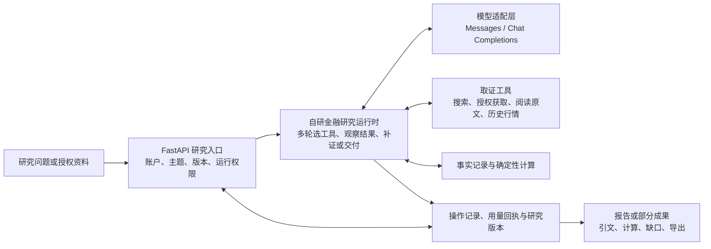

# ForesightNine 后端架构与能力说明

核对日期为 2026 年 11 月 18 日。本文以默认研究请求的实际执行路径为准，同时核对工作区代码、运行中的外部 API 和已保存的验收记录。

## 1. 主打能力

**ForesightNine 的后端主线是可复核的金融研究。** 用户可以从一个问题或一份资料开始。研究 Agent 负责判断需要哪些证据、选择下一步工具、处理反馈并整理结论。服务端负责落实资料权限、检查事实与原文的关联、执行财务计算，并将研究过程和成果保存为同一主题下的可追溯版本。

当前最适合发挥这套架构的任务是**已有可取得资料的事实核验、财务指标对比和证据分析**。例如比较一家公司两期收入，研究记录可以保留原文片段、金额和期间、用于计算的事实 ID、公式、结果以及缺失资料。用户能够沿着结论回查原文，也可以独立重算。只给一个开放式市场问题同样可以启动，交付质量取决于实际能获取的行情、披露和其他证据。 [研究入口](../../apps/api/app/main.py) · [研发计划](../../../plan.md)

## 2. 默认研究链路

1. **接收任务。** 默认研究入口是 `POST /v2/research/topics/{topic_id}/runs`。后端核对账户、主题当前版本、已有资料的归属和调用授权。同一个账户使用相同幂等键重提相同请求时，可以返回已接收的操作，避免再次发起同一运行。
2. **确定本次可用能力。** 添加资料、配置来源发现和预算都是可选项。省略预算时，应用层不自动设置研究总时长、总 Token、模型或搜索次数及费用上限。明确关闭、零预算和空来源选择会影响对应行动；空来源选择下，即使另行启用补充搜索，仍只允许发现线索。账户额度、单次请求技术超时和供应商上下文属于执行边界。
3. **运行工具循环。** 模型根据问题、资料清单及工具反馈决定后续动作。服务端串行处理研究工具，校验参数，记录执行和结果，再交给模型继续。最新代码的工具包含搜索、授权获取、资料阅读、历史价格、事实记录、计算和研究提交。
4. **保存和交付。** 运行可以保存完整报告，也可以保存已取得的证据、事实、计算及缺口。结果提交关联原研究版本，用户在运行期间修改主题时，后台提交会检查版本冲突。研究版本、已读原文、操作进度和调用结算都有对应读取入口。 [请求与默认规则](../../apps/api/app/research_runs.py) · [运行时与工具](../../apps/api/app/research_runtime.py) · [主题和版本](../../apps/api/app/research_topics.py)

## 3. 后端各层的职责

| 层 | 现在承担的工作 | 能力边界 |
| --- | --- | --- |
| **研究编排** | 按问题选择取证、计算与提交动作，根据工具返回补证。对重复且证据状态没有变化的动作进行无进展处理。 | 当前默认入口由一个研究协调 Agent 执行。反证查找由模型结合任务和工具推进，现有配置、工具和提示词尚未证明每次运行都会完成独立反证核验。 |
| **模型协议** | 将工具定义、工具调用、工具返回、对话续接和用量统一到内部协议。已实现 Anthropic Messages 与 Chat Completions 适配，服务端配置模型和端点。 | 外部当前运行使用 Messages。换模型服务需要确认其原生工具、续接及用量能力。OpenAI Responses 目前没有相应适配器。 |
| **证据与计算** | 将候选线索、已授权资料、已读原文、事实、计算和主张分别保存。计算使用确定性代码，输出公式、原始输入、精度和结果。 | 支持位置和数值匹配、币种及单位一致性和部分期间检查。报告正文及引文的语义支持尚缺完整独立验证。 |
| **运行控制** | 管理异步操作、幂等、取消、检查点、用量预留和结算。明确未发送的 DNS 或 TCP 故障可重试当前模型轮次，已确认的工具结果可保留。 | 外部请求状态不明时会阻止盲目重放。能否继续运行或交付已有结果，取决于检查点、资料、研究版本及模型配置是否仍满足恢复条件。真实环境跨进程恢复仍需验收。 |
| **存储与导出** | 主题和版本独立于浏览器聊天。服务端支持 PostgreSQL 持久存储，开发和隔离验证可用内存。按账户和资料权限读取原文并导出。 | 完整导出受每份资料的导出权限限制，另有只含元数据的导出。数据库有记录只能证明操作和产物已保存。 |

[内部模型协议](../../apps/api/app/model_protocol.py) · [Messages 适配器](../../apps/api/app/anthropic_messages.py) · [Chat 适配器](../../apps/api/app/chat_research_adapter.py) · [计算实现](../../apps/api/app/research_calculations.py) · [检查点与恢复](../../apps/api/app/research_recovery.py) · [持久化](../../apps/api/app/storage.py)

### 可复核性具体体现在哪里

- **资料先于事实。** 事实记录指向已经读过的来源片段。服务端检查引文位置和数字是否出现于该引文。期间、数量级、业务含义和主张是否合理，仍需要根据完整上下文复核。
- **计算先保留输入。** 增长率、比率和差额以已记录事实为输入。增长率检查基期和期间顺序，顺序校验依赖可识别的期间格式。利润率等比率要求同期间。计算正确也需要源数据的量纲和比较口径正确。
- **结论可以追到原文。** 最新代码对完整提交要求至少有一条来源支持的主张，并校验主张附带引文的来源和位置。正文仍由模型撰写，服务端尚未逐句证明每项实质性结论都有充分证据。显式部分交付可以保留已定位的结论、已记录数字与计算，以及无法完成的事项。 [事实记录与提交](../../apps/api/app/research_runtime.py) · [金融计算](../../apps/api/app/research_calculations.py)

## 4. 信源覆盖和开放式研究

| 资料路径 | 当前能力 | 对研究交付的实际影响 |
| --- | --- | --- |
| **用户提供资料** | 支持文本、可提取文字的 PDF 和 HTML，记录资料归属和允许的使用方式。 | 用户可提供不同市场的资料。复杂表格、扫描件和数量级仍需要相应的提取与复核。 |
| **联网搜索** | 部署已有独立搜索连接器。最新代码让手动搜索与 Agent 使用共用的候选转换，多轮搜索合并去重，并记录格式错误、空结果和政策排除。 | 搜索能够产生不同市场的待核验线索。候选链接能否成为证据，取决于授权、可抓取范围和实际取得的原文。 |
| **直接获取原文与结构化数据** | 当前主要是美国 SEC 的部分披露与指标、美国经济分析局和美联储的部分官方网页或 PDF。 | 当前覆盖适合有限范围内的公司披露和宏观取证。跨市场披露和来源独立性仍缺稳定验证。FRED 继续按项目规则排除。 |
| **历史行情** | 最新工作区实现按配置标的获取日收盘序列，保存日期、供应商、调整口径及响应哈希，可以进入阅读、引用和计算链路。 | 需要明确的标的映射及许可，且目前未在外部 API 部署或启用。当前接入未建立历史发布及修订可用性，有显式历史截止时间的运行不会启用这条获取路径。行情快照服务与研究证据有各自的许可和存储边界。 |

拿纳斯达克走势研究来说，后端需要先明确指数身份，再取得同一指数的日收盘序列和已知交易日口径，最后用新闻或宏观原文支撑解释和情景。搜索发现候选只是第一步。指数价格序列、相关事件原文和情景依据需要各自能够追溯。产品面向全球金融问题，具体任务的可交付范围由已接入来源和验证结果决定。 [搜索转换](../../apps/api/app/research_discovery.py) · [已接入来源](../../apps/api/app/research_source_catalog.py) · [来源权限](../../apps/api/app/research_source_policy.py) · [历史价格工具](../../apps/api/app/research_historical_prices.py)

## 5. 当前代码、部署和验收

| 核对范围 | 当前状态 | 能据此确认的能力 |
| --- | --- | --- |
| **外部 API** | Messages 和搜索连接器已启用。检查运行容器时，最新搜索格式修复及历史行情模块尚未加载。 | 当前外部服务能调用模型和搜索连接器，浏览器仍可能遇到先前的搜索交接故障。 |
| **最新工作区** | 基于本地提交 `26e15a4` 的后续改动包含搜索统一转换、部分交付、历史行情工具及相关检查。 | 新的研究主路径已实现，完成条件取决于环境配置、授权资料和真实验收。 |
| **真实模型与财报摘录** | 模型读取微软年报的最小事实摘录，记录两期收入，通过代码算出同比 **17.79%**。最后一次尝试在发送前的 DNS 阶段失败。 | 真实模型、证据读取和确定性计算已经实际联动。完整报告未交付。 |
| **真实搜索与纳斯达克问题** | 隔离实例一次搜索获得 **8 条候选，格式拒绝为 0**。历史行情工具未取得授权序列，随后模型请求超时，结果为部分完成。 | 已证明新版 Agent 能接收并保存真实搜索结果。这次运行没有取得可引用的行情或原文。 |
| **完整离线链路** | 测试从只输入问题开始，使用生产形态的搜索返回和固定行情数据交付有引用、可导出的报告并复算 **25.00%**。 | 证明接口、工具、引用、计算、版本保存和导出可以接通。无法据此估计真实研究的完成率。 |

最近一次集中检查记录为 **66 项 API 通过**，另有 1 项显式设置零模型调用时的确定性自动抓取失败，已在修改前复现。Web **25 项通过**，类型检查通过。两次真实尝试都留下部分交付证据，目前没有足够数据估计完整任务的典型延迟、准确率或成本。 [财报摘录实测](phase-a/360-messages-runtime-validation/evaluation.md) · [搜索与行情验收](phase-a/361-native-search-validation-2026-11-18.md)

## 6. 产品能力所处阶段

**首次研究是现阶段后端的主线。** 最小闭环在离线环境可用，真实验收已经覆盖了模型工具往返、取证计算和搜索转换等不同环节。阶段 B 的完整验收仍需要在真实授权资料上交付带引文且可复算的报告，随后用不同任务和故障恢复场景确认稳定性。

当前主题和版本已具备回看、复核及比较的基础。阶段 C 所规划的新事件自动关联旧判断、持续跟踪和提醒，尚未作为新研究主路径交付。原有 Challenge、情景世界线和在客户端执行的 FM 组合模拟仍属于已有的独立工作流。新后端的主要价值集中在一次次研究能积累为可复核的证据记录，后续基于这些记录开展增量复核。 [阶段规划](../../../AGENTS.md) · [运行时里程碑](../../../plan.md) · [旧有工作流](../../README.md)
