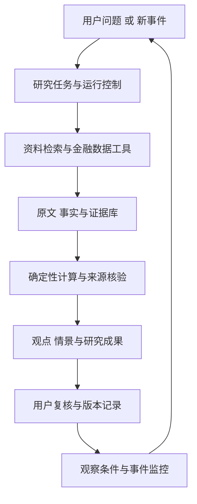

# ForesightNine 融合金融 AI 工具宏观方案

版本：v0.1 草案  
日期：2026 年 11 月 11 日  
用途：确定产品方向、重构范围、建设顺序和验收方式，为后续产品规格与技术方案提供依据。

> 2026-11-13 补充：第 13 节记录用户要求的系统性架构改进，细化本方案与阶段 B 规格；属于实施方向，不代表已完成。与早期草案存在冲突时，以用户最新指令及第 13 节为准。当前暂停测试和模型实验，具体状态见阶段 B 验收记录。

建议围绕 ForesightNine 建设一个面向全球市场的金融研究工作台：由 Agent 主动获取资料、调用计算工具和检查反证，将研究整理为可核验的观点与情景，并持续跟踪影响判断的新变化。

OpenClaw-stock 提供市场监控、信息采集和个人持仓场景的经验；ForesightNine 提供观点审查、证据记录、世界线和组合研究的基础。两个项目的既有实现均按新目标重新评估，产品核心、Agent 和数据体系重新设计，经过验证的模块按边界迁移。

本方案是规划草案。现有代码和线上状态需在实施盘点中重新验证；本方案不替代根目录 `plan.md` 的执行基线，也不表示其中的市场范围、模型和数据采购已经确定。

## 1 产品定位与目标用户

**产品定位：面向多类金融研究任务的通用金融分析 Agent 工作台，帮助用户研究全球市场、维护投资观点，并在重要变化发生时复核判断。** 具体支持范围由数据、工具和验证结果决定，开发样本不构成产品边界。

优先服务有明确研究需求的主动投资者、独立研究者和小型研究团队。他们需要减少搜集、核验和重复更新的工作，同时保留对关键假设与结论的判断权。

产品应帮助用户回答四类问题：

1. 发生了什么，哪些变化与我的研究有关？
2. 我的判断有什么依据，最有力的反证是什么？
3. 不同条件下，影响如何传导到公司、行业和资产？
4. 新信息出现后，原来的判断是否需要修改？

第一阶段以研究和模拟为范围，交付研究笔记、比较表、情景分析和更新提醒。真实下单、资金托管、全市场实时交易信号不进入首版。

### 产品价值假设

相较于用户自行使用通用 AI 与搜索，产品应减少来源核验和持续更新的时间，并让重要判断可以追溯到证据、计算和历史版本。长期价值来自用户积累的研究，以及系统发现新信息与既有判断之间关系的能力。

这一价值需要通过真实任务验证。聊天次数、报告长度、模型数量和抓取新闻数量都不适合作为主要成功标准。

## 2 核心产品体验

以“研究主题”为组织单位。用户可以从一个自然语言问题、一篇资料或一组关注资产开始，不必在开始研究时输入资金金额。

每个研究主题持续保存研究范围、相关公司、原始资料、支持与反对证据、计算、假设、情景、观察条件和版本。对话是使用这些内容的入口，核心信息以可编辑对象保存。

| 产品界面 | 核心用途 | 主要成果 |
| --- | --- | --- |
| 研究工作区 | 提问、读取资料、比较公司、调用计算、检查进度与缺口 | 带引用的研究笔记和比较表 |
| 证据与情景 | 核查出处，检查传导关系、关键假设及失效条件 | 证据卡、情景图、分歧与待验证事项 |
| 变化收件箱 | 查看新信息影响了哪项既有判断 | 有来源的新旧差异、复核建议、研究更新记录 |
| 资产与暴露 | 将观察名单或手动持仓关联到研究主题 | 风险依赖、集中暴露、敏感性和可选模拟 |

用户可以接受、修改或保留异议。采集和分析可以自动运行；改变用户已确认的核心判断时，系统呈现变更建议并保存接受过程。数据不可用或证据冲突时，成果中明确保留缺口。

### 代表性任务

用户提出：“研究未来两年 AI 数据中心扩张对电力设备公司的影响，并持续跟踪这个判断。”

系统明确地区和时间范围，选择少量相关公司，查阅披露与宏观资料，计算业务变化，检查产能、订单转化和估值等替代解释，再形成情景与观察条件。后续新财报出现时，系统指出发生变化的事实、受影响的假设和需要复核的结论。

一次任务的完整成果包括：研究结论、关键事实与出处、计算表、反方意见、情景、未知项，以及后续观察计划。用户无需生成组合权重，也能完成一次有价值的研究。

## 3 第一版范围与全球市场路线

首版建议优先验证美股公司研究与全球宏观，支持中英文输入、检索和输出；实际任务与市场覆盖在资料盘点和原型评估后收敛。建立覆盖多种研究任务的评估集，从中选择一项资料充分的任务，完成首次研究和后续更新的首条开发闭环。样本行业、公司、数量与事件不限定产品范围。

| 建设层次 | 首版 | 后续扩展条件 |
| --- | --- | --- |
| 公司研究 | 美股公司公开披露、指定公司比较 | 港股、A 股及其他市场逐个验证资料覆盖和处理质量 |
| 宏观研究 | 与主题相关的少量全球宏观指标和政策资料 | 增加指标时具备明确出处、发布和修订记录 |
| 语言 | 中英文研究，保留原文与对应引用 | 依照用户需求和核验能力扩展更多语言 |
| 资产 | 公司与证券识别、观察名单 | ETF、债券、商品、外汇和加密资产按任务扩展 |
| 行情 | 满足研究需要的日频或明确延迟数据 | 高频数据须有实际场景、预算和可靠供应来源 |
| 交付渠道 | Web 完整研究与更新流程 | 移动端和通知渠道在核心闭环稳定后接入 |

韩国市场保留为可选覆盖区域。公司、证券、交易所、币种和交易日历分别建模，避免某一地区的代码或货币规则成为系统默认假设。

全球覆盖不等于首日接入所有市场。每个市场的实际覆盖、时效和已知缺口都应对用户可见。

## 4 数据与信源体系

数据按研究用途组织，原始来源、事实提取、计算结果和模型解释分别保存。各数据源通过统一适配边界接入，并记录覆盖、更新频率、失败状态和使用权限。

| 数据层 | 用途 | 必须保留的信息 |
| --- | --- | --- |
| 一手披露 | 财报、公司公告、监管和政策文件 | 原文、发布机构、发布日期、数据期间、定位信息 |
| 结构化金融数据 | 财务指标、价格、公司行为、宏观序列 | 公司或资产标识、单位、币种、调整口径、可用时间 |
| 新闻与专业研究 | 发现事件、了解预期和替代解释 | 原始报道、转载关系、发布时间、访问与展示权限 |
| 社媒与另类信息 | 发现待调查线索 | 来源、上下文、核验状态，避免与已确认事实混用 |
| 用户资料 | 笔记、报告、持仓及私人判断 | 归属、可见范围、用户声明和外部可验证程度 |

建设优先级为：可靠的一手资料与结构化数据，其次是新闻检索，最后按需要引入社媒和另类信息。来源数量不代表信息独立性，同一报道的多次转载不能作为多份独立证据。

SEC 的 EDGAR 接口提供公司申报历史和 XBRL 财务数据，可作为美股披露的基础接入候选；不同期间、单位和披露语境仍需校验。[SEC 官方文档](https://www.sec.gov/search-filings/edgar-application-programming-interfaces)

所有重要数据区分事件发生时间、公开时间、系统获取时间和修订版本。宏观历史研究应使用当时可见版本；ALFRED 对原始发布及后续修订的建模可作为设计参考。[ALFRED 官方说明](https://fred.stlouisfed.org/docs/api/fred/alfred.html) FRED 的使用条款对其服务或内容用于软件及 AI 开发、训练有限制；具体推理用途的适用性尚未确认，不能因参考其版本模型而假设已获数据接入或模型处理许可。详见[阶段 A 来源核验](phase-a/03-source-inventory.md)。

来源发生故障时，显示缺失、过期或部分完成状态。开发模拟数据单独标记并隔离，不能进入真实研究证据。付费数据的保存、展示、导出与再分发范围在接入时逐项确认，成本纳入产品预算。

## 5 Agent 与系统架构

新 Agent 围绕任务目标执行“规划、取证、计算、检查、交付、更新”的循环。默认采用一个研究协调 Agent，配合可测试的工具和工作流；独立核验、专门分析或并行任务是否需要额外 Agent，由评估结果决定。

| 系统部分 | 责任 |
| --- | --- |
| 研究 Agent | 明确问题、提出检索方向、解释材料、识别缺口和替代解释 |
| 工具与计算层 | 检索、提取、数值计算、数据与单位校验；计算可独立复核 |
| 运行控制 | 任务状态、调用预算、超时重试、取消恢复、幂等和运行日志 |
| 研究存储 | 文档、证据、假设、情景及用户确认记录；长期状态独立于聊天上下文 |
| 事件监控 | 按来源更新和观察条件生成事件，去重并控制提醒频率 |
| 产品与账户 | 工作区、权限、资料归属、成果展示与成本使用情况 |

技术上可延续已熟悉的 TypeScript、Python 和 PostgreSQL，新增独立的任务执行与文档存储能力。Web、后端和计算工具通过版本化接口协作。具体 Agent 框架、模型和检索供应商在原型评估后选择，不作为产品身份。

外部文档和工具返回视为数据，不能改变系统权限或研究规则。用户资料按账户隔离；工具调用受范围与预算控制。运行记录保存输入、输出、来源和决策摘要，支持审计与恢复；重放记录不等于保证外部服务永远返回相同结果。

## 6 判断方法与世界线重构

撤下未经验证的综合买卖分数。保留用途明确的财务、市场与风险指标，分别呈现事实可靠性、观点依据、事件概率和资产敏感性。LLM 自报置信度不能替代实证校准。

| 原有机制 | 新方案 |
| --- | --- |
| 技术面、情绪等固定权重合成总分 | 展示各项观察与用途；组合规则只有在验证后才用于特定任务 |
| 用总分决定观点是否可以继续 | 展示关键缺口与未解决异议，允许带保留意见推进研究 |
| 由来源类型直接决定证据等级 | 同时检查一手性、相关性、时间、独立性和原文是否支持该主张 |
| 每次固定生成弱、主、强三条世界线 | 保留为可编辑模板，按问题调整分支；只有互斥且穷尽时才归一化概率 |
| 默认生成模型概率 | 先定义可观察事件、期限与估计方法，区分主观估计、历史基准和校准预测 |
| 研究流程必须以 FM 权重结束 | 不强制每次研究使用 FM；可选模块及普通研究/观点驱动组合研究双入口都是待评估方案，最终定位尚未批准 |

世界线的核心是把假设、传导、时间和失效条件显式连接。事实关联与推测的因果关系要分别标注；情景路径不等于观察到的价格历史。

预测概率需要长期保存预测时间、事件定义和最终结果，才有条件评估校准效果。区间或低置信度标签本身不能证明预测可靠。

FM 原有数值对齐和回归测试仍可保留。实现与参考公式一致，只证明计算复现；是否产生有效信号或有用的组合结果，需要独立验证。现有客户端 FM 边界在迁移时继续保留，任何后续计算位置调整另行评估。

## 7 两个项目的迁移原则

按业务能力迁移，避免把旧目录整体拼接为新系统。新核心建立独立版本边界，旧研究和已有服务保留可恢复的版本。

| 项目资产 | 处理方向 | 迁移条件 |
| --- | --- | --- |
| OpenClaw-stock 数据连接器 | 选择性适配 | 接口有效、来源可追溯、失败行为和使用权限明确 |
| 监控和通知经验 | 保留需求，重建事件流程 | 关联具体研究，去重、静默与故障状态可验证 |
| 持仓和现金管理 | 借鉴领域需求 | 统一币种、价格时点和记录语义，明确手动记录与模拟的区别 |
| 固定评分与旧交易策略 | 留作实验基线 | 不作为新产品默认判断依据 |
| 旧回测代码 | 审核后选择性使用 | 核验时间、成交、成本和数据泄漏，不沿用未经验证的绩效结论 |
| ForesightNine 证据与世界线 | 保留核心概念并演进模型 | 支持灵活任务、可编辑情景和持续更新 |
| contracts 与数值测试 | 优先复用 | 对新接口和业务语义仍然适用 |
| 账户、计费、部署及双端界面 | 单独盘点 | 基于当前代码和运行证据复核，不以历史文档代替验收 |

实施前先保存两个项目的代码基线、未提交修改和研究数据清单。迁移使用显式转换与兼容读取，保留原始来源和历史版本；不能把已有模型推断升级成已验证事实。

## 8 分阶段建设与阶段出口

以可验证成果决定是否进入下一阶段。工期和人力在数据供应、原型结果及复用范围明确后估算。

| 阶段 | 主要交付 | 进入下一阶段的条件 |
| --- | --- | --- |
| A 范围与基线 | 代表性研究任务、固定评估样本、代码资产清单、来源与成本矩阵 | 研究范围可执行，数据可获得，基线质量和成本有记录 |
| B 首次研究闭环 | Web 研究空间、工具调用、引用、计算、反方分析和成果导出 | 真实资料上的研究可以复核；失败、取消和恢复路径完整 |
| C 情景与持续更新 | 可编辑情景、观察条件、变化收件箱和版本差异 | 新事件能对应原假设，重复事件不重复提醒，旧结论可追溯 |
| D 资产影响研究 | 观察名单或手动持仓、暴露分析、敏感性和可选 FM | 事实、情景和模拟结果清晰区分，计算与数据条件通过验证 |
| E 扩展与运营 | 其他市场、移动端、通知渠道及商业化配置 | 首版任务质量、提醒价值和单位成本在试用中稳定，扩展收益明确 |

首个可试用版本以 B 与 C 的闭环为目标：用户能完成一次研究，并看到一次有依据的后续更新。D 和 E 不作为验证这一核心价值的前提。

## 9 质量评估与实验纪律

主要衡量“有多少研究与更新值得用户接受，以及完成它们花了多少核验时间”。同时记录事实准确率、引用支撑程度、计算正确性、关键缺口、提醒误报漏报、延迟和每次有效成果的成本。

首批建议建立约 30 个可人工核验的任务，覆盖事实与计算、比较与反方研究、增量更新三类，并包含数据缺失、过期、冲突和工具失败的情况。样本规模是启动建议，正式阈值在建立人工基线后预先确定，不根据结果事后移动标准。

与“通用 AI 加搜索”和“无 Agent 的固定工具流程”比较，使用同一资料范围、时间窗口和任务要求。结论核验既检查有没有引用，也检查引用是否真正支持陈述；研究接受率不能单独替代正确性检查。

LLM 实验固定任务集、数据快照、工具权限、提示词版本和调用预算；每次只改变一个主要因素。记录模型标识、提供商实际支持的生成参数、尝试次数、工具轨迹、耗时和成本，重复运行并保留独立测试集。无法锁定的模型服务版本和在线检索变化也应记录，不宣称绝对可复现。

研究能力与投资效果分开评估。历史研究限制外部资料时间仍不能完全消除模型训练知识中的未来信息；涉及预测与投资效果时，增加预先登记的前向观察和样本外验证。这类偏差已有专门研究讨论。[Look-Ahead-Bench](https://arxiv.org/abs/2601.13770)

## 10 成本与运营原则

成本按首次研究、增量更新和持续观察分别计量，包含模型、搜索、数据许可、文档处理和存储。复用同一原文与已核验提取结果，新事件优先更新受影响部分，避免每次完整重做研究。

每项任务有调用、时间和费用上限；耗尽预算时交付已完成内容并说明缺口。提醒按用户关注的研究触发，状态不变时保持安静；监控断开应显示服务状态，避免被误解为没有市场变化。

商业模式可探索订阅加明确任务额度，专业数据连接作为后续选项。价格根据有效成果的实际成本和用户价值验证后确定，不直接沿用旧项目的套餐与 Token 配额。

公开提供服务之前，应落实所接入数据的使用范围、用户资料处理、账户权限和适用的发布要求。这些条件随具体功能评估，不用未经验证的覆盖或收益宣传替代产品能力。

## 11 当前建议与待收敛决策

| 决策 | 当前建议 | 何时收敛 |
| --- | --- | --- |
| 产品名称 | 暂沿用 ForesightNine | 品牌与用户定位验证时 |
| 首批用户 | 主动投资者、独立研究者、小型研究团队 | 代表任务与试用招募时 |
| 首条开发样本 | 从覆盖多类任务的评估集中选择资料充分的一项，不作为产品范围限制 | 阶段 A；AI 电力链只是示例 |
| 首发市场 | 美股公司研究与全球宏观，中英文 | 数据覆盖与成本盘点后 |
| Agent 方案 | 一个协调 Agent 加可测试工具，按证据决定拆分 | 阶段 A 和 B 的对照评估 |
| 模型和数据供应商 | 接口可替换，按任务质量、可用性和成本选择 | 固定样本评估与接入核验后 |
| FM 和组合研究 | 可选方法，进入阶段 D | 数据条件和方法独立验证后 |
| 移动端与付费 | 核心闭环稳定后扩展 | 阶段 E |

阶段 A 的具体工作与验收见 [阶段 A 实施方案](/home/lxx/Foresightnine/src/docs/product/phase-a-implementation-plan-2026-11-11.md)。阶段 B 实施规格应细化用户任务与页面流程、首批来源清单、核心数据对象、工具输入输出和验收条件，并在盘点后估算人力与费用。以一个样本的首次研究和一次更新作为首条交付链路，并用其他任务检查泛化。

## 12 设计依据与项目材料

以下材料用于解释方案来源，具体产品选择仍以本项目的任务验证为依据。

- Anthropic 的金融服务模板把财报复核、财务模型维护和市场研究组织为工具驱动的工作流，可参考其任务边界，不视为本项目效果保证。[官方产品说明](https://www.anthropic.com/news/finance-agents)
- FinToolBench 将金融工具执行、时效和任务要求纳入评估，支持本方案将工具与流程质量纳入验收的方向。[研究论文](https://arxiv.org/abs/2603.08262)
- [ForesightNine 现有项目说明](/home/lxx/Foresightnine/src/README.md)、[原执行计划](/home/lxx/Foresightnine/plan.md)和[OpenClaw-stock 项目说明](/home/lxx/Openclaw-stock/README.md)是迁移盘点的入口；历史功能和测试记录不等同于新版本验收。

## 13 系统性架构改进（2026-11-13）

### 13.1 目标、现状与原则

继续建设面向全球市场的通用金融分析 Agent。用户可从问题、资料或关注资产开始研究；开发样本中的市场、行业和公司不构成产品边界。首次研究与模拟是首版范围，真实下单、资金托管和全市场实时交易信号不在首版。实际支持范围依赖可获得、获授权的数据和验证结果。

阶段 B 已有研究入口、资料导入、引用定位、计算、反方展示、版本及导出等基础，但真实样本仍出现引用不能完整支持主张、反方不相关、资料未完全阅读却断言全文缺失、表格口径和比较方向不一致等问题。已有实现和历史检查的具体边界以 [阶段 B 当前验收证据](phase-a/208-stage-b-current-audit.md) 为准。不能将本节设计视为已实现或已通过验收。

优先以通用数据对象、检索和工具流程解决问题，不按单个样本或措辞不断叠加特例；已有保护暂时保留为风险提示，不未经验证整体删除。一个协调 Agent 加有边界的工具是默认方向，是否增设专门 Agent 由质量、延迟和成本评估决定，不把角色数量当作质量指标。

### 13.2 目标架构与研究循环

研究按理解问题、建立子任务、取证、提取、确定性计算、形成主张、检查冲突及缺口、预算内有范围补充和交付的循环执行。简单任务可跳过不必要步骤；获取不足时保存部分成果和明确缺口。禁止把未检索到等同于不存在，也不能因引用可定位就视为已经支持主张。

### 13.3 核心对象与数据关系

- **研究主题与任务**：问题、范围、对象、截止时间、子任务、状态及缺口；不要求预先给观点或资金。
- **来源资料与证据**：归属、权限、原文或许可内内容、来源定位、版本、事件/公开/获取/修订时间、已读取范围和核查状态；区分原文、提取、计算与解释。
- **金融事实与计算**：对象、指标、期间、数值、单位、币种、口径、来源和状态；计算另记录输入事实、公式版本、精度、结果和失败原因。缺失、不兼容及零分母不能生成有效数值。
- **主张、反方与未知**：每项主张关联支持与反对证据、计算和未解决问题；反方记录其回应的判断及其证据。引用存在、引用支持、用户确认分别标识。
- **运行与版本**：模型和工具输入输出、来源快照、工具权限、预算、用量、错误、检查点、作者及历史版本；对话不作为唯一研究存储。

来源、金融事实、结论与计算之间建立可追溯关联，支持按公司、对象、期间、指标和来源定位；比较结果每一项都保留双方证据和口径，不将多家公司绑定为固定样本。

### 13.4 资料和工具层

工具定义版本化输入、输出、授权、时点、失败语义和成本，包括来源发现、文档读取、结构化金融数据、事实提取、金融计算与交付。适配器分离供应商与产品接口；数据源只在覆盖、质量、保存/展示/导出及模型处理许可明确后接入，保留 FRED 限制。

文档保留章节、段落、页码、表格表头、行列、单位与原文定位，识别失败或语义不明确时提示缺口，不将恢复候选自动视为已确认事实。检索结合研究子问题、实体、期间、指标、文档结构、关键词与语义相关性，兼顾反证及来源独立性；记录资料与片段覆盖，不把转载当独立证据。四种时间独立建模；历史数据过滤不能排除模型训练知识中的未来信息。

确定性代码负责受支持公式、单位和币种处理、期间与输入检查、精度及重算。模型解释不代替代码算术；算术正确也不证明事实输入和经济含义正确。工具结果保留调用参数、数据源及失败状态，能从成果跳转至原文、表格、数据或计算记录。

### 13.5 主张审查与研究交付

分别检查引用是否真实且位置明确、来源与时间是否可用、证据是否覆盖各项实质断言、对象/指标/期间/单位/方向是否匹配、是否存在冲突及反方是否回应原判断。模型辅助审查是有边界的判断，不是独立事实证明，不能自动清除不确定性。对复杂比较分别保留各方数据、来源、计算和缺口；多公司结果可按对象和问题呈表格，每格可查看来源。

研究入口支持问题或资料；界面展示计划、运行进度、来源、结论、计算、反方、未知和具体缺口；结果可编辑、确认、保留异议并按权限导出。阶段 C 才实现事件关联、版本差异、去重与变化收件箱；阶段 D 再关联观察名单、手动持仓和暴露。状态无变化时安静，监控故障不能显示成没有变化。

### 13.6 运行、安全、迁移与成本

服务端按账户约束资料、工具、调用次数、时间和费用；持久化状态、调用预留、幂等、取消、检查点与错误。预算耗尽保留已完成内容并说明缺口；外部调用状态不明时提示用量和费用未知，不盲目重放。外部内容是非可信数据，不能改变权限；资料和导出隔离，凭据不进入客户端或交付物。

保留现有研究主题、版本、来源、运行、引用定位、金融计算以及旧 Challenge、世界线和 FM 的已有实现和数值边界。以版本化接口、显式转换和兼容读取逐步迁移；保留原文、历史版本和未提交修改，不将旧模型解释提升为已验证事实。FM 的可选模块与双入口均为待评估产品选项，不预断最终定位。

成本分别记录首次研究、增量更新和持续观察，包含模型、搜索、数据授权、文档处理和存储；可复用原件与已核验提取结果，不把模型服务版本不确定、费用未知或缺失用量当作零。

### 13.7 建设顺序及质量纪律

阶段 B 的模块边界、现状及整合顺序见[阶段 B 研究 Agent 宏观框架](phase-a/334-stage-b-architecture-boundary.md)。

阶段 B 按证据与主张结构、研究计划和有界取证、工具与金融数据、引用/反方审查、Web/保存/导出的顺序整合，形成首次研究闭环。阶段 C 建设情景与后续更新；D 建设资产与暴露及可选模拟；E 再扩展市场、移动端、通知和商业化。首个可试用版本目标仍是 B 与 C。工期、人力、供应商和价格不在缺乏证据时预定。

#### 实施优先级与交付物

以下是目标和依赖，不是已完成清单；阶段 B 内可以围绕同一闭环分批整合，不按单条样本循环增加规则。具体代码状态和未完成项以阶段 B 当前验收记录为准。

| 优先级 | 建设内容 | 可检查的交付物及边界 |
| --- | --- | --- |
| P0：可信研究底座 | 统一任务、来源、证据、金融事实、计算、主张及版本的契约与关联；保留来源许可、时点、已读范围和不确定状态 | 可从每条结论回溯至证据或计算；旧研究可兼容读取，资料不足时明确缺口；字段完整不等于语义正确 |
| P0：执行与工具 | 面向子问题的规划、资料发现和读取、金融数据、确定性计算；受控补充取证 | 工具有版本、权限、成本和失败语义；运行有预算、检查点、取消和部分交付，失败不伪装为无变化 |
| P0：质量与交付 | 逐项检查引用定位与支持、比较口径、冲突和反方；统一研究工作区、保存与导出 | 展示已确认、待核查及未知状态；复杂比较保留各方来源与公式；模型复查不能自动证明真实性 |
| P1：持续研究 | 建立可编辑假设、情景、观察条件及事件与主张的关联 | 阶段 C 输出有依据的新旧差异、去重提醒和可追溯版本；监控失败单独呈现 |
| P2：资产与扩展 | 将研究关联观察名单、手动持仓与暴露，并评估可选模拟及 FM 定位 | 阶段 D 区分事实与模拟，保留计算边界；阶段 E 再扩展市场、移动端和运营 |

落地时以共同契约和小范围兼容适配替代一次性重写：先盘点实际实现与缺口，建立数据和工具接口，再把现有入口接入完整研究链路；对历史规则逐项判断其风险和覆盖范围，保留必要保护，以跨任务的机制取代新增长期特例。供应商接入、市场扩张和功能承诺均以权限、覆盖及实际验证结果为条件。

借鉴外部产品时关注可迁移的能力：研究计划及逐条引用、结构化数据与工具协作、可比较的公司指标和可追溯数据时点；不照搬产品界面或将多 Agent 编排当作必需前提。外部产品的宣传或开源示例不构成 ForesightNine 的质量和投资效果证据。

用户于 2026-11-13 要求先完成实现、暂时禁止测试和模型实验；在用户后续解除该限制前不执行测试或模型调用，不把尚未验证的变更称为通过。用户要求跳过人工验收，不向用户设置人工验收关卡；独立质量证据、评估基线和未通过项如实保留，不能因跳过而伪称通过。之后若开展正式质量对照，事先冻结任务、数据、工具权限、参数和预算，一次仅改变一个主要因素，并控制用量、记录未知费用；当前授权不意味着立即执行该对照。

### 13.8 外部参考

参考 [AlphaSense 研究计划与引文](https://help.alpha-sense.com/hc/en-us/articles/41666587181203-Interacting-with-Generative-Search)、[OpenBB 数据处理](https://docs.openbb.co/workspace/analysts/ai-features/copilot-data-handling)及[工具与组件关联](https://docs.openbb.co/workspace/developers/widget-configuration/matching-widget-to-mcp-tool)、[Koyfin 结构化比较](https://www.koyfin.com/help/release-notes/compare-matrix-beta/)、[TradingAgents 时点及运行控制](https://github.com/TauricResearch/TradingAgents/releases)和 [Financial Datasets 数据来源与时点](https://www.financialdatasets.ai/enterprise)。商业产品能力来自公开说明，不能据此推断内部实现、产品准确率或授权；开源框架也不证明投资效果。
