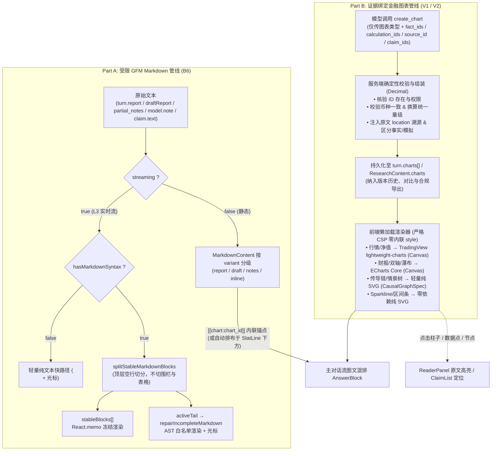

# 前端内容渲染与实时流式体验方案：续跑流式修复（P0）、受限 GFM Markdown（B6）与证据绑定金融图表

日期：2026 年 11 月 19–20 日。状态：**已完成全部 4 阶段（S1 / M1–M4 / V1 / V2）本地实现与独立验收（尚未提交 Git、尚未发布线上）**。

本文围绕 ForesightNine Web 研究工作台在**中断续跑/多轮流式过程展示**、**结构化文本渲染**与**金融图形可视化**三方面的核心问题与能力缺口，结合线上实证与源码审计，并参照 [Ragent_product](https://github.com/ragent-app/Ragent_product) 的成熟实践与前沿 AI/Agent 产品（Perplexity Finance / Perplexity Computer、Claude Inline Visuals、ChatGPT、Vercel `streamdown`）的工程共识，整理出统一的前后端协同实施方案：

- **Part C（阶段 S1，P0 缺陷修复，最高优先）**：修复中断/超时后点击「继续研究」「交付已有成果」及第 2 轮+ 缺失实时流式过程展示的问题（覆盖主对话流门控、续跑态 UI、侧边过程面板透传、自动跟随滚动与 SSE 终态竞态）；
- **Part A（阶段 M1–M4，关闭 B6）**：受限 GFM Markdown 静态与 L3 流式渲染体系（覆盖正式报告、虚线流式草稿、`partial_notes`、过程说明与结论条）；
- **Part B（阶段 V1–V2，金融可视化）**：Evidence-Bound ChartSpec 证据绑定金融图表体系（行情时间序列、多期财报对比与双轴组合图、逻辑传导与情景分支图、嵌入式微图形），坚持**零模型幻觉数字、零任意代码执行、点击直达原文溯源、严格 CSP 兼容**。

> 关联基线：[plan.md](../../../plan.md) · [Web 研究工作台重建方案](web-research-workbench-plan-2026-11-18.md) · [UI 设计规格](../design/research-workbench-ui-2026-11-18.md) · [实时流式过程方案](research-streaming-progress-plan-2026-11-19.md)

---

## 1. 现状诊断与前沿产品参照

### 1.1 当前 ForesightNine 现状（源码与线上实证）
- **中断续跑与后续轮次缺失实时流式过程（P0 线上缺陷）**：线上与源码实证表明，后端在续跑（`POST .../continue` / `/recover`）及第 2 轮+ 时 SSE 通道与模型流式推送均正常工作（`GET .../runs/{op}/events?after=0` 返回 `200 OK`），但前端 [TopicPage.tsx](../../apps/web/src/pages/TopicPage.tsx#L333-L336) 以 `liveIndex > turns.length` 控制 `<LiveTurn>` 挂载，导致续跑同一轮（`turn.index === turns.length`）时 `<LiveTurn>` 全程不渲染（即使刷新页面亦如此），叠加 [RecordPanel.tsx](../../apps/web/src/pages/topic/RecordPanel.tsx#L506-L510) 未透传 `stream`、旧卡片按钮退化与第 2 轮自动滚动失效，用户体感“只有第 1 轮能看到流式过程”（详析见第 5 节）。
- **Markdown 渲染缺失（B6 未实施）**：[src/apps/web/package.json](../../apps/web/package.json) 尚无 Markdown 解析依赖；[UI 设计规格](../design/research-workbench-ui-2026-11-18.md) 第 8 节明确标注 B6 未完成。当前 [Conversation.tsx](../../apps/web/src/pages/topic/Conversation.tsx)（`turn.report`、`partial_notes`、`claim.text`）、[LiveStreamView.tsx](../../apps/web/src/pages/topic/LiveStreamView.tsx)（`draftReport`、`state.text`）与 [ProcessTimeline.tsx](../../apps/web/src/pages/topic/ProcessTimeline.tsx)（`model.note`）均按纯文本拆分渲染，导致模型输出的 `##` 标题、`|---|---|` 财报对比表、`**加粗**` 与列表原样暴露原始符号；后端 [research_runtime.py](../../apps/api/app/research_runtime.py) 亦未声明 Markdown 输出子集。
- **金融图形展示缺失**：后端虽已具备结构化事实（`ResearchFact`）、确定性计算（`ResearchCalculation`）、SEC XBRL 序列（`sec_company_concept`）、历史行情序列（`historical_prices`）及客户端组合引擎（[fm-engine](../../packages/fm-engine)），但前端除关键指标卡片 `StatLine` 与已读覆盖率条 `CoverageBar` 外，尚无价格曲线、财报对比柱/双轴图、瀑布图或逻辑传导图展示能力。

### 1.2 参照 `Ragent_product` 与前沿 AI/Agent 产品的架构取舍

| 维度 | `Ragent_product` 成熟设计 | 前沿 AI / Agent 主流形态 | ForesightNine 适配决策 |
| --- | --- | --- | --- |
| **流式 Markdown 稳定性** | `realtime-render.js` `computeStreamingBlockSplit` 按顶层空行切分稳定前缀与尾部活跃块（绝不切开围栏代码块）；无语法文本走纯文本快路径 | Vercel `streamdown` / `remend` 在流式解析前自动补全尾部未闭合的 `**`/`*`/`` ` ``/```` ``` ```` 并挂起半截链接与表格行 | **两者融合**：移植 `splitStableMarkdownBlocks` + `React.memo` 冻结已闭合块，仅对末尾活跃块做 `repairIncompleteMarkdown` 预修复 |
| **Markdown 安全机制** | Web 端原生 JS `marked.min.js` + `innerHTML` + DOM 后置增强 | AST → React 虚拟 DOM 白名单映射（`rehype-harden` 思路），禁用 `rehype-raw` | **必须走 React AST（零 `innerHTML`）**：防范外部抓取源 Indirect Prompt Injection，满足 `style-src 'self'` CSP，并为正文内联引文与图表锚点预留 React 组件插槽 |
| **表格与阅读标尺** | `enhanceTables` 自动套 `.md-table-wrap` 横向滚动；`DESIGN.md` / `AgentoMarkdownTokens` 确立 16px/1.65 正文与克制标题层级 | Perplexity Finance / Gemini Deep Research 强调等宽数字（`tabular-nums`）、数值列右对齐与表格复制 | **直接沿用 Ragent 安静排版标尺 + 横滚表格**，增加财务数值自动右对齐与一键复制 TSV（可直贴 Excel） |
| **数学公式与美元 `$`** | `markdown-math.js` 零远程依赖轻量渲染，支持通用 `$...$` | 金融垂直产品规避单 `$` 冲突 | **首版严禁单 `$` 行内公式**（防止 `$130.5B ... $42.0B` 吞并正文）；后续如增公式仅开放 `$$...$$` / `\[...\]` |
| **金融图表生成范式** | — | ① **沙箱写代码画图**（Claude Artifacts / ChatGPT Code Interpreter）：自由度高但数字不可审计、需独立代码执行沙箱、视觉不统一；<br>② **工具驱动 + 金融专用组件 + 证据溯源**（Perplexity Finance / TradingView Lightweight Charts）+ **声明式 JSON ChartSpec**（Vega-Lite / ECharts） | **采用形态 ②（Evidence-Bound ChartSpec）**：模型只声明视图意图与已核验的 `fact_ids` / `calculation_ids` / `source_id`，由服务端确定性组装并核验单位/币种，前端用双 Canvas 懒加载引擎 + 轻量纯 SVG 渲染，**点击数据点直跳 `ReaderPanel` 原文高亮** |
| **样式、依赖与 CSP** | 纯 CSS 语义令牌，零远程高亮 CDN | `streamdown` 强绑定 Tailwind + Shiki/KaTeX/Mermaid；完整 `mermaid.js` >1.5 MB 且常注入 `<style>` | **零 Tailwind、零重型插件、零 `mermaid.js`**：Markdown 仅装 `react-markdown` + `remark-gfm`；图表懒加载 `lightweight-charts` + `echarts/core`（Canvas）+ 自研 ~10 KB 纯 SVG 传导图；全量样式走 [index.css](../../apps/web/src/styles/index.css) |

---

## 2. 总体内容渲染架构（文本与图表统一管线）



---

## 3. Part A：受限 GFM Markdown 渲染方案（关闭 B6）

### 3.1 后端 B6 契约与 Prompt 约束
1. **格式约定（零破坏兼容）**：
   - 约定 `ResearchTurn.report`、`ResearchTurn.partial_notes` 与 L3 `draft_report` 流使用 **受限 GFM Markdown（`restricted_gfm_markdown`）**。
   - 历史已保存的纯文本报告天然是合法 Markdown，无需数据迁移；OpenAPI 路径与字段结构保持不变。
2. **模型提示词补充（[research_runtime.py](../../apps/api/app/research_runtime.py)）**：
   - 在 `SubmitRequest.report` 的 `Field(description=...)` 与 `SYSTEM` 中补充简明格式约定：
     - 报告使用简洁的受限 GFM Markdown（`##`/`###` 分节、列表、`**加粗**`，多期或跨公司财务数据优先使用 GFM 表格呈现）；
     - 严禁输出原始 HTML 标签与 Markdown 图片 ``；
     - 货币金额直接书写（如 `$130.5B` 或 `USD 130.5B`），不要用单 `$` 包裹数学公式。
3. **服务端边界不变**：服务端继续仅保存原始 Markdown 纯文本并按既有权限规则导出 JSON，不执行 HTML 渲染。

### 3.2 安全与金融专项红线

| 防护项 | 强制实现规则 |
| --- | --- |
| **零原始 HTML / 零 `innerHTML`** | 绝不安装 `rehype-raw`；`react-markdown` 开启 `skipHtml={true}`，所有 `<script>`、`<iframe>`、`<svg>`、`onerror=` 全部剥离或转义；前端零 `dangerouslySetInnerHTML`。 |
| **禁用 Markdown 图片 ``** | 自定义 `img` 渲染器将 `` 降级为纯文本占位（如 `[图片：alt]`），**绝不输出 `` 标签**，防范外部网页提示词注入诱导数据外带，同时消除 `img-src 'self' data:` CSP 告警。 |
| **链接协议与来源安全** | `urlTransform` 与自定义 `a` 组件仅放行规范 `https://`（拒绝 `javascript:`、`data:`、`vbscript:`、`http:`、`file:`、含凭据 URL 及内网/回环主机）；放行链接强制 `target="_blank" rel="noopener noreferrer"` 并显示外部链接图标；`draft` 与 `notes` 级别中链接降级为不可点击纯文本（保留文字与域名）。 |
| **金融 `$` 金额零误伤** | 不启用单 `$` 行内 LaTeX 解析，确保 `$35.1B 至 $130.5B` 按原文显示。 |
| **严格 CSP (`style-src 'self'`)** | 禁止运行时插入 `<style>` 标签；全部排版、表格、代码块样式写入 [index.css](../../apps/web/src/styles/index.css)。 |
| **异常输入防御** | 继承 `report <= 100_000` 字符上限；解析异常时安全回退为纯文本分段，绝不白屏。 |

### 3.3 前端核心模块设计（`src/apps/web/**`）
仅新增两项轻量依赖（锁入 [pnpm-lock.yaml](../../pnpm-lock.yaml)）：`react-markdown`、`remark-gfm`。

1. **`src/apps/web/src/lib/markdownStream.ts`（纯函数，流式切分与未闭合补全）**：
   - `hasMarkdownSyntax(text: string): boolean`：无 Markdown 语法时走 `<p>` 零解析快路径。
   - `splitStableMarkdownBlocks(text: string): { stableBlocks: string[]; activeTail: string }`（移植自 Ragent `computeStreamingBlockSplit`）：追踪围栏代码块（```` ``` ```` / `~~~`）与 GFM 连续表格行，仅在顶层空行切分稳定前缀块。
   - `repairIncompleteMarkdown(tail: string): string`（借鉴 `streamdown` / `remend`，仅作用于 `streaming === true` 的 `activeTail`）：
     - 自动补全尾部未闭合围栏代码块、单反引号行内代码、成对 `**` / `~~` / `*`（忽略标识符下划线如 `sec_company_concept` 与列表前缀 `* `）；
     - 暂挂未写完的链接尾部 `[text](https://...` 或孤立 `[text`，消除括号闪烁；
     - 平滑过渡尚未收到 `|---|---|` 分隔行的半截表格表头。
2. **`src/apps/web/src/lib/markdownSafety.ts`（纯函数，安全与金融表格辅助）**：
   - `safeExternalHref(raw)`：严格校验 `https:` 公开合法链接并返回 `{ href, host }`；
   - `isNumericCellText(text)`：识别财务数值/比率单元格（`$130,497`、`+114.2%`、`-3.4 pp`、`12.5x`、`N/A`、`—`）供自动右对齐与 `tabular-nums`；
   - `extractTableTsv(tableEl)`：提取标准 TSV 供一键复制直贴 Excel / Google Sheets。
3. **`src/apps/web/src/ui/MarkdownContent.tsx`（统一渲染组件）**：
   - Props：`{ content: string; variant: "report" | "draft" | "notes" | "inline"; streaming?: boolean; showCursor?: boolean; chartsById?: ReadonlyMap<string, ResearchChart>; renderChart?: (chart: ResearchChart) => ReactNode; className?: string }`。
   - **分级白名单**：
     - `report`：标题降级映射（`h1`/`h2` → `<h2>`、`h3` → `<h3>`、`h4`–`h6` → `<h4>`），允许段落、列表、引用、GFM 表格、代码块、强调、分割线、安全 `https` 外链；禁 `img`。
     - `draft`：同 `report`，但 `a` 降级为不可点击 `<span className="md-link-plain">`，表格隐藏复制按钮减少流式抖动。
     - `notes`：允许段落、列表、加粗/斜体/删除线、行内代码、引用、小标题降级 `<h4>`；禁表格、围栏代码、图片与可点外链。
     - `inline`：`allowedElements={["p", "strong", "em", "del", "code"]}` + `unwrapDisallowed` 展平为行内元素，保证 `ClaimList` 与 `ProcessTimeline` 紧凑不错行。
   - **结构化子组件**：`MarkdownTable`（外包 `.md-table-wrap` 横滚 + `.md-num` 右对齐等宽数字 + 静态 `report` 一键复制 TSV）；`MarkdownCodeBlock`（语言名顶栏 + 一键复制 + 横滚 `<pre>`）。
   - **扩展口预留**：支持独立行块级锚点 `[[chart:chart_id]]` 回调 `renderChart`（Part B 接入后即可图文混排，未提供 `renderChart` 时平滑忽略），并预留正文内联 `[1]` → `CitationButton` 转换钩子。

### 3.4 页面区域差异化渲染矩阵

| 页面区域 | 涉及文件 | 渲染配置 |
| --- | --- | --- |
| 正式研究报告 `turn.report` | [Conversation.tsx](../../apps/web/src/pages/topic/Conversation.tsx) | `variant="report"`（支持内联图表锚点） |
| L3 虚线草稿 `draftReport` | [LiveStreamView.tsx](../../apps/web/src/pages/topic/LiveStreamView.tsx) | `variant="draft" streaming showCursor={streamingDraft}` |
| 部分完成说明 `partial_notes` | [Conversation.tsx](../../apps/web/src/pages/topic/Conversation.tsx) | `variant="notes"` |
| 过程说明 `model.note` / `state.text` | [ProcessTimeline.tsx](../../apps/web/src/pages/topic/ProcessTimeline.tsx)、[LiveStreamView.tsx](../../apps/web/src/pages/topic/LiveStreamView.tsx) | `variant="inline"` |
| 结论条目 `claim.text` | [Conversation.tsx](../../apps/web/src/pages/topic/Conversation.tsx) | `variant="inline"`（尾部紧跟 `CitationButton`） |
| 思考过程 `state.thinking` & 用户提问 `AskBubble` | [LiveStreamView.tsx](../../apps/web/src/pages/topic/LiveStreamView.tsx)、[Conversation.tsx](../../apps/web/src/pages/topic/Conversation.tsx) | **保持纯文本**（维持视觉与可信度分层） |

### 3.5 Markdown 视觉与 CSS 规范（纯 CSS 写入 `index.css`）
全部在 [index.css](../../apps/web/src/styles/index.css) 的 `.md-prose` 作用域下复用既有浅/深色令牌（`--on-surface`、`--on-variant`、`--on-tertiary`、`--fill-2`、`--fill-3`、`--separator`、`--group`、`--mono`）：
- **标题克制层级**（不压过 `.large-title h1` `28px`）：`h2` `19px/600`、`h3` `16.5px/600`、`h4` `15px/600`；首元素 `margin-top: 0`。
- **正文、列表与引用**：段落 `16px/1.65`、`margin: 0 0 12px`；列表 `padding-left: 22px`；`blockquote` 左 `2.5px solid var(--separator)` + `--on-variant` 无厚重底框。
- **金融 GFM 表格（`.md-table-wrap`）**：`0.5px solid var(--separator)` 细边圆角 `10px`，内部 `.md-table-scroll` 横向滚动；`th` `13px/600` 浅底 `var(--fill-3)` 不换行；`td` `14px/1.5`；数值列 `.md-num` 右对齐 + `font-variant-numeric: tabular-nums`。`< 600px` 手机端收紧内边距为 `6px 10px`、`13.5px`，确保整页 **0 横向溢出**。
- **代码与链接**：行内 `code` 使用 `--mono` + `--fill-2`；围栏块 `.md-code-wrap` 圆角 `10px` + 顶部语言/复制条 + 横滚 `<pre>`；外链细下划线，降级链接 `.md-link-plain` 附次要域名标签。

---

## 4. Part B：证据绑定金融图表与可视化体系（ChartSpec）

### 4.1 核心原则：为什么采用 Evidence-Bound ChartSpec？
金融 Agent 的图表必须经得起投资者核查，因此**禁止模型在输出里手写无出处的原始数值数组**，也**不通过执行模型编写的任意 JS/Python 代码生成图表**，而是坚持四条核心设计原则：

1. **数据引用强绑定（零幻觉画图）**：数值型图表只能引用当前研究已通过核验的 `fact_id`、`calculation_id`、或已授权入库的结构化序列 `source_id`（`sec_company_concept` / `historical_prices`），坐标数值完全由服务端确定性代码读取与组装。
2. **口径与单位自动校验对齐**：服务端用 `Decimal` 核查同坐标轴上所有序列的**币种一致性**与**期间可比性**；遇到量级差异（如 `millions` 与 `billions` 混用），由服务端确定性换算至统一量级并在图表副标题显式注明；若存在不可比币种或引用不存在 ID，校验失败并退回模型修正，绝不画错图。
3. **事实与推演/模拟视觉硬隔离**：沿用 [AGENTS.md](../../../AGENTS.md) 边界——已核实历史事实与行情使用实心柱/实线；若阶段 C/D 展示情景推演值或组合模拟路径，强制标注 `is_projected: true` / `is_simulated: true`，前端以虚线样式 + 明确警示角标区分。
4. **多轮对话状态迭代（对标 Perplexity Computer）**：图表作为版本化结构对象保存在 `ResearchContent.charts` 中，用户追问“把营业利润率叠加到右轴”或“加上 AMD 对比”时，模型可引用已有 `chart_id` 生成新版本图表，版本对比与导出完整可追溯。

### 4.2 后端受控工具与数据结构设计

#### A. 新增受控工具 `create_chart`（[research_runtime.py](../../apps/api/app/research_runtime.py)）
在现有 8 个原生工具基础上，按需新增受控工具 `create_chart`（受严格 Pydantic Schema 校验，不暴露任意样式/脚本字段）：

```json
{
  "chart_type": "combo_bar_line",
  "title": "英伟达近两财年总收入与营业利润率对比",
  "x_axis": { "label": "财年" },
  "y_axes": [
    { "id": "left", "label": "总收入", "unit_preference": "billions", "currency": "USD" },
    { "id": "right", "label": "营业利润率", "unit_preference": "percent" }
  ],
  "series": [
    {
      "name": "总收入",
      "mark": "bar",
      "y_axis_id": "left",
      "binding": { "kind": "facts", "fact_ids": ["fact-1", "fact-2"] }
    },
    {
      "name": "营业利润率",
      "mark": "line",
      "y_axis_id": "right",
      "binding": { "kind": "calculations", "calculation_ids": ["calc-1", "calc-2"] }
    }
  ],
  "replaces_chart_id": null,
  "rationale": "以双轴组合图直观对比收入体量扩张与利润率变化"
}
```

支持的 `binding.kind` 白名单：
- `facts`：引用已记录的 `fact_ids`（服务端取 `value`/`unit`/`currency`/`period` 及 `source_id` + `location`）；
- `calculations`：引用已完成的 `calculation_ids`（服务端取 `value`/`unit`/`currency` 及关联输入 `fact_ids`）；
- `historical_prices`：引用本轮或既有版本中 `retrieval_method == "historical_prices"` 的 `source_id`（可选 `normalize_base_100: true` 做多标的归一涨跌幅对比）；
- `sec_concept_series`：引用 `retrieval_method == "sec_companyconcept"` 的 `source_id` + 期间过滤（自动按报告期排序并标注 10-K / 10-Q 口径）。

#### B. 服务端确定性产出 `ResearchChart`（入库与前端消费契约）
服务端校验通过后生成不可变 `ResearchChart`（保存至 `ResearchContent.charts[]`，并在 `ResearchTurn.chart_ids[]` 关联）：
- `chart_id`、`turn_id`、`chart_type`（白名单：`bar` | `grouped_bar` | `stacked_bar` | `line` | `combo_bar_line` | `waterfall` | `scatter` | `price_series` | `causal_graph`）；
- `title`、`subtitle`（服务端自动补齐单位、币种、缩放说明及 `as_of` 截止时间）；
- `is_simulated` / `has_projected_points`（事实/模拟隔离标记）；
- `axes` 与组装好的 `series[].points[]`：每个点均携带 `x`、`y`（规范化后的精确字符串或数值）、`display_value`、`is_projected` 以及 **`provenance: { fact_id?, calculation_id?, source_id, character_start?, character_end? }`**；
- **导出权限联动**：`ResearchChart` 遵守所引用 `source_id` 的权限——当引用的底层资料 `permissions.display == False` 时拒绝创建或隐藏原文跳链；导出完整 JSON 时随版本一起校验导出权限。

#### C. 逻辑传导与情景推演契约 `CausalGraphSpec`（阶段 C）
针对 [AGENTS.md](../../../AGENTS.md)“不同条件下，影响如何传导到公司、行业和资产”，支持 `chart_type: "causal_graph"`：
- `nodes`: `[{ id, label, category: "macro" | "industry" | "company" | "asset" | "scenario", status?: "confirmed" | "assumption" | "invalidated" }]`（上限如 20 节点防视觉失控）；
- `edges`: `[{ from, to, relation, direction: "positive" | "negative" | "uncertain" | "conditional", claim_ids: string[] }]`（要求关联已有 `claim_ids` 或显式标为未核实假设）。

### 4.3 四类金融图形与渲染引擎选型（零 Tailwind、严格 CSP、按需懒加载）

不引入巨无霸单一框架，采用**“双 Canvas 懒加载引擎 + 轻量纯 SVG”**架构，**零首屏包体开销**且 100% 规避 `style-src 'self'` 内联样式冲突：

| 图形分类 | 典型金融场景 | 推荐渲染引擎 | 加载与安全特性 |
| --- | --- | --- | --- |
| **1. 行情与连续时间序列** | 股价日频走势、多标的归一涨跌幅对比、成交量、阶段 D 客户端 FM 组合净值曲线（NAV）与回撤 | **TradingView `lightweight-charts`**（Perplexity Finance 同款） | ~45 KB gzip，纯 HTML5 Canvas（零动态 `<style>`、零大 SVG DOM），原生十字准星、缩放与时间轴；`React.lazy` 独立 chunk 懒加载 |
| **2. 财报与多维对比图** | 多期营收/利润柱状图、**营收柱 + 利润率双 Y 轴组合图（Combo）**、利润桥瀑布图（Waterfall）、同行估值散点/气泡图、收入结构堆叠条 | **Apache ECharts（`echarts/core` 按需导入 + `CanvasRenderer`）** | 仅 tree-shake 引入 `BarChart`、`LineChart`、`ScatterChart`、`GridComponent`、`TooltipComponent`、`LegendComponent` 与 `CanvasRenderer`；Canvas 渲染零 CSP 冲突，内置高清 Retina 适配与 PNG 导出，`React.lazy` 懒加载 |
| **3. 传导链与情景分支图** | 宏观事件 → 行业 → 公司传导链、供应链上下游、阶段 C 弱/主/强世界线与失效条件 | **自研确定性 DAG/树布局纯 SVG 组件（`CausalGraphView`）** | ~10 KB 零额外依赖（**不引入 >1.5 MB 且易触发 CSP 的完整 `mermaid.js`**）；原生复用 CSS 令牌，点击节点/连线直接高亮并跳转到 `ClaimList` 对应支持/反方结论 |
| **4. 嵌入式微图形** | 表格内迷你走势（Sparkline）、概率区间条（替代单点概率）、估值分位条、已读覆盖率条（已有 `CoverageBar`） | **零依赖纯 React SVG** | 极轻、零依赖，与 `tabular-nums` 及安静排版无缝融合 |

### 4.4 对话流交互、图文混排与 L3 流式联动
延续 [UI 设计规格](../design/research-workbench-ui-2026-11-18.md)“对话是主工作面、安静克制、二级面板按需展开”的原则：

1. **主对话流内联图表容器（`.chart-card`）**：
   - 极简细描边（`0.5px solid var(--separator)`，`border-radius: 14px`，底色 `var(--group)`，无厚重阴影）；
   - **头部**：图表标题（`15px/600`）+ 副标题元信息（单位、币种、缩放换算、`as_of` 截止时间、事实或模拟角标）；
   - **右上角轻工具条**：`图表 / 数据表` 一键切换（核数与无障碍兜底）、`放大查看`（在宽屏检查器或大浮层中精细缩放交互）、`导出`（PNG 图像 / CSV 明细）；
   - **交互溯源**：悬停显示精确 `Decimal` 原值、期间、口径与来源标题；**点击任意柱子/数据点直接调用 `view.openPanel({ kind: "reader", sourceId, range })` 跳转 `ReaderPanel` 高亮原财报引文**（点击传导图节点/边跳转 `gotoClaim`）。
2. **与 Markdown 报告的混排规则**：
   - 若报告正文包含独立行锚点 `[[chart:chart_id]]`，`MarkdownContent` 将对应 `ResearchChart` 内联渲染在该段落下方；
   - 未在正文中通过锚点引用的本轮图表，自动按创建顺序排布在报告正文与 `StatLine` 之间，确保每张已创建图表都有稳定展示位；
   - 未注册或非法 ID 的 `[[chart:...]]` 文本静默忽略，防止模型编造不存在的图表占位符。
3. **与 L3 实时流式的联动（零闪烁策略）**：
   - 模型在流式阶段调用 `create_chart` 时，**不做半截坐标轴闪烁渲染**，仅在过程流（`tool_status`）或草稿区显示轻量骨架提示（`● 正在组装并校验图表：…`）；
   - `create_chart` 经服务端校验通过后，在 `ProcessTimeline` 的工具摘要中展示图表名称与点数（带 `运行中暂存` 标签），轮次核验完成后在正式 `AnswerBlock` 中平滑呈现成品图。

### 4.5 金融图表视觉、主题与无障碍规范
- **低饱和金融语义色板**（定义在 [index.css](../../apps/web/src/styles/index.css) 浅/深色 `:root` 变量中，Canvas 渲染器启动与切换主题时通过 `getComputedStyle(document.documentElement)` 读取）：
  - 主序列与对比序列采用低饱和中性/蓝色/绿/琥珀梯队（兼顾红绿色盲区分，避免刺眼荧光色）；
  - 模拟/情景预测序列统一用虚线或斜纹填充并带 `--warning` 提示条；
  - 全部坐标轴数值与 Tooltip 强制 `tabular-nums`，严格保留服务端给出的有效小数位，不做前端浮点舍入失真。
- **移动端与无障碍**：
  - `< 600px` 手机端图表固定合理高度（220–260px），图例折行放顶部避免挤占绘图区，同时允许一键切换“数据表”竖屏清晰读数；
  - 每个图表容器提供语义化 `role="figure"`、`aria-label` 与可切换的 HTML `<table>` 明细视图，满足键盘与屏幕阅读器完整访问。

---

## 5. Part C：中断续跑与多轮实时流式过程展示修复方案（P0）

### 5.1 故障根因总览（源码与线上实证）
线上请求轨迹与源码审计确认：**续跑与第 2 轮+ 时的后端 SSE 推送（`GET .../runs/{op}/events?after=0` → `200 OK`）与模型流式输出均正常运转**，但前端存在 1 个阻断性主因与 4 个连带问题，导致用户在模型超时、截断等中断后点击卡片继续，或开启后续轮次时看不到实时生成过程：

| 编号 | 级别 | 故障现象 | 精确源码位置 | 根因说明 |
| --- | --- | --- | --- | --- |
| **R1** | **P0（主因）** | 第 1 / `N` 轮因模型超时、截断或未提交落盘 `partial` 后，点击卡片「继续研究」或「交付已有成果」（含中途刷新），主对话区全程不显示 `<LiveTurn>`、思考流与虚线草稿，只剩底部单行 `<LiveBar>` | [TopicPage.tsx](../../apps/web/src/pages/TopicPage.tsx#L333-L336)<br>[main.py](../../apps/api/app/main.py#L2601-L2604)<br>[research_turns.py](../../apps/api/app/research_turns.py#L57-L68)<br>[research_runtime.py](../../apps/api/app/research_runtime.py#L1810-L1891) | 流式收到首帧后超时（`received=True`）或截断会清除 `pending` 并落盘 `Turn N (status="partial")`，此时 `turns.length === N`。续跑归属同一轮，后端复用旧 `turn_meta` 使 `turn.index === N`。而前端门控写为 `live.progress ? liveIndex > turns.length : pendingAsk !== null \|\| turns.length === 0`：首帧前因 `pendingAsk === null && turns.length >= 1` 为 `false`，首帧后因 `N > N` 仍为 `false`，全程拦截 `<LiveTurn>`。 |
| **R2** | **P0/P1** | 即便点击底部 `<LiveBar>` 打开右侧「研究记录 → 过程」面板，仍看不到实时思考流与输出状态 | [RecordPanel.tsx](../../apps/web/src/pages/topic/RecordPanel.tsx#L506-L510) | `StepsTab` 未向 `<ProcessTimeline>` 传递 `stream={liveSelected ? view.live!.stream : undefined}`，且在 `rows.length === 0 && !current` 时直接短路显示空态文案，忽略早期 `stream.delta`。 |
| **R3** | **P1** | 续跑启动后旧「未完成的部分」卡片主按钮从「继续研究」突变为置灰「重新提问」；若直接放开 `<LiveTurn>` 还会重复展示同一轮时间戳与问题气泡 | [TopicPage.tsx](../../apps/web/src/pages/TopicPage.tsx#L93-L96)<br>[TopicPage.tsx](../../apps/web/src/pages/TopicPage.tsx#L478-L506)<br>[Conversation.tsx](../../apps/web/src/pages/topic/Conversation.tsx#L87-L97) | `activeRun` 非空时 `recoveryOperation` 变为 `null`（`recovery.data` 为 `undefined`），但 `TurnView` 未在 `activeRun` 期间收起 `actions`，导致 `CalloutActions` 回落到置灰的「重新提问」。 |
| **R4** | **P1** | 续跑与第 2 轮追问（含「重新提问 / 补充缺口」）启动后视口不自动滚到底部实时区，长第 1 轮报告下易误以为没有输出 | [TopicPage.tsx](../../apps/web/src/pages/TopicPage.tsx#L274-L292)<br>[TopicPage.tsx](../../apps/web/src/pages/TopicPage.tsx#L325-L326)<br>[TopicPage.tsx](../../apps/web/src/pages/TopicPage.tsx#L339-L369) | `onContinue` / `onDeliver` / `startFirstTurn` 未重置 `nearBottomRef` 也不触发滚动；`sendWith` 触发 `showPendingTurn` 变为 `true` 时，滚动监听 effect 同步执行 `update()` 测距（此时新块已撑高、`scrollTo` 尚未执行，距离 > 80px），抢先将 `nearBottomRef` 置 `false`、`awayFromLive` 置 `true`，且平滑滚动未设置 `suppressScrollUntilRef`。 |
| **R5** | **P2（竞态）** | ① 第 2 轮+ 刷新或从 `InterruptedTurn` 续跑在 `progress.snapshot` 前空白闪烁；② 客户端时钟快于服务端时失败轮次残留 `pendingAsk`；③ `/recover` 极快终态偶发多等 15s 心跳 | [queries.ts](../../apps/web/src/api/queries.ts#L363-L408)<br>[TopicPage.tsx](../../apps/web/src/pages/TopicPage.tsx#L137-L139)<br>[main.py](../../apps/api/app/main.py#L3243-L3266) | ① `step.current`/`step.event` 无 snapshot 时合成 `turn: { index: 0 }`；② `orphanRun.created_at >= pendingAsk.at` 跨时钟比较；③ 后端 SSE 在 `subscribe()` 前读快照并复用 `cached_initial=True`，存在极短窗口错过 `publish_terminal`。 |

#### `showLiveTurn` 现状 vs 修复后真值对照

| 运行场景 | `turns.length` | `live.progress.turn.index` | `live.operation_id` 是否已在 `turns` 中 | 现状 `showLiveTurn` | 修复后 `showLiveTurn` |
| --- | --- | --- | --- | --- | --- |
| 第 1 轮全新研究 | `0` | `1` | 否 | `true`（正常） | `true`（新轮模式） |
| 第 1 / `N` 轮 `partial` 后点「继续研究 / 交付已有成果」（含刷新） | `N` | `N` | **否**（新 `operation_id`） | **`false`（全程隐藏）** | **`true`（续跑模式）** |
| 第 2 轮+ `orphanRun`（`failed`/`cancelled`）点「继续研究」首帧前 | `>= 1` | 未到（`null`） | 否 | **`false`（断档闪烁）** | **`true`（立即挂载）** |
| 第 2 轮+ 追问 / 刷新重连首帧前 | `>= 1` | 未到（`null`） | 否 | 刷新时 **`false`** | **`true`（立即挂载）** |
| 运行刚结束，`topic` 先刷新而 `runs` 缓存滞后数毫秒 | `N` | `N` | **是**（已落盘） | `false`（防双渲染） | **`false`（精准防双渲染）** |

### 5.2 分项解决方案（前后端协同）

#### 修复 1：以 `operation_id` 归属与终态判断替换 `liveIndex > turns.length`（[TopicPage.tsx](../../apps/web/src/pages/TopicPage.tsx)）
- 废弃依赖轮次号大小的启发式判断，改为按真实运行归属精准判定：
  ```tsx
  const liveCommitted =
    live !== null && turns.some((turn) => turn.operation_ids.includes(live.operation.operation_id));
  const liveTerminal =
    live?.progress != null && !isActiveStatus(live.progress.operation_status);
  const showLiveTurn = live !== null && !liveCommitted && !liveTerminal;
  ```
- 只要存在尚未落盘且未终态的活跃运行，**无论第 1 轮、第 2 轮+、续跑还是页面刷新，`<LiveTurn>` 均立即挂载并承接 SSE 实时流**；一旦 `topic` 缓存已写入该 `operation_id` 或 `progress` 报告终态，立刻退出挂载，杜绝双渲染。

#### 修复 2：区分“续跑当前轮”与“开启新轮”的 UI 交互（[TopicPage.tsx](../../apps/web/src/pages/TopicPage.tsx)、[Conversation.tsx](../../apps/web/src/pages/topic/Conversation.tsx)、[index.css](../../apps/web/src/styles/index.css)）
1. **识别续跑态**：
   - 新增轻量状态 `pendingContinue: { mode: "continue" | "deliver"; targetTurnId: string | null; operationId: string | null } | null`（在 `onContinue` / `onDeliver` `onSuccess` 时记录并在该运行离开活跃态或切主题时清除）；
   - 定义 `isContinuingLastTurn`：`showLiveTurn && lastTurn !== null && (live.progress ? live.progress.turn.index === lastTurn.index : pendingContinue?.targetTurnId === lastTurn.turn_id || (lastTurn.status === "partial" && pendingAsk === null))`；
   - 续跑文案模式 `continuingMode`：命中 `isContinuingLastTurn` 时取 `pendingContinue?.mode ?? "continue"`，否则为 `null`。
2. **收起旧卡片操作按钮**：
   - [TopicPage.tsx](../../apps/web/src/pages/TopicPage.tsx#L482) 将 `TurnView` 的 `actions` 传参收紧为 `index === turns.length - 1 && turn.status === "partial" && !orphanRun && !activeRun`（运行期间不展示旧卡片按钮，彻底消除「继续研究 → 置灰重新提问」跳变）。
3. **`<LiveTurn>` 增加续跑呈现（`continuing?: "continue" | "deliver" | null`）**：
   - `continuing` 非空时：不重复渲染 `<TurnStamp>` 与 `<AskBubble>`，使用紧凑续跑区块（`.turn-continuation`），头部显示「第 N 轮 · 正在继续研究」或「第 N 轮 · 正在交付已有成果」，主体完整渲染实时 `<ProcessTimeline>`、思考流 `<LiveThinkingBlock>` 与虚线草稿 `<LiveDraftPreview>`；
   - `continuing` 为空时（全新第 1 轮或第 2 轮+）：保持既有 `<TurnStamp>` + `<AskBubble>` + 「正在研究」不变。

#### 修复 3：右侧「研究记录 → 过程」面板接通实时流（[RecordPanel.tsx](../../apps/web/src/pages/topic/RecordPanel.tsx)）
- 在 `StepsTab`（[RecordPanel.tsx](../../apps/web/src/pages/topic/RecordPanel.tsx#L490-L514)）中：
  - 将 `stream={liveSelected ? view.live!.stream : undefined}` 传入 `<ProcessTimeline>`；
  - 当 `liveSelected && rows.length === 0 && !current` 时，改为渲染 `<LiveEmptyOrStream stream={view.live!.stream} idleText="正在等待研究过程输出…" />`，不再短路为静态空态文案。

#### 修复 4：统一自动跟随滚动与保护窗口（[TopicPage.tsx](../../apps/web/src/pages/TopicPage.tsx)）
- 抽取 `followLiveOutput()` 回调：
  - 置 `nearBottomRef.current = true`、`setAwayFromLive(false)`；
  - 立即写入 `suppressScrollUntilRef.current = Date.now() + 550`（先于 effect 的 `update()` 生效），再于 `requestAnimationFrame` 中平滑滚至 `scrollRef.current.scrollHeight`。
- 在 `sendWith`、`onContinue`、`onDeliver`、`startFirstTurn` 的 `onSuccess` 中统一调用 `followLiveOutput()`；
- 滚动监听 effect（[TopicPage.tsx](../../apps/web/src/pages/TopicPage.tsx#L339-L369)）初始化调用 `update()` 时遵守 `Date.now() < suppressScrollUntilRef.current` 保护逻辑，避免第 2 轮/续跑刚挂载新块时被误判为“用户已上滑离开实时区”。

#### 修复 5：收口 3 个边界竞态（[TopicPage.tsx](../../apps/web/src/pages/TopicPage.tsx)、[queries.ts](../../apps/web/src/api/queries.ts)、[main.py](../../apps/api/app/main.py)）
1. **`PendingAsk` 改按 `operationId` 收敛**：`PendingAsk` 增加 `operationId: string`（取自 `startTurn` 的 `onSuccess(data)` 返回值 `data.operation.operation_id`）；当 `activeRun?.operation_id === pendingAsk.operationId`、`orphanRun?.operation_id === pendingAsk.operationId` 或 `turns` 已包含该 `operationId` 时立即清理，彻底移除跨时钟字符串比较 `orphanRun.created_at >= pendingAsk.at`。
2. **`useRunProgress` 早期帧防御**：在修复 1 已解除 `turn.index` 门控耦合的基础上，保持 `queries.ts` 在 `progress.snapshot` 未到达前接收 `step.current` / `step.event` / `stream.delta` 的安全合并，且 `progress.snapshot` 到达后准确覆盖 `turn` 元信息。
3. **后端 SSE 订阅后刷新初始快照**（[main.py](../../apps/api/app/main.py#L3260-L3275)）：将 `snapshot = load_progress(effective_after, cached_initial=True)` 改为在 `research_live_broker.subscribe(...)` **之后**调用 `load_progress(effective_after, cached_initial=False)`，关闭极快终态（如 `/recover` 交付已有成果）在 `authorize` 与 `subscribe` 之间完成而错过 `publish_terminal`、需多等 15s 心跳的竞态窗口。

---

## 6. 统一分阶段实施路线与验收标准

按“**先止血线上 P0 续跑流式缺陷（S1），再关闭 Markdown B6（M1–M4），随后渐进落地金融图表（V1–V2）**”的顺序推进，每阶段独立验收：

### 阶段零：P0 续跑与多轮流式过程修复（Phase S1，最高优先）

| 范围 | 核心工作与涉及文件 | 验收标准 |
| --- | --- | --- |
| **前端门控、续跑 UI、侧边栏与滚动** | 更新 [TopicPage.tsx](../../apps/web/src/pages/TopicPage.tsx)、[Conversation.tsx](../../apps/web/src/pages/topic/Conversation.tsx)、[RecordPanel.tsx](../../apps/web/src/pages/topic/RecordPanel.tsx)、[index.css](../../apps/web/src/styles/index.css)；在 [TopicPage.test.tsx](../../apps/web/src/pages/TopicPage.test.tsx) 补充 6 组回归用例 | • `partial` 轮次点「继续研究」与「交付已有成果」立即隐藏旧卡片按钮并渲染续跑 `<LiveTurn>`（无重复问题气泡），全程可见实时步骤、思考流与虚线草稿，刷新重连依然可见<br>• 第 2 轮+ `orphanRun` 续跑与第 2 轮全新追问（含「重新提问 / 补充缺口」）无断档闪烁，视口自动跟随到底部<br>• 右侧「研究记录 → 过程」面板实时显示思考流与工具状态<br>• `topic` 先于 `runs` 刷新时 `liveCommitted` 精准防双渲染 |
| **后端 SSE 初始快照竞态修复** | 更新 [main.py](../../apps/api/app/main.py#L3260-L3275)（`subscribe` 后 `cached_initial=False`）；在 [test_research_live_stream.py](../../apps/api/tests/test_research_live_stream.py) 补充终态竞态与 `/continue` 续跑流式测试 | • 极快终态 `/recover` 首帧即返回终态与 `run.terminal`，无需等待 15s 心跳<br>• `/continue` 续跑 SSE 完整下发历史累计步骤 + 新 `step.event` + `stream.delta` |

### 阶段一：Markdown B6 落地（Phase M1 – M4）

| 阶段 | 核心工作与涉及文件 | 验收标准 |
| --- | --- | --- |
| **M1：核心引擎与单测** | 安装 `react-markdown`、`remark-gfm`；新增 `markdownStream.ts`、`markdownSafety.ts`、`MarkdownContent.tsx`（预留 `[[chart:...]]` 锚点口）及完整 Vitest 单测 | • 流式逐字补全（未闭合 `**`/`*`/`~~`/`` ` ``/```` ``` ````/半截链接/半截表格）全通过<br>• `$130.5B ... $42.0B` 零公式误解析<br>• XSS（`<script>`、`onerror`、`javascript:`、`data:`、``）零注入、零 ``<br>• `splitStableMarkdownBlocks` 验证已稳定块不因尾块增量重渲染 |
| **M2：全工作台接入与样式** | 更新 [Conversation.tsx](../../apps/web/src/pages/topic/Conversation.tsx)、[LiveStreamView.tsx](../../apps/web/src/pages/topic/LiveStreamView.tsx)、[ProcessTimeline.tsx](../../apps/web/src/pages/topic/ProcessTimeline.tsx)、[index.css](../../apps/web/src/styles/index.css)、[mock-api/fixtures.mjs](../../apps/web/qa/mock-api/fixtures.mjs) 与 [mock-api/server.mjs](../../apps/web/qa/mock-api/server.mjs) | • `typecheck`、全量 Vitest、`vite build`、`mock-api` 全部通过<br>• 流式草稿增长仍不触发历史 `TurnView` 重渲染<br>• 历史纯文本报告 100% 正常渲染 |
| **M3：后端 B6 契约与文档** | 更新 [research_runtime.py](../../apps/api/app/research_runtime.py) `SubmitRequest.report` 与 `SYSTEM`；更新 [UI 设计规格](../design/research-workbench-ui-2026-11-18.md) 第 8 节 B6 状态与 [progress.md](../progress.md) | • 后端相关 pytest + `export_openapi.py --check` + `generate-research-v2.mjs --check` 全部通过<br>• 密钥扫描 0 告警 |
| **M4：浏览器 QA 与上线** | Headless Chrome 158 部署态 CSP 验收（含 S1 续跑流式回归 + 流式草稿 Markdown → 核验切换正式报告 → 财报表格横滚/复制 → 代码块复制）；授权后本地提交并按备份流程滚动发布公网 | • `1440×900`、`390×844`（深色）、`320×640`（浅色）**0 横向溢出、0 CSP 违规、0 控制台报错**<br>• 公网 `https://app.foresightnine.com` 端到端续跑流式与 Markdown 渲染正常 |

### 阶段二：证据绑定金融图表 V1（Phase V1，复用阶段 B 现有数据）

| 范围 | 核心工作 | 验收标准 |
| --- | --- | --- |
| **后端 `create_chart` 与契约** | 新增 `research_charts.py`（确定性取数、币种校验、`Decimal` 量级统一、溯源元数据注入）；在 `research_runtime.py`、`research_topics.py`、`research_progress.py` 与 v2 OpenAPI 接入 `create_chart` 与 `ResearchChart`（首批 5 种：`bar`、`grouped_bar`、`line`、`combo_bar_line`、`price_series`） | • 不可比币种、不存在 `fact_id`、无展示权限来源均在服务端 fail-closed 退回<br>• `millions` 与 `billions` 混用确定性统一换算无浮点误差<br>• 版本保存、对比与权限导出完整覆盖 `charts` |
| **前端双 Canvas 懒加载视图** | 懒加载引入 `lightweight-charts` 与 `echarts/core`（Canvas）；实现 `ChartCard.tsx`（含图表/数据表切换、放大查看、PNG/CSV 导出、点击数据点跳 `ReaderPanel` 原文高亮）并接入 `MarkdownContent` 的 `[[chart:chart_id]]` 锚点 | • 首屏主 bundle 零明显增重（图表引擎独立动态 chunk）<br>• 浅/深色切换无闪烁、Canvas 渲染 0 CSP 违规<br>• Headless Chrome 验证点击柱子/点精准打开原文高亮，手机端 0 横向溢出 |

### 阶段三：逻辑传导图与阶段 C/D 视图扩展（Phase V2）

| 范围 | 核心工作 | 验收标准 |
| --- | --- | --- |
| **传导链与情景分支图（阶段 C）** | 新增 `CausalGraphSpec` 与轻量纯 SVG `CausalGraphView`（绑定 `claim_ids` 与影响方向/失效条件）及嵌入式概率区间条、Sparkline | • 点击节点/边精准定位 `ClaimList` 支持/反方结论<br>• 零 `mermaid.js` 依赖、0 CSP 违规、清晰区分已核实与假设节点 |
| **组合模拟与敏感性（阶段 D）** | 复用 `lightweight-charts` 与 `echarts/core` 承接客户端 [fm-engine](../../packages/fm-engine) 输出的权重分布、NAV 净值路径、回撤与压力测试 | • 保持 FM 纯客户端计算边界不变，严守 `FM Raw` 与约束结果分离及“模拟数据”显式标识 |

---

## 7. 实施前确认项（未特别指定则按推荐默认值执行）

1. **S1 与 M1–M4 发布节奏**：推荐**将 S1（P0 续跑流式修复）与 M1–M4（Markdown B6）按“S1 先完成并自验 → M1–M4 接续推进”同批次或分批发布**；如需最快止血线上体验，可单独先发 S1（改动极小、10 分钟内可完成测试与热发布）。
2. **代码块语法高亮（Part A）**：默认首版采用“等宽清爽排版 + 语言标签 + 一键复制”（最轻量、零包体膨胀）；可选同步移植 Ragent `markdown-enhancements.js` 的零依赖纯 CSS 词法高亮（Python / SQL / JSON 等）。
3. **GFM 表格一键复制（Part A）**：默认在已完成正式报告（`variant="report"`）的表格右上角提供轻量“复制表格（TSV，可直贴 Excel）”按钮；流式草稿与 `notes` 中不显示。
4. **图表实施节奏（Part B）**：推荐先交付并上线 **S1 + Part A（Markdown B6）** 立即改善线上核心体验，随后再启动 **Part B（图表 V1：`create_chart` + `lightweight-charts` + `echarts/core`）**；也可以在确认后按 S1 → M1–M4 → V1 连续分阶段推进。
5. **图表 V1 首批支持类型（Part B）**：默认首批支持 5 种最高频金融数值图（`bar`、`grouped_bar`、`line`、`combo_bar_line`、`price_series`）外加 `waterfall`（利润桥/归因，可选是否纳入 V1）。
