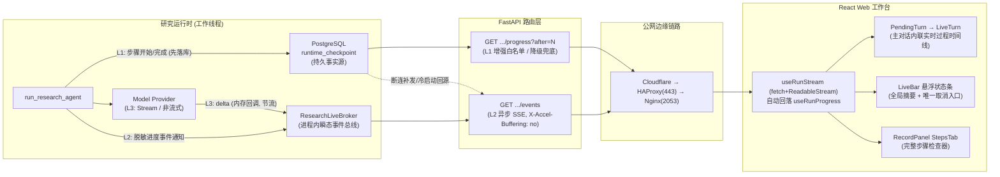

# 研究过程实时流式展示完整方案

日期：2026 年 11 月 19 日。状态：**L1–L3 已完成实现与分阶段验收（#7、#13、#21），Experiment P2（`glm-5.3-flash` `text/event-stream`）通过并进入滚动部署**。

本文围绕 ForesightNine Web 研究工作台（[UI 设计规格](../design/research-workbench-ui-2026-11-18.md)）在研究执行期间的实时可视化体验，结合后端原生工具运行时（[research_runtime.py](../../apps/api/app/research_runtime.py)）、进度脱敏接口（[research_progress.py](../../apps/api/app/research_progress.py)）、模型协议层及公网边缘链路，给出从**结构化实时过程内联展示（L1）**、**SSE 实时推送（L2）**到**模型原生逐字流式输出（L3）**的完整架构与实施方案。

> 关联基线：[plan.md](../../../plan.md) · [UI 设计规格](../design/research-workbench-ui-2026-11-18.md) · [开放来源获取与研究闭环规划](open-source-retrieval-and-loop-plan-2026-11-19.md)

---

## 1. 现状诊断：为什么当前执行过程“不像流式”？

逐层核查当前代码与公网运行链路，造成“等待感强、过程不可见”的原因分布在四个层面：

| 层面 | 当前实现（源码实证） | 用户体感问题 |
| --- | --- | --- |
| **1. UI 主区域布局** | 进行中轮次在 [Conversation.tsx](../../apps/web/src/pages/topic/Conversation.tsx) 的 `PendingTurn` 仅渲染时间戳与问题气泡，回答区域完全留白；进度状态压缩在底部的单行截断玻璃条 [LiveBar.tsx](../../apps/web/src/pages/topic/LiveBar.tsx)（`white-space: nowrap`）；完整步骤列表 `StepsTab` 藏在默认关闭的二级面板 [RecordPanel.tsx](../../apps/web/src/pages/topic/RecordPanel.tsx) 中。 | 发送问题后主画布大面积空白，用户必须主动点开二级面板才能看到步骤。 |
| **2. 进度事件粒度** | [research_progress.py](../../apps/api/app/research_progress.py) 的白名单视图只返回 `current`（仅有 `{kind: "model"}` 或 `{kind: "tool", name}`）和已完成工具的 `name`/`status`/`reason`/`rationale`。`LiveBar.tsx` 甚至用*上一条已完成工具*的 `rationale` 去匹配当前工具名，导致同类工具连续调用时短暂展示旧理由、异类工具无理由。同时，`checkpoint` 里已实时落盘的 `leads`、`facts`、`calculations`、`read_ranges` 以及模型返回的 `text`/`thinking` 块均未透出。 | 即使打开“过程”页签，也只看到“搜索线索 · 完成”“模型思考中”，看不到搜了什么词、发现了哪些链接、读了什么文件、刚记下了哪些数字。 |
| **3. 前后端推送通道** | [useRunProgress](../../apps/web/src/api/queries.ts) 每 `1.5s` 轮询 `GET /v2/research/topics/{topic_id}/runs/{operation_id}/progress?after=N`（[polling.ts](../../apps/web/src/lib/polling.ts)）。后端 v1 已有 SSE 端点（[main.py](../../apps/api/app/main.py) `/v1/operations/{operation_id}/events`），前端共享包也有 `fetch + ReadableStream` 解析器（[sse.ts](../../packages/api-client/src/sse.ts)），但 v2 研究运行尚未接入 SSE。 | 存在 0–1.5s 的阶梯延迟，且无法承载高频的逐字流式增量。 |
| **4. 模型调用协议** | [anthropic_messages.py](../../apps/api/app/anthropic_messages.py) 与 [openai_compatible.py](../../apps/api/app/openai_compatible.py)（`stream: False`）均采用**同步非流式 HTTP POST** 阻塞等待整包返回。[provider_capabilities.py](../../apps/api/app/provider_capabilities.py) 虽已预留 `CapabilityProfile.stream`，但尚未实现流式传输与增量解析。 | 单次模型推理或生成报告耗时 10–40 秒期间，服务端拿不到任何中间字节，界面只能长时间静止在“模型思考中”。 |

---

## 2. 不可逾越的产品、安全与架构边界

ForesightNine 是强调**可核查证据、引文定位与合规边界**的金融研究工作台，不能直接照搬普通聊天机器人的“盲目逐字输出”。流式设计必须满足以下六条红线：

1. **未核验结论不得冒充正式回答**：`submit_research` 提交的 `claims` 与 `quotation` 必须在服务端通过 `locate()` 原文位置核验、来源权限与 `as_of` 截止时间检查；失败时会退回模型重试或降级为 `partial`（并清空正式 `report`）。因此，流式思考文本、过程说明和未提交的暂存数字必须与正式 `AnswerBlock` 在视觉、文案和数据结构上**严格隔离**，绝不让未核验文本以正式结论样式落地。
2. **权限与隐私白名单隔离**：以下内容**严禁**进入实时过程流或 SSE 载荷：
   - `read_sources` 返回的原文正文片段（特别是 `permissions.display == False` 的资料）；
   - 模型加密推理块 `redacted_thinking`、思考签名 `signature`、完整 `system` 提示词及历史消息原文；
   - 凭据、API Key、内部调用堆栈与私有传输诊断（`private_validation_diagnostics`）。
3. **不可信内容安全渲染**：模型输出的过程说明、思考文本、搜索标题、URL 域名均为不可信文本，前端仅做纯文本或受限安全文本渲染，禁止 `dangerouslySetInnerHTML` 或动态插入 `<style>`（同时遵守线上 `CSP: style-src 'self'; connect-src 'self'`）。
4. **流式传输 ≠ 持久化账本（不破防重复外呼与计费结算）**：沿用 [plan.md](../../../plan.md) 原则，SSE 与逐字 delta 仅为**瞬态只读视图**，不得取代 `runtime_checkpoint` 与计费账本：
   - Token 级增量仅走内存通道，**不逐字写 PostgreSQL**，避免写放大与锁竞争；
   - 上游流式响应一旦开始写出请求字节或收到部分分片后中断，必须标记为 `started_unknown` / `provider_response_received = True`，**禁止自动重试**，防止重复外呼与重复扣费。
5. **协议优先与能力门控**：不按模型品牌硬编码流式逻辑；是否启用模型原生流式由显式 `CapabilityProfile.stream is True` 控制，未知或不支持的上游自动回落到非流式调用 + 结构化步骤流。
6. **视觉与交互克制**：遵循 [UI 设计规格](../design/research-workbench-ui-2026-11-18.md)——“对话是主工作面、可信度分层可见、完成时保持安静”。实时过程在运行中自动展开满足透明感，完成后自动平滑折叠为单行摘要，不抢占正式研究结论的主视觉。

---

## 3. 总体架构与三层演进路线

将“流式展示过程”拆分为 **L1 / L2 / L3** 三个独立可交付层次，每一层都可单独验收并向下一层平滑演进：



### 三层能力与性价比总览

| 层次 | 核心目标 | 改动范围 | 独立价值 | 复杂度与风险 |
| --- | --- | --- | --- | --- |
| **L1：主对话内联过程流 + 富结构化事件** | 消除回答区空白；让每一步“正在做什么”和“刚查到什么”实时生长出来 | `research_runtime.py`、`research_progress.py`、`Conversation.tsx`、`LiveBar.tsx`、`RecordPanel.tsx`、`index.css` | **最高性价比**：不改模型协议与基础设施即可解决 ~70% 黑盒等待感，且自动适配所有不支持流式的模型 | **低**：不触碰计费/传输协议，离线可全测 |
| **L2：v2 SSE 实时推送通道** | 1.5s 轮询升级为毫秒级推送，支持断点续接与自动降级 | 新增 `research_live_stream.py` + `GET .../events`；前端 `useRunStream`；核查 Nginx SSE 配置 | 消除 1.5s 阶梯感，减少空轮询，并为 L3 逐字增量提供唯一传输通道 | **中**：需处理异步队列、慢消费者背压与 Nginx/Cloudflare 缓冲 |
| **L3：模型原生 Streaming（逐字思考与过程流）** | 消除单次模型调用 10–40 秒的静止期，实时逐字展示思考与过程说明 | `openai_compatible.py` 流式传输与解析、`anthropic_messages.py` 流式状态机、`research_runtime.py` 回调接线、`LiveTurn` 逐字渲染 | **体感对齐一线 AI 研究产品** | **中高**：需严控中途断流不重放、usage 完整结算、上游网关兼容 |

---

## 4. L1 详细设计：主对话内联实时过程 + 富结构化事件

### 4.1 后端事件模型与进度白名单扩展

#### 4.1.1 扩展 `current`（解决“正在执行什么”不明确与 `LiveBar` 理由错配）
当前 `research_runtime.py` 在工具执行前写入 `state['pending']` 时只记录 `kind` 和 `call_id`。改造后在 `pending` 中附加脱敏的 `activity` 字段，并经 [research_progress.py](../../apps/api/app/research_progress.py) 白名单清洗后输出为 `progress.current`：

```json
{
  "kind": "tool",
  "name": "discover_sources",
  "rationale": "检索英伟达 FY2025 与 FY2026 10-K 收入与营业利润数据",
  "target": "NVIDIA FY2026 10-K revenue operating income",
  "started_at": "2026-11-19T12:40:12Z"
}
```

各动作类型允许暴露的 `target` 白名单（严格截断至 `<= 200` 字符，不含原文正文或密钥）：

| 动作 (`kind` / `name`) | `target` 内容来源（服务端脱敏生成） | 禁止包含 |
| --- | --- | --- |
| `model` | 可选子阶段 `phase`：`connecting` / `thinking` / `responding` / `retrying`（如 pre-send 重试第 N 次） | prompt、消息体、诊断栈 |
| `discover_sources` | 搜索词 `req.query` | 搜索服务密钥、内部请求头 |
| `acquire_sources` | 待获取的 URL 域名或标题列表（最多 3 个，如 `sec.gov、nvidianews.nvidia.com`） | query 中的未知 token（仅展示 `host` + 截断路径或线索标题） |
| `sec_company_concept` | `f"{req.entity_query} · {req.taxonomy}:{req.tag} ({req.unit})"` | — |
| `historical_prices` | `f"{req.instrument_id} ({req.start_date} ~ {req.end_date})"` | — |
| `read_sources` | 资料标题与读取字符区间（如 `《NVIDIA FY2026 10-K》0–18,000 字`） | **绝不包含原文文本** |
| `record_facts` | 拟记录数字条目数与标签列表（如 `总收入、营业利润（2 项）`） | 完整引文超长文本 |
| `calculate_financials` | 拟计算公式列表（如 `增长率、利润率（2 项）`） | — |
| `submit_research` | 固定描述 `正在核验引文位置与研究结论` | 未通过核验的报告正文与主张 |

> **顺带修复现有缺陷**：[LiveBar.tsx](../../apps/web/src/pages/topic/LiveBar.tsx) 第 14 行不再用上一条已完成事件 `lastTool.rationale` 拼接当前状态，改为直接读取 `current.rationale` 与 `current.target`。

#### 4.1.2 扩展 `events` 脱敏摘要（让每一步都有可读产出）
在 [research_runtime.py](../../apps/api/app/research_runtime.py) 写入 `state['events']` 时为每类事件补充脱敏 `summary`，由 `research_progress.py:sanitize_event` 按严格字段白名单透出：

1. **模型阶段说明（`kind: "model"` 扩展 `note` 字段）**：
   - 当模型本轮返回了非空 `text` 块（例如 `anthropic_messages` 中的 `type == "text"` 或 `openai_compatible` 中的 `message.content`）且伴随工具调用时，提取清洗后的纯文本前 **600 字符**作为 `note`（不提取 `redacted_thinking`、`signature` 或工具 JSON）。
   - 前端将此显示为模型的阶段性研究思路（例如：“已定位英伟达 10-K，接下来提取 FY2025 与 FY2026 营业利润并计算利润率变化”），明确归属为“过程说明，非正式结论”。
2. **工具执行摘要（`kind: "tool"` 扩展 `summary` 对象，按工具名白名单过滤）**：
   - `discover_sources`：`{ found_count, eligible_count, denied_count, leads_preview: [{ title, host, published_at }] }`（最多展示前 5 条，URL 只留安全 `host` 或经规范校验的公开链接）。
   - `acquire_sources`：`{ acquired_count, failed_count, items: [{ title, host, status, reason, total_characters }] }`（最多 5 条）。
   - `sec_company_concept`：`{ entity, tag, unit, status, title, total_characters }`。
   - `read_sources`：`{ read_count, items: [{ source_id, title, start, end, total_characters }] }`（绝不带 `text`）。
   - `record_facts`：`{ recorded_count, facts_preview: [{ label, value, unit, currency, period }] }`（最多 5 条，均为已通过 `locate()` + `_quoted_numbers()` 校验的数字）。
   - `calculate_financials`：`{ calculated_count, calcs_preview: [{ formula_id, value, unit, currency, expression }] }`（最多 5 条）。
3. **运行中汇总快照（`progress.interim`）**：
   - 随 `/progress` 返回轻量计数 `{ leads_count, acquired_sources_count, read_sources_count, facts_count, calculations_count }`，供 UI 顶部一行动态刷新（如 `已发现 8 条线索 · 获取 2 份资料 · 记录 4 个数字`）。

#### 4.1.3 兼容性与存储约束
- `research_progress.py` 对历史旧事件（不含 `summary`/`note`/`target`）全部默认返回 `None` 或省略，向后兼容已有主题记录。
- 新增 `summary` 严格控长（每条事件序列化后 `< 2 KB`），避免撑大 `runtime_checkpoint` 和 `ResearchTurn.events`。
- 同步更新 `src/apps/web/src/api/types.ts`、`src/apps/web/src/lib/research.ts` 与 `src/apps/web/src/lib/copy.ts`（如需将 progress 纳入 v2 OpenAPI，同步刷新 `openapi/v2/openapi.json` 及 `@foresightnine/contracts`）。

---

### 4.2 UI / UX 详细设计（贴合 Ragent + Apple Glass 规范）

#### 4.2.1 主对话区 `PendingTurn` 升级为内联 `LiveTurn`
不再在问题气泡下方留白，而是直接在回答位渲染一个**低饱和、可折叠的内联实时过程流**（无厚重卡片，复用现有字体、图标和语义色）：

```text
                        第 1 轮 · 今天 12:40
                                   ┌──────────────────────────────┐
                                   │ 比较英伟达最近两个财年的总收入 │
                                   │ 和营业利润率                  │
                                   └──────────────────────────────┘

● 正在研究 · 已用 0:24 · 3 次调用 · 1 次搜索 · 记下 2 个数字            收起 ⌃
│
│  ✦ 思路（过程说明）
│    需要先核实英伟达最新两个完整财年的 10-K 披露，优先通过 SEC
│    结构化数据读取 Revenues 与 OperatingIncomeLoss。
│
│  ✓ 搜索线索 · 完成
│    NVIDIA FY2025 FY2026 Form 10-K revenue operating income
│    发现 6 条线索（sec.gov、investor.nvidia.com 等）         [展开线索 ⌄]
│
│  ✓ 查询 SEC 结构化数据 · 已获取
│    NVDA · us-gaap:Revenues (USD) → 已获取 XBRL 记录（12,480 字符）
│
│  ✓ 记录数字 · 完成（待最终提交）
│    FY2025 总收入 130,497 百万 USD · FY2026 总收入 ...
│
│  ● 模型思考中 · 第 4 次调用
│    [L3 启用时在此逐字流式显示 thinking / 过程说明，淡色次要文字 + 柔和光标]
```

#### 4.2.2 生命周期与状态切换
1. **运行中（`pending` / `running`）**：
   - 内联过程流默认**展开**。
   - 新步骤追加时，若用户当前位于对话底部（距离底端 ≤ 80px），自动平滑跟随滚动（尊重 `prefers-reduced-motion`）；若用户手动向上滚动阅读历史轮次，则**暂停自动滚底**，并在底部显示轻量“回到实时过程 ↓”链接，绝不抢占滚动条。
   - 已通过工具校验的数字/计算在时间线内以浅底芯片展示，并带“运行中暂存，待最终提交”提示，不与最终 `StatLine` 混淆。
2. **完成后（`completed` / `partial`）**：
   - 当运行结束、`topicQuery` 刷新返回新版本后，`LiveTurn` 无缝切换为正式 `TurnView`。
   - 回答顶部（状态行下方、正文上方）提供一个**默认收起的单行过程折叠栏**：
     `已完成 8 步研究过程 · 2 次搜索 · 3 份资料 · 4 次调用 ⌄`
   - 用户点击可就地展开回看本轮完整过程时间线（复用同一 `ProcessTimeline` 组件），也可点击回答底部的摘要链接或顶栏图标在右侧 `RecordPanel` 检查器中对照查看。
   - **视觉收敛**：完成后恢复“安静阅读”体验，正文、关键数字、结论与引文编号仍是绝对主角。
3. **运行中断 / 取消（`failed` / `cancelled`）**：
   - 在 `InterruptedTurn` 中保留已发生的步骤时间线（默认展开最后 3 步或可一键展开全部），方便用户一眼看清“卡在哪一步失败/超时”，紧接其下再给“继续研究 / 交付已有成果 / 重新提问”操作块。

#### 4.2.3 `LiveBar` 的定位与分工
- 保持 [UI 设计规格](../design/research-workbench-ui-2026-11-18.md) 第 7 节约束：**“取消”按钮全页唯一入口仍在 `LiveBar`**。
- 当 `LiveTurn` 在视口内可见时，`LiveBar` 保持精简（当前单行状态 + 计时 + 取消按钮）；当用户向上滚动导致 `LiveTurn` 离开视口时，点击 `LiveBar` 主区域优先平滑滚回 `LiveTurn`（并在右侧提供小按钮直接打开检查器“过程”页签）。

#### 4.2.4 响应式与无障碍规则
- **移动端（`< 600px`）与小屏（`320px`）**：
  - 实时过程时间线默认最多展示最新 **4 步**，更早步骤自动折叠为“查看前 N 步”；L3 流式思考块设置 `max-height: 180px; overflow-y: auto` 内部滚动，避免撑爆手机屏幕。
  - 横屏矮屏（`max-height: 500px`）自动收紧行间距，保证问题与最新一步同屏可见。
- **CSP 与样式**：全部样式写入 [index.css](../../apps/web/src/styles/index.css)（无运行时内联 `<style>`）；复用 `--on-variant`、`--on-tertiary`、`--running`、`--fill-3`、`--separator` 令牌，浅色/深色模式自动适配。
- **无障碍（a11y）**：屏幕阅读器维持原规则——`aria-live="polite"` 仅播报大状态切换（开始、结束、中断、取消），不对每一步或每个 token 刷屏播报；折叠区使用语义化 `<button aria-expanded>` 或现有 `Disclosure` 组件。

---

## 5. L2 详细设计：v2 SSE 实时推送通道与边缘层适配

### 5.1 为什么不能直接复用旧 `/v1/operations/{id}/events`？
核查 [operations.py](../../apps/api/app/operations.py) 第 543 行可见，v1 `sse_events` 是同步生成器，靠 `while True: ... sleep(0.1)` 轮询存储，存在三个问题：
1. 在 FastAPI/Uvicorn 下同步生成器会长期占用线程池工作线程（并发连接稍多即耗尽 anyio 线程池）；
2. v1 `SseEvent` 契约被锁定在 v1 OpenAPI 快照中，只含通用 `operation.progress` 字段，不承载研究步骤和流式思考增量；
3. v1 事件必须先写数据库再读，无法承载 L3 的高频内存 token delta。

因此应在 v2 命名空间新增专用异步 SSE 接口，同时保留 `GET .../progress` 作为完整降级兜底。

### 5.2 新增接口与事件协议

- **端点**：`GET /v2/research/topics/{topic_id}/runs/{operation_id}/events`
- **请求参数与头**：
  - 鉴权：`Authorization: Bearer <token>`（复用 `_authenticated_account` + `operations.require_owner` + `topic` 归属校验）；
  - 断点续接：支持 `Last-Event-ID` 请求头或查询参数 `?after=<event_index>`（`after` 对应持久化 `events` 下标）。
- **响应头**：
  ```http
  Content-Type: text/event-stream; charset=utf-8
  Cache-Control: no-cache, no-transform
  Connection: keep-alive
  X-Accel-Buffering: no
  ```
- **SSE 事件类型表**：

| `event` 字段 | 是否有 `id`（可重放） | 载荷摘要 | 说明 |
| --- | --- | --- | --- |
| `progress.snapshot` | 是（`cp:<event_count>`） | 同 `build_progress(...)` 完整结构 | 建连首帧立即下发，确保刷新页面或重连后秒级对齐当前状态 |
| `step.current` | 否（瞬态） | `{ current, usage, interim }` | 某一步开始执行（工具启动或模型开始调用/重试） |
| `step.event` | 是（`ev:<index>`） | 单条经 `sanitize_event` 清洗的 `ProgressEvent` + 最新 `usage` + `interim` | 某一步落库完成后推送，前端按 `index` 幂等合并 |
| `stream.delta` | 否（瞬态，L3 使用） | `{ call_seq, channel: "thinking" \| "text" \| "tool_status", delta, seq }` | L3 模型逐字增量（经 50–100ms 合帧节流），仅内存推送不落库 |
| `stream.reset` | 否（瞬态，L3 使用） | `{ call_seq, reason }` | 某次模型调用重试、结束或切入工具执行时清空/封口对应临时流缓冲区 |
| `run.terminal` | 是（`done:<status>`） | `{ operation_status, version_id }` | 终态通知，前端收到后关闭流并 `invalidateQueries` 拉取正式版本 |
| *(注释心跳)* | — | `: heartbeat\n\n` | 每 15 秒无事件时发送，防止 Cloudflare / NAT 空闲断连 |

### 5.3 进程内轻量事件总线（`ResearchLiveBroker`）
新增独立模块 `src/apps/api/app/research_live_stream.py`：
- **发布侧（同步研究线程）**：
  - 在 `main.py` 的 `save_runtime(state)` 落库**之后**立即调用 `broker.publish_checkpoint(operation_id, sanitized_progress)`；
  - 在 L3 模型流式回调中调用 `broker.publish_delta(operation_id, ...)`（内部带节流缓冲，避免过密推送）。
- **订阅侧（异步 FastAPI 协程）**：
  - `async def subscribe(operation_id, ...)` 使用 `asyncio.Queue(maxsize=128)`，通过 `loop.call_soon_threadsafe` 接收来自工作线程的推送，**零阻塞线程池**。
  - **背压保护（慢消费者策略）**：队列满时优先丢弃旧的瞬态 `stream.delta`，绝不阻塞后台研究线程；当有新 `step.event` 或终态到达时保证送达，或在恢复空间后发一次 `progress.snapshot` 重新同步。
- **生命周期与资源上限**：
  - 运行结束并延迟宽限期（如 30 秒）后自动清理内存订阅桶，防止内存泄漏；
  - 单账户限制最多同时打开 `N`（如 6）个 SSE 订阅，超限时返回 `429`（前端自动无感降级为 1.5s 轮询）。
- **多进程/进程重启安全**：如果客户端连到一个未持有该运行内存通道的 worker，SSE 首帧仍能从 PostgreSQL `checkpoint` 构建 `progress.snapshot`，并可按低频（如 1.5s）监听 DB 变化或返回降级提示由前端无缝切回轮询。

### 5.4 前端流式消费与无感降级（`useRunStream`）
- **为什么不用原生 `EventSource`**：浏览器原生 `EventSource` 不支持自定义 `Authorization: Bearer` 请求头，且不应把令牌拼入 URL 查询参数（会泄露到访问日志与浏览器历史）。
- **实现方案**：在 `src/apps/web/src/api/stream.ts` 实现基于 `fetch` + `ReadableStream` 的通用 v2 SSE 解析器（复用 [packages/api-client/src/sse.ts](../../packages/api-client/src/sse.ts) 的双换行帧切分、UTF-8 流式解码与 `AbortSignal` 取消逻辑，完全满足同源 `CSP: connect-src 'self'`）。
- **状态机与降级策略**：
  1. `useRunProgress` 优先尝试打开 `/events` SSE 流；
  2. 收到 `step.event` 按 `index` 幂等合并，与轮询数据结构 100% 一致；
  3. 收到 `stream.delta` 写入独立的瞬态文本状态（不触发整个 `TopicPage` 昂贵计算，仅订阅在 `LiveTurn` 子组件内）；
  4. 遇到网络断开、代理缓冲超时或非 401/403/404 错误时：先按指数退避（1s → 2s → 4s）携带 `after` 重连最多 3 次；仍不可用时自动平滑回落到现有的 `1.5s` `/progress` 轮询，保证**任何网络环境下进度都不会中断**；
  5. 收到 `run.terminal` 后立即执行既有 `invalidateQueries(topic / runs / topics / recovery)`。

### 5.5 公网边缘代理核查项（Cloudflare → HAProxy → Nginx → Uvicorn）
当前公网拓扑已确认为：`Cloudflare → HAProxy(0.0.0.0:443, timeout 1h) → Nginx(127.0.0.1:2053) → FastAPI(127.0.0.1:8000)`。部署 L2 前需在 Nginx 侧逐项确认：
- 对 `/v2/research/` 下的 `/events` 路径（或所有 SSE 响应）设置：
  - `proxy_http_version 1.1;`
  - `proxy_set_header Connection "";`
  - `proxy_buffering off;`（同时 FastAPI 响应已带 `X-Accel-Buffering: no`）
  - `gzip off;`（**关键**：Nginx 若对 `text/event-stream` 开启 gzip，会把小块数据攒满缓冲块才刷出，彻底破坏逐字流式效果）
  - `proxy_read_timeout 3600s;`（避免默认 60s 切断长研究连接）
- Cloudflare 侧：默认代理连接无数据 100s 超时，靠服务端 **15 秒心跳** 即可稳定保活；响应头带 `Cache-Control: no-cache, no-transform` 防止边缘压缩/转换。

---

## 6. L3 详细设计：模型协议原生 Streaming（逐字思考与过程流）

### 6.1 能力门控（遵循协议优先原则）
沿用 [provider_capabilities.py](../../apps/api/app/provider_capabilities.py) 的 `CapabilityProfile.stream`：
- 仅当当前部署（或个人模型配置）的 `profile.stream is True` 且调用方传入 `on_stream_event` 回调时，才向上游发送 `"stream": true`；
- `profile` 缺失或 `profile.stream is not True` 时，自动沿用现有非流式路径，不强行发送上游可能不支持的流式参数（符合 `plan.md` 与 `AGENTS.md`）。

### 6.2 底层安全流式传输（保留全部 SSRF / 诊断 / 取消不变量）
在 [openai_compatible.py](../../apps/api/app/openai_compatible.py) 中，基于现有 `_PinnedHTTPSConnection`、`_validated_addresses`（IPv4 优先 + 公网 IP 校验）、`_TRANSPORT_SLOTS`（16 并发闸门）、`TransportDiagnostics`、`on_submission` 与 `cancel_event`，新增 `_default_stream_transport`：

1. **连接与写请求阶段**（与 `_default_binary_transport` 逻辑完全一致）：
   - 完成 DNS / DoH、TCP、TLS 握手并在 `begin_submission()` 记录 `started_unknown` 与触发 `on_submission()`；
   - **Pre-send 故障不变量不变**：若在 `dns`/`tcp`/`tls` 写字节前失败，仍保持 `submission_state == "not_started"`，可走既有 pre-send 重试；一旦请求写出，绝不自动重试。
2. **流式读取阶段**：
   - 检查 HTTP 状态码：若非 `2xx`，按普通响应有界读出错误体（≤ 64 KB）并做既有 `safe_provider_error` 脱敏，返回 `ProviderFailure`（`provider_response_received = True`）。
   - 若为 `2xx` 且 `Content-Type` 包含 `text/event-stream`：逐行（`readline(max_line_bytes)`）读取 SSE 帧并实时交付协议解析回调；若上游虽收到 `stream: true` 却返回 `application/json`（部分兼容代理常见行为），自动走非流式 JSON 解析兜底。
   - **双层字节上限（重要工程细节）**：
     - 原始 SSE 帧由于每 token 都带 `event:/data:` JSON 包装，字节数远大于最终文本；将原始流总字节上限独立设为 **`2_000_000`（2 MB）**；
     - 重组后的最终逻辑消息（`safe_blocks` / `message` + `tool_calls`）仍严格受原 **`_MAX_RESPONSE_BYTES`（256 KB）** 限制。
   - **三层超时保护**：
     - 连接超时：`connect_timeout_seconds`（默认 15s）；
     - 首字节超时（TTFB）与**帧间空闲超时**（如默认 45s，防止上游挂死不断流）；
     - 整次模型调用总 `deadline`（受 `policy.timeout_seconds` 与用户 `max_elapsed_seconds` 约束）。
   - **即时取消**：每次读取循环检查 `cancel_event`（并通过 `socket.settimeout(min(remaining, 0.25))` 保证 250ms 内响应取消），触发后立刻 `shutdown(SHUT_RDWR)` 断链。

### 6.3 双协议流式状态机与完整重组

#### A. Anthropic Messages（[anthropic_messages.py](../../apps/api/app/anthropic_messages.py)）
请求体增加 `"stream": true`，状态机严格按官方文档解析 SSE 帧，最终拼装出与非流式完全一致的 `ModelResponse`：

| 上游 SSE `event` | 服务端重组动作 | 推送给前端瞬态流 |
| --- | --- | --- |
| `message_start` | 记录初始 `usage`（`input_tokens`、`cache_creation_input_tokens`、`cache_read_input_tokens`） | — |
| `content_block_start` | 按 `index` 初始化块：`text` / `thinking` / `redacted_thinking` / `tool_use(id, name)` | 若为 `tool_use` 且 `name == "submit_research"`，发 `channel: "tool_status"`（“正在整理结论与报告…”）；其他工具可发“正在准备工具参数…” |
| `content_block_delta` | • `text_delta`: 累加 `text`<br>• `thinking_delta`: 累加 `thinking`<br>• `signature_delta`: 累加 `signature`（**完整保留用于多轮续接**）<br>• `input_json_delta`: 累加 `partial_json` | • `text_delta` → 经节流发 `channel: "text"`<br>• `thinking_delta` → 经节流发 `channel: "thinking"`<br>• `signature_delta` / `redacted_thinking` → **绝不外发** |
| `content_block_stop` | 校验块完整性；若为 `tool_use`，将 `partial_json` 解析为 `dict` 并构造 `ModelToolCall` | 可发块结束标记 |
| `message_delta` | 记录最终 `stop_reason` 与 `usage.output_tokens`（合并 `message_start` 得到完整 `ModelUsage`） | — |
| `message_stop` | 校验所有块关闭、`stop_reason` 合法（`max_tokens`/`refusal`/`model_context_window_exceeded` 同非流式报错逻辑）、`tool_use` ID 唯一 | 发 `stream.reset` |
| `error` | 抛出 `ProviderFailure(..., provider_response_received=True)`，附带已收到的保守 `reported_tokens`（若有） | 发 `stream.reset` |

#### B. OpenAI Chat Completions（[openai_compatible.py](../../apps/api/app/openai_compatible.py) + [chat_research_adapter.py](../../apps/api/app/chat_research_adapter.py)）
请求体增加 `"stream": true`（并在配置支持时加 `"stream_options": {"include_usage": true}`）：
- 按 `choices[0].delta` 累加：
  - `delta.content` → 拼装最终 `message['content']`，经节流发 `channel: "text"`；
  - `delta.reasoning_content`（或部署 `profile.continuation_fields` 显式允许的推理字段）→ 拼装并保留在 `message`（供多轮续接），经节流发 `channel: "thinking"`；
  - `delta.tool_calls` → 按 `item['index']` 合并 `id`、`function.name` 与 `function.arguments` 字符串片段；
  - 捕获 `finish_reason` 与尾帧 `usage`（`prompt_tokens` / `completion_tokens` / `total_tokens`），遇 `[DONE]` 结束并校验重组完整性。

### 6.4 中途断流、取消与账本对账不变量
- **已收到部分增量但未收到 `message_stop` / `[DONE]` 就断链**：
  - 传输层抛出 `_TransportFailure` / `_TransportTimeout` 且 `diagnostics.submission_state == "response_received"`；
  - `research_runtime.py` 不得将其判为 `not_started`，不得自动重放；
  - 进入既有 `model_returned` 错误结算路径：若已获得上游 `usage` 则按实结算，否则按既有保守未知用量规则记账并交由对账接口呈报，同时向前端发 `stream.reset` 并切换展示真实的 `partial` / 中断原因。
- **单轮多工具与思考流落库边界**：
  - `thinking` 原文一般较长，**不把完整推理链永久塞入 `ResearchTurn.events`**（完整 `safe_blocks` 仅按既有机制保存在私有 `runtime_checkpoint` 供续接使用，不直接暴露给前端/导出）；
  - 完成后过程流中仅保留脱敏后的 `model.note`（面向用户的短文本说明）与结构化工具步骤，保证导出 JSON 干净可控。

### 6.5 `submit_research` 阶段的特殊处理策略
模型在最后一轮调用 `submit_research` 生成长 `report` 时耗时可能达到 10–30 秒。有两种可选策略：
- **策略 A（推荐首版默认）**：收到 `content_block_start(name="submit_research")` 后，过程流立刻显示明确动态状态 `● 正在起草研究报告并整理引文，完成后将自动核验原文位置…`（可附带已生成字符数进度如 `已起草约 1,200 字`），待服务端完成 `locate()` 校验落库后再一次性呈现正式 `AnswerBlock`。**零误导风险、零撤回闪烁**。
- **策略 B（可选增强）**：在 `input_json_delta` 中通过轻量增量 JSON 字符串扫描器提取 `report` 字段，在独立虚线容器内逐字预览并顶部固定警示“草稿生成中 · 引文与数值尚未经服务端核验，最终结果以核验后为准”；核验通过后替换为带引用编号的正式正文，若核验退回或转 `partial` 则自动撤下草稿并说明原因。

### 6.6 前端高频逐字渲染优化
- **状态隔离**：在 `useRunStream` 中，将 `liveThinking` / `liveText` 存放在独立 ref + 节流状态中（每 `60ms` 或 `requestAnimationFrame` 合并刷新一次），仅驱动 `LiveTurn` 内的 `<LiveStreamText>` 子组件重渲染，避免整个 `TopicPage`（含历史轮次、引用索引、侧栏）随每个 token 重算。
- **视觉呈现**：
  - `thinking` 流使用 13px、`--on-tertiary` / `--on-variant` 字色、左侧 `2px` 细竖线（`--separator`），带轻微收折高度（如桌面最大 `260px`、手机 `160px` 自动滚底）与“收起思考”开关；
  - `text` 阶段说明使用 14px、`--on-variant` 字色，呈现清晰的阶段进展；
  - 当该次调用进入工具执行后，上一轮的 `thinking` 块自动折叠为“已思考（约 N 字）⌄”，让注意力无缝转移到新启动的工具步骤。

---

## 7. 实施 L2 / L3 前的两项受控预验证实验

严格遵循 [AGENTS.md](../../../AGENTS.md)“控制变量、固定参数与预算、保留可检查记录”的实验原则，在编写 L2/L3 生产代码前，先做两项最小实测并记录结果（不改线上业务数据）：

1. **实验 P1：公网边缘 SSE 零缓冲探针（无模型调用、零费用）**
   - **目标**：验证当前 `Cloudflare → HAProxy (443) → Nginx (2053) → FastAPI (8000)` 链路对 `text/event-stream` 的实际首包延迟与分块即时性。
   - **方法**：用现有 `/v1/operations/{id}/events` 或本地隔离 SSE 探针每秒吐出 1 帧带时间戳的数据，连续 30 秒，在公网侧用 `curl -N` 逐帧比对服务端发出时间与客户端接收时间。
   - **通过标准**：每帧端到端延迟 `< 300ms`（证明 Nginx 未缓冲且未对 SSE 开启 gzip），连续 120 秒空闲心跳不断连。
2. **实验 P2：线上模型端点 Streaming + Tools 契约探针（受控 1 次小调用）**
   - **目标**：实测当前线上研究使用的 `anthropic_messages` 协议端点（`glm-5.3-flash`）及（如适用）`openai_chat_completions` 端点在 `stream: true` + `tools` 下的真实响应格式。
   - **核对清单**：
     - 是否正常返回 `text/event-stream`；
     - 是否产出 `thinking_delta`、`text_delta`、`signature_delta` 与 `input_json_delta`；
     - `message_start` + `message_delta` 是否完整返回 `input_tokens` 与 `output_tokens`；
     - 重组后的 `safe_blocks` 用于第二轮续接时上游是否接受（不报 HTTP 400）。
   - **结果处理**：若实测全部通过，标记该端点/模型版本的 `CapabilityProfile.stream = True`；若任一项不完整（如缺失 `usage` 或不兼容 `signature`），则在能力配置中保持 `stream = False`，线上继续使用 L1 + L2（零阻塞）。

---

## 8. 分阶段实施路线、涉及文件与验收标准

### Phase 1（L1）：内联实时过程流 + 富结构化事件（建议优先交付）

* **后端改动**：
  * [src/apps/api/app/research_runtime.py](../../apps/api/app/research_runtime.py)：在 `pending` 写入脱敏 `activity`（`rationale`、`target`、`started_at`）；在 `events` 写入脱敏 `summary` 与模型短文本 `note`。
  * [src/apps/api/app/research_progress.py](../../apps/api/app/research_progress.py)：扩展 `current_activity`、`sanitize_event` 白名单与 `interim` 计数，严格强制字段长度与类型校验，确保不泄露原文或诊断信息。
* **前端改动**：
  * [src/apps/web/src/api/types.ts](../../apps/web/src/api/types.ts)、[src/apps/web/src/lib/research.ts](../../apps/web/src/lib/research.ts)、[src/apps/web/src/lib/copy.ts](../../apps/web/src/lib/copy.ts)：扩展 `RunProgress` / `ProgressEvent` 类型与步骤摘要格式化。
  * 新增 `src/apps/web/src/pages/topic/ProcessTimeline.tsx`：统一渲染运行中与历史轮次的过程时间线（被 `LiveTurn`、`TurnView` 折叠区和 `RecordPanel` 的 `StepsTab` 复用）。
  * [src/apps/web/src/pages/topic/Conversation.tsx](../../apps/web/src/pages/topic/Conversation.tsx)：将 `PendingTurn` 升级为内联 `LiveTurn`，在 `AnswerBlock` 顶部增加完成后默认折叠的过程摘要入口，并在 `InterruptedTurn` 保留失败前步骤。
  * [src/apps/web/src/pages/topic/LiveBar.tsx](../../apps/web/src/pages/topic/LiveBar.tsx) & [src/apps/web/src/pages/TopicPage.tsx](../../apps/web/src/pages/TopicPage.tsx)：修复 `rationale` 错配，实现“在底自动跟随、手动上滑暂停”逻辑。
  * [src/apps/web/src/styles/index.css](../../apps/web/src/styles/index.css)：补充内联过程时间线、暂存芯片、折叠摘要及移动端断点样式（全量复用现有 CSS 变量）。
* **验收门槛**：
  * 后端单测覆盖全部 8 类工具的 `activity`/`summary` 脱敏、权限受限资料绝不泄露原文、旧 checkpoint 兼容读取；
  * 前端单测（Vitest）与模拟后端无头浏览器验收：覆盖运行中生长、完成后自动折叠、中断保留步骤、上滑暂停滚底、`LiveBar` 取消与展开面板，CSP 违规 `0` 条、控制台错误 `0` 条，覆盖 9 个视口尺寸（含 320px/390px/1440px）浅深色截图检查。

### Phase 2（L2）：v2 SSE 实时推送与边缘层验证

* **前置**：完成实验 P1（公网边缘 SSE 零缓冲探针）。
* **后端改动**：
  * 新增 `src/apps/api/app/research_live_stream.py`：实现线程安全 `ResearchLiveBroker`（按 `operation_id` 订阅、背压丢弃瞬态帧、15s 心跳、终态自动清理、单账户连接数限制）。
  * [src/apps/api/app/main.py](../../apps/api/app/main.py)：新增 `GET /v2/research/topics/{topic_id}/runs/{operation_id}/events`（鉴权、所有权隔离、冷启动首帧 `progress.snapshot`）；在 `save_runtime` 与终态提交处发布事件。
  * 如需纳入契约，更新 [openapi/v2/openapi.json](../../packages/contracts/openapi/v2/openapi.json) 与 `@foresightnine/contracts`。
* **前端改动**：
  * 新增 `src/apps/web/src/api/stream.ts`：`fetch` + `ReadableStream` SSE 解析器与断连退避重连控制器。
  * [src/apps/web/src/api/queries.ts](../../apps/web/src/api/queries.ts)：`useRunProgress` 优先走 SSE，失败或被限流时无缝回落到 `1.5s` 轮询；页面切换/取消严格 `abort()`。
* **验收门槛**：
  * 后端测试：跨账户访问 404/403、断线带 `after` 补齐无重复、慢消费者不阻塞运行主线程、单账户超连接数返回 429；
  * 前端测试：SSE 正常流、断连重连、自动降级到轮询、取消中止连接；
  * 公网实测：浏览器 DevTools Network 确认 `/events` 逐事件实时到达而非结束时整包到达。

### Phase 3（L3）：模型原生 Streaming（逐字思考与过程流）

* **前置**：完成实验 P2（线上模型端点 Streaming + Tools 契约探针）。
* **后端改动**：
  * [src/apps/api/app/openai_compatible.py](../../apps/api/app/openai_compatible.py)：新增 `_default_stream_transport`（保留 pinned IP、公网校验、IPv4 优先、`TransportDiagnostics`、取消与三层超时；原始流 2 MB 上限 + 重组 256 KB 上限），并在 `_complete` 支持 `profile.stream is True` 流式重组。
  * [src/apps/api/app/anthropic_messages.py](../../apps/api/app/anthropic_messages.py)：在 `complete_turn` 支持 `stream: true` 完整状态机重组（`text`/`thinking`/`redacted_thinking`/`tool_use`/`signature`/`usage`），受 `profile.stream` 门控。
  * [src/apps/api/app/chat_research_adapter.py](../../apps/api/app/chat_research_adapter.py) & [src/apps/api/app/research_runtime.py](../../apps/api/app/research_runtime.py)：透传可选 `on_stream_event` 瞬态回调至 `ResearchLiveBroker`（50–100ms 节流合帧，不写数据库）；`submit_research` 按已选策略展示状态。
* **前端改动**：
  * `ProcessTimeline.tsx` 新增独立 `<LiveStreamText>` 子组件，按 `rAF`/60ms 批量渲染 `thinking` 与 `text` 逐字流，支持收折、限高滚动与 `prefers-reduced-motion` 兼容。
* **验收门槛**：
  * **核心安全与计费回归**：模拟流式读到一半断连 / 超时 / 收到 `error` 帧 / 用户中途取消，严格验证：① 绝不自动重试；② `provider_response_received` 与账本结算状态正确；③ 重组后的 `ModelResponse` 与非流式字节级语义等价（含 `signature` 续接）；④ `redacted_thinking` 与原文绝不外泄；
  * **可控真实模型对照验收**：在固定问题与快照条件下，对比开启/关闭 `stream` 两次受控运行的四维状态（传输、结构、证据、交付）、总耗时、首字呈现时间（TTFT）与 Token 结算一致性。

---

## 9. 已确认的四项产品决策与实测记录（2026-11-19）

1. **分阶段串行交付与逐层验收**：按 **L1 → L2 → L3** 顺序分阶段实施并独立验收（#7 / #13 / #21），同时接入 `FORESIGHTNINE_MESSAGES_STREAM` 部署门控（仅在 `FORESIGHTNINE_MESSAGES_CAPABILITY_*` 校验通过后生效，不改变 Challenge 路由）。
2. **模型推理原文（`thinking`）展示（L3）**：运行中在当前步骤内默认展开（限高可滚动、次要字色、明确标注 `"模型思考过程 · 非正式结论"`，支持手动收折；禁止推送 `redacted_thinking`、`signature`、`system` 与非 `submit_research` 原始工具 JSON），下一工具启动或轮次结束时通过 `stream.reset` 自动收折清空。
3. **`submit_research` 报告生成阶段展示策略（L3 = 策略 B）**：[TopLevelReportExtractor](../../apps/api/app/research_stream_extract.py) 增量解码顶层 `"report"` 并通过 `stream.delta(channel="draft_report")` 在独立虚线草稿框逐字预览，顶部显著提示 `"草稿生成中 · 引文与数值尚未经服务端核验，最终结果以核验后为准"`；一旦发生引文校验驳回（`submission_rejected`）、降级部分完成（`submission_partial`）、取消或失败，立即触发 `stream.reset` 撤回未核验草稿，核验通过后再切换为正式 `AnswerBlock`。
4. **完成后过程时间线形态（L1）**：运行中在主对话流内联展开，完成后自动折叠为正式回答顶部单行摘要（与运行中和检查器共用脱敏 `events` 架构与 `ProcessTimeline`）。

### Experiment P2 受控双轮流式与续接实测摘要（`glm-5.3-flash`，`max_output_tokens=1024`，零凭据外泄）

- **Turn 1（`read_sources` 工具调用）**：`HTTP 200` `text/event-stream`（`99` 帧 SSE、0 JSON 回落），TTFT `6494.7 ms` / 总耗时 `8221.4 ms`，收到 `thinking` `46` 条（`177` 字符）与 `tool_status` `1` 条；完整保留 `thinking.signature`（len=24）且 `stream.delta` 零泄漏 `signature`/`redacted_thinking`；用量 `476 + 98 = 574 tokens`。
- **Turn 2（携带 Turn 1 `ModelAssistantContinuation` 与 `signature` 触发 `submit_research`）**：`HTTP 200` `text/event-stream`（`139` 帧 SSE），TTFT `4396.7 ms` / 总耗时 `6591.3 ms`，收到 `tool_status` `1` 条与 `draft_report` `34` 条（`146` 字符，`100%` 精确匹配最终提交的 `report`）；用量 `638 + 144 = 782 tokens`。结论：**GO**（可开启 `FORESIGHTNINE_MESSAGES_STREAM='true'`）。
