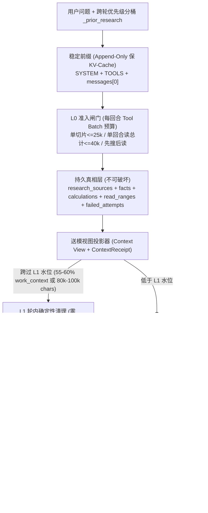

# `topic_5d4fcec25ec14f40809154d3d2be71b0` 最近两轮报错深度分析与上下文管理演进方案

日期：2026 年 11 月 19 日（2026 年 11 月 20 日完成授权滚动部署与受控回环实测）。状态：**Phase 1–3 与 Twelve Data 历史行情（`ETF:QQQ` / `ETF:ONEQ` / `ETF:SPY`）已完成经授权的 `aws-runtime` 滚动发布（`timeout=300s`、`work_context_tokens=64000`，FRED 保持禁用边界），并通过同题受控回环实测（8 次流式调用全部成功、0 超时、0 漏结、2 次 L1 确定性压缩）**。

本文基于线上 PostgreSQL（`research_topics`、`research_run_inputs`、`research_sources`、`usage_ledger`、`billing_states`、`operation_state`、`operation_events`）、容器运行日志、`aws-runtime/api.env` 实际参数及当前仓库代码（`9215858`，Stage 1–3 上线后版本），完整复盘主题 `topic_5d4fcec25ec14f40809154d3d2be71b0`（问题：“分析纳斯达克最近走势，并分析预测未来的可能”，账号 `account_8887e09f4185483a8323042c6e4ba643`）最近两轮全部报错的根因，并结合**前沿主流 Agent Harness**（Anthropic Context Editing / Compaction、OpenAI Codex、Manus）与项目 [`Ragent_product`](https://github.com/ragent-app/Ragent_product.git) 的源码实现，提出 ForesightNine 下一阶段的**超时治理、续跑保护与上下文管理完整改进方案**。

---

## 1. 运行环境基线与吞吐对照

### 1.1 线上实际运行配置（`aws-runtime/api.env`）

- **推理模型协议与上限**：
  - `FORESIGHTNINE_RESEARCH_MODEL_PROTOCOL='anthropic_messages'`
  - `FORESIGHTNINE_RESEARCH_LLM_BASE_URL='https://api.z.ai/api/anthropic'`
  - `FORESIGHTNINE_RESEARCH_LLM_MODEL='glm-5.3-flash'`
  - `FORESIGHTNINE_MESSAGES_STREAM='true'`
  - `FORESIGHTNINE_RESEARCH_MAX_OUTPUT_TOKENS='16384'`（Stage 3 从 `4096` 提升至 `16384`）
  - **`FORESIGHTNINE_RESEARCH_LLM_TIMEOUT_SECONDS='120'`**（未随 `max_output_tokens` 同步上调）
  - `FORESIGHTNINE_LLM_STREAM_IDLE_TIMEOUT_SECONDS` 未设置（代码默认 `45.0s`）
  - `FORESIGHTNINE_LLM_RESPONSE_TIMEOUT_SECONDS` 未设置（回退至 `idle_timeout = 45.0s`）
  - `FORESIGHTNINE_LLM_CAPABILITY_PROFILE='{"endpoint":"https://api.z.ai/api/anthropic/v1/messages","model":"glm-5.3-flash","version":"2023-06-01","mode":"json_object","output_tokens":16384,"input_counter":"chars_div_3","native_tools":true,"stream":true,"continuation":true}'`（未设 `context_tokens`，L1 触发水位默认回退至 `120,000` 字符）
- **搜索与行情数据源**：
  - `FORESIGHTNINE_SEARCH_PROVIDER='glm_coding_mcp'`、`FORESIGHTNINE_SEC_USER_AGENT='ForesightNine/1.0 privacy@foresightnine.com'`
  - 已配置 `FORESIGHTNINE_TWELVEDATA_API_KEY`，但**未配置 `FORESIGHTNINE_RESEARCH_HISTORICAL_PRICES`**，导致运行时 `historical_prices_available=false`、`available_historical_price_instruments=[]`。
- **账户额度**：`quota_limit=50,000,000`，截至 `2026-11-19T16:09:10Z` 累计 `consumed_tokens=700,807`、`reserved_tokens=0`（本次两轮超时的上游消耗在账本中被记为 `0`）。

### 1.2 同模型同环境实测出词速率基线

参照本主题前 3 次成功调用与 15 分钟前同环境 `operation:b621c411afc8cbe33e76ab64`（同为 `glm-5.3-flash` + `max_output_tokens=16384` + `stream=true`）的实测传输诊断：

| 样本调用 | `wire_bytes` | `input_tokens` (`cache_read`) | `output_tokens` | `response_headers` | `response_body` | 实测出词速率 |
| :--- | ---: | ---: | ---: | ---: | ---: | ---: |
| `topic_5d4fcec2` Call 1 (`ace6e932`) | 13,919 | 3,781 (`0`) | 799 | 4,343 ms | 16,022 ms | **49.9 tok/s** |
| `topic_5d4fcec2` Call 2 (`ecf95f5a`) | 19,815 | 4,949 (`0`) | 286 | 4,311 ms | 4,369 ms | **65.5 tok/s** |
| `topic_5d4fcec2` Call 3 (`7359bb92`) | 25,034 | 6,397 (`0`) | 772 | 4,460 ms | 11,465 ms | **67.3 tok/s** |
| 对照 `b621c411` Call (`435f7c4d`) | 134,542 | 1,741 (`36,800`) | 3,820 | 2,304 ms | **59,999 ms** | **63.7 tok/s** |
| 对照 `b621c411` Call (`f1651cd9`) | 108,861 | 8,365 (`21,760`) | 3,921 | 2,374 ms | **52,661 ms** | **74.5 tok/s** |

> 关键推论：在 `api.z.ai` 当前约 **50–75 tok/s** 的实际流式输出速率下，单次输出达到 `~3,800` tokens 就需要 **53–60 秒**；若一次调用进入深度 `thinking` + 批量工具参数或报告撰写（输出 `6,000–8,000+` tokens，远未触及 `16,384` 上限），再叠加上游首包延迟（实测可达 `14.6s`），**必然超过 `120s` 总墙钟上限**。

---

## 2. 最近两轮执行轨迹与报错全记录

| 轮次 / 版本 | Operation ID 与时间（UTC） | 入口与终态 | 账本消耗与请求规模 | 逐调用实证与报错细节 |
| :--- | :--- | :--- | :--- | :--- |
| **第 1 轮（首跑）** `V2` (`version_d4cf2c1307564742a49ff3a2e1e182d1`) | `operation:124d52c0f8becd14f7264f84` `16:03:14 – 16:06:19` 耗时 **`185.1s`** | 新建主题提问 **`partial` (`provider_timeout`)** 报告 `0` 字 / `0` fact / `0` calc | `model_calls=4` `search_calls=2` 账本 `16,984 tok` （第 4 次实结 **`0`**） | 1. **Call 1**（`ace6e932...`，`13,919 B`）：确认 `historical_prices_available=false` 后并行发起 2 次 `discover_sources`，发现 10+8 条候选，分别过滤 7+5 条 `redirect_link`，保留 6 条有效线索（Yahoo Finance、Nasdaq、WSJ、Charles Schwab）； 2. **Call 2**（`ecf95f5a...`，`19,815 B`）：`acquire_sources` 抓取 4 个 URL——成功入库 3 份：`source_b00d5264...`（Yahoo 实时页 `9,072` 字符）、`source_dd2dc30f...`（Schwab 周度展望 `21,262` 字符）、`source_c0480efb...`（Yahoo 历史数据页 `27,463` 字符）；`www.nasdaq.com` 返回 403（`http_forbidden_or_challenge`）； 3. **Call 3**（`7359bb92...`，`25,034 B`）：模型算得 3 份原文合计 `57,797 > 40,000`，于是在**同一回合内并行发出 2 个 `read_sources` 调用**（`34,072` + `23,725` 字符），将 3 份资料全文（含 253 行全年日线 OHLCV 表 `23.6 KB` + Schwab 长文 `21.3 KB` + 页面导航/侧栏噪音）一次灌入 `history[2]`（tool result 合计 `61,112 B`）； 4. **Call 4**（`e4ef57e5...`，`16:04:18.8 – 16:06:19.1`）：请求体跃升至 **`wire_bytes=88,610`**（`estimated_input_tokens_heuristic=29,554`，`reserved_tokens=105,044`）。`dns 129ms` → `tcp 67ms` → `tls 71ms` → `request_write 67ms` → `response_headers 2,205ms (HTTP 200)` → **`response_body` 持续流式读取 `117,413 ms`** → 在 **`120,000 ms` 触发 `stage="deadline", result="timeout"`**，在 [anthropic_messages.py](../../apps/api/app/anthropic_messages.py#L494-L499) 抛出 `ProviderFailure('provider_timeout')`。 |
| **第 2 轮（续跑）** `V3` (`version_89f2d569992941c3a7ac190bdbba3917`) | `operation:3db82537836f56872c326afd` `16:07:10 – 16:09:11` 耗时 **`121.2s`** | 点击前端“继续研究” (`POST /continue`) **`partial` (`provider_timeout`)** 报告 `0` 字 / `0` fact / `0` calc | `+1 call`（Turn 累计 `5`） 账本 **`+0 tok`** | **Call 1**（`0d38247b...`，`16:07:10.3 – 16:09:10.9`）：检查点 `history` 原样为 **`74,740 B`**、`compaction_count=None`、`failed_attempts=[]`、`consecutive_truncation_continuations=0`、无 `continuation_guidance`，**以逐字节相同的 `wire_bytes=88,610`（`reserved_tokens=105,044`）重放了第 1 轮 Call 4**。本次 `response_headers` 耗时升至 **`14,566 ms`（HTTP 200）**，随后 **`response_body` 持续流式读取 `105,100 ms`**，于 **`120,000 ms` 再次触发 `stage="deadline", result="timeout"`**。结束后 `GET .../recovery-status` 仍返回 `can_continue=true, reason=null`。 |

### 关键传输实证：并非上游卡死，而是本地硬墙钟掐断活跃流

依据 [openai_compatible.py](../../apps/api/app/openai_compatible.py#L860) 与 [openai_compatible.py](../../apps/api/app/openai_compatible.py#L931-L962) 的三层超时机制：
- 每收到一个 SSE frame 或 `ping`，都会刷新 `idle_deadline = monotonic() + 45.0`；
- 超时触发时按 `reason = "deadline" if deadline <= idle_deadline else ("response_body" if got_headers else "response_headers")` 记录中断阶段。

两轮失败记录的最后两个阶段均为 `response_body`（`117,413 ms` / `105,100 ms`）与 `deadline`（`120,000 ms`），说明在超过 105–117 秒的时间窗内，**从未出现超过 45 秒的静默断流**——模型全程都在流式生成内容，只是还没来得及吐完完整响应就被 120 秒总墙钟一刀切断。

---

## 3. 五类根因缺陷拆解

### 缺陷 1（P0）：`max_output_tokens=16384` 与总墙钟超时 `120s` 严重失配

- **代码与配置位置**：`aws-runtime/api.env`（`FORESIGHTNINE_RESEARCH_MAX_OUTPUT_TOKENS='16384'`、`FORESIGHTNINE_RESEARCH_LLM_TIMEOUT_SECONDS='120'`）、[main.py](../../apps/api/app/main.py#L647)、[anthropic_messages.py](../../apps/api/app/anthropic_messages.py#L385-L396)、[openai_compatible.py](../../apps/api/app/openai_compatible.py#L943-L950)。
- **机制缺陷**：
  1. Stage 3 为解决 `4096` 截断将 `max_output_tokens` 提升至 `16384`，但没有同步提升 `timeout_seconds`；
  2. 流式模式已经具备 `connect_timeout=15s` 与 `idle_timeout=45s` 两道防卡死护栏，但 `deadline = monotonic() + 120.0` 把“正在高速吐字的正常长思考/长输出”与“无响应卡死”一视同仁地强杀；
  3. 面对开放性趋势分析 + 预测问题且单次输入含 57.8k 字符行情与展望时，`glm-5.3-flash` 的 `thinking` + 大批量 `record_facts` 或报告起草极易超过 `~6,000–7,000` tokens，在 `50–70 tok/s` 速率及 `2–15s` 首包耗时下几乎必然撞墙。

### 缺陷 2（P0）：`provider_timeout` 绕过 Stage 2 全部保护，形成新的 `/continue` 死循环

- **代码位置**：[research_runtime.py](../../apps/api/app/research_runtime.py#L1871-L1891)、[research_recovery.py](../../apps/api/app/research_recovery.py#L22-L38,L67-L174)、[main.py](../../apps/api/app/main.py#L3062-L3065)、[Conversation.tsx](../../apps/web/src/pages/topic/Conversation.tsx#L87-L98)。
- **机制缺陷**：
  1. **不记失败记忆**：[anthropic_messages.py](../../apps/api/app/anthropic_messages.py#L495) 将 `provider_timeout` 设为 `retryable=True`，而 [research_runtime.py](../../apps/api/app/research_runtime.py#L1876-L1886) 只在 `error['code'] in ('provider_output_truncated', 'provider_context_limit')` 或 `retryable is False` 时写入 `failed_attempts`。结果两轮超时后 `failed_attempts` 均为空数组 `[]`；
  2. **不触发续跑引导与压缩**：[research_recovery.py](../../apps/api/app/research_recovery.py#L24-L38) 中 `TRUNCATION_FAILURE_REASONS` 与 `CONTINUATION_COMPACTION_REASONS` 都不含 `provider_timeout`，导致 `prepare_runtime_continuation` 既不调整上下文，也不注入任何“上轮超时、请拆小步骤简洁输出”的 `continuation_guidance`；
  3. **无连续超时熔断**：`consecutive_truncation_continuations` 始终为 `0`，第 2 轮再次超时后 `recovery-status` 仍返回 `can_continue=true`，前端继续引导用户点击“继续研究”，形成“每次白等 120 秒再原样超时”的新死循环。

### 缺陷 3（P1）：单回合并行多次 `read_sources` 绕过 `40,000` 字符批上限 + 缺乏结构化行情通道

- **代码位置**：[research_runtime.py](../../apps/api/app/research_runtime.py#L34,L800,L1980-L1983)、[research_historical_prices.py](../../apps/api/app/research_historical_prices.py#L57-L71)。
- **机制缺陷**：
  1. Stage 1 在 `_read_sources` 中加入了 `MAX_READ_SOURCE_SPAN_CHARS = 25,000` 与 `MAX_READ_SOURCES_BATCH_CHARS = 40,000`，但只在**单次工具调用**内校验。模型在 Call 3 `thinking` 中明确算出 `9,072 + 21,262 + 27,463 = 57,797 > 40,000`，随即在同一 assistant turn 内发出 **2 个并行 `read_sources` 调用**（`34,072` + `23,725`）合法绕过限制，使单步 tool result 膨胀至 `61,112 B`、下轮请求从 `25 KB` 暴涨至 `88.6 KB`；
  2. `source_c0480efb...` 虽经 HTML 表格瘦身，仍含 253 行完整 1 年日线 OHLCV（`23,611` 字符）及导航/全球指数侧栏/页脚（`3,852` 字符）；`source_b00d5264...`（`9,072` 字符）中大量为 Yahoo 导航、热股榜与侧栏噪音；
  3. `api.env` 虽已有 `FORESIGHTNINE_TWELVEDATA_API_KEY`，但未配置 `FORESIGHTNINE_RESEARCH_HISTORICAL_PRICES`，`historical_prices_available=false` 迫使模型只能走网页抓取（且 `www.nasdaq.com` 403 拒访）。

### 缺陷 4（P1）：流式半途超时误结 `actual_tokens=0` 且缺失流式中断现场诊断

- **代码位置**：[openai_compatible.py](../../apps/api/app/openai_compatible.py#L802-L803)、[anthropic_messages.py](../../apps/api/app/anthropic_messages.py#L172-L174,L242-L252,L494-L499)、[research_coordinator.py](../../apps/api/app/research_coordinator.py#L298-L300,L328-L344)。
- **机制缺陷**：
  1. **账务失真**：收到 HTTP 200 `text/event-stream` 响应头即置 `submission_state='response_received'`；`api.z.ai` 在 `message_start` 下发 `usage={"input_tokens": 0, "output_tokens": 0}`（真实 token 仅在流尾 `message_delta` 返回）。120s 超时中断时，`partial_reported_tokens()` 返回 **`0`**（而非 `None`），`finish_model` 判定 `type(0) is int and 0 >= 0` 即 `known=True`，将两次长达 ~110s 的流式调用在 `usage_ledger` 中均结清为 **`status="settled", actual_tokens=0`**，真实上游消耗（两轮合计约 ~60k 输入 + 数万输出 tokens）完全脱离账本与预算风控；
  2. **错误归类失准**：`model_call_receipts.processing_error` 被统一写为 `'post_response_processing_failure'`，与真实原因（流式传输超时）不符；
  3. **流式现场不可见**：`private_validation_diagnostics` 未记录中断前的 `ttft_ms`（首个 delta 到达时间）、`streamed_bytes`、各 block 类型字节统计（`thinking` / `text` / `tool_use` 名称）与已收帧数，事后无法判断 117s 究竟耗在超长 `thinking` 还是在写 `submit_research` / `record_facts`。

### 缺陷 5（P2）：次要状态与缺口口径偏差

- `official_fetch_status` 显示 `"completed"`，但本轮仅抓到 Yahoo Finance 和 Charles Schwab 普通公开网页（`retrieval_method="web_html"`），官方 `nasdaq.com` 反而是 403 失败；
- `gaps` 落库为通用的 `{"code": "provider_no_result", "message": "Provider request ended without a usable result."}`（[research_runtime.py](../../apps/api/app/research_runtime.py#L312-L315)），而 `turn.reason` 为 `provider_timeout`，未把超时原因直接透传到 gap 语义中。

---

## 4. 上下文管理演进分析：现状 × 前沿 Agent Harness × `Ragent_product` 取舍

### 4.1 现状复盘：Stage 1/2 已落地的能力与新暴露的 6 类深层短板

`commit 9215858`（Stage 1/2）已为 ForesightNine 补上了文档站内检索（`outline_source` / `search_source`）、单次 `read_sources` 硬限、L1 确定性 `compact_runtime_history`、L2 续跑压缩与 `repeated_truncation` 熔断。但本次 `topic_5d4fcec2` 实测叠加代码走查，暴露出当前上下文治理仍有 **6 类关键短板**：

1. **前缀 KV-Cache 隐性破坏点（`_user_with_failure_awareness` 改写 `messages[0]`）**：
   - [research_runtime.py](../../apps/api/app/research_runtime.py#L1294-L1337) 在存在 `failed_attempts` 或 `continuation_guidance` 时，会直接把 `prior_failed_attempts` 与 `recovery_guidance` 注入 **`turn.user`（即 `messages[0]`）**。
   - 在未清空 `history` 的续跑（如超时续跑保留最近工具结果）或轮内重试场景下，改动 `messages[0]` 会**从第 1 条用户消息起全量击穿前缀 KV-Cache**；同时 [anthropic_messages.py](../../apps/api/app/anthropic_messages.py#L120-L128) 的 `_wire` 尚未按能力位支持显式 `cache_control` 断点（本主题前 3 轮 `cache_read_input_tokens` 均为 `0`，而 `b621c411` 到更大前缀后才触发服务端隐式缓存）。
2. **输入闸门按“单次 tool call”而非“单回合 tool batch”计数**：
   - 模型在 Call 3 通过并行 2 次 `read_sources` 轻松注入 `57.8k` 字符；同理，若模型并行发起多次 `search_source` / `sec_company_concept` / `read_sources`，单步仍可能灌入超过 `80k–120k` 字符，直接把下一步推理推入高延迟/超时/截断区。
3. **仅清理 `tool_result`，未治理历史 `thinking` 块膨胀**：
   - [research_runtime.py](../../apps/api/app/research_runtime.py#L1106-L1183) 的 `compact_runtime_history` 只替换 `exchange['results']`，从未处理 `exchange['assistant']['content']` 中的历史 `thinking` 块（如本主题 `history[0]` 单步 `thinking` 即占 `4.1 KB`，多轮复杂研究可达数万字节）。
4. **原地覆盖 `state['history']` 且缺乏显式覆盖/省略回执（Silent Gap 风险）**：
   - [research_runtime.py](../../apps/api/app/research_runtime.py#L1701) 在调用前直接**原地改写** `state['history']` 并随 `save()` 落库，且没有生成结构化的 `context_receipt`（记录哪些 `source_spans` / `tool_call_id` 被省略、压缩前后字符数、受保护的 `fact_id` 清单），既削弱了断点审计透明度，也缺乏“未覆盖区间不可宣称已核验”的显式不变量约束。
5. **L1 水位与 `context_tokens` 仍受计费上界牵制，且跨轮 `_prior_research` 缺少 Token 预算分桶**：
   - 因 `provider_capabilities` 未拆分“工作窗口容量（触发 L1/L2 压缩）”与“账务保守上界（防配额溢出）”，线上被迫不配 `context_tokens`，导致 L1 长期硬编码在 `120,000` 字符（而本主题仅 `74.7k` 字符就已造成单轮生成超 120s）；
   - 跨轮记忆 `_prior_research`（[research_runtime.py](../../apps/api/app/research_runtime.py#L1367-L1417)）只按固定条数截断（`200` facts / `100` calcs / `100` claims），在长主题多轮追问下可能无预警吞噬 `30k–50k+` tokens。
6. **失败恢复策略“一刀切”，未按失败类型区分“保数据降输出”与“清上下文减输入”**：
   - 截断/超窗（`provider_output_truncated` / `provider_context_limit`）往往需要激进缩减输入（`keep_recent=0`）；但 `provider_timeout`（尤其在刚读完资料、`facts=[]` 时）如果盲目清空最新 `read_sources`，反而会逼模型重读；如果不做任何干预，又会死循环原样超时。

---

### 4.2 前沿主流 Agent Harness 的核心范式（2025–2026）

当前生产级长周期 Agent Harness 已形成共识：**“更大上下文窗口 ≠ 更好效果”**，上下文是受注意力衰减（Context Rot）、TTFT/吞吐延迟与 KV-Cache 经济性共同约束的**有限注意力预算**，工程实践收敛为四层递进机制：

1. **Anthropic（Claude Code / Messages API `context_management`）**：
   - **L0 零摘要轻量编辑优先**：服务端原生提供 `clear_tool_uses_20250919`（超阈值按时间顺序清空旧 `tool_result` 并保留结构化占位，支持 `keep`、`clear_at_least`、`exclude_tools`）与 **`clear_thinking_20251015`**（裁剪旧轮次已消费的推理块），且在**缓存命中之后、计费之前**生效，避免频繁击穿前缀缓存；
   - **L1/L2 阶梯压缩**：工具清理仍不足时才进入 `compact_20260112`（阈值触发摘要）或 `compact-2026-09-04`（显式签名的 compaction block），并支持带指令的 `/compact <focus>`。
2. **OpenAI（Codex CLI / Responses API Compaction）**：
   - **协议级状态压缩 + 外置持久化**：通过 `POST /responses/compact` 与服务端 `compact_threshold` 生成紧凑、不透明的加密 compaction item 延续长会话，同时把工作状态（代码、清单、校验结果）沉淀到文件系统/结构化产物，不依赖易失对话历史；
   - **反 Compaction Loop 教训**：社区与生产实证反复验证，纯摘要压缩容易丢失精确约束、失败路径与错误码，导致模型重复踩坑；必须把“失败尝试、边界条件与精确引用”放在确定性外置账本中。
3. **Manus（Context Engineering for Production Agents）**：
   - **KV-Cache 命中率第一法则**：前缀必须保持严格 **Append-only + 确定性序列化**（绝不修改早期消息或 `messages[0]` 里的动态时间戳/引导语），动态提醒/任务锚定（如早期 `todo.md` 复述或尾部状态重申）一律**追加到尾部**以兼顾前缀缓存与近因注意力（Recency Attention）；
   - **文件系统即扩展内存（Context Offloading）**：大体积观测产物全部落盘、上下文只保留受控预览或指针，按需切片读取，避免把原始抓取/日志直接堆进上下文。

---

### 4.3 `Ragent_product` 上下文体系源码拆解与 ForesightNine 具体取舍

直接检视 [`Ragent_product`](https://github.com/ragent-app/Ragent_product.git)（`chat/` 目录）源码后，可见其面向**跨会话、多 Runtime（Claude Code / Codex / 自定义 Provider）、长周期软件工程协作**建设了一套非常完整的上下文治理体系。将其逐模块与 ForesightNine（**单主题金融研究、短高密工具循环 4–15 步、严格逐字原文偏移引文校验 `locate()`、账务可审计、遵循 `AGENTS.md` 协议配置优先与禁止模型品牌硬编码**）对照，得出以下精确取舍矩阵：

| `Ragent_product` 模块与核心机制 | 前沿对应思想 | ForesightNine 取舍结论 | 具体工程理由与落地边界 |
| :--- | :--- | :--- | :--- |
| **`chat/tool-result-descriptor.mjs`** 超长工具输出不直接塞入对话，持久化为 `rawOutputRef` + `outputSha256`，上下文仅放 `head_tail` 预览（默认 `2400` 字符），通过 `readToolResultRange`（上限 `64 KB`）校验 SHA-256 后按字节区间回读。 | Manus 文件系统卸载 + Anthropic `clear_tool_uses` | **改造吸收（保留定位，禁用 `head_tail` 剪裁原文）** | ForesightNine 已将原文持久化于 `research_sources`（含 `content_sha256`）并已有 `search_source`/`outline_source`/`read_sources`。**吸收点**：给**所有大体积工具返回**（不止 `read_sources`，还包括长列表的 `sec_company_concept`、`historical_prices`、`search_source`）统一建立 Descriptor 规范与单回合总体积上限；**拒绝点**：绝不对可引用正文用 `head_tail` 中段剪裁（会破坏 `locate()` 偏移与遗漏关键财务脚注）。 |
| **`chat/session-auto-compaction.mjs`** 三档渐进预算 `COMPACTION_LEVEL`：`50% TRIM_TOOLS`（零 API 成本裁剪工具输出）→ `70% COMPACT`（独立隐藏 `context_compactor` LLM Worker 增量摘要，`MAX_INCREMENTAL_MERGE_DEPTH=5` 防格式漂移）→ `85% EMERGENCY`（清 `resumeId` 强制新上下文）；对 Codex 委派原生 `remote_compaction_v2`。 | Anthropic 分层编辑 + Codex 服务端 Compaction | **吸收三档阶梯水位与 L1/L3 思想； 明确舍弃“后台独立 LLM 摘要 Worker”** | **吸收**：建立清晰的**三档渐进治理**——**L0 准入控制**（单回合读取总预算 + `search_source` 先搜后读）→ **L1 轮内确定性清理**（零模型调用、清理旧 `tool_result` 与已消费 `thinking`）→ **L2/L3 异常续跑重组或受控重置**（带熔断）。 **舍弃 LLM Compactor Worker**：金融研究单轮周期短（1–5 分钟），另起隐藏 LLM 摘要会话既引入 15–60s 额外延迟与复杂计费对账，更存在**金融数字/期间/单位“二手改写幻觉”**风险；且 `AGENTS.md` 要求不依赖特定外部 coding harness。 |
| **`chat/continuity-work-state.mjs`** 结构化工作状态账本：`goal`、`status`、`plan`、`decision`、`completed_work`、`failed_attempt`、`blocker`、`unresolved`、`next_action`，每项均带 `sourceRefs` 溯源与幂等 `upsert`/`resolve`。 | OpenAI / Manus 结构化外置状态 | **核心吸收（补齐非证据类工作记忆）** | ForesightNine 已有比代码 Agent 更强的领域证据账本（`facts`、`calculations`、`claims`、`read_ranges`），但在**过程控制记忆**上偏弱。应吸收其 `failed_attempt`（涵盖 `provider_timeout`、403、429、截断，带 `rootCause` / `retryCondition`）与轻量 `open_blockers / source_access_failures`（如记住 `nasdaq.com` 403，压缩后不再重复尝试），且由服务端确定性维护，不靠模型自由文本复述。 |
| **`chat/context-receipt.mjs` & `chat/continuity-core.mjs`** 7 条不变量（`I-CTX-001`..`I-CTX-007`），核心 `I-CTX-003 NO_SILENT_GAP` 强制 `coveredThroughSeq` 永不跨越 `omittedRanges`，每次上下文构建产出带 `contentDigest`、`includedSourceRefs` 与 `binding` 的可校验回执。 | 可审计上下文账本 | **核心吸收（金融审计高度契合）** | `plan.md §5` 明确要求“记录模型看到的覆盖及省略情况，使用户能回查依据”。吸收 `ContextReceipt` 与 `NO_SILENT_GAP` 思想：压缩或省略上下文时，**不破坏原始审计历史**，而是单独产出 `context_receipt`（记录 `compacted_tool_call_ids`、`omitted_spans`、`preserved_fact_ids`、`before_chars`/`after_chars`、`prefix_cache_reset` 标记），彻底消除静默丢信息。 |
| **`chat/context-attention-assembler.mjs`** 按优先级分桶装填：`P0 mandatory`（超限即抛 `CONTEXT_MANDATORY_OVER_BUDGET`）→ `P1 structured (30%)` → `P2 recent (40%)` → `tools (12%)` → `recall (10%)` + 剩余额度溢流；用 `ceil(chars/3)` 估算 + `contentDigest` 去重 + 产出 `omitted` 列表。 | 注意力预算分桶与按需召回 | **按边界拆分取舍： 跨轮（Turn N→N+1）与 L2 重组吸收； 单轮循环内禁止每步重排** | **关键取舍**：`Ragent` 的 Assembler 为跨会话/跨 Provider 交接设计，每轮重组会彻底破坏前缀 KV-Cache。因此 ForesightNine **单轮循环内**必须坚守 Manus **Append-only**（低于 L1 水位一字节不动），**仅在两个天然重置前缀的边界**引入优先级分桶预算：① 跨轮 `_prior_research` 组装（解决 200 facts/100 claims 无 token 预算上限问题，P0 当前问题与能力 → P1 确认事实/计算/打开缺口 → P2 近期结论与用户复核意见 → P3 历史读段索引）；② L2 失败恢复重建上下文时。同样禁止对金融引用正文中段 `clip(65%/35%)`。 |
| **`chat/session-pre-compact-extraction.mjs`** 压缩前触发一次低 effort、禁 thinking、8s 超时的 detached LLM 调用，最多抽取 3 条硬约束/精确数字写入 `taskCard.memory`。 | 压缩前关键事实保护 | **明确舍弃** | ForesightNine 的 `record_facts` 与 `calculate_financials` 已是 100% 确定性且带原文偏移校验的 Protected Facts；在 `facts=[]` 时超时（如本主题），额外增加一个 8s LLM 抽取器不仅在 `api.z.ai` 延迟下极易超时，还可能绕过 `locate()` 产生未经原文核验的伪事实。正确解法是引导模型**先小步 `record_facts` 落盘再综合撰写**。 |
| **`chat/turn-context-hook.mjs`** 动态上下文块（任务卡、协议、状态投影）在回合注入时拼装，与静态系统指令分离。 | Manus 尾部锚定（Tail Injection） | **改造吸收（迁移至尾部注入）** | 修复当前 `_user_with_failure_awareness` 改写 `messages[0]` 的 KV-Cache 杀手：静态 `SYSTEM + TOOLS + messages[0]` 永远不变，失败记忆与续跑/超时引导作为**尾部动态块**（紧贴最新一轮 `tool_result` 或末尾 user turn）瞬态注入，既保住前缀缓存又落在模型近因注意力高点。 |
| **`chat/runtime-context-compiler.mjs`** 按 `runtimeFamily` / `providerProfile` / `model` / `runtimeFingerprint` / `instructionRevision` 决定走 `native resume` 还是 `semantic hydrate`。 | 跨协议安全续接 | **局部吸收（与既有 `runtime_binding` 对齐）** | ForesightNine 已有 `runtime_binding` 校验（[main.py](../../apps/api/app/main.py#L3047)）防止换模型/换配置后错误续跑；可进一步吸收其“协议能力驱动”思路——当配置了支持原生 `cache_control` 或服务端上下文编辑的协议能力位时按能力开启，未知则安全走本地确定性路径，不依赖外部 CLI 会话状态。 |
| **`chat/model-context-windows.mjs`** 按上游返回模型 ID 匹配正则表（如 `/^glm-5/i -> 128_000`），未知返回 `null`。 | 显式上下文窗口感知 | **明确舍弃正则表； 吸收“未知显式返回 `None` + 配置注入”原则** | 严格遵守 `AGENTS.md`“按 wire API 协议与显式配置适配，不硬编码模型品牌”原则（且连 `Ragent` 的正则表面对新版本如 `glm-5.3-flash` 也可能误判为 `128_000`）。改为在 `FORESIGHTNINE_LLM_CAPABILITY_PROFILE` 中显式配置 `work_context_tokens`（与计费防溢出上界解耦），未配置时保守回退至可配置的字符水位。 |

---

### 4.4 ForesightNine 下一代三层上下文治理目标架构

核心不变量（吸收 `Ragent_product` 契约化思维，适配金融研究）：
- **`I-FIN-CTX-001`（前缀不可变）**：低于 L1 水位时，`SYSTEM`、`TOOLS`、`messages[0]` 与历史消息前缀字节保持严格一致；任何动态引导（失败提示、超时拆步指令）只允许尾部瞬态注入。
- **`I-FIN-CTX-002`（真相与视图分离）**：`research_sources` 原文与检查点审计日志永不因压缩丢失；`compact_runtime_history` 仅作用于送模工作视图或保留独立 `context_receipt`，绝不修改 `facts`、`calculations`、`read_ranges` 与 `locate()` 偏移基准。
- **`I-FIN-CTX-003`（零静默遗漏 / No Silent Gap）**：任何被折叠的 `tool_result` 或跨轮裁剪的 `prior_research` 必须写入 `context_receipt.omitted`（含 `source_id`、区间、原因），严禁把省略区间呈现为已核验覆盖。
- **`I-FIN-CTX-004`（零幻觉压缩）**：轮内上下文缩减 100% 确定性执行，不引入后台 LLM 二次改写金融数字或结论。
- **`I-FIN-CTX-005`（单回合体积有界）**：同一 assistant turn 内并行调用的总读取字符数不得突破单回合上限，防止模型通过拆并行调用绕过护栏。
- **`I-FIN-CTX-006`（失败必收敛）**：无论是 `provider_output_truncated`、`provider_context_limit` 还是 `provider_timeout`，均必须写入 `failed_attempts` 并受连续续跑熔断上限保护，绝不出现无改变的无限 `/continue` 重放。

---

## 5. 完整分阶段改进实施方案

### Phase 1（P0 · 立即止血：消除 120s 误杀与超时 `/continue` 死循环）

| 编号 | 改造项 | 涉及文件 / 配置 | 核心实现要点 |
| :--- | :--- | :--- | :--- |
| **1.1** | **对齐流式超时与 `16384` 输出上限** | `aws-runtime/api.env` [main.py](../../apps/api/app/main.py#L647) [anthropic_messages.py](../../apps/api/app/anthropic_messages.py#L385-L396) [openai_compatible.py](../../apps/api/app/openai_compatible.py#L847-L965) | 1. 将 `FORESIGHTNINE_RESEARCH_LLM_TIMEOUT_SECONDS` 由 `120` 提升至 **`300`**（并保持 `FORESIGHTNINE_LLM_CONNECT_TIMEOUT_SECONDS=15`、`FORESIGHTNINE_LLM_STREAM_IDLE_TIMEOUT_SECONDS=45`、`FORESIGHTNINE_LLM_RESPONSE_TIMEOUT_SECONDS=45`）； 2. 在配置检查/日志中引入告警提示：当 `max_output_tokens >= 8192` 且 `timeout_seconds < 240` 时输出配置失配提醒； 3. 明确区分 `timeout_kind`：`connect_timeout`、`header_timeout`、`stream_idle_timeout`、`stream_deadline_timeout`，写入 `private_validation_diagnostics` 便于精确区分“真卡死”与“长输出超时”。 |
| **1.2** | **将 `provider_timeout` 纳入失败记忆与差异化续跑策略** | [research_runtime.py](../../apps/api/app/research_runtime.py#L1810-L1891) [research_recovery.py](../../apps/api/app/research_recovery.py#L22-L174) [main.py](../../apps/api/app/main.py#L3062-L3105) | 1. 在 [research_runtime.py](../../apps/api/app/research_runtime.py#L1876-L1886) 与未收到响应分支（L1819）中，将 **`provider_timeout`** 一律记入 `failed_attempts`（含 `timeout_kind`、`elapsed_ms`、`wire_bytes`、`streamed_bytes`）； 2. 在 [research_recovery.py](../../apps/api/app/research_recovery.py) 中新增 `TIMEOUT_FAILURE_REASONS = frozenset({'provider_timeout'})` 与 `MAX_TIMEOUT_CONTINUATIONS = 2`（独立计数 `consecutive_timeout_continuations`）： &nbsp;&nbsp;- **第 1 次超时后 `/continue`**：若 `facts` 非空或 `history_chars >= 80_000`，仅对早期轮次做 `keep_recent=1` 压缩（**当 `facts=[]` 时保留最新一次读取结果，避免逼模型重读**）；同时注入**超时专用尾部引导**——明确告知模型上次调用因生成时间超过单次墙钟上限中断，要求**缩短思维链、先分批调用 `record_facts` 落盘关键事实、避免单步同时做长推理和写完整个大报告**； &nbsp;&nbsp;- **连续第 2 次超时后**：`runtime_timeout_loop_blocked` 触发，`recovery-status` 返回 `can_continue=false, reason='repeated_timeout'`，`POST /continue` 返回 HTTP `409`（`lifecycle_conflict`）； 3. 前端 [copy.ts](../../apps/web/src/lib/copy.ts#L177-L186) 与 [Conversation.tsx](../../apps/web/src/pages/topic/Conversation.tsx#L87-L105) 同步支持 `repeated_timeout` 中文提示并禁用继续研究主按钮，改为引导“缩小问题范围重新提问”或查看已入库资料。 |

### Phase 2（P1 · 上下文治理系统性升级）

| 编号 | 改造项 | 涉及文件 | 核心实现要点 |
| :--- | :--- | :--- | :--- |
| **2.1** | **单回合 `tool_batch` 累计读取预算（堵住并行绕过）** | [research_runtime.py](../../apps/api/app/research_runtime.py#L34,L800,L1980-L1983) | 在执行单个 assistant turn 的 `calls` 循环中维护 `turn_read_chars = 0` 与 `MAX_READ_SOURCES_TURN_CHARS = 40_000`（以及全部工具结果单回合总字符护栏，如 `60_000`）。本回合内后续并行 `read_sources` 若使累计读取超出 `40,000`，直接返回 `status='invalid'`（不污染 `read_ranges`）并引导使用 `search_source`/`outline_source` 或分回合先 `record_facts` 再读其余来源。 |
| **2.2** | **动态引导改为尾部注入，保前缀 KV-Cache** | [research_runtime.py](../../apps/api/app/research_runtime.py#L1294-L1337,L1648-L1660) [anthropic_messages.py](../../apps/api/app/anthropic_messages.py#L120-L128) | 1. 停止在 `_user_with_failure_awareness` 中修改 `messages[0]`；当 `state['history']` 非空且存在 `failed_attempts` / `continuation_guidance` 时，以**瞬态尾部块**附加到送模视图末尾（或合并至最后一条 `user` 工具结果消息的尾部 text block，严格遵守 Anthropic `user`/`assistant` 交替约束）； 2. 在 `provider_capabilities.py` 中新增可选能力位 `explicit_cache_control: bool = False`，开启时仅在 `anthropic_messages._wire` 为静态 `system`/`tools` 与稳定前缀末尾附加 `cache_control: {"type": "ephemeral"}`（默认关闭，不强加不支持服务）。 |
| **2.3** | **历史 `thinking` 块安全清理 + 视图/回执化（`ContextReceipt`）** | [research_runtime.py](../../apps/api/app/research_runtime.py#L1034-L1240,L1701) [research_recovery.py](../../apps/api/app/research_recovery.py#L142-L174) | 1. `compact_runtime_history` 在触发 L1/L2 清理时，除折叠旧轮 `tool_result` 外，按协议安全规则清理 `history[:cutoff]` 中已被后续工具调用消费的旧 `thinking` 块（保留最近 `keep_recent` 步与 `tool_use` 结构，确保符合 Anthropic extended thinking 协议校验——仅在非当前活跃 assistant turn 清理）； 2. 将压缩结果结构化写入 `state['context_receipts']`（保留最近 20 条：`trigger`、`before_chars`、`after_chars`、`cleared_tool_call_ids`、`cleared_thinking_turns`、`omitted_spans`、`preserved_facts_count`、`prefix_reset`），并在 `turn` 诊断与进度视图中可追溯。 |
| **2.4** | **解耦 `work_context_tokens` 与计费上界 + 跨轮 `_prior_research` 优先级分桶** | [provider_capabilities.py](../../apps/api/app/provider_capabilities.py) [research_runtime.py](../../apps/api/app/research_runtime.py#L1201-L1240,L1367-L1417) | 1. 在 `CapabilityProfile` 中新增可选配置 `work_context_tokens`（仅用于计算轮内 L1 55% 水位，不触发 `utf8_byte_upper_bound` 账务拒单），并将默认无配置时的 `DEFAULT_L1_COMPACT_TRIGGER_CHARS` 调整为更贴合流式吞吐的 `80,000–100,000` 字符（且仅在存在可清理旧步时触发，不频繁抖动前缀）； 2. 升级 `_prior_research`：在保留 `PRIOR_LIMITS` 之外引入 `ceil(chars/3)` token 预算与四档优先级（P0 当前问题/范围/能力 → P1 已确认 facts/calculations/未决 gaps/来源拒访记录 → P2 最近结论与用户批注 → P3 `read_ranges` 索引），超预算项记录到 `prior_omitted`（落实 `I-FIN-CTX-003`）。 |

### Phase 3（P1–P2 · 账务准确性、可观测性与数据源体验）

| 编号 | 改造项 | 涉及文件 | 核心实现要点 |
| :--- | :--- | :--- | :--- |
| **3.1** | **修复流式半途超时 `0 token` 误结算** | [anthropic_messages.py](../../apps/api/app/anthropic_messages.py#L172-L175,L242-L252,L364-L370,L494-L499) [research_coordinator.py](../../apps/api/app/research_coordinator.py#L298-L300,L328-L344) | 1. `partial_reported_tokens()` 仅在已收到最终 `message_delta` 或明确非零真实用量（`input_tokens > 0 or output_tokens > 0`）时返回整数，否则对中途断流返回 `None`； 2. 流式半途超时时 `reported_tokens=None`，`finish_model` 按未知用量保守对账（避免账本写 `actual_tokens=0` 掩盖数万真实上游消耗），同时区分 `processing_error` 为 `'stream_timeout'` 而非笼统的 `'post_response_processing_failure'`。 |
| **3.2** | **补全流式中断现场诊断** | [anthropic_messages.py](../../apps/api/app/anthropic_messages.py#L164-L212,L253-L373) [research_diagnostics.py](../../apps/api/app/research_diagnostics.py) | 在白名单诊断（不含正文与密钥）中记录 `stream_metrics`：`frames_received`、`ttft_ms`、`last_frame_elapsed_ms`、`reassembled_bytes`、`block_bytes_by_type`（`thinking` / `text` / `tool_use` 各自字节数）与 `active_tool_names`。下次一旦出现慢调用，一眼即可定位是 `thinking` 过长还是某个工具参数过大。 |
| **3.3** | **网页正文降噪、状态口径修正与结构化行情核验** | [research_fetch.py](../../apps/api/app/research_fetch.py) [research_runtime.py](../../apps/api/app/research_runtime.py#L312-L315) [main.py](../../apps/api/app/main.py#L2712) `aws-runtime/api.env` | 1. 排查并收敛 HTML 解析中的 `<nav>` / `<footer>` / `<aside>` 导航与广告侧栏文本（保留主体正文与完整数据表格），降低 Yahoo Finance 等财经页 30–50% 无关噪音； 2. `provider_gap` 对 `provider_timeout` 透传专属 gap code（而非笼统的 `provider_no_result`）；区分 `official_fetch_status` 与一般公开网页抓取状态，避免抓到 Yahoo 网页却标成官方资料 `completed`； 3. 若业务已确认 Twelve Data 许可证允许存储/展示/模型输入，按 [research_historical_prices.py](../../apps/api/app/research_historical_prices.py#L48-L71) 配置 `FORESIGHTNINE_RESEARCH_HISTORICAL_PRICES`（常见美股宽基 ETF/指数如 `QQQ` / `IXIC` 等经核验标的），让指数走势问题直连结构化日线工具，彻底免去抓取 27k Yahoo HTML（FRED 仍按 `AGENTS.md` 保持禁用边界）。 |

---

## 6. 验证与验收标准（实施后执行）

1. **单元测试与契约回归**：
   - `test_anthropic_messages_provider.py`：验证流式中断时（仅收 `message_start(usage=0)` 未收 `message_delta`）`reported_tokens` 返回 `None`、`stream_metrics` 准确记录 `ttft_ms` / `block_bytes_by_type` / `timeout_kind`；
   - `test_research_runtime.py`：验证同回合并行 2 次 `read_sources` 总量超过 `40,000` 字符时第 2 次被拒且不污染 `read_ranges`；验证动态 `recovery_guidance` 不修改 `messages[0]`；验证 `compact_runtime_history` 产出 `context_receipt` 且安全清理旧轮 `thinking` 块；验证 `_prior_research` 优先级分桶与 `prior_omitted` 记录；
   - `test_research_recovery_acceptance.py` & `test_research_multiturn.py`：验证 `provider_timeout` 写入 `failed_attempts`、第 1 次 `/continue` 在 `facts=[]` 时保留最新读段并注入尾部超时拆步引导、连续第 2 次超时触发 `repeated_timeout` 熔断且第 3 次 `POST /continue` 返回 HTTP `409`；
   - Web 测试（`copy.test.ts`、`TopicPage.test.tsx`）：验证 `repeated_timeout` 中文文案与屏蔽“继续研究”按钮。
2. **受控公网实测对照（固定变量、隔离测试账号）**：
   - 锁定问题 `"分析纳斯达克最近走势，并分析预测未来的可能"`、相同模型 `glm-5.3-flash`、`max_output_tokens=16384`、调整后 `timeout_seconds=300`、`idle_timeout=45`、`stream=true`、显式实验预算；
   - 核验四维指标：① **传输维度**（无 120s 误杀，记录实际 `ttft_ms`、`response_body` 耗时与 `stream_metrics`）；② **结构与上下文维度**（单回合读取不超过 40k，前缀 `cache_read_input_tokens` 命中率提升，必要时 L1 压缩产出 `context_receipt`）；③ **证据维度**（`record_facts`、`calculate_financials` 与引文偏移 `locate()` 通过，预测内容显式标为推断/情景而非事实）；④ **账务与恢复维度**（真实 token 账本无 `0 token` 漏记；单独构造人工超时用例验证 `repeated_timeout` 熔断生效）。

---

## 7. 实施与阶段性验收记录（2026-11-19 至 2026-11-20）

以下记录基于三阶段并发交付后的代码审核、`foresightnine-api-test:local` / `src/apps/web` 实测回归及离线端到端冒烟验证（看板 `#14`、`#19`、`#27`）；**尚未修改线上 `aws-runtime/api.env`、未重启线上容器，也未启用 `FORESIGHTNINE_RESEARCH_HISTORICAL_PRICES`**。

### 7.1 Phase 1（P0 · 超时分类、失败记忆与 `/continue` 熔断 — 独立验收 PASS `#14`）

- **改动文件**：
  - 传输与诊断：[transport_diagnostics.py](../../apps/api/app/transport_diagnostics.py)、[research_diagnostics.py](../../apps/api/app/research_diagnostics.py)、[openai_compatible.py](../../apps/api/app/openai_compatible.py)、[anthropic_messages.py](../../apps/api/app/anthropic_messages.py)
  - 运行时、恢复与协调：[research_runtime.py](../../apps/api/app/research_runtime.py)、[research_recovery.py](../../apps/api/app/research_recovery.py)、[main.py](../../apps/api/app/main.py)、[research_coordinator.py](../../apps/api/app/research_coordinator.py)、[research_acquisition.py](../../apps/api/app/research_acquisition.py)
  - 前端文案与门控：[copy.ts](../../apps/web/src/lib/copy.ts)、[Conversation.tsx](../../apps/web/src/pages/topic/Conversation.tsx)
  - 测试：[test_anthropic_messages_provider.py](../../apps/api/tests/test_anthropic_messages_provider.py)、[test_generation_diagnostics.py](../../apps/api/tests/test_generation_diagnostics.py)、[test_openai_compatible_provider.py](../../apps/api/tests/test_openai_compatible_provider.py)、[test_research_runtime.py](../../apps/api/tests/test_research_runtime.py)、[test_research_recovery_acceptance.py](../../apps/api/tests/test_research_recovery_acceptance.py)、[test_research_multiturn.py](../../apps/api/tests/test_research_multiturn.py)、[test_research_runtime_api.py](../../apps/api/tests/test_research_runtime_api.py)、[copy.test.ts](../../apps/web/src/lib/copy.test.ts)、[TopicPage.test.tsx](../../apps/web/src/pages/TopicPage.test.tsx)
- **关键实现**：统一配置超时上限由 `180s` 提升至 `600s`；细化 `connect_timeout`、`header_timeout`、`stream_idle_timeout`、`stream_deadline_timeout` 与 `response_timeout`，透传至 `ProviderFailure` 与脱敏传输诊断；增加 `max_output_tokens >= 8192 and 0 < timeout_seconds < 240` 非阻塞配置告警；将 `provider_timeout` 写入 `state['failed_attempts']`，区分于截断熔断独立计数 `consecutive_timeout_continuations`（`MAX_TIMEOUT_CONTINUATIONS = 2`）：第 1 次超时 `/continue` 在 `facts=[]` 且 `<80k` 时保留未提取 `read_sources`、否则以 `keep_recent=1`（`timeout_continuation_compacted`）折叠并注入超时拆步引导；连续第 2 次超时后 `/recovery-status` 返回 `can_continue=false, reason='repeated_timeout'`，`POST /continue` 返回 HTTP `409`，前端隐藏续跑入口并提示缩小范围重问。
- **验证证据（`#14`）**：
  - API（`foresightnine-api-test:local`，`FORESIGHTNINE_LOCAL_AUTH_MODE=mock`）：8 核心套件 **`216 passed, 2 warnings in 32.65s`**；`test_research_recovery_acceptance.py` 定向 **`6 passed, 32 deselected`**（全文件另有 17 项既有遗留 `evidence_strategy` 422 失败及 1 项跳过）。
  - Web（`src/apps/web`）：`tsc --noEmit` PASS（0 错误）；`vitest run` **`Test Files 24 passed (24), Tests 257 passed (257)`**。
  - 离线 E2E 冒烟（`SMOKE_OK`）：`AnthropicMessagesProvider` + `_default_stream_transport` 触发 `stream_deadline_timeout` → 记录 `failed_attempts[0]`（`timeout_kind="stream_deadline_timeout"`, `wire_bytes=15549`, `streamed_bytes=15`）→ 1st `POST /continue` 保留未读 `read_sources` 并注入引导 → 2nd 连续超时触发 `reason="repeated_timeout"` → 第 3 次 `POST /continue` 未调用模型直接返回 HTTP `409`。

### 7.2 Phase 2（P1 · 回合读取预算、前缀 KV-Cache 保护、旧 `thinking` 清理与分桶预算 — 独立验收 PASS `#19`）

- **改动文件**：
  - 协议与能力：[model_protocol.py](../../apps/api/app/model_protocol.py)、[provider_capabilities.py](../../apps/api/app/provider_capabilities.py)、[anthropic_messages.py](../../apps/api/app/anthropic_messages.py)、[chat_research_adapter.py](../../apps/api/app/chat_research_adapter.py)
  - 运行时、恢复与进度：[research_runtime.py](../../apps/api/app/research_runtime.py)、[research_recovery.py](../../apps/api/app/research_recovery.py)、[research_progress.py](../../apps/api/app/research_progress.py)、[main.py](../../apps/api/app/main.py)
  - 测试：[test_anthropic_messages_provider.py](../../apps/api/tests/test_anthropic_messages_provider.py)、[test_provider_structured_capabilities.py](../../apps/api/tests/test_provider_structured_capabilities.py)、[test_research_capabilities.py](../../apps/api/tests/test_research_capabilities.py)、[test_research_runtime.py](../../apps/api/tests/test_research_runtime.py)、[test_research_runtime_api.py](../../apps/api/tests/test_research_runtime_api.py)、[test_research_multiturn.py](../../apps/api/tests/test_research_multiturn.py)、[test_research_recovery_acceptance.py](../../apps/api/tests/test_research_recovery_acceptance.py)、[test_research_progress.py](../../apps/api/tests/test_research_progress.py)
- **关键实现**：在单回合 `tool_batch`（含断点续跑 `cursor`）强制执行 `MAX_READ_SOURCES_TURN_CHARS = 40_000` 与 `MAX_TURN_TOOL_RESULT_CHARS = 60_000`；引入 `ModelTurnInput.tail_note` 承载动态失败/超时引导，使 `messages[0]` 及历史前缀在低于 L1 水位时保持字节不变，并新增显式 `CapabilityProfile.explicit_cache_control` 开关按配置标记 `ephemeral`；`compact_runtime_history` 安全清理 `history[:cutoff]` 中已消费的 `thinking` 块并落盘有界 `state['context_receipts']`（最多 20 条），进度视图仅返回脱敏计数字段；`CapabilityProfile.work_context_tokens` 驱动 55% 轮内 L1 触发水位（默认字符水位下调至 `90_000`，与计费拒单隔离）；`_prior_research` 升级为 `PRIOR_RESEARCH_TOKEN_BUDGET = 12_000`（`ceil(chars/3)`）P0–P3 四档分桶，含 `failed_source_accesses`、不中段截断引文并显式输出 `prior_omitted`。
- **验证证据（`#19`）**：
  - API（`foresightnine-api-test:local`）：12 核心套件 **`260 passed, 2 warnings in 22.57s`**；`test_research_recovery_acceptance.py` 定向 **`6 passed, 32 deselected in 1.49s`**。
  - 离线 E2E 冒烟（`PHASE2_SMOKE_OK`）：验证同回合并行 `24k + 20k` 超限第 2 次被拒（`error='read_turn_budget_exceeded'`，未污染 `read_ranges`）、超时后 `/continue` 保持 `messages[0]`/`messages[1]` 字节一致并将引导追加至尾部、`compact_runtime_history` 清理旧 `thinking`（`cleared_thinking_turns=1`, `cleared_thinking_chars=1551`, `chars_saved=6299`）并生成白名单 `context_receipts`、`work_context_tokens=20000` 将 L1 水位收敛至 `14805`、`explicit_cache_control=True` 正确标注稳定性前缀 `cache_control`、以及 `token_budget=600` 下 `prior_research` 分桶保留 P0 与 4 条 P1 事实并准确报告 `prior_omitted`。

### 7.3 Phase 3（P1–P2 · 断流零误结算、流式指标、HTML 降噪与状态/Gap 口径 — 独立验收 PASS `#27`）

- **改动文件**：
  - 流式结算与诊断：[anthropic_messages.py](../../apps/api/app/anthropic_messages.py)、[research_diagnostics.py](../../apps/api/app/research_diagnostics.py)、[research_coordinator.py](../../apps/api/app/research_coordinator.py)
  - 抓取、运行时、接口与模板：[research_fetch.py](../../apps/api/app/research_fetch.py)、[research_runtime.py](../../apps/api/app/research_runtime.py)、[main.py](../../apps/api/app/main.py)、[staging.env.example](../../../infra/docker/staging.env.example)
  - 前端文案：[copy.ts](../../apps/web/src/lib/copy.ts)
  - 测试：[test_anthropic_messages_provider.py](../../apps/api/tests/test_anthropic_messages_provider.py)、[test_generation_diagnostics.py](../../apps/api/tests/test_generation_diagnostics.py)、[test_billing.py](../../apps/api/tests/test_billing.py)、[test_research_fetch.py](../../apps/api/tests/test_research_fetch.py)、[test_research_runtime.py](../../apps/api/tests/test_research_runtime.py)、[test_research_runtime_api.py](../../apps/api/tests/test_research_runtime_api.py)、[test_research_multiturn.py](../../apps/api/tests/test_research_multiturn.py)、[test_research_recovery_acceptance.py](../../apps/api/tests/test_research_recovery_acceptance.py)、[copy.test.ts](../../apps/web/src/lib/copy.test.ts)
- **关键实现**：`anthropic_messages` 仅在收到 `message_delta` 或明确非零用量时产出整型用量，仅收到 `message_start(usage=0)` 后断流返回 `reported_tokens=None`，`research_coordinator` 标记 `processing_error='stream_timeout'` 并由 `finish_model` 保守保留未结算 `unknown` 状态（不再误结算 `actual_tokens=0`），同时落盘白名单 `stream_metrics`（`frames_received`、`ttft_ms`、`last_frame_elapsed_ms`、`reassembled_bytes`、`block_bytes_by_type`、`active_tool_names`）；`_TextParser` 抑制 `<nav>`/`<footer>`/`<aside>` 与 `role="navigation"|"banner"|"contentinfo"|"complementary"` 噪音并保留 `<main>`/`<article>`/`<table>`；`provider_gap` 对 `ProviderFailure` 与 `model_returned` 错误字典均映射专属 `'provider_timeout'` gap（Web `GAP_LABEL` 同步中文化）；`acquire` 对非官方公网页面标记 `official_fetch_status="web_retrieved"`（保留 `"completed"` 专用于官方/SEC 来源）。
- **验证证据（`#27`）**：
  - API（`foresightnine-api-test:local`）：16 核心套件 **`341 passed, 2 warnings in 40.89s`**；`test_research_table_provenance.py` 表格追溯定向 **`6 passed, 7 deselected`**（全文件另有 6 项 `analyze_xbrl` 因未改动的遗留 `research_analysis.py` `DraftContractError` 失败）；定向恢复 **`6 passed, 32 deselected`**；`test_billing.py` 定向 **`1 passed, 25 deselected`**（全文件 `20 passed, 6 failed`，6 项为既有遗留 challenge/cleanup 用例）。
  - 契约与安全门禁：`export_openapi.py --check`（`PASS OpenAPI 25 paths`）；`boundaries.mjs` 对源码根路径 PASS（仅旧 Windows `D:\Foresightnine\{plan,agent}.md` 检查项失败）；`secret-scan.mjs` 零真实凭据泄露（仅标记合成 `'sk-secret...'` 单测夹具及既有验收脚本）。
  - Web（`src/apps/web`）：`tsc --noEmit` PASS；`vitest run` **`Test Files 27 passed (27), Tests 270 passed (270)`**。
  - 离线 E2E 冒烟（`PHASE3_SMOKE_OK`）：验证 `message_start(usage=0)` 断流后 `reported_tokens=None`、`settlement='unknown'`（未误结 `actual_tokens=0`）、`processing_error='stream_timeout'` 与 `stream_metrics` 记录；HTML 剔除导航/页脚/侧栏同时保留正文与金融表格；`provider_gap` 产出 `code='provider_timeout'`；`web_retrieved` 与 `completed` 优先级区分；与 Phase 1/2 超时 `/continue` + `repeated_timeout` 协同贯通。

### 7.4 线上配置调优、滚动部署与受控回环实测

经用户明确授权后，已完成 `aws-runtime` 线上配置更新、Twelve Data 实盘探针核验、Web/API 重新构建与滚动重启，并使用一次性隔离本地测试账号在回环地址执行了第 6 节同题受控对照实测（全程严守 `AGENTS.md`，未修改受保护用户账号 `account_8887e09f4185483a8323042c6e4ba643` 及历史主题 `topic_5d4fcec25ec14f40809154d3d2be71b0`）：

1. **可逆备份与回滚基线（`/home/ubuntu/.local/state/foresightnine/aws-runtime`）**：
   - API 镜像回滚标签：`foresightnine-migration-api:pre-timeoutctx-20261120`（`17b1cd96a8fb`）；
   - 环境配置备份：`api.env.bak-timeoutctx-20261120`（`chmod 600`）；
   - 静态前端备份：`web.bak-timeoutctx-20261120`（含 4 枚 App Link 指纹的 `.well-known/assetlinks.json` 经 SHA-256 校验逐字节保留）。
2. **线上配置调整（`aws-runtime/api.env`，零密钥泄露）与 Twelve Data 实盘核验**：
   - 超时与能力窗口：`FORESIGHTNINE_RESEARCH_LLM_TIMEOUT_SECONDS='300'`、`FORESIGHTNINE_LLM_STREAM_IDLE_TIMEOUT_SECONDS='45'`；`FORESIGHTNINE_LLM_CAPABILITY_PROFILE` 保持 `output_tokens=16384`、`input_counter="chars_div_3"`、`native_tools=true`、`stream=true`、`continuation=true`，新增 `"work_context_tokens":64000`（未设置 `context_tokens` 与 `explicit_cache_control`）；
   - `FORESIGHTNINE_RESEARCH_HISTORICAL_PRICES`：经实盘 `time_series`（`2026-11-13`..`2026-11-18`，`adjust=none`）与 `HistoricalPriceConfig.model_validate_json` 精确匹配校验，启用 3 个通过实测的美国宽基 ETF 标的（`provider="twelve_data"`、`authorized=true`、`permissions={"store":true,"model_input":true,"display":true,"export":false}`、`exchange_timezone="America/New_York"`、`currency="USD"`、`adjustment="none"`）：`ETF:QQQ`（`QQQ`/`NASDAQ`）、`ETF:ONEQ`（`ONEQ`/`NASDAQ`）、`ETF:SPY`（`SPY`/`NYSE`）；`IXIC`（Twelve Data 404 invalid symbol）与 `NDX`（404 Grow/Venture 套餐限制）已剔除；**FRED 保持禁用边界**。
3. **产物构建、健康检查与日志**：
   - API 镜像：`foresightnine-migration-api:public`（`sha256:6da21f86e997744d5c7eb8c7ee39f59a5f8eb4e59b36653bed4803829a33f109`）；
   - Web 产物：`index.html`（`fbd495df8686d18d848b15e290714dbadadcf26c1dfaa249ef8422801dfba058`）、`assets/index-BycdqQH4.js`（`10c6bddb1323be2a739a4f42f80bb5171f6a204ce5c9af7e72cd9bcf521e2648`）、`assets/index-BvH6lQRq.css`、`assets/EChartsCanvasChart-Bwci1Wcl.js`、`assets/PriceSeriesChart-j2OiF2uh.js`、`.well-known/assetlinks.json`（`6bea4422d48824cb618923096c70d5208e35c814cbb627d80728ba8023b1db90`，4 指纹完整）；
   - 健康检查：`docker compose ps` 6 服务（`api`/`challenge-gateway`/`origin`/`postgres`/`redis`/`web`）全部健康；回环 `127.0.0.1:8000/readyz`、`127.0.0.1:4173/` 与公网 `https://app.foresightnine.com/{readyz,,.well-known/assetlinks.json}` 均返回 `200`；`api` 启动日志无错误、无 `research_timeout_output_mismatch` 告警。
4. **受控回环实测（Run 1 · 固定变量对照 `topic_5d4fcec2`）**：
   - **实验设置**：隔离一次性账号 `account_262bf7d6c4804a8c9188206b8993748a`（`GET /v2/research/capabilities` 返回 `historical_prices_available=true`、`search_available=true`、`web_fetch_enabled=true`、`sec_available=true`）；新建主题 `topic_dd77b4ebcde246a5942f002df741ad04` / `operation:5836c3b0f7f6b4e19cda9c79`，问题锁定 `"分析纳斯达克最近走势，并分析预测未来的可能"`，固定模型 `glm-5.3-flash`（`anthropic_messages`、`stream=true`、`max_output_tokens=16384`）与显式实验预算 `max_model_calls=10`、`max_search_calls=4`、`max_total_tokens=250000`、`max_elapsed_seconds=420`。
   - **① 传输与诊断维度**：`research_run_inputs.provider_limits` 落盘 `{"timeout_seconds": 300.0, "max_output_tokens": 16384}`；全运行墙钟 `361.77s`（8 次模型调用全部成功、`failed_attempts=[]`、0 次 `120s` 误杀）。8 次调用均落盘白名单 `stream_metrics`：`ttft_ms` `2,465–5,329 ms`，`last_frame_elapsed_ms` `6,388–102,533 ms`，`frames_received` `164–5,313`，各流式响应速率 `63.8–90.5 tok/s`；最重两次调用为 Call 3（`record_facts`+`discover_sources`，`response_body=66,824 ms`、`last_frame=102,533 ms`、`out=5,313 tok`、`thinking=9,505 B`）与 Call 8（`submit_research`，`response_body=73,567 ms`、`last_frame=90,798 ms`、`out=4,760 tok`、`thinking=7,397 B`、`tool_use=8,333 B`），单次请求 `wire_bytes` 峰值 `80,800 B`（低于改造前 `88,610 B` 峰值）。SSE `/events` 回放返回 `progress.snapshot`（`id: cp:22`）与 `run.terminal`（`id: done:completed`）。（注：因本次显式设置 `max_elapsed_seconds=420`，第 7/8 次调用剩余总预算降至 `187.0s`/`154.8s` `< 240s`，触发了非阻塞 `llm_timeout_output_cap_mismatch` 日志告警且仍顺利完成。）
   - **② 工具与上下文治理维度**：Call 1 优先调用 `historical_prices`（Twelve Data）拉取 `ETF:QQQ` 与 `ETF:SPY`（各 `249` 条日线收盘，`12,672` 与 `12,695` 字符），彻底替代了原 `27,463` 字符 Yahoo 历史表 HTML 抓取；两轮 `read_sources` 回合读取总量分别为 `25,367` 字符（Call 2）与 `7,331` 字符（Call 5），均严格满足 `<= 40,000` 单回合护栏。在 `work_context_tokens=64000` 与剩余总预算联动触发下，轮内 L1 确定性压缩（`l1_in_turn`）实际触发 **2 次**（`compaction_count=2`，共压缩 `50,753` 字符）：第 1 次（Call 5 后）`81,107 -> 42,480` 字符（`-38,627`，清理 2 个旧工具结果 + 3 轮旧 `thinking` 共 `11,584` 字符，保留 15 条事实），第 2 次（Call 7 后）`58,623 -> 46,497` 字符（`-12,126`，清理 2 个旧工具结果 + 2 轮旧 `thinking` 共 `2,915` 字符，保留 23 条事实），`wire_bytes` 由 `80,800 B` 回落至 `65,234 B` / `70,858 B`。全运行提示词总输入 `153,206` tokens 中 `cache_read_input_tokens` 达 `91,328`（**总前缀缓存命中率 `59.6%`**；未压缩连续步最高达 `87.2%`–`93.4%`；即便 L1 触发 `prefix_reset=true` 后，静态 `SYSTEM + TOOLS` 的 `5,888` tokens 仍稳定命中缓存）。
   - **③ 证据与完成质量维度**：`status="completed"`、`reason="submitted"`、`search_status="completed"`、**`official_fetch_status="web_retrieved"`**（准确区分 Citi 公网 `web_html` 评论 `7,331` 字符与官方来源，未误标 `"completed"`；Reuters 线索因 `http_forbidden_or_challenge` 失败并记入 `failed_source_accesses`）。产出 **`23` 条可定位事实**、**`12` 项确定性计算**（`result_status="matched"`、`input_status="matched"`）、**`7` 条带原文偏移引用的主张**（`5` 条 `support` + `2` 条 `counterargument`）、**`1` 张归一化价格走势图**（`price_series`，`498` 点）、**`4` 条显式缺口**与 **`2,062` 字分析报告**；报告中未来展望显式标注 `2026年情景预测（推断，非保证）` 并声明主观概率与缺失变量。
   - **④ 账务与数据卫生维度**：`usage_ledger` 落盘 `8` 条记录，全部为 `status="settled"`，单次 `actual_tokens` 为 `6,506–31,426`（零 `0 token` 误结算），合计 **`170,260` tokens**（与 `billing_states.consumed_tokens=170,260`、`reserved_tokens=0` 精确一致，累计预留 `592,133`）。
5. **Check 2 · 直连 HTML 降噪实测（零 LLM 消耗）**：
   - 使用同一隔离测试账号在清理前调用 `POST /v2/research/sources/fetch`：
     - `https://finance.yahoo.com/quote/%5EIXIC/`：HTTP `201`、`web_html`，提取 **`7,184` 字符**，较 Phase 3 前 `source_b00d5264`（`9,072` 字符）**缩减 `1,888` 字符（`-20.8%`）**；
     - `https://www.schwab.com/learn/story/weekly-traders-outlook`：HTTP `201`、`web_html`，提取 **`21,291` 字符**（Phase 3 前 `source_dd2dc30f` 为 `21,262` 字符，`+29` 字符；该站点导航与免责声明位于普通 `
` 而非 `<nav>`/`<footer>`/`<aside>` 或对应 ARIA `role` 标签内，加之文章更新略有差异，未进一步缩减）。
6. **测试账号清理与生产隔离校验**：
   - 测试结束后立即调用 `DELETE /v1/auth/local/account`（HTTP `200 {'deleted': True}`），`psql` 只读校验确认临时账号在 `accounts`/`auth_sessions`/`research_topics`/`research_sources`/`research_run_inputs` 残留为 `0`；受保护账号 `account_8887e09f4185483a8323042c6e4ba643`（`billing_states` `v100`、`700807/0`）与 `topic_5d4fcec25ec14f40809154d3d2be71b0`（`v3`、`3` 版本）与实测前基线逐字段一致、零修改。

### 7.5 保留边界与实测暴露的待优化项

1. **未注入当前日期导致模型默认查询 `2025` 全年行情**：`research_as_of=null` 且 `SYSTEM`/初始用户负载未提供当前系统日期（`2026-11-20`），致使 `glm-5.3-flash` 在 Run 1 中主动请求 `2025-01-01` 至 `2025-12-31` 的 `QQQ`/`SPY` 日线并围绕 2026 展望作答，未能拉取 2026 年截至 `2026-11` 的最新实盘行情；后续可考虑在非 `as_of` 研究上下文显式注入当前 UTC 日期提示。
2. **线上未人为复现 `provider_timeout` 熔断路径**：Run 1 全程 8 次调用均在 `300s` 单次超时内正常完成，因此 `repeated_timeout -> HTTP 409` 在真实公网环境未自然触发（继续由 Phase 1/3 单元测试与离线 E2E 冒烟 `#14`/`#27` 提供回归覆盖）。
3. **非语义 `
` 包裹的网页边栏/免责文本仍会透出**：Phase 3 的 `<nav>`/`<footer>`/`<aside>` 与 ARIA `role` 过滤使 Yahoo IXIC 页下降 `20.8%`，但 Yahoo 页底 `
` 包裹的全球指数榜与 Charles Schwab 页首/页尾 `
` 包裹菜单与免责声明仍保留在提取文本中。
4. **紧预算运行尾段触发 `llm_timeout_output_cap_mismatch` 非阻塞告警**：当调用方显式设定较紧的 `max_elapsed_seconds`（如 `420s`）时，尾部调用按剩余运行时间夹紧至 `<240s` 会触发该告警（不中断执行）。
5. **数据源边界不变**：`FRED` 继续严格保持禁用边界；`IXIC`/`NDX` 因 Twelve Data 接口/套餐限制未启用，以 `ETF:QQQ`/`ETF:ONEQ`/`ETF:SPY` 替代覆盖。
