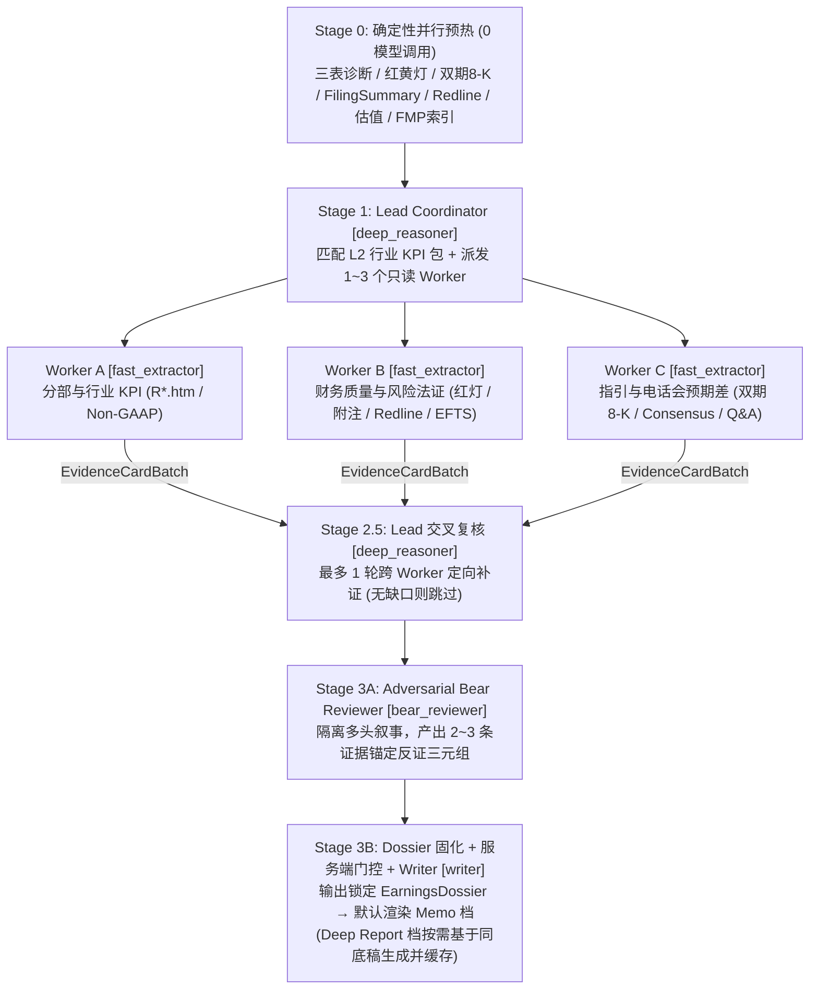

# 方向 A：美股单公司财报极致深度拆解（买方投研小组架构）设计方案

- **日期**：2026-11-24
- **状态**：方案定稿待审阅（尚未修改业务代码，不代表 M1 或阶段 B 已通过验收）
- **适用范围**：在保留 ForesightNine 通用金融研究与证据治理底座的前提下，先将**单公司美股财报深度拆解（10-Q / 10-K / 8-K）**打穿至买方分析师级水准，作为突破阶段 B 真实质量验收与后续接入阶段 C（持续跟踪与增量复核）的标杆垂类。

---

## 1. 已锁定的核心产品与架构决策

| 维度 | 最终决策 |
| --- | --- |
| **核心垂类场景** | 首期主打**单公司美股财报深度拆解（10-Q / 10-K / 8-K）**；多公司横评作为后续延伸，不分散首期精力。 |
| **行业适用边界** | 首期聚焦**非金融美股**做到极致；代码按 SEC SIC 等行业分类自动识别银行、保险、REITs，关闭不适用指标（如传统毛利率、存货周转、普通 EV/EBITDA）并显式标注边界。 |
| **双档位交付** | **买方备忘录档（Memo / Tear Sheet）**与**完整深研报告档（Deep Report）**均完整实现、用户自由切换。默认首跑产出 Memo 档；Deep Report 档基于同一份已锁定的结构化底稿（`EarningsDossier`）按需生成并缓存，绝不重跑取证工具、不改变事实口径。 |
| **数据来源策略** | SEC 免费一手披露为主干（含 `8-K Exhibit 99.1`、`FilingSummary.xml + R*.htm`、章节导航与跨期 Redline Diff、限定目标 CIK 范围的 `EFTS` 全文检索）；新增统一抽象接口补齐**一致预期（Consensus）与电话会纪要（Transcript）**，首期适配 **FMP**；凭据策略沿用 Twelve Data（开发自用阶段允许平台 key + 用户 Settings BYOK，公开发布前切回严格 BYOK 并复核条款）；继续支持用户上传文件增强。 |
| **确定性诊断与估值** | 每次单公司财报拆解默认输出**盈利质量排雷（红/黄/绿灯透明异常 + 强制查 MD&A/附注解释，不做黑箱总分）**、**指引兑现与 Non-GAAP 调节核对**，以及**基础估值倍数 + Reverse-DCF 隐含增速**（负 FCF 或缺行情时显式降级）。 |
| **Agent 编排架构** | 采用**方案 2：有界主从式“买方投研小组”**——`Stage 0 确定性并行预热` → `Stage 1 Lead 规划` → `Stage 2 3 个并行只读专题 Worker` → `Stage 2.5 跨 Worker 交叉补证（硬上限 1 轮）` → `Stage 3A 独立空头审查` → `Stage 3B 底稿固化与服务端门控渲染`。 |
| **行业化方法包** | L1 通用美股财报主干 + L2 **5 大非金融行业 KPI 插件**（软件/云、半导体/硬件、互联网/广告、消费/零售、医药/生物科技）。 |
| **异构模型路由** | 抽象 **4 个逻辑模型槽位**（`fast_extractor`、`deep_reasoner`、`bear_reviewer`、`writer`），协议优先、不硬编码品牌；未单独配置时全部回落主研究模型。 |
| **并行可视化 UI** | 对标公开仓库 `ragent-app/Ragent_product` 的 `android/feature/organization/`（有向组织图 + 节点语义动作态 + 曲线边通信粒子 + 点击节点看简洁过程日志抽屉）；正式成果统一收口至最终底稿；运行中指令由 Lead 统一接收并定向重派受影响 Worker。 |
| **底稿导出** | 首期同时支持 **Markdown + CSV** 与 **Excel（`.xlsx`）多 Sheet 投研底稿导出**（严格受来源 `export` 权限约束）。 |

---

## 2. 现状基线与核心短板（截至 2026-11-24）

### 2.1 已有可复用底座
- **SEC 结构化基础**：`src/apps/api/app/fin_data/adapters/sec_edgar.py` 已实现 CIK 解析、提交列表、`companyfacts`/`companyconcept` 标准三表行、`derive_q4` 单季 Q4 推导，以及 `derive_period_metrics`（确定性 FCF、毛利率/净利率、TTM、YoY/QoQ 增速）。
- **确定性算术与多源核对**：`research_calculations.py`（10 种可审计公式）与 `research_reconciliation.py`（I1 多源口径核对器，区分四舍五入与实质冲突）。
- **运行时与证据底座**：`research_runtime.py`、`research_checkpoints.py`、`research_live_stream.py`、`research_delivery.py`、`research_semantic_review.py`、`research_source_policy.py` 与 `research_methods/packs/earnings_review.json`。

### 2.2 待打穿的 5 个核心短板
1. **SEC 数据深度不足**：`companyfacts` 丢失 XBRL 维度，无法直取分部/地区/产品拆解与关键附注表；8-K 主文档不含真正业绩发布内容（核心在 `Exhibit 99.1`）；缺少 10-K/10-Q 结构化章节导航与跨期 Redline Diff；`EFTS` 默认关闭。
2. **缺少电话会与一致预期通路**：难以自动计算 Beat/Miss（vs. Consensus）与核查管理层电话会 Q&A 表态。
3. **财务诊断与估值计算未成体系**：缺少一站式盈利质量排雷（SBC 占比、FCF ex-SBC、营运资本 DSO/DIO 背离、真实股本稀释）、Non-GAAP 调节表验算与 Reverse-DCF 隐含预期。
4. **单循环编排在深度财报任务上存在结构瓶颈**：前期凑资料耗轮次、长文本导致上下文稀释与过早压缩、同上下文“自己审自己”导致反证变软。
5. **交互与交付物偏“问答流”**：缺少并行投研小组过程可视化、买方底稿视图（Memo / Deep Report 切换）与多 Sheet 导出。

---

## 3. 系统架构设计

### 3.1 SEC 深度解析引擎与第三方数据层（A1）

1. **8-K Exhibit 99.1 双期直取工具（`sec_earnings_release`）**
   - 解析 8-K 目录 `index.json`，识别 Item 2.02 关联的 `EX-99.1`（业绩新闻稿）及可选 `EX-99.2`。
   - 默认成对获取**本期 + 上期 8-K Exhibit 99.1**，提取管理层业绩摘要、Non-GAAP 调节表原文与下季/全年 Guidance 段落。
2. **基于 `FilingSummary.xml` + `R*.htm` 的分部与附注直表工具（`sec_filing_tables`）**
   - 拉取目标 10-Q / 10-K 的官方 `FilingSummary.xml` 目录（几十 KB），按类别（`Statements` / `Notes` / `Tables`）建立表索引。
   - 按需拉取目标 `R*.htm`（如 *Segment Information*、*Revenue Disaggregation*、*Stock-Based Compensation*、*Debt*、*Commitments and Contingencies*），后端确定性解析为带期间、单位、币种的结构化二维表并持久化为可引用来源。
3. **10-K / 10-Q 章节导航与跨期 Redline Diff（`sec_filing_sections` / `sec_redline_diff`）**
   - 按标准 Item 切分并索引 `Item 1A Risk Factors`、`Item 2/7 MD&A`、`Liquidity & Capital Resources`、`Critical Accounting Estimates`。
   - `sec_redline_diff` 确定性对比本期与上期（或去年同期）的 Risk Factors、会计政策及关键附注，过滤日期/纯数字滚动噪音，输出**实质新增段落、删除段落与措辞变化**。
4. **限定范围的 SEC 全文检索（`sec_fulltext_search`）**
   - 在策略层按需放开 `EFTS_URL`，**强制限定在当前目标公司 CIK 范围内**，支持跨近 2–3 年 10-K/10-Q/8-K 精准检索关键词（如 `backlog`、`tariff`、`impairment`、`customer concentration`）。
5. **一致预期与电话会纪要统一接入层（`earnings_consensus` / `earnings_transcript`）**
   - 定义与供应商解耦的内部数据契约，首期适配 **FMP（Financial Modeling Prep）**。
   - 沿用 `market_credentials.py` 与 `FinDataPolicy` 权限模型：开发自用阶段允许环境变量配置平台 key，同时支持用户 Settings BYOK；公开发布前切回严格 BYOK 并完成许可核验。
   - 凭据缺失或无覆盖时优雅降级：明确标记 `consensus / transcript unavailable`，自动回退至“上期 8-K 99.1 指引 vs. 本期实际”并提示用户可上传电话会纪要。

### 3.2 确定性财务诊断与估值计算层（A1）

所有数值统一使用 `Decimal` 确定性计算，附带公式、输入 `fact_id` / XBRL 标签与异常触发规则：

1. **盈利质量与现金流体检包（`earnings_quality_diagnostics`）**
   - **行业门控**：通过 SEC SIC 码识别银行、保险、REITs，关闭不适用指标并显式返回 `sector_applicability` 说明。
   - **5 组核心诊断**：
     - **利润率变动桥**：毛利率、R&D、SG&A、营业利润率、净利率的 YoY / QoQ **bps 变动**；
     - **利润含金量与真实 FCF**：`OCF / Net Income`、`FCF / Net Income`、`FCF Margin`、`SBC / Revenue`、`SBC / FCF`、**`FCF ex-SBC`**；
     - **营运资本排雷**：应收账款/存货增速 vs. 营收/成本增速、`DSO / DIO / DPO / CCC` 跨期变化；
     - **资本配置与真实稀释**：`CapEx / Revenue`、回购+分红占 FCF 比例、**稀释股本 YoY 净变动**；
     - **偿债与杠杆**：Net Cash / Net Debt、`Net Debt / TTM EBITDA`、`EBIT / Interest Expense`、流动比率。
   - **透明异常信号（Red / Yellow / Green Flags）**：代码按明确阈值标出异常（例如 `OCF/NI < 0.8`、应收增速领先营收 > 15pp、SBC 占 FCF > 30%），**不输出黑箱综合总分**，而是把异常清单作为强制核查任务交给法证 Worker 去 MD&A/附注找合理解释。
2. **指引兑现与 GAAP/Non-GAAP 核对器（`guidance_and_nongaap_reconciler`）**
   - 确定性计算实际值 vs. 上季指引区间中值 / FMP 一致预期的 **Beat / Miss（绝对值与百分比）**，以及新指引方向（`Raise / Maintain / Cut`）。
   - 验算 `GAAP + 各调节项 = Non-GAAP`，计算 Non-GAAP 放大比例并标出反复剔除的经常性项目。
3. **估值与隐含预期工具（`valuation_and_implied_expectations`）**
   - 结合 `market_data` 最新收盘价、最新稀释股本、资产负债表与 TTM（及有 FMP 时的 NTM）财务数据，确定性计算：市值、EV、`P/E (TTM & Forward)`、`EV/Sales`、`EV/EBITDA`、`EV/EBIT`、`P/FCF`、`FCF Yield`、`EV / (FCF ex-SBC)`。
   - **Reverse-DCF 逆向隐含预期**：在透明参数假设（WACC 与永续增长率 3×3 敏感性矩阵）下反推当前股价隐含的未来 5 年 FCF 复合增速；若 TTM FCF ≤ 0 或缺行情则显式降级不强算。
4. **跨源口径核对联动**
   - 复用 `research_reconciliation.py`，自动区分“正常 GAAP vs. Non-GAAP 口径并列”与“同口径数值冲突/重述”。

### 3.3 方案 2：有界主从式“买方投研小组” Agent 编排（A2）

#### 关键工程契约与治理规则
1. **强 Schema 隔离**：
   - `Stage 0` 产出不可变 `EarningsPrefetchSnapshot`；
   - `Stage 1` 产出 `ResearchDispatchPlan`（缺源支线直接标记 `skipped`，不空跑）；
   - `Stage 2` 各 Worker 严格只读、限定最小工具子集、设软轮次上限（默认 3–4 轮），**只输出带 `source_id / fact_id / location` 的 `EvidenceCardBatch`**，绝不直接写最终报告；
   - `Stage 2.5` 由 Lead 检查跨 Worker 线索缺口，**硬上限 1 轮**定向补派；
   - `Stage 3A` 物理隔离多头撰稿语气，强制每条 Bear Case 输出结构化三元组：**质疑论点 + 硬证据引文/数字 + 下季可观测证伪指标**（为阶段 C 持续跟踪铺好数据结构）；
   - `Stage 3B` 经服务端引文定位、数值复算与缺口门控后固化不可变 `EarningsDossier`，默认渲染 **Memo 档**，**Deep Report 档**按需生成并缓存。
2. **4 个逻辑模型槽位（协议优先，零配置回落）**：
   - `fast_extractor`（Worker A/B/C）、`deep_reasoner`（Lead 规划与 Stage 2.5 补证调度）、`bear_reviewer`（独立空头对抗，支持跨家族模型互审）、`writer`（Memo / Deep Report 渲染）。
   - 未单独配置任何槽位时，自动回落至用户主研究模型；启动前经 `provider_capabilities.py` 校验槽位所需协议能力（如原生 tool calling）。
3. **L1 + L2 双层方法包**：
   - 升级 `research_methods/packs/earnings_review.json` 为 L1 通用美股财报主干；
   - 新增 5 个 L2 非金融行业 KPI 插件包：**软件/云（SaaS & Cloud）**、**半导体/硬件（Semis & Hardware）**、**互联网/广告（Internet & Ads）**、**消费/零售（Consumer & Retail）**、**医药/生物科技（Pharma & Biotech）**，按 SIC 自动匹配并支持模型按需激活。
4. **并发账本、局部存活、检查点与运行中干预（Mid-run Steering）**：
   - 所有并行 Worker 共享父运行 `ResearchExecutionContext`（统一 Token/费用记账、SEC 全局限流、取消信号传播与权限校验）。
   - **局部存活**：单条支线失败（如 FMP 超时）不影响其他支线成果留存，并在 `EarningsDossier.open_gaps` 显式标注。
   - **子任务级检查点**：扩展 `research_checkpoints.py`，每个 Stage 与每个 Worker 完成即落盘，中断恢复时复用已完成 `EvidenceCardBatch`、不重复外呼。
   - **Mid-run Steering**：运行中用户追加指令统一由 Lead Coordinator 接收并增量评估，只定向取消/重派受影响 Worker，不重跑无关已完成支线。

### 3.4 并行可视化 UI、双档底稿与多格式导出（A3）

1. **对标 `ragent-app/Ragent_product` 的 Web 组织图 UI**
   - 扩展 `research_live_stream.py` SSE 协议，推送带严格 `sequence`、`stage`、`node_id`、`action_kind`（`READING / SEARCHING / INSPECTING / DELEGATING / WAITING_SUBORDINATES / NEEDS_USER / BLOCKED / FAILED`）、`edge_event`（普通派发边 & `isReview` 审查边）的结构化事件；前端采用单向不可变 reducer，不从文本猜状态。
   - **视觉与交互**：
     - 采用 Focus Tree 有向组织图呈现 `Lead → 3 个并行 Worker → Bear Reviewer → Writer`，支持节点平滑生长/分离动效与克制的边粒子流（遵循 `UI_RULES.md` 的 `MotionPolicy`：支持 reduced motion、无无限 shimmer、颜色必配文字与图标）。
     - 点击任意节点弹出简洁侧栏/底抽屉，**仅展示该角色的简洁过程日志**（当前任务摘要、实时动作、时间线与阻断原因），不堆叠中间原始卡片。
     - 运行完成后自动折叠为顶部紧凑执行摘要条（可随时重新展开）。
2. **买方财报底稿视图（`TopicPage` 扩展）**
   - 顶部提供 `买方备忘录（Memo）` ⇄ `完整深研报告（Deep Report）` 切换器。
   - 结构化呈现：业绩速览与预期差条 → 盈利质量排雷区（红/黄/绿灯 + 附注核查解释）→ 多季趋势与分部/行业 KPI 表 → 跨期 Redline 变动区 → 估值与 Reverse-DCF 矩阵 → 证据锚定 Bear Case（含下季证伪指标）与缺口提示。
   - 全数字与引文点击直接联动右侧 `ReaderPanel` 穿透至 SEC 原始 `R*.htm` 表格或 8-K/10-Q/电话会原文段落。
3. **多格式投研底稿导出**
   - 同时支持 **Markdown + CSV** 与 **Excel（`.xlsx`）多 Sheet 工作簿导出**（Sheet 划分建议：`Summary & Valuation`、`Quarterly Financials`、`Earnings Quality`、`Segments & KPIs`、`Guidance & Non-GAAP`、`Bear Case & Sources`）。
   - 导出前强制经过来源 `export` 权限过滤，未授权外部数据不进入导出文件并在导出说明中显式标注。

---

## 4. 分阶段实施路线与验收标准

| 阶段 | 实施范围 | 出口验收标准 |
| --- | --- | --- |
| **A1：SEC 深度解析 + FMP 接入 + 确定性诊断层** | `sec_earnings_release`（双期 8-K 99.1）、`sec_filing_tables`（`FilingSummary/R*.htm`）、`sec_filing_sections`、`sec_redline_diff`、`sec_fulltext_search`（限 CIK）、FMP 统一接口与凭据策略、`earnings_quality_diagnostics`、`guidance_and_nongaap_reconciler`、`valuation_and_implied_expectations`（含 Reverse-DCF）与行业门控。 | 离线单测全绿 + 真实 SEC 多行业样本解析与 `Decimal` 复算零误差；银行/REITs 边界拒算验证通过。 |
| **A2：买方投研小组编排 + 4 槽位路由 + 5 行业方法包** | Stage 0 预热 + Lead + 3 并行 Worker + Stage 2.5 补证 + 独立 Bear Reviewer + `EarningsDossier` 固化 + 双档按需渲染 + 4 逻辑模型槽位 + 5 大 L2 行业 KPI 包 + 子任务级检查点恢复 + Mid-run Steering 定向重派。 | 并行执行、局部失败存活、中断恢复、模型槽位回落与异构路由、Mid-run Steering 全量离线与集成测试通过。 |
| **A3：对标 `Ragent_product` 并行 UI + 双档底稿 + 多格式导出** | 组织图 SSE 协议、Focus Tree 并行组织图与简洁日志抽屉、Memo/Deep Report 双档底稿视图、数字/引文穿透 `ReaderPanel`、Markdown/CSV/Excel（`.xlsx`）导出。 | Web 类型检查、组件单测、真实浏览器端到端验收及移动端可读性检查通过。 |
| **A4：垂类黄金评测集与阶段 B 真实模型验收** | 构建 **20–25 道真实美股财报高难度基准题**（覆盖 5 大非金融行业 + 2 道银行/REITs 边界 + 2 道缺源/无 FMP 降级），在冻结条件与受控预算下对照“旧单协调者”与“通用大模型 + 搜索”。 | 四维验收达标（传输可靠性、口径与复算正确率、引文支撑率与反证锋利度、耗时/成本/人工核验效率）；沉淀完整实验证据作为阶段 B 出口依据。 |

---

## 5. 风险与边界说明

- **不构成发布或部署授权**：本方案为开发期架构与实施规划，公开发布前仍须完成 FMP/Twelve Data 等第三方来源条款审计与严格 BYOK 切换。
- **不破坏通用架构底座**：虽然首期聚焦美股非金融单公司财报，但 `FilingSummary`、组织图 SSE 协议、4 槽位路由、L1/L2 方法包与 `EarningsDossier` 均设计为可扩展契约，便于阶段 B 通过后平滑推进**阶段 C（财报季持续跟踪与假设 Diff）**以及横向复制到多公司横评、港/A 股或 IPO 垂类。
- **严格遵守实验纪律**：A2 的多 Worker 架构必须通过 A4 的受控真实模型实验，用数据证明相对旧单协调者在质量、耗时或核验效率上的真实净收益。
